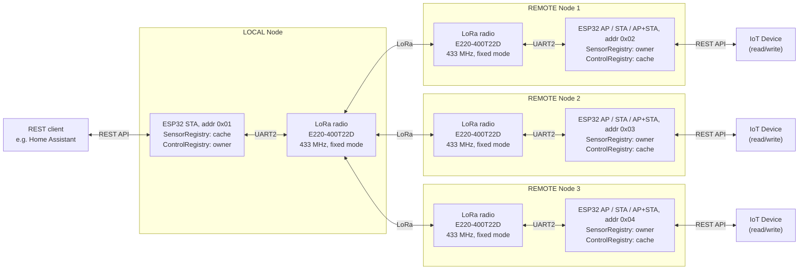
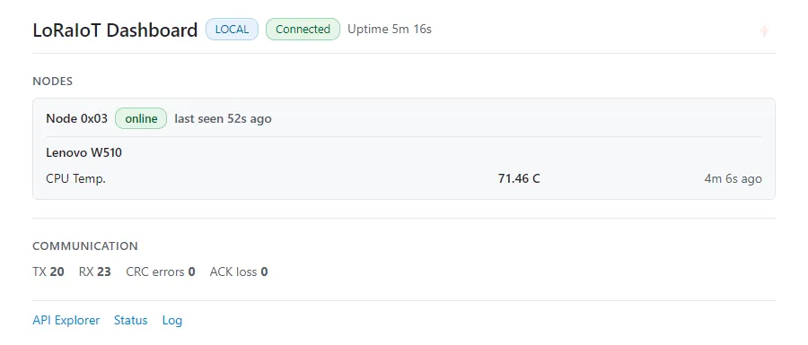
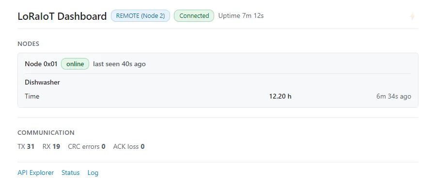

# LoRaIoT - Multi-Floor ESP32 LoRa Gateway Bridge

## 1. Executive Summary

LoRaIoT is an enterprise-grade, half-duplex, point-to-point (P2P) RF bridge designed to transparently extend local IP networks and link remote physical layers across high-attenuation boundaries (such as reinforced concrete floors, steel-grid structures, or long distances).

By leveraging the high-penetration physics of the 433 MHz UHF spectrum and Semtech LLCC68-based E220 transceivers, LoRaIoT bridges a vertically or horizontally isolated remote WiFi network directly to a local LAN and downstream Home Automation/MQTT systems. A remote node runs in one of three WiFi modes (see [WiFi modes](#wifi-modes)): `STA` (client of an existing router), `AP` (its own SoftAP) or `AP_STA` (both at once). To guarantee non-blocking operations, the firmware is architected around a dual-core FreeRTOS threading model on the ESP32, integrating thread-safe queue-serialized UART2 transactions, persistent NVS state management, a framed binary protocol (protobuf/nanopb over a CRC-16 frame layer), and an on-demand 6-step physical wiring diagnostics suite.

LoRaIoT carries two kinds of data. Each kind has exactly one **owner** node that defines the devices and datapoints and pushes the values, and one **cache** node that mirrors them so its own REST clients can read them locally without waiting for the radio:

| | Sensor data (measurements) | Control data (setpoints) |
|---|---|---|
| Typical example | Grid Power Monitor: voltage, current, power | DC/DC converter: voltage set, current limit |
| Direction | REMOTE to LOCAL | LOCAL to REMOTE |
| Owner (registry) | REMOTE (`SensorRegistry`) | LOCAL (`ControlRegistry`) |
| Cache (registry) | LOCAL (`SensorRegistry`) | REMOTE (`ControlRegistry`) |
| Written by | IoT device: `POST /api/lora/sensor/data` on the REMOTE REST API (SoftAP or LAN address) | Home Automation: `POST /api/lora/nodes/control?addr=<n>` on LOCAL |
| Read by | Home Automation: `GET /api/lora/nodes/sensor?addr=<n>` on LOCAL | IoT device: `GET /api/lora/nodes/control` on the REMOTE REST API (SoftAP or LAN address) |

**Sensor data flow (REMOTE to LOCAL):**

1. An IoT device joins the REMOTE node's SoftAP WiFi (`AP` / `AP_STA` mode; in `STA` mode it uses the node's LAN address instead) and POSTs its readings as JSON. The REMOTE node stores them in its `SensorRegistry`, auto-assigns a stable device index and metric id to each new name, and answers immediately over WiFi.
2. When a device or datapoint is new, the REMOTE node announces a changed `registry_rev` in its BEACON. LOCAL then fetches the device and datapoint definitions (name, unit, scale) from REMOTE over LoRa and caches them ([`REQUEST(Describe)`](doc/LoRaProtocol.md) in the protocol - also called a *definition crawl*).
3. The REMOTE node pushes the values to LOCAL as confirmed data frames ([`DATA_ACK`](doc/LoRaProtocol.md)), which LOCAL acknowledges (up to 3 retries). Later updates with an unchanged schema skip the definition step and carry only the values.
4. Home Automation reads the cached values from LOCAL over the LAN. Reads are served from the cache, so they do not generate LoRa traffic unless `?live=true` is requested.

**Control data flow (LOCAL to REMOTE):**

1. Home Automation POSTs a setpoint to LOCAL for a given REMOTE node (`addr`). LOCAL stores it in its `ControlRegistry` and registers the device and datapoints on first use.
2. LOCAL pushes the value to the REMOTE node as a confirmed data frame ([`DATA_ACK`](doc/LoRaProtocol.md)) and returns the delivery result to the caller (`200` acknowledged, `202` deferred until the REMOTE node has fetched the definitions, `504` no acknowledgement). LOCAL keeps the latest setpoint even if delivery fails; after a deferred delivery the value is pushed again once the REMOTE node has fetched the definitions.
3. The REMOTE node stores the value in its `ControlRegistry` cache.
4. The IoT device polls the REMOTE node's REST API (SoftAP in `AP` / `AP_STA` mode, LAN address in `STA` mode), reads the setpoint and applies it. This is also served from the cache, so the device never waits for the radio.

All values are transported as integers; the real value is `value / scale`. The full frame and message specification is in [`doc/LoRaProtocol.md`](doc/LoRaProtocol.md), the REST endpoints are in [`doc/RestApi.md`](doc/RestApi.md).



Notes:

- REMOTE nodes 2 and 3 are optional. A single LOCAL node and one REMOTE node form a complete system; further REMOTE nodes can be added at any time.
- Throughput is limited by the UART2 link between ESP32 and E220 (115200 baud) and by the LoRa air rate (default 62.5 kbps, half-duplex, shared by all nodes). The link is designed for small, infrequent sensor and setpoint updates, not bulk data.
- Each REMOTE node supports up to 4 IoT devices (`DEVICE_TABLE_MAX_DEVICES`), each with up to 8 datapoints (`DEVICE_TABLE_MAX_METRICS`), i.e. at most 32 datapoints per REMOTE node. Device and metric names are limited to 12 characters, units to 5 characters (see `src/registry/src/DeviceTable.h`).

Sensor data example: a Grid Power Monitor pushes its readings to the REMOTE node's SoftAP (default `192.168.4.1`, `AP` / `AP_STA` mode). Values are integers; the real value is `value/scale`.

```bash
curl -s -X POST http://192.168.4.1/api/lora/sensor/data \
  -H "Content-Type: application/json" \
  -d '{"device":"GridPower",
       "metrics":{"Voltage":   {"value":2305,"unit":"V", "scale":10},
                  "Current":   {"value":52,  "unit":"A", "scale":10},
                  "Power":     {"value":1198,"unit":"W", "scale":1},
                  "Frequency": {"value":5001,"unit":"Hz","scale":100}
                 }
      }'
```

Control data example: the Home Automation system sets the output voltage of a DC/DC converter on REMOTE node 1 (`addr=2`) via the LOCAL node. LOCAL stores the setpoint and pushes it over LoRa to the REMOTE node, where the IoT device reads it with `GET /api/lora/nodes/control`.

```bash
curl -s -X POST "http://<LOCAL-IP>/api/lora/nodes/control?addr=2" \
  -H "Content-Type: application/json" \
  -d '{"device":"DcDc",
       "metrics":{"Voltage": {"value":4800,"unit":"V","scale":100},
                  "Current": {"value":150, "unit":"A","scale":10}
                 }
      }'
```

### Live dashboard

Every node serves a self-contained, real-time dashboard at `http://<node-ip>/`. The page is stored in flash (about 12 KB, no CDN, no external assets) and is updated once per second over the WebSocket endpoint `/ws/data`. It shows the node tier, WebSocket connection state, uptime, the peer nodes with their devices and metrics (scaled value, unit, age), and the LoRa link counters (TX, RX, CRC errors, ACK loss). If no update arrives for 3 s the page marks the link as lost and reconnects automatically.

- **LOCAL** shows the sensor values cached from its REMOTE nodes (same data as `GET /api/lora/nodes/sensor`).
- **REMOTE** shows the control setpoints cached from LOCAL (same data as `GET /api/lora/nodes/control`).

LOCAL (`http://<LOCAL-IP>/`), listing `REMOTE node 0x03` with its `CPU temperature` sensor:



REMOTE Node 2 (`http://<REMOTE-IP>/`), listing `LOCAL (0x01)` with a control `dishwasher` device:



### WiFi modes

A REMOTE node can run in one of three WiFi modes. The mode is stored in NVS and read with `GET /api/wifi/mode`; it is changed with `PUT /api/wifi/mode` (the node reboots automatically). `LOCAL` normally stays in `STA` mode.

| Mode | Behaviour | How to reach the node |
|---|---|---|
| `STA` (default) | Client of an existing router. The WiFiManager captive portal runs while the node is unprovisioned. | LAN address from the router (`staIp`) |
| `AP` | The node hosts its own SoftAP (default SSID `LoRaIoT-Node-<n>`, password `LoRaIoT`, IP `192.168.4.1`, channel 1) and does not join a router. WiFiManager is bypassed. | Join the node's SSID, then `apIp` |
| `AP_STA` | SoftAP and router connection at the same time. If the router connection fails, the node keeps running as SoftAP only. | `apIp`, and `staIp` when connected |

```bash
curl -s -X PUT http://<REMOTE-IP>/api/wifi/mode \
  -H "Content-Type: application/json" \
  -d '{"mode":"AP","ssid":"LoRaIoT-Node-1","password":"MySecretPassword","ip":"192.168.4.1","channel":1}'
```

Notes:

- Provision the node (tier, LoRa channel) in `STA` mode first. In `AP` mode the captive portal is not available.
- After switching `STA` to `AP`, the old LAN address no longer works. Join the node's SSID and use `apIp`.
- `GET /reset` erases the WiFi mode as well and returns the node to `STA`. It is a developer-only recovery step.
- The `192.168.4.1` addresses in this document are the default `apIp`, which can be changed with the `ip` field.

> Abbreviations and technical terms used in this document are explained in [Appendix A: Glossary](#appendix-a-glossary-of-abbreviations).

---

## 2. System Hardware Requirements

To construct and successfully run the LoRaIoT gateway bridge, the following hardware components are strictly required:

1. **Microcontroller (2 Units):** ESP32 (dual-core ESP32-WROOM-32 or ESP32-S3 recommended; single-core variants such as ESP32-C3, C6, S2, H2 are also supported (but untested) via the `TASK_CREATE` portability macro — see `src/util/src/TaskUtils.h`).
2. **LoRa Radio Module (2 Units):** Ebyte E220-400T22D (incorporating the Semtech LLCC68 RF chip operating in the 433 MHz UHF ISM band, delivering up to 22 dBm transmission power).
3. **Antennas (2 Units):** High-quality 433 MHz SMA whip antennas (such as $18\text{ cm}$ dipole whips) tuned to the 433 MHz frequency range.
4. **Decoupling Capacitor (2 Units):** A $100\mu\text{F}$ (or larger) low-ESR electrolytic capacitor connected in parallel directly across each E220's `VCC` and `GND` lines. This buffers high-current RF transmission bursts ($\approx 110\text{mA}$ peak) and prevents voltage sags that can cause ESP32 kernel brownout reboots.
5. **On-Demand Status LED (2 Units):** A standard LED connected in series with a $330\,\Omega$ current-limiting resistor, wired between ESP32 GPIO 21 and GND.

---

## 3. Hardware Design & Wiring Specification

The physical interface between the ESP32 (38-pin DevKitC) and the Ebyte E220-400T22D transceiver relies on five dedicated GPIO lines. It is critical to enforce the exact pin mappings below to maintain compatibility with both the production firmware and the hardware diagnostics engine.

### Canonical Pin Mapping

| E220 Pin | Pin Name | ESP32 GPIO | Direction (ESP32) | Functional Description |
|:---:|:---:|:---:|:---:|---|
| **1** | M0 | **GPIO 4** | Output | Mode control (Bit 0) |
| **2** | M1 | **GPIO 2** | Output | Mode control (Bit 1) |
| **3** | RXD | **GPIO 17** | Output (TX2) | UART2 transmit line to E220 RXD |
| **4** | TXD | **GPIO 16** | Input (RX2) | UART2 receive line from E220 TXD |
| **5** | AUX | **GPIO 15** | Input | Hardware status indicator (HIGH = Idle / Ready) |
| **6** | VCC | **3.3V or 5V** | Output Power | Primary module power supply (decoupled with 100uF capacitor) |
| **7** | GND | **GND** | Ground | Common reference ground |

### E220 Hardware Operating Modes

By driving the M0 and M1 pins, the ESP32 dynamically commands the E220 through different operating states:

| M1 Pin | M0 Pin | Mode | Purpose | UART Baud Rate | Description |
|:---:|:---:|:---:|---|:---:|---|
| **LOW** | **LOW** | **Mode 0** | Normal / Transceive | **115200** (Configured) | Active RF transceiving. E220 handles RF-to-UART conversion. |
| **LOW** | **HIGH** | **Mode 1** | WOR (Wake on Radio) | 115200 | Power-saving mode. Receives and transmits WOR preambles. |
| **HIGH** | **LOW** | **Mode 2** | WOR Power Save | 115200 | Puts E220 RX to sleep, waking up periodically to sense preambles. |
| **HIGH** | **HIGH** | **Mode 3** | Config / Deep Sleep | **9600** (Fixed) | Accept registers read/write commands over UART. |

---

## 4. Firmware Architecture & Threading Model

For the full threading model, FreeRTOS core assignments, concurrency rules, TX/RX lifecycle
sequence diagram, and boot initialisation sequence diagram see
[`doc/Architecture.md`](doc/Architecture.md).

---

## 5. Boot & Communication Lifecycle

Both nodes run from a single shared codebase. Role selection (`LOCAL` or `REMOTE`) happens once via the WiFiManager captive portal and is persisted in NVS. The WiFi mode (`STA`, `AP`, `AP_STA`) is not part of the portal; it is set with `PUT /api/wifi/mode` (see [WiFi modes](#wifi-modes)).

```
  [ PHASE 1: BUILD ]           [ PHASE 2: DEPLOY ]          [ PHASE 3: RUN ]
+--------------------+      +----------------------+      +------------------+
| - Arduino IDE      |      | - WiFi Captive Portal|      | - Boot & Diag    |
| - platformio.ini   | ===> | - Select Tier        | ===> | - Framed LoRa    |
| - lib_deps check   |      | - Set Channel / Addr |      | - BEACON / PING  |
+--------------------+      +----------------------+      | - REST / WS API  |
                                                          +------------------+
```

### Phase 1: Build & Compile
- **Dependencies:** The compiler expects the following libraries (downloaded automatically in PlatformIO via `lib_deps`):
  - `WiFiManager` (>= 2.0.17)
  - `ArduinoJson` (>= 7.4.3)
  - `ESPAsyncWebServer` (>= 3.12.1)
  - `AsyncTCP` (>= 3.5.0)
- **Compilation:**
  - **PlatformIO:** Run `pio run -e esp32dev` from the root directory.
  - **Arduino IDE:** Load the `LoRaIoT.ino` sketch stub, open Library Manager, install the four required dependencies, and click Compile.

### Phase 2: Deploy & Provision
1. **Flash Firmware:** Flash the compiled binary onto both ESP32 boards.
2. **WiFi Provisioning (first boot, `STA` mode):**
   - Power on the node. Connect your phone or laptop to the captive WiFi portal (`AutoConnectAP`).
   - Open your browser to `http://192.168.4.1`.
   - In the configuration form, select the node's **Gateway Tier** (`LOCAL`, `REMOTE (Node 1)`, `REMOTE (Node 2)`, or `REMOTE (Node 3)`) and the desired **LoRa Channel** (0-31, default Channel 25 / `0x19`).
   - A fresh node always starts in `STA` mode. To run a REMOTE node as its own access point, switch it afterwards with `PUT /api/wifi/mode` (`AP` or `AP_STA`). In `AP` mode the portal is bypassed, so complete this step first.
3. **Address Assignment:**
   - `LOCAL` is assigned address `0x01`; `REMOTE (Node 1)` is `0x02`, `REMOTE (Node 2)` is `0x03`, `REMOTE (Node 3)` is `0x04`.
   - `0x00` is invalid; `0xFF` is broadcast.
   - To re-provision, call `GET /reset` which clears WiFi credentials and all NVS settings.

### Phase 3: Run & Communicate
1. **E220 Initialisation:** On boot, the ESP32 configures the E220 in Mode 3 (9600 baud) writing the persistent register block (`REG0=0xE7`, `REG1=0x00`, `REG3=0x40`), then returns to Mode 0 (115200 baud). The `loraTransportTask` starts and owns UART2 exclusively from this point.
2. **Boot Diagnostics:** On the first `applicationLoop()` tick, the 6-step E220 wiring check runs automatically (Mode 3 register read/write/verify + nanopb + frame codec self-tests). The `loraIsReady()` gate opens only after this completes, allowing `BeaconTask` and other radio tasks to start transmitting.
3. **BEACON / Discovery (REMOTE):**
   - REMOTE broadcasts a `BEACON` frame every 5s (UNDISCOVERED state) until it receives any frame from LOCAL, then beacons every 60s (DISCOVERED state).
   - After 2 minutes of silence from LOCAL, REMOTE reverts to 5s fast beaconing (self-healing).
   - LOCAL registers the REMOTE node in `SensorRegistry` (via `cachedRegistry()`) on the first received BEACON and schedules a definition crawl ([`REQUEST(Describe)`](doc/LoRaProtocol.md)) to learn the REMOTE's sensor device definitions.
4. **PING / ACK (both nodes):**
   - LOCAL sends a liveness check ([`PING`](doc/LoRaProtocol.md)) to REMOTE via `PingTask` on BEACON reception or on-demand via REST. The ping carries `boot_id` and optionally `registry_rev` to tell REMOTE when LOCAL's control definitions have changed.
   - REMOTE also runs `PingTask` and sends PINGs to LOCAL for keep-alive monitoring.
   - The receiving node replies with a framed `ACK`; the sender logs the RTT.
5. **Sensor data push (REMOTE):**
   - An IoT sensor on REMOTE (via its SoftAP in `AP` / `AP_STA` mode, or its LAN address in `STA` mode) POSTs readings to `POST /api/lora/sensor/data`. REMOTE stores them in `SensorRegistry` and increments `registry_rev` when the schema changes.
   - When `registry_rev` changes, REMOTE immediately sends a PING to LOCAL carrying the new revision. LOCAL fetches the updated definitions from REMOTE over LoRa (definition crawl, [`REQUEST(Describe)`](doc/LoRaProtocol.md)), then REMOTE's `PushTask` pushes the current values as confirmed data frames ([`DATA_ACK`](doc/LoRaProtocol.md)).
   - A LAN client reads the values from LOCAL via `GET /api/lora/nodes/sensor?addr=2`.
6. **Control setpoint push (LOCAL) and retrieval (REMOTE):**
   - A LAN controller POSTs a setpoint to LOCAL via `POST /api/lora/nodes/control?addr=2`. LOCAL stores it in `ControlRegistry` and immediately pushes it to REMOTE as a confirmed data frame ([`DATA_ACK`](doc/LoRaProtocol.md)). If REMOTE acknowledges, LOCAL returns `200 {"delivery":"ok"}`.
   - If REMOTE is unreachable at the time of the POST, LOCAL returns `504 {"delivery":"timeout"}` but **keeps the setpoint in `ControlRegistry`**. The value is re-delivered automatically once REMOTE comes back online (see step 7 below).
   - If REMOTE does not yet recognise the control device (e.g. after its own reboot), it tells LOCAL it needs the definitions first ([`ACK{status=BAD_REQUEST}`](doc/LoRaProtocol.md)) and fetches them from LOCAL via a definition crawl ([`REQUEST(Describe)`](doc/LoRaProtocol.md)). LOCAL returns `202 {"delivery":"after_describe"}`. Once the crawl completes, LOCAL's `PushTask` re-pushes the stored value as a confirmed data frame ([`DATA_ACK`](doc/LoRaProtocol.md)) without any further action from the caller.
   - REMOTE caches the setpoint in its `ControlRegistry`. An IoT device on REMOTE (SoftAP or LAN address) reads the current setpoint via `GET /api/lora/nodes/control`.
   - See `doc/LoRaProtocol.md` §15 for the full end-to-end sequence diagrams for both scenarios.
7. **Self-healing after an outage:**
   - **REMOTE reboots or is temporarily out of range:** REMOTE resets its `boot_id` and reverts to fast BEACON every 5 s. LOCAL detects the new `boot_id` on the first received BEACON, clears its cached sensor registry for that node, sends a liveness check ([`PING`](doc/LoRaProtocol.md)) carrying `registry_rev` if LOCAL has control devices, and starts a fresh definition crawl ([`REQUEST(Describe)`](doc/LoRaProtocol.md)). Once the crawl completes, both `PushTask` instances re-deliver the latest values in each direction - REMOTE pushes its current sensor readings and LOCAL pushes its stored control setpoints. No manual intervention is needed.
   - **LOCAL reboots:** LOCAL sends a broadcast liveness check ([`PING`](doc/LoRaProtocol.md)) at boot carrying its new `boot_id`. REMOTE detects the new `boot_id`, clears its cached control registry, and fetches the definitions from LOCAL via a definition crawl ([`REQUEST(Describe)`](doc/LoRaProtocol.md)). After the crawl, LOCAL's `PushTask` re-delivers the control setpoints.
   - **Temporary RF loss (no reboot):** Both nodes run `PingTask`. After 60 s of silence, each node sends keep-alive PINGs to the peer. After three unanswered PINGs the peer is marked `online: false` in the REST views. As soon as any frame is received, the peer is immediately revived (`online: true`) and normal operation continues with no re-crawl needed (the `boot_id` has not changed, so cached definitions remain valid).
   - **Entry purge and re-entry:** If no frame is received for 180 s (three missed slow beacons), LOCAL purges the registry entry entirely. REMOTE re-enters through its fast-beacon cycle, which triggers a full rediscovery as described above.
8. **Fixed Mode Routing:**
   - Both modules use Fixed Transmission Mode (`REG3=0x40`). The transport layer prepends the 3-byte E220 routing header `[ADDH][ADDL][CH]` before every write. Broadcast uses `[0xFF][0xFF][CH]`.
   - The E220 never delivers the sender address; SRC and DST are carried in the LoRaIoT frame header (`doc/LoRaProtocol.md` §4).
9. **REST & WebSocket API:** A non-blocking `ESPAsyncWebServer` on port 80 exposes the full REST API (see `doc/RestApi.md`). Key endpoints: `GET /api/lora/nodes/sensor` (sensor data), `GET,POST /api/lora/nodes/control` (control data), `POST /api/lora/sensor/data` (REMOTE sensor ingestion), `GET,PUT /api/wifi/mode` (WiFi mode). A WebSocket endpoint (`/ws/data`) pushes a JSON state snapshot (tier, uptime, LoRa counters, cached nodes, last echo) once per second to the browser dashboard served at `GET /` (see [Live dashboard](#live-dashboard)).

---

## 6. REST API Quick-start Examples

The examples below use placeholder addresses. Replace them with the actual IP addresses
assigned to your nodes by your router. The REMOTE node's SoftAP address is `192.168.4.1`
by default (configurable) and exists only in `AP` and `AP_STA` mode, when a device is
connected directly to REMOTE's WiFi AP; the LAN addresses depend on your network.

```
<LOCAL-IP>   LAN address of the LOCAL node  (e.g. 192.168.1.147 in the development setup)
<REMOTE-IP>  Address of the REMOTE node: its LAN address in STA / AP_STA mode
             (e.g. 192.168.1.174 in the development setup), or its SoftAP address
             (192.168.4.1 by default) in AP / AP_STA mode
```

### IoT sensor posting data to REMOTE

An IoT sensor connected to REMOTE's SoftAP (`192.168.4.1`) pushes a voltage and temperature reading:

```bash
curl -s -X POST http://192.168.4.1/api/lora/sensor/data \
  -H "Content-Type: application/json" \
  -d '{"device":"SensorA",
       "metrics":{"Voltage":{"value":335,
                             "unit":"V",
                             "scale":100},
                  "Temp":{"value":215,
                          "unit":"C",
                          "scale":10}
                 }
      }'
```

**Response (first post - schema registered, `registry_rev` incremented):**
```json
{"accepted":[{"metric":"Voltage",
              "device_idx":1,
              "metric_id":1
             },
             {"metric":"Temp",
              "device_idx":1,
              "metric_id":2
             }],
 "rejected":[],
 "registry_rev":1
}
```

The values are now in REMOTE's `SensorRegistry`. On the next BEACON, LOCAL will see the new `registry_rev`, crawl the definitions, and REMOTE's `PushTask` will deliver the values over LoRa. A LAN client can then read them from LOCAL:

```bash
curl -s "http://<LOCAL-IP>/api/lora/nodes/sensor?addr=2&device=1"
```

**Response:**
```json
{"nodes":[{"addr":2,
           "boot_id":305419896,
           "registry_rev":1,
           "online":true,
           "peer_last_seen_ms_ago":1200,
           "devices":[{"device":1,
                       "name":"SensorA",
                       "has_data":true,
                       "age_ms":4500,
                       "alert":false,
                       "metrics":[{"id":1,
                                   "name":"Voltage",
                                   "unit":"V",
                                   "scale":100,
                                   "value":335
                                  },
                                  {"id":2,
                                   "name":"Temp",
                                   "unit":"C",
                                   "scale":10,
                                   "value":215
                                  }]
                      }]
          }]
}
```

`value / scale` gives the real number: `335 / 100 = 3.35 V`, `215 / 10 = 21.5 °C`.

---

### Controller posting a setpoint to LOCAL (delivered to REMOTE over LoRa)

A home automation controller on the LAN sets a target voltage for a charger attached to REMOTE:

```bash
curl -s -X POST "http://<LOCAL-IP>/api/lora/nodes/control?addr=2" \
  -H "Content-Type: application/json" \
  -d '{"device":"Charger",
       "metrics":{"VoltageSet":{"value":333,
                                "unit":"V",
                                "scale":100}}}'
```

**Response (REMOTE acknowledged):**
```json
{"accepted":[{"metric":"VoltageSet",
              "device_idx":1,
              "metric_id":1
             }],
 "rejected":[],
 "registry_rev":1,
 "delivery":"ok"
}
```

LOCAL stores the setpoint and delivers it to REMOTE as a `DATA_ACK` frame. A `delivery` of `"after_describe"` means REMOTE rebooted and does not have the definitions yet - they will be pushed automatically once REMOTE crawls LOCAL.

The IoT device on REMOTE's SoftAP retrieves the cached setpoint:

```bash
curl -s http://192.168.4.1/api/lora/nodes/control
```

**Response:**
```json
{"nodes":[{"addr":1,
           "boot_id":987654321,
           "registry_rev":1,
           "online":true,
           "peer_last_seen_ms_ago":800,
           "devices":[{"device":1,
                       "name":"Charger",
                       "has_data":true,
                       "age_ms":120,
                       "alert":false,
                       "metrics":[{"id":1,
                                   "name":"VoltageSet",
                                   "unit":"V",
                                   "scale":100,
                                   "value":333
                                  }]
                      }]
          }]
}
```

`333 / 100 = 3.33 V`. Check `online` and `age_ms` before applying the value - if `online` is `false` or `age_ms` exceeds your staleness limit, fall back to a safe state.

---

### Live sensor read (bypasses cache, queries REMOTE directly)

Force a fresh reading from REMOTE's device 1 without waiting for the next push:

```bash
curl -s "http://<LOCAL-IP>/api/lora/nodes/sensor?addr=2&device=1&live=true"
```

LOCAL sends a live-read request to REMOTE over LoRa ([`REQUEST(Read)`](doc/LoRaProtocol.md) in the protocol) and waits up to 3 s for the reply. Returns `504` on timeout.

---

## 7. On-Demand Diagnostics & Multi-Node Debugging

Since serial monitors can typically only focus on a single COM port at a time, LoRaIoT integrates tools to trace and isolate physical wiring faults or airframe issues over the local network.

### The 6-Step Hardware Diagnostics Check
The diagnostics run automatically at boot and can be re-triggered at any time via REST:

**Trigger the check on demand** (run on each node you want to test - replace with `<LOCAL-IP>` or `<REMOTE-IP>`):
```bash
curl -s http://<LOCAL-IP>/api/diag/e220
curl -s http://<REMOTE-IP>/api/diag/e220
```
*This safely calls `LoRaTransport.pause()` to suspend the background transceiver task before touching UART2, and `LoRaTransport.resume()` when done.*

**Fetch the results from each node:**
```bash
curl -s http://<LOCAL-IP>/api/log
curl -s http://<REMOTE-IP>/api/log
```

Look for `E220 diag:` lines in the log. The six steps and their failure interpretations:

| Step | What is tested | Fail diagnosis |
|---|---|---|
| 1 | AUX reads HIGH in Mode 0 (idle) | No power to E220 (check VCC/GND) or AUX wire loose/stuck |
| 2 | AUX returns HIGH after entering Mode 3 (M1=1, M0=1) | M0 or M1 control line disconnected |
| 3 | Read all 8 registers (`C1 00 08`) — response is not `FF FF FF` | RXD/TXD lines loose, swapped, or another task is holding UART2 |
| 4 | Temp-write a different channel (`C2`), read back, compare | Register write path broken — E220 flash worn or SPI conflict |
| 5 | Temp-write original values back (`C2`), read back, compare | Values did not round-trip — likely a UART noise or timing issue |
| 6 | Return to Mode 0 — AUX rises HIGH again | M0/M1 lines intermittent or AUX stuck LOW after mode switch |

Steps 4 and 5 use the **temporary write command `0xC2`** — nothing is stored in the E220's flash, so a power cycle always restores the previous configuration.

### Multi-Node Log Comparison
```bash
curl -s http://<local_ip>/api/log
curl -s http://<remote_ip>/api/log
```

---

## 8. Range & RF Optimization Rules

To guarantee successful communication across thick structures or vertically separated building floors, follow these critical physics-based adjustments:

### 1. The Parallel-Tilt Antenna Rule (Vertical Floors)
Whip antennas have a **toroidal (doughnut-shaped) radiation pattern**. They radiate maximum energy horizontally, but have **deep axial nulls (zero signal)** extending directly out of the **tip** and **base** of the whip.
- **The Problem:** If `LOCAL` (Floor 4) and `REMOTE` (Floor 0) are aligned vertically, perfectly vertical antennas (`||`) point their blind spots directly at each other, causing a massive $20\text{ dB}$ to $30\text{ dB}$ signal loss.
- **The Solution:** Tilt **both** antennas parallel to each other at a **$30^\circ$ to $45^\circ$ angle** (e.g., `//` or `\\`). This tilts the maximum radiation torus directly along the diagonal line of sight between the floors, while keeping their polarization axes perfectly aligned.

### 2. Dropping Air Data Rate for Link Budget Gains
Receiver sensitivity is mathematically coupled to Spreading Factor and bandwidth. Lowering the air data rate makes the radio receiver orders of magnitude more sensitive:
- By changing the configuration register `REG0` from **62.5 kbps** (`REG0_AIR_DATA_RATE_62K5`) to **2.4 kbps** (`REG0_AIR_DATA_RATE_2K4`), the link budget increases by **approximately $14 \text{ dB}$**.
- In RF physics, **every $6\text{ dB}$ increase in link budget doubles the penetrative capacity through concrete/steel walls or doubles the open-space range.**
- Set the data rate to `2.4 kbps` or `9.6 kbps` via `PUT /api/lora/airrate` (applies live, no reboot) to punch through dense concrete building cores.
- End-to-end feasibility at 2.4 kbps has been verified - see [`doc/LoRaProtocol.md §18`](doc/LoRaProtocol.md) for measured RTTs, test results, and the `LORA_REQUEST_TIMEOUT_MS` adjustment required at that rate.

---

## Appendix A: Glossary of Abbreviations

Please see [doc/Glossary.md](./doc/Glossary.md).
