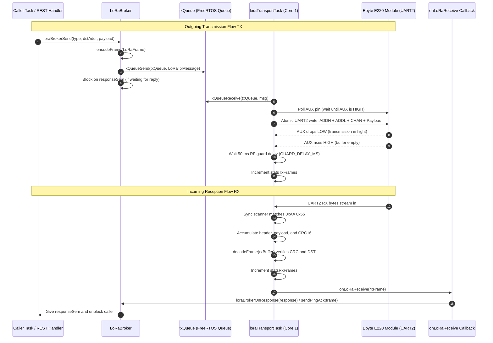
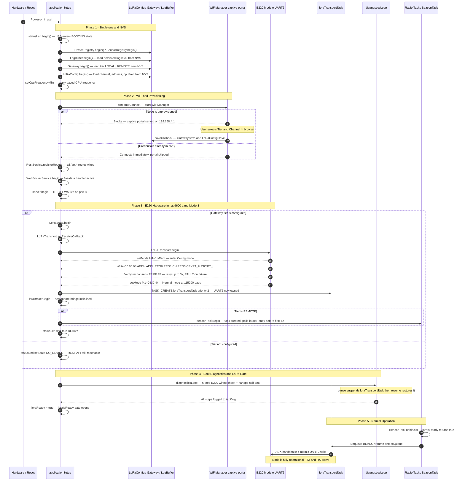

# LoRaIoT - Multi-Floor ESP32 LoRa Gateway Bridge

## 1. Executive Summary

LoRaIoT is an enterprise-grade, half-duplex, point-to-point (P2P) RF bridge designed to transparently extend local IP networks and link remote physical layers across high-attenuation boundaries (such as reinforced concrete floors, steel-grid structures, or long distances).

By leveraging the high-penetration physics of the 433 MHz UHF spectrum and Semtech LLCC68-based E220 transceivers, LoRaIoT bridges a vertically or horizontally isolated remote WiFi SoftAP directly to a local LAN and downstream Home Automation/MQTT systems. To guarantee non-blocking operations, the firmware is architected around a dual-core FreeRTOS threading model on the ESP32, integrating thread-safe queue-serialized UART2 transactions, persistent NVS state management, a framed binary protocol (protobuf/nanopb over a CRC-16 frame layer), and an on-demand 6-step physical wiring diagnostics suite.

> Abbreviations and technical terms used in this document are explained in [Appendix A: Glossary](#appendix-a-glossary-of-abbreviations).

```
       [ Remote SoftAP Node ]                           [ Local Station Node ]
  +-------------------------------+                +-------------------------------+
  |  ESP32 WiFi AP (192.168.4.1)  |                |  ESP32 WiFi STA               |
  |  - IoT Sensor Endpoints       |                |  - Local LAN Connection       |
  |  - BEACON / PING / DATA       |                |  - Home Automation Uplink     |
  +-------------------------------+                +-------------------------------+
                 | (UART2)                                        | (UART2)
  +-------------------------------+                +-------------------------------+
  |  E220-400T22D (ADDR 0x02)     | <=== LoRa ===> |  E220-400T22D (ADDR 0x01)     |
  |  Fixed Mode (Channel 0x19)    |    (433 MHz)   |  Fixed Mode (Channel 0x19)    |
  +-------------------------------+                +-------------------------------+
```

---

## 2. System Hardware Requirements

To construct and successfully run the LoRaIoT gateway bridge, the following hardware components are strictly required:

1. **Microcontroller (2 Units):** ESP32 (dual-core ESP32-WROOM-32 or ESP32-S3 recommended; single-core variants such as ESP32-C3, C6, S2, H2 are also supported via the `TASK_CREATE` portability macro — see `src/util/src/TaskUtils.h`).
2. **LoRa Radio Module (2 Units):** Ebyte E220-400T22D (incorporating the Semtech LLCC68 RF chip operating in the 433 MHz UHF ISM band, delivering up to 22 dBm transmission power).
3. **Antennas (2 Units):** High-quality 433 MHz SMA whip antennas (such as $18\text{ cm}$ dipole whips) tuned to the 433 MHz frequency range.
4. **Decoupling Capacitor (2 Units):** A $100\mu\text{F}$ (or larger) low-ESR electrolytic capacitor connected in parallel directly across each E220's `VCC` and `GND` lines. This buffers high-current RF transmission bursts ($\approx 110\text{mA}$ peak) and prevents voltage sags that can cause ESP32 kernel brownout reboots.
5. **On-Demand Status LED (2 Units):** A standard LED connected in series with a $330\,\Omega$ current-limiting resistor, wired between ESP32 GPIO 21 and GND.

---

## 3. Hardware Design & Wiring Specification

The physical interface between the ESP32 (38-pin DevKitC) and the Ebyte E220-400T22D transceiver relies on five dedicated GPIO lines. It is critical to enforce the exact pin mappings below to maintain compatibility with both the production firmware and the hardware diagnostics engine.

### Canonical Pin Mapping

| E220 Pin | Pin Name | ESP32 GPIO | Direction (ESP32) | Functional Description |
|:---:|:---:|:---:|:---:|---|
| **1** | M0 | **GPIO 4** | Output | Mode control (Bit 0) |
| **2** | M1 | **GPIO 2** | Output | Mode control (Bit 1) |
| **3** | RXD | **GPIO 17** | Output (TX2) | UART2 transmit line to E220 RXD |
| **4** | TXD | **GPIO 16** | Input (RX2) | UART2 receive line from E220 TXD |
| **5** | AUX | **GPIO 15** | Input | Hardware status indicator (HIGH = Idle / Ready) |
| **6** | VCC | **3.3V or 5V** | Output Power | Primary module power supply (decoupled with 100uF capacitor) |
| **7** | GND | **GND** | Ground | Common reference ground |

### E220 Hardware Operating Modes

By driving the M0 and M1 pins, the ESP32 dynamically commands the E220 through different operating states:

| M1 Pin | M0 Pin | Mode | Purpose | UART Baud Rate | Description |
|:---:|:---:|:---:|---|:---:|---|
| **LOW** | **LOW** | **Mode 0** | Normal / Transceive | **115200** (Configured) | Active RF transceiving. E220 handles RF-to-UART conversion. |
| **LOW** | **HIGH** | **Mode 1** | WOR (Wake on Radio) | 115200 | Power-saving mode. Receives and transmits WOR preambles. |
| **HIGH** | **LOW** | **Mode 2** | WOR Power Save | 115200 | Puts E220 RX to sleep, waking up periodically to sense preambles. |
| **HIGH** | **HIGH** | **Mode 3** | Config / Deep Sleep | **9600** (Fixed) | Accept registers read/write commands over UART. |

---

## 4. Firmware Architecture & Threading Model

To ensure that real-time RF communication never blocks the TCP/IP stack or HTTP/WebSocket servers, LoRaIoT enforces a strict multi-threaded layout using FreeRTOS.

```
            Core 0 (System Core)                   Core 1 (Application Core)
     +---------------------------------+      +---------------------------------+
     | - WiFi Stack & LwIP             |      | - Main Arduino loop()           |
     | - ESPAsyncWebServer (Callbacks) |      |   applicationSetup/Loop()       |
     +---------------------------------+      | - loraTransportTask (Priority 2)|
                      |                       | - WebSocketService broadcastTask|
                      |                       |   (Priority 1)                  |
                      |                       | - BeaconTask [REMOTE only]      |
                      |                       |   (Priority 1)                  |
                      |                       +---------------------------------+
                      |                                        |
                      +======= [ txQueue (Serialized) ] =======+
                                         |
                                      UART2 -> E220
```

> On single-core builds all tasks run on the only available core with no affinity pinning. The `TASK_CREATE` macro in `src/util/src/TaskUtils.h` handles this automatically.

### Core Assignments
- **Core 0 (System Core):** Handles the high-frequency WiFi stack, TCP/IP processing, and non-blocking asynchronous web callbacks from `ESPAsyncWebServer` (such as REST API and WebSocket events).
- **Core 1 (Application Core):** Runs the primary application loop, the low-level `loraTransportTask`, WebSocket broadcast, and (on REMOTE) the beacon task.

### Concurrency Rules
1. **Single UART2 Ownership:** The `loraTransportTask` is the **sole owner** of `LoRaSerial` (UART2). Web server callbacks on Core 0 must never write directly to UART2. The diagnostics engine borrows UART2 via `LoRaTransport.pause()` / `LoRaTransport.resume()`.
2. **The `txQueue` Bridge:** Any task intending to transmit calls `LoRaTransport.sendFrame()` or `LoRaTransport.sendRaw()`, which copies the packet into a `LoRaTxMessage` and posts it onto the FreeRTOS `txQueue`. The `loraTransportTask` drains the queue, executes the AUX handshake, and writes bytes atomically to UART2.
3. **LoRa Readiness Gate:** The `loraIsReady()` function (declared in `Application.h`) returns `true` only after the boot diagnostics have completed on the first `applicationLoop()` tick. Radio tasks (e.g. `BeaconTask`) must poll this before transmitting to avoid corrupting the E220 UART state during the diagnostics Mode 3 sequence.
4. **Shared State Mutexes:** All shared state structs (`LoRaState`, `DeviceRegistry`, `SensorRegistry`, `LogBuffer`) are protected by FreeRTOS mutexes.

### LoRa Message Transmission and Reception Lifecycle

The diagram below details how requests from REST callbacks or background tasks are dispatched across FreeRTOS queues to the single UART2 driver task, how AUX hardware flow control is enforced, and how incoming frames are parsed, validated, and routed to application handlers.



### Boot Initialisation Sequence

The diagram below traces the exact sequence of steps from power-on (or reset after reflash) until the node is fully ready to send and receive LoRa frames.



---

## 5. Unified Singleton Design Pattern

The codebase is built around the **Arduino Singleton Pattern** to prevent global variable name-shadowing collisions in C++ while presenting a clean, intuitive API. Every hardware controller or configuration subsystem defines an underlying class with a `-Class` suffix and exports a single global instance with a clean name:

- **`LoRaTransportClass` → `LoRaTransport`**: Manages low-level UART2 transceiving, the FreeRTOS background task, and the `txQueue`.
- **`LoRaConfigClass` → `LoRaConfig`**: Manages persistent NVS parameters (channel, address, CPU frequency).
- **`GatewayClass` → `Gateway`**: Manages the persistent gateway role (`LOCAL` or `REMOTE`).
- **`LogBufferClass` → `LogBuffer`**: Manages the multi-level (`INFO`/`DEBUG`/etc.) log ring buffer in RAM and provides JSON serialization.
- **`StatusLed` → `statusLed`**: Manages the asynchronous status LED state machine.
- **`LoRaStateClass` → `LoRaState`**: Mutex-protected per-SRC link state (duplicate detection, reboot detection via `boot_id`, LRU registry with 180s stale purge). Used on both LOCAL and REMOTE.
- **`DeviceRegistryClass` → `DeviceRegistry`**: LOCAL-only cache of remote node entries and their device/metric definitions (populated by Describe crawl).
- **`SensorRegistryClass` → `SensorRegistry`**: REMOTE-only registry of IoT devices posting sensor data via the SoftAP.

---

## 6. Boot & Communication Lifecycle

Both nodes run from a single shared codebase. Role selection (`LOCAL` or `REMOTE`) happens once via the WiFiManager captive portal and is persisted in NVS.

```
  [ PHASE 1: BUILD ]           [ PHASE 2: DEPLOY ]          [ PHASE 3: RUN ]
+--------------------+      +----------------------+      +------------------+
| - Arduino IDE      |      | - WiFi Captive Portal|      | - Boot & Diag    |
| - platformio.ini   | ===> | - Select Tier        | ===> | - Framed LoRa    |
| - lib_deps check   |      | - Set Channel / Addr |      | - BEACON / PING  |
+--------------------+      +----------------------+      | - REST / WS API  |
                                                          +------------------+
```

### Phase 1: Build & Compile
- **Dependencies:** The compiler expects the following libraries (downloaded automatically in PlatformIO via `lib_deps`):
  - `WiFiManager` (>= 2.0.17)
  - `ArduinoJson` (>= 7.4.3)
  - `ESPAsyncWebServer` (>= 3.12.1)
  - `AsyncTCP` (>= 3.5.0)
- **Compilation:**
  - **PlatformIO:** Run `pio run -e esp32dev` from the root directory.
  - **Arduino IDE:** Load the `LoRaIoT.ino` sketch stub, open Library Manager, install the four required dependencies, and click Compile.

### Phase 2: Deploy & Provision
1. **Flash Firmware:** Flash the compiled binary onto both ESP32 boards.
2. **WiFi Provisioning:**
   - Power on the node. Connect your phone or laptop to the captive WiFi portal (`AutoConnectAP`).
   - Open your browser to `http://192.168.4.1`.
   - In the configuration form, select the node's **Gateway Tier** (`LOCAL` or `REMOTE`) and the desired **LoRa Channel** (0-31, default Channel 25 / `0x19`).
3. **Address Assignment:**
   - `LOCAL` is assigned address `0x01`; `REMOTE` is assigned address `0x02`.
   - `0x00` is invalid; `0xFF` is broadcast.
   - To re-provision, call `GET /reset` which clears WiFi credentials and all NVS settings.

### Phase 3: Run & Communicate
1. **E220 Initialisation:** On boot, the ESP32 configures the E220 in Mode 3 (9600 baud) writing the persistent register block (`REG0=0xE7`, `REG1=0x00`, `REG3=0x40`), then returns to Mode 0 (115200 baud). The `loraTransportTask` starts and owns UART2 exclusively from this point.
2. **Boot Diagnostics:** On the first `applicationLoop()` tick, the 6-step E220 wiring check runs automatically (Mode 3 register read/write/verify + nanopb + frame codec self-tests). The `loraIsReady()` gate opens only after this completes, allowing `BeaconTask` and other radio tasks to start transmitting.
3. **BEACON / Discovery (REMOTE):**
   - REMOTE broadcasts a `BEACON` frame every 5s (UNDISCOVERED state) until it receives any frame from LOCAL, then beacons every 60s (DISCOVERED state).
   - After 2 minutes of silence from LOCAL, REMOTE reverts to 5s fast beaconing (self-healing).
   - LOCAL registers the REMOTE node in `DeviceRegistry` on the first received BEACON and schedules a Describe crawl.
4. **PING / ACK (LOCAL):**
   - LOCAL sends a framed `PING` (nanopb `Beacon{boot_id}` payload) to REMOTE every 2s.
   - REMOTE replies with a framed `ACK`; LOCAL logs the RTT.
5. **Fixed Mode Routing:**
   - Both modules use Fixed Transmission Mode (`REG3=0x40`). The transport layer prepends the 3-byte E220 routing header `[ADDH][ADDL][CH]` before every write. Broadcast uses `[0xFF][0xFF][CH]`.
   - The E220 never delivers the sender address; SRC and DST are carried in the LoRaIoT frame header (`doc/LoRaProtocol.md` §4).
6. **REST & WebSocket API:** A non-blocking `ESPAsyncWebServer` on port 80 exposes the full REST API (see `doc/RestApi.md`) and a WebSocket endpoint (`/ws/data`) that broadcasts a JSON state snapshot every 1s: `{uptime_s, tier, lora{tx_frames, rx_frames, crc_errors, ack_loss}, echo{...}|null}`.

---

## 7. On-Demand Diagnostics & Multi-Node Debugging

Since serial monitors can typically only focus on a single COM port at a time, LoRaIoT integrates tools to trace and isolate physical wiring faults or airframe issues over the local network.

### The 6-Step Hardware Diagnostics Check
The diagnostics run automatically at boot and can be re-triggered at any time via REST:

**Trigger the check on demand:**
```bash
curl -s http://<node_ip>/api/diag/e220
```
*This safely calls `LoRaTransport.pause()` to suspend the background transceiver task before touching UART2, and `LoRaTransport.resume()` when done.*

**Fetch the results:**
```bash
curl -s http://<node_ip>/api/log
```

Look for `E220 diag:` lines in the log. The six steps and their failure interpretations:

| Step | What is tested | Fail diagnosis |
|---|---|---|
| 1 | AUX reads HIGH in Mode 0 (idle) | No power to E220 (check VCC/GND) or AUX wire loose/stuck |
| 2 | AUX returns HIGH after entering Mode 3 (M1=1, M0=1) | M0 or M1 control line disconnected |
| 3 | Read all 8 registers (`C1 00 08`) — response is not `FF FF FF` | RXD/TXD lines loose, swapped, or another task is holding UART2 |
| 4 | Temp-write a different channel (`C2`), read back, compare | Register write path broken — E220 flash worn or SPI conflict |
| 5 | Temp-write original values back (`C2`), read back, compare | Values did not round-trip — likely a UART noise or timing issue |
| 6 | Return to Mode 0 — AUX rises HIGH again | M0/M1 lines intermittent or AUX stuck LOW after mode switch |

Steps 4 and 5 use the **temporary write command `0xC2`** — nothing is stored in the E220's flash, so a power cycle always restores the previous configuration.

### Multi-Node Log Comparison
```bash
curl -s http://<local_ip>/api/log
curl -s http://<remote_ip>/api/log
```

---

## 8. Range & RF Optimization Rules

To guarantee successful communication across thick structures or vertically separated building floors, follow these critical physics-based adjustments:

### 1. The Parallel-Tilt Antenna Rule (Vertical Floors)
Whip antennas have a **toroidal (doughnut-shaped) radiation pattern**. They radiate maximum energy horizontally, but have **deep axial nulls (zero signal)** extending directly out of the **tip** and **base** of the whip.
- **The Problem:** If `LOCAL` (Floor 4) and `REMOTE` (Floor 0) are aligned vertically, perfectly vertical antennas (`||`) point their blind spots directly at each other, causing a massive $20\text{ dB}$ to $30\text{ dB}$ signal loss.
- **The Solution:** Tilt **both** antennas parallel to each other at a **$30^\circ$ to $45^\circ$ angle** (e.g., `//` or `\\`). This tilts the maximum radiation torus directly along the diagonal line of sight between the floors, while keeping their polarization axes perfectly aligned.

### 2. Dropping Air Data Rate for Link Budget Gains
Receiver sensitivity is mathematically coupled to Spreading Factor and bandwidth. Lowering the air data rate makes the radio receiver orders of magnitude more sensitive:
- By changing the configuration register `REG0` from **62.5 kbps** (`REG0_AIR_DATA_RATE_62K5`) to **2.4 kbps** (`REG0_AIR_DATA_RATE_2K4`), the link budget increases by **approximately $14 \text{ dB}$**.
- In RF physics, **every $6\text{ dB}$ increase in link budget doubles the penetrative capacity through concrete/steel walls or doubles the open-space range.**
- Set the data rate to `2.4 kbps` or `9.6 kbps` inside `LoRaTransport.cpp` to punch through dense concrete building cores.

---

## Appendix A: Glossary of Abbreviations

Please see [Glossary.md](./Glossary.md).
