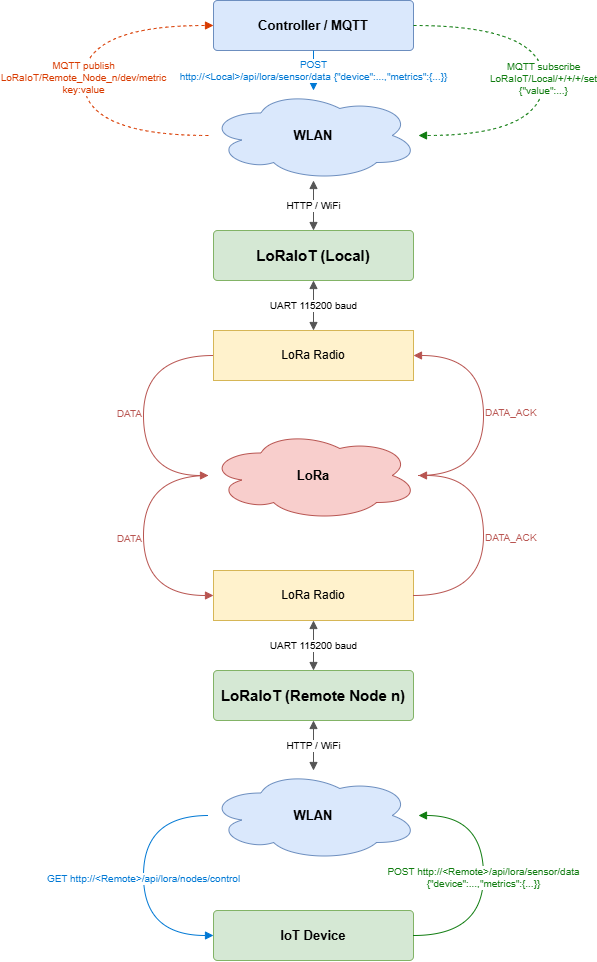
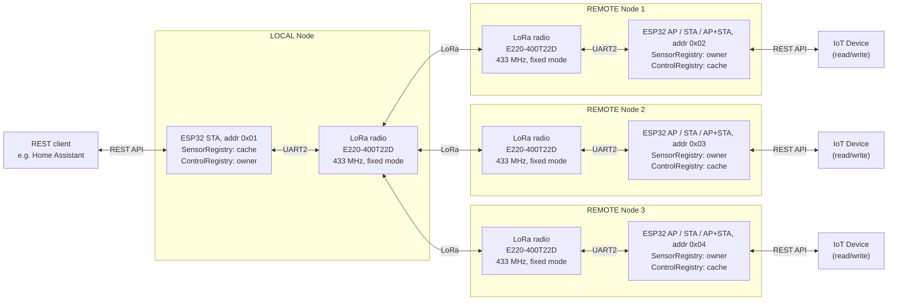
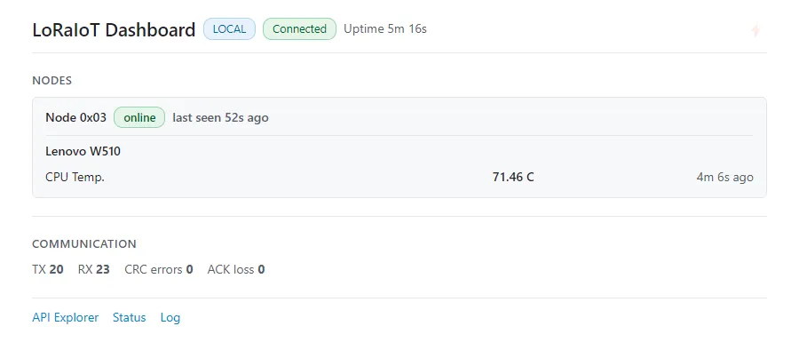
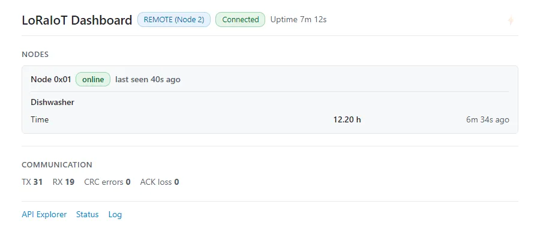
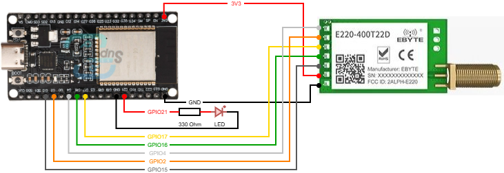

# LoRaIoT - Multi-Floor ESP32 LoRa Gateway Bridge

## 1. Executive Summary

LoRaIoT is a small wireless network of ESP32 microcontroller nodes that talk to each other over a LoRa radio link. LoRa is a low-power, long-range radio technology well suited to IoT applications where WiFi does not reach or battery life matters.

The network always has exactly **one LOCAL node** and up to **three REMOTE nodes**. Each node exposes a REST API. LOCAL connects to your WiFi network; a REMOTE node either joins your WiFi network, hosts its own WiFi access point, or does both (see [WiFi modes](#wifi-modes)).

LoRaIoT is a data bridge between a REST or MQTT client (for example Home Assistant) on the LOCAL side and IoT devices on the REMOTE side. It works across high-attenuation boundaries such as reinforced concrete floors, steel-grid structures or long distances: the 433 MHz UHF band and Ebyte E220 transceivers (Semtech LLCC68 chip) penetrate such obstacles far better than WiFi. LOCAL is the only node that needs to be reachable from your network; Home Assistant never needs to know that REMOTE nodes exist.



> Abbreviations and technical terms used in this document are explained in [Appendix A: Glossary](#appendix-a-glossary-of-abbreviations).

<details>
<summary>Technical highlights</summary>

LoRaIoT is a half-duplex, point-to-point (P2P) RF bridge. A remote node runs in one of three WiFi modes (see [WiFi modes](#wifi-modes)): `STA` (client of an existing router), `AP` (its own SoftAP) or `AP_STA` (both at once). To guarantee non-blocking operations, the firmware is architected around a dual-core FreeRTOS threading model on the ESP32, integrating thread-safe queue-serialized UART2 transactions, persistent NVS state management, a framed binary protocol (protobuf/nanopb over a CRC-16 frame layer), and an on-demand 6-step physical wiring diagnostics suite.

</details>

LoRaIoT carries two kinds of data. Each kind has exactly one **owner** node that defines the devices and datapoints and pushes the values, and one **cache** node that mirrors them so its own REST clients can read them locally without waiting for the radio:

| | Sensor data (measurements) | Control data (setpoints) |
|---|---|---|
| Typical example | Environment sensor: temperature, humidity, air pressure trend, firmware version, daylight | Power supply: output voltage, current limit, power on/off |
| Direction | REMOTE to LOCAL | LOCAL to REMOTE |
| Owner (registry) | REMOTE (`SensorRegistry`) | LOCAL (`ControlRegistry`) |
| Cache (registry) | LOCAL (`SensorRegistry`) | REMOTE (`ControlRegistry`) |
| Written by | IoT device: `POST /api/lora/sensor/data` on the REMOTE REST API (SoftAP or LAN address) | Home Automation: `POST /api/lora/nodes/control?addr=<n>` on LOCAL |
| Read by | Home Automation: `GET /api/lora/nodes/sensor?addr=<n>` on LOCAL | IoT device: `GET /api/lora/nodes/control` on the REMOTE REST API (SoftAP or LAN address) |

<details>
<summary>Step by step: sensor data flow and control data flow</summary>

**Sensor data flow (REMOTE to LOCAL):**

1. An IoT device joins the REMOTE node's SoftAP WiFi (`AP` / `AP_STA` mode; in `STA` mode it uses the node's LAN address instead) and POSTs its readings as JSON. The REMOTE node stores them in its `SensorRegistry`, auto-assigns a stable device index and metric id to each new name, and answers immediately over WiFi.
2. When a device or datapoint is new, the REMOTE node announces a changed `registry_rev` in its BEACON. LOCAL then fetches the device and datapoint definitions (name, unit, scale) from REMOTE over LoRa and caches them ([`REQUEST(Describe)`](doc/LoRaProtocol.md) in the protocol - also called a *definition crawl*).
3. The REMOTE node pushes the values to LOCAL as confirmed data frames ([`DATA_ACK`](doc/LoRaProtocol.md)), which LOCAL acknowledges (up to 3 retries). Later updates with an unchanged schema skip the definition step and carry only the values.
4. Home Automation reads the cached values from LOCAL over the LAN. Reads are served from the cache, so they do not generate LoRa traffic unless `?live=true` is requested.

**Control data flow (LOCAL to REMOTE):**

1. Home Automation POSTs a setpoint to LOCAL for a given REMOTE node (`addr`). LOCAL stores it in its `ControlRegistry` and registers the device and datapoints on first use.
2. LOCAL pushes the value to the REMOTE node as a confirmed data frame ([`DATA_ACK`](doc/LoRaProtocol.md)) and returns the delivery result to the caller (`200` acknowledged, `202` deferred until the REMOTE node has fetched the definitions, `504` no acknowledgement). LOCAL keeps the latest setpoint even if delivery fails; after a deferred delivery the value is pushed again once the REMOTE node has fetched the definitions.
3. The REMOTE node stores the value in its `ControlRegistry` cache.
4. The IoT device polls the REMOTE node's REST API (SoftAP in `AP` / `AP_STA` mode, LAN address in `STA` mode), reads the setpoint and applies it. This is also served from the cache, so the device never waits for the radio.

All values are transported as integers; the real value is `value / scale`. The full frame and message specification is in [`doc/LoRaProtocol.md`](doc/LoRaProtocol.md), the REST endpoints are in [`doc/RestApi.md`](doc/RestApi.md).

</details>



<details>
<summary>Notes and limits</summary>

- REMOTE nodes 2 and 3 are optional. A single LOCAL node and one REMOTE node form a complete system; further REMOTE nodes can be added at any time.
- Throughput is limited by the UART2 link between ESP32 and E220 (115200 baud) and by the LoRa air rate (default 62.5 kbps, half-duplex, shared by all nodes). The link is designed for small, infrequent sensor and setpoint updates, not bulk data.
- Each REMOTE node supports up to 4 IoT devices (`DEVICE_TABLE_MAX_DEVICES`), each with up to 8 datapoints (`DEVICE_TABLE_MAX_METRICS`), i.e. at most 32 datapoints per REMOTE node. Device and metric names are limited to 12 characters, units to 5 characters (see `src/registry/src/DeviceTable.h`).

</details>

In the examples below, `<LOCAL-IP>` is the LAN address of the LOCAL node and `<REMOTE-IP>` is the address of a REMOTE node: its LAN address in `STA` / `AP_STA` mode, or its SoftAP address (`192.168.4.1` by default) in `AP` / `AP_STA` mode. More worked examples are in [`doc/RestApi.md`](doc/RestApi.md#worked-examples).

Sensor data example: an environment sensor pushes its readings to the REMOTE node's SoftAP (default `192.168.4.1`, `AP` / `AP_STA` mode). Numeric values are integers; the real value is `value/scale`. Text (`"incr."`) and true/false values are sent as they are.

```bash
curl -s -X POST http://192.168.4.1/api/lora/sensor/data \
  -H "Content-Type: application/json" \
  -d '{"device":"Env-Sensor",
       "metrics":{"Temperature": {"value":215,"unit":"C",    "scale":10},
                  "Humidity":    {"value":483,"unit":"%",    "scale":10},
                  "AirPressure": {"value":"incr."},
                  "Firmware":    {"value":110,"unit":"vers.","scale":100},
                  "Daylight":    {"value":true}
                 }
      }'
```

Control data example: the Home Automation system sets the output voltage and current limit of a power supply on REMOTE node 1 (`addr=2`) via the LOCAL node and switches it off. LOCAL stores the setpoints and pushes them over LoRa to the REMOTE node, where the IoT device reads them with `GET /api/lora/nodes/control`.

```bash
curl -s -X POST "http://<LOCAL-IP>/api/lora/nodes/control?addr=2" \
  -H "Content-Type: application/json" \
  -d '{"device":"Power-Supply",
       "metrics":{"Voltage": {"value":1200,"unit":"V","scale":100},
                  "Current": {"value":50,  "unit":"A","scale":10},
                  "Pwr":     {"value":"off"}
                 }
      }'
```

### MQTT telemetry and control

The LOCAL node can forward received sensor data to an MQTT broker and accept setpoint commands over MQTT, without any change to the LoRa protocol or the REMOTE nodes.

- **Settings:** `PUT /api/mqtt/config` (broker, port, user, password, topic prefix, retain, enable). Persisted to NVS; applied live without a reboot.
- **Telemetry topics:** `<prefix>/Remote_Node_<n>/<device>/<metric>` - scaled decimal values, one topic per metric.
- **Availability topics:** `<prefix>/Remote_Node_<n>/status` (`online` / `offline`) and `<prefix>/Local/status` (LWT).
- **Control `/set` topic:** `<prefix>/Local/Remote_Node_<n>/<device>/<metric>/set` - JSON payload identical to one metric entry of `POST /api/lora/nodes/control`. Translates directly into a LoRa `DATA_ACK` push.
- **Status:** `GET /api/mqtt/status` returns live connection state (`idle`, `disconnected`, `connected`, `error`).

For the full topic specification, payload format and worked `mosquitto_sub` / `mosquitto_pub` examples see [`doc/Architecture.md` §8.5 to §8.7](doc/Architecture.md#85-topic-scheme-and-payloads). The configuration keys and defaults are in [`doc/RestApi.md`](doc/RestApi.md#get-apimqttconfig).

### Live dashboard

Every node serves a self-contained, real-time dashboard at `http://<node-ip>/`. The page is stored in flash (about 12 KB, no CDN, no external assets) and is updated once per second over the WebSocket endpoint `/ws/data`. It shows the node tier, WebSocket connection state, uptime, the peer nodes with their devices and metrics (scaled value, unit, age), and the LoRa link counters (TX, RX, CRC errors, ACK loss). If no update arrives for 3 s the page marks the link as lost and reconnects automatically.

- **LOCAL** shows the sensor values cached from its REMOTE nodes (same data as `GET /api/lora/nodes/sensor`).
- **REMOTE** shows the control setpoints cached from LOCAL (same data as `GET /api/lora/nodes/control`).

<details>
<summary>Screenshots of the dashboard on LOCAL and on a REMOTE node</summary>

LOCAL (`http://<LOCAL-IP>/`), listing `REMOTE node 0x03` with its `CPU temperature` sensor:



REMOTE Node 2 (`http://<REMOTE-IP>/`), listing `LOCAL (0x01)` with a control `dishwasher` device:



</details>

### WiFi modes

A REMOTE node can run in one of three WiFi modes. The mode is stored in NVS and read with `GET /api/wifi/mode`; it is changed with `PUT /api/wifi/mode` (the node reboots automatically). `LOCAL` normally stays in `STA` mode.

| Mode | Behaviour | How to reach the node |
|---|---|---|
| `STA` (default) | Client of an existing router. The WiFiManager captive portal runs while the node is unprovisioned. | LAN address from the router (`staIp`) |
| `AP` | The node hosts its own SoftAP (default SSID `LoRaIoT-Node-<n>`, password `LoRaIoT`, IP `192.168.4.1`, channel 1) and does not join a router. WiFiManager is bypassed. | Join the node's SSID, then `apIp` |
| `AP_STA` | SoftAP and router connection at the same time. If the router connection fails, the node keeps running as SoftAP only. | `apIp`, and `staIp` when connected |

<details>
<summary>Switching the mode: example and notes</summary>

```bash
curl -s -X PUT http://<REMOTE-IP>/api/wifi/mode \
  -H "Content-Type: application/json" \
  -d '{"mode":"AP","ssid":"LoRaIoT-Node-1","password":"MySecretPassword","ip":"192.168.4.1","channel":1}'
```

Notes:

- Provision the node (tier, LoRa channel) in `STA` mode first. In `AP` mode the captive portal is not available.
- After switching `STA` to `AP`, the old LAN address no longer works. Join the node's SSID and use `apIp`.
- `GET /reset` erases the WiFi mode as well and returns the node to `STA`. It is a developer-only recovery step.
- The `192.168.4.1` addresses in this document are the default `apIp`, which can be changed with the `ip` field.

</details>

---

## 2. System Hardware Requirements

To construct and successfully run the LoRaIoT gateway bridge, the following hardware components are strictly required:

1. **Microcontroller (2 Units):** ESP32 (dual-core ESP32-WROOM-32 or ESP32-S3 recommended; single-core variants such as ESP32-C3, C6, S2, H2 are also supported (but untested) via the `TASK_CREATE` portability macro - see `src/util/src/TaskUtils.h`).
2. **LoRa Radio Module (2 Units):** Ebyte E220-400T22D (incorporating the Semtech LLCC68 RF chip operating in the 433 MHz UHF ISM band, delivering up to 22 dBm transmission power).
3. **Antennas (2 Units):** High-quality 433 MHz SMA whip antennas (such as $18\text{ cm}$ dipole whips) tuned to the 433 MHz frequency range.
4. **Decoupling Capacitor (2 Units):** A $100\mu\text{F}$ (or larger) low-ESR electrolytic capacitor connected in parallel directly across each E220's `VCC` and `GND` lines. This buffers high-current RF transmission bursts ($\approx 110\text{mA}$ peak) and prevents voltage sags that can cause ESP32 kernel brownout reboots.
5. **On-Demand Status LED (2 Units):** A standard LED connected in series with a $330\,\Omega$ current-limiting resistor, wired between ESP32 GPIO 21 and GND.

---

## 3. Hardware Design & Wiring Specification

The physical interface between the ESP32 (38-pin DevKitC) and the Ebyte E220-400T22D transceiver relies on five dedicated GPIO lines. It is critical to enforce the exact pin mappings below to maintain compatibility with both the production firmware and the hardware diagnostics engine.



### Canonical Pin Mapping

<details>
<summary>Pin mapping table: E220 to ESP32 (click to expand)</summary>

| E220 Pin | Pin Name | ESP32 GPIO | Direction (ESP32) | Functional Description |
|:---:|:---:|:---:|:---:|---|
| **1** | M0 | **GPIO 4** | Output | Mode control (Bit 0) |
| **2** | M1 | **GPIO 2** | Output | Mode control (Bit 1) |
| **3** | RXD | **GPIO 17** | Output (TX2) | UART2 transmit line to E220 RXD |
| **4** | TXD | **GPIO 16** | Input (RX2) | UART2 receive line from E220 TXD |
| **5** | AUX | **GPIO 15** | Input | Hardware status indicator (HIGH = Idle / Ready) |
| **6** | VCC | **3.3V or 5V** | Output Power | Primary module power supply (decoupled with 100uF capacitor) |
| **7** | GND | **GND** | Ground | Common reference ground |

</details>

### E220 Hardware Operating Modes

The M0/M1 operating-mode table (Mode 0 to Mode 3) is in [`doc/Architecture.md` §10.1](doc/Architecture.md#101-e220-hardware-operating-modes).

---

## 4. Boot & Communication Lifecycle

Both nodes run from a single shared codebase. Role selection (`LOCAL` or `REMOTE`) happens once via the WiFiManager captive portal and is persisted in NVS. The WiFi mode (`STA`, `AP`, `AP_STA`) is not part of the portal; it is set with `PUT /api/wifi/mode` (see [WiFi modes](#wifi-modes)).

```
  [ PHASE 1: BUILD ]           [ PHASE 2: DEPLOY ]          [ PHASE 3: RUN ]
+--------------------+      +----------------------+      +------------------+
| - Arduino IDE      |      | - WiFi Captive Portal|      | - Boot & Diag    |
| - platformio.ini   | ===> | - Select Tier        | ===> | - Framed LoRa    |
| - lib_deps check   |      | - Set Channel / Addr |      | - BEACON / PING  |
+--------------------+      +----------------------+      | - REST / WS API  |
                                                          +------------------+
```

### Phase 1: Build & Compile
- **Dependencies:** The compiler expects the following libraries (downloaded automatically in PlatformIO via `lib_deps`):
  - `WiFiManager` (>= 2.0.17)
  - `ArduinoJson` (>= 7.4.3)
  - `ESPAsyncWebServer` (>= 3.12.1)
  - `AsyncTCP` (>= 3.5.0)
- **Compilation:**
  - **PlatformIO:** Run `pio run -e esp32dev` from the root directory.
  - **Arduino IDE:** Load the `LoRaIoT.ino` sketch stub, open Library Manager, install the four required dependencies, and click Compile.

### Phase 2: Deploy & Provision
1. **Flash Firmware:** Flash the compiled binary onto both ESP32 boards.
2. **WiFi Provisioning (first boot, `STA` mode):**
   - Power on the node. Connect your phone or laptop to the captive WiFi portal (`AutoConnectAP`).
   - Open your browser to `http://192.168.4.1`.
   - In the configuration form, select the node's **Gateway Tier** (`LOCAL`, `REMOTE (Node 1)`, `REMOTE (Node 2)`, or `REMOTE (Node 3)`) and the desired **LoRa Channel** (0-31, default Channel 23 / `0x17`).
   - A fresh node always starts in `STA` mode. To run a REMOTE node as its own access point, switch it afterwards with `PUT /api/wifi/mode` (`AP` or `AP_STA`). In `AP` mode the portal is bypassed, so complete this step first.
3. **Address Assignment:**
   - `LOCAL` is assigned address `0x01`; `REMOTE (Node 1)` is `0x02`, `REMOTE (Node 2)` is `0x03`, `REMOTE (Node 3)` is `0x04`.
   - `0x00` is invalid; `0xFF` is broadcast.
   - To re-provision, call `GET /reset` which clears WiFi credentials and all NVS settings.

### Phase 3: Run & Communicate

After provisioning, both nodes boot, configure the E220 radio, run self-tests, and enter
the beacon-based discovery loop. REMOTE pushes sensor data and LOCAL pushes control setpoints
over LoRa using confirmed frames. All three failure modes (REMOTE reboot, LOCAL reboot,
temporary RF loss) are handled automatically with no manual intervention.

For the full runtime behaviour - E220 init, boot diagnostics, beacon and discovery, ping and
liveness, sensor and control data flows, delivery results (`200`/`202`/`504`), and
self-healing scenarios - see
[doc/Architecture.md §9 Runtime Behaviour](doc/Architecture.md#9-runtime-behaviour).

---

## 5. Troubleshooting

If the link does not come up, call `GET /api/diag/e220` on each node to run the 6-step E220 wiring and register check.
Then read `GET /api/log` on both nodes and look for the `E220 diag:` lines.
The six steps, their failure interpretations and the multi-node log comparison are described in [`doc/Architecture.md` §10.2](doc/Architecture.md#102-on-demand-diagnostics-and-multi-node-debugging).

---

## 6. Range & RF Optimization Rules

To guarantee successful communication across thick structures or vertically separated building floors, follow these critical physics-based adjustments:

### 1. The Parallel-Tilt Antenna Rule (Vertical Floors)
Whip antennas have a **toroidal (doughnut-shaped) radiation pattern**. They radiate maximum energy horizontally, but have **deep axial nulls (zero signal)** extending directly out of the **tip** and **base** of the whip.
- **The Problem:** If `LOCAL` (Floor 4) and `REMOTE` (Floor 0) are aligned vertically, perfectly vertical antennas (`||`) point their blind spots directly at each other, causing a massive $20\text{ dB}$ to $30\text{ dB}$ signal loss.
- **The Solution:** Tilt **both** antennas parallel to each other at a **$30^\circ$ to $45^\circ$ angle** (e.g., `//` or `\\`). This tilts the maximum radiation torus directly along the diagonal line of sight between the floors, while keeping their polarization axes perfectly aligned.

### 2. Dropping Air Data Rate for Link Budget Gains
Lowering the air data rate via `PUT /api/lora/airrate` (persisted to NVS, applies live without a reboot) trades throughput for range and receiver sensitivity to penetrate dense concrete building cores.
For the link budget theory, register constants, and measured timing at 2.4 kbps, see [`doc/LoRaProtocol.md §18`](doc/LoRaProtocol.md#link-budget-and-air-rate-selection).

---

## 7. Documentation

**For users** (set up and use the system):

- [`FAQ.md`](FAQ.md) - plain-language questions and answers about nodes, data types, WiFi modes and operation.
- [`doc/WiringLoRaIot.md`](doc/WiringLoRaIot.md) - wiring diagram (ESP32, E220, status LED) with the reproducible draw.io specification and an assembly checklist.
- [`doc/RestApi.md`](doc/RestApi.md) - all REST endpoints with parameters, status codes and worked curl examples.
- [`doc/Glossary.md`](doc/Glossary.md) - abbreviations and technical terms.

**For developers** (clone the project and change it):

- [`doc/Architecture.md`](doc/Architecture.md) - firmware internals: threading model and FreeRTOS core assignments, concurrency rules, TX/RX lifecycle and boot sequence diagrams, describe crawl, MQTT service and topic scheme, runtime behaviour, E220 interface and diagnostics.
- [`doc/LoRaProtocol.md`](doc/LoRaProtocol.md) - over-the-air frame and message specification, including link budget and air rate.
- [`doc/OpenAPI.md`](doc/OpenAPI.md) - how the OpenAPI specification and the Swagger UI are served from the firmware.
- [`doc/NanopbGeneration.md`](doc/NanopbGeneration.md) - generating and testing the protobuf sources.
- [`doc/LoggingAnalysis.md`](doc/LoggingAnalysis.md) - analysis of the logging infrastructure (PROGMEM for format strings).

---

## Appendix A: Glossary of Abbreviations

Please see [doc/Glossary.md](./doc/Glossary.md).
