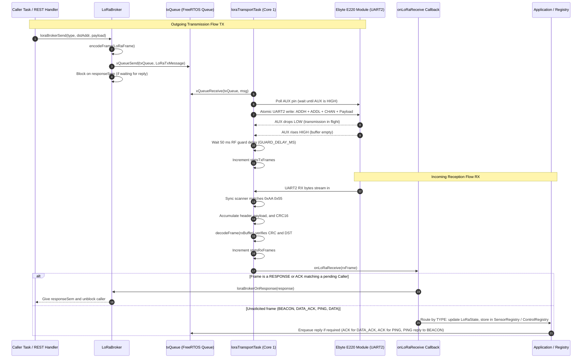
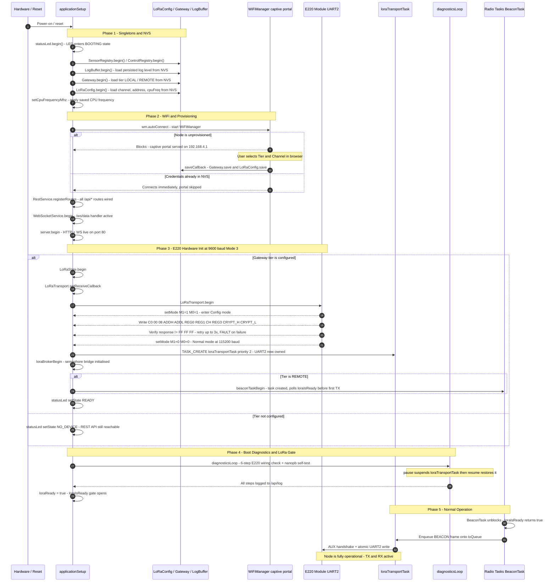

# LoRaIoT - Firmware Architecture

This document is the developer reference for the LoRaIoT firmware internals.
For hardware wiring, quick-start examples, and operational guides see
[`README.md`](../README.md).

---

## 1. Threading Model

To ensure that real-time RF communication never blocks the TCP/IP stack or HTTP/WebSocket
servers, LoRaIoT enforces a strict multi-threaded layout using FreeRTOS.

```
            Core 0 (System Core)                   Core 1 (Application Core)
     +---------------------------------+      +---------------------------------+
     | - WiFi Stack & LwIP             |      | - Main Arduino loop()           |
     | - ESPAsyncWebServer (Callbacks) |      |   applicationSetup/Loop()       |
     +---------------------------------+      | - loraTransportTask (Priority 2)|
                      |                       | - WebSocketService broadcastTask|
                      |                       |   (Priority 1)                  |
                      |                       | - BeaconTask [REMOTE only]      |
                      |                       |   (Priority 1)                  |
                      |                       +---------------------------------+
                      |                                        |
                      +======= [ txQueue (Serialized) ] =======+
                                         |
                                      UART2 -> E220
```

> On single-core builds all tasks run on the only available core with no affinity pinning.
> The `TASK_CREATE` macro in `src/util/src/TaskUtils.h` handles this automatically.

### Core Assignments

- **Core 0 (System Core):** Handles the high-frequency WiFi stack, TCP/IP processing, and
  non-blocking asynchronous web callbacks from `ESPAsyncWebServer` (REST API and WebSocket
  events).
- **Core 1 (Application Core):** Runs the primary application loop, the low-level
  `loraTransportTask`, WebSocket broadcast, and (on REMOTE) the beacon task.

### Concurrency Rules

1. **Single UART2 Ownership:** The `loraTransportTask` is the **sole owner** of `LoRaSerial`
   (UART2). Web server callbacks on Core 0 must never write directly to UART2. The diagnostics
   engine borrows UART2 via `LoRaTransport.pause()` / `LoRaTransport.resume()`.
2. **The `txQueue` Bridge:** Any task intending to transmit calls `LoRaTransport.sendFrame()`
   or `LoRaTransport.sendRaw()`, which copies the packet into a `LoRaTxMessage` and posts it
   onto the FreeRTOS `txQueue`. The `loraTransportTask` drains the queue, executes the AUX
   handshake, and writes bytes atomically to UART2.
3. **LoRa Readiness Gate:** The `loraIsReady()` function (declared in `Application.h`) returns
   `true` only after the boot diagnostics have completed on the first `applicationLoop()` tick.
   Radio tasks (e.g. `BeaconTask`) must poll this before transmitting to avoid corrupting the
   E220 UART state during the diagnostics Mode 3 sequence.
4. **Shared State Mutexes:** All shared state structs (`LoRaState`, `SensorRegistry`,
   `ControlRegistry`, `LogBuffer`) are protected by FreeRTOS mutexes.

---

## 2. LoRa Message Transmission and Reception Lifecycle

The diagram below details how requests from REST callbacks or background tasks are dispatched
across FreeRTOS queues to the single UART2 driver task, how AUX hardware flow control is
enforced, and how incoming frames are parsed, validated, and routed to application handlers.
The RX path shows both the synchronous response path (used when a Caller is blocking on a
reply) and the asynchronous application routing path (used for unsolicited frames such as
BEACON, DATA_ACK, and PING).



---

## 3. Boot Initialisation Sequence

The diagram below traces the exact sequence of steps from power-on (or reset after reflash)
until the node is fully ready to send and receive LoRa frames.



---

## 4. Unified Singleton Design Pattern

The codebase is built around the **Arduino Singleton Pattern** to prevent global variable
name-shadowing collisions in C++ while presenting a clean, intuitive API. Every hardware
controller or configuration subsystem defines an underlying class with a `-Class` suffix and
exports a single global instance with a clean name:

- **`LoRaTransportClass` -> `LoRaTransport`**: Manages low-level UART2 transceiving, the
  FreeRTOS background task, and the `txQueue`.
- **`LoRaConfigClass` -> `LoRaConfig`**: Manages persistent NVS parameters (channel, address,
  CPU frequency).
- **`GatewayClass` -> `Gateway`**: Manages the persistent gateway role (`LOCAL` or `REMOTE`).
- **`LogBufferClass` -> `LogBuffer`**: Manages the multi-level (`INFO`/`DEBUG`/etc.) log ring
  buffer in RAM and provides JSON serialization.
- **`StatusLed` -> `statusLed`**: Manages the asynchronous status LED state machine.
- **`LoRaStateClass` -> `LoRaState`**: Mutex-protected per-SRC link state (duplicate
  detection, reboot detection via `boot_id`, LRU registry with 180s stale purge). Used on
  both LOCAL and REMOTE.
- **`PeerRegistry` -> `SensorRegistry`**: Manages sensor devices and metric definitions
  (owned on REMOTE, cached on LOCAL).
- **`PeerRegistry` -> `ControlRegistry`**: Manages control devices and setpoint definitions
  (owned on LOCAL, cached on REMOTE).
