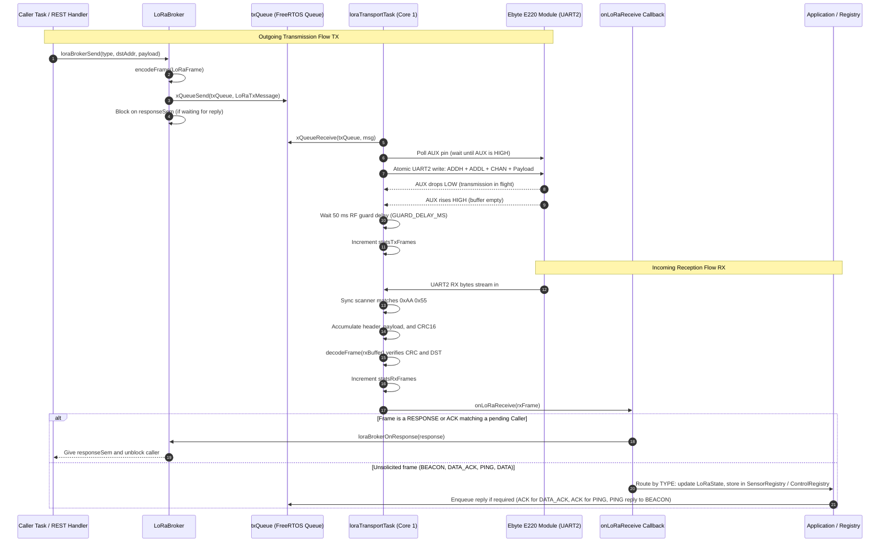
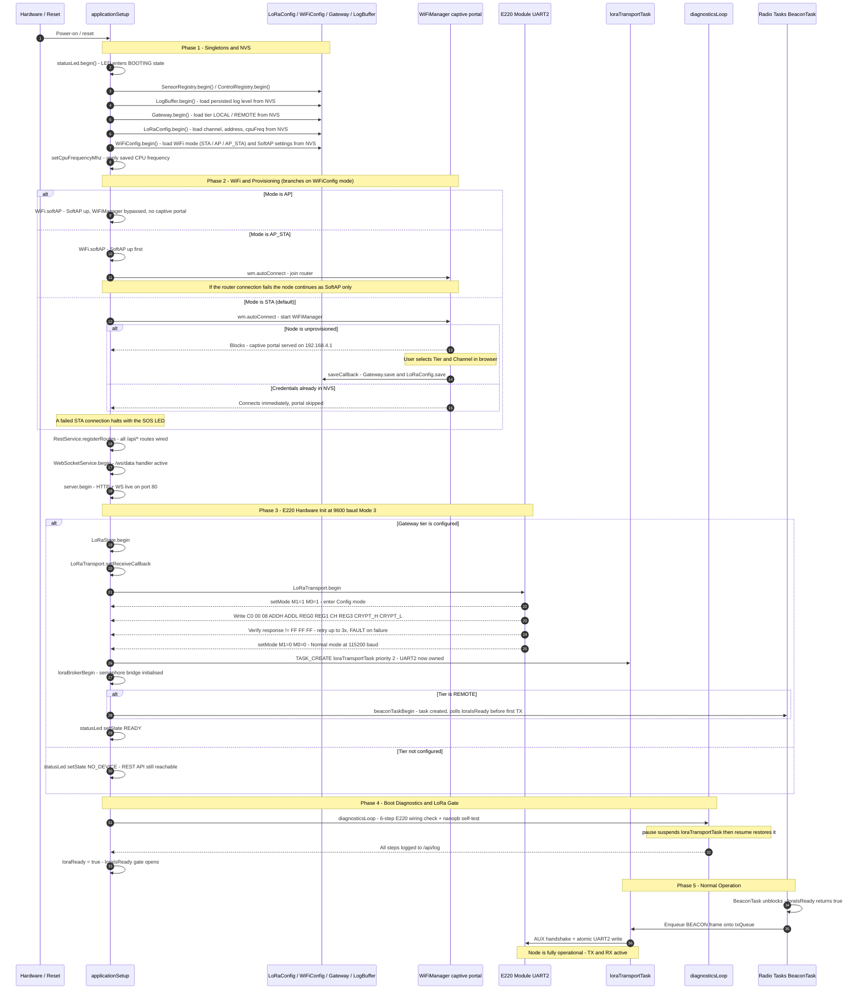
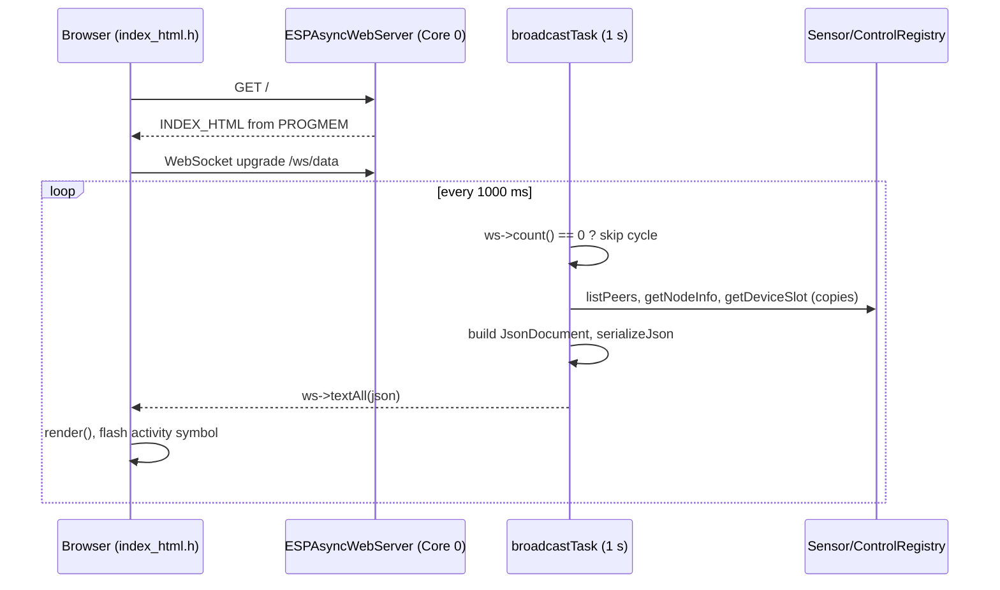
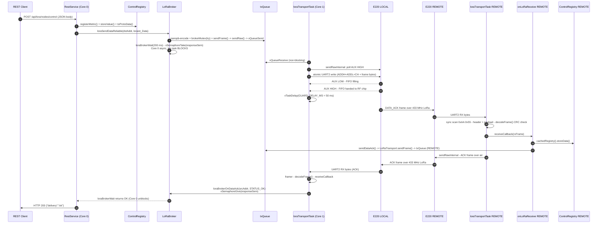
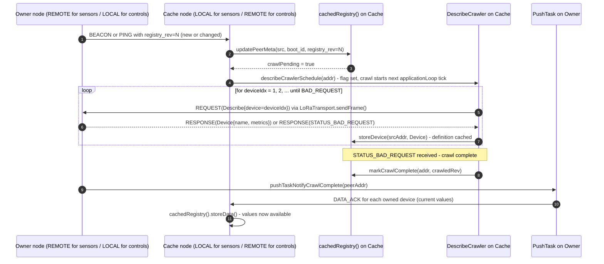

# LoRaIoT - Firmware Architecture

This document is the developer reference for the LoRaIoT firmware internals.
For hardware wiring, quick-start examples, and operational guides see
[`README.md`](../README.md).

---

## 1. Threading Model

To ensure that real-time RF communication never blocks the TCP/IP stack or HTTP/WebSocket
servers, LoRaIoT enforces a strict multi-threaded layout using FreeRTOS.

```
            Core 0 (System Core)                   Core 1 (Application Core)
     +---------------------------------+      +---------------------------------+
     | - WiFi Stack & LwIP             |      | - Main Arduino loop()           |
     | - ESPAsyncWebServer (Callbacks) |      |   applicationSetup/Loop()       |
     +---------------------------------+      | - loraTransportTask (Priority 2)|
                      |                       | - WebSocketService broadcastTask|
                      |                       |   (Priority 1)                  |
                      |                       | - BeaconTask [REMOTE only]      |
                      |                       |   (Priority 1)                  |
                      |                       +---------------------------------+
                      |                                        |
                      +======= [ txQueue (Serialized) ] =======+
                                         |
                                      UART2 -> E220
```

> On single-core builds all tasks run on the only available core with no affinity pinning.
> The `TASK_CREATE` macro in `src/util/src/TaskUtils.h` handles this automatically.

### Core Assignments

- **Core 0 (System Core):** Handles the high-frequency WiFi stack, TCP/IP processing, and
  non-blocking asynchronous web callbacks from `ESPAsyncWebServer` (REST API and WebSocket
  events). The WiFi stack serves one radio. In `AP_STA` mode the SoftAP and the station
  interface share it, so both interfaces run on the same channel.
- **Core 1 (Application Core):** Runs the primary application loop, the low-level
  `loraTransportTask`, WebSocket broadcast, and (on REMOTE) the beacon task.

### Concurrency Rules

1. **Single UART2 Ownership:** The `loraTransportTask` is the **sole owner** of `LoRaSerial`
   (UART2). Web server callbacks on Core 0 must never write directly to UART2. The diagnostics
   engine borrows UART2 via `LoRaTransport.pause()` / `LoRaTransport.resume()`.
2. **The `txQueue` Bridge:** Any task intending to transmit calls `LoRaTransport.sendFrame()`
   or `LoRaTransport.sendRaw()`, which copies the packet into a `LoRaTxMessage` and posts it
   onto the FreeRTOS `txQueue`. The `loraTransportTask` drains the queue, executes the AUX
   handshake, and writes bytes atomically to UART2.
3. **LoRa Readiness Gate:** The `loraIsReady()` function (declared in `Application.h`) returns
   `true` only after the boot diagnostics have completed on the first `applicationLoop()` tick.
   Radio tasks (e.g. `BeaconTask`) must poll this before transmitting to avoid corrupting the
   E220 UART state during the diagnostics Mode 3 sequence.
4. **Shared State Mutexes:** All shared state structs (`LoRaState`, `SensorRegistry`,
   `ControlRegistry`, `LogBuffer`) are protected by FreeRTOS mutexes.

---

## 2. LoRa Message Transmission and Reception Lifecycle

The diagram below details how requests from REST callbacks or background tasks are dispatched
across FreeRTOS queues to the single UART2 driver task, how AUX hardware flow control is
enforced, and how incoming frames are parsed, validated, and routed to application handlers.
The RX path shows both the synchronous response path (used when a Caller is blocking on a
reply) and the asynchronous application routing path (used for unsolicited frames such as
BEACON, DATA_ACK, and PING).



---

## 3. Boot Initialisation Sequence

The diagram below traces the exact sequence of steps from power-on (or reset after reflash)
until the node is fully ready to send and receive LoRa frames.



---

## 4. Unified Singleton Design Pattern

The codebase is built around the **Arduino Singleton Pattern** to prevent global variable
name-shadowing collisions in C++ while presenting a clean, intuitive API. Every hardware
controller or configuration subsystem defines an underlying class with a `-Class` suffix and
exports a single global instance with a clean name:

- **`LoRaTransportClass` -> `LoRaTransport`**: Manages low-level UART2 transceiving, the
  FreeRTOS background task, and the `txQueue`.
- **`LoRaConfigClass` -> `LoRaConfig`**: Manages persistent NVS parameters (channel, address,
  CPU frequency).
- **`GatewayClass` -> `Gateway`**: Manages the persistent gateway role (`LOCAL` or `REMOTE`).
- **`LogBufferClass` -> `LogBuffer`**: Manages the multi-level (`INFO`/`DEBUG`/etc.) log ring
  buffer in RAM and provides JSON serialization.
- **`StatusLed` -> `statusLed`**: Manages the asynchronous status LED state machine.
- **`LoRaStateClass` -> `LoRaState`**: Mutex-protected per-SRC link state (duplicate
  detection, reboot detection via `boot_id`, LRU registry with 180s stale purge). Used on
  both LOCAL and REMOTE.
- **`PeerRegistry` -> `SensorRegistry`**: Manages sensor devices and metric definitions
  (owned on REMOTE, cached on LOCAL).
- **`PeerRegistry` -> `ControlRegistry`**: Manages control devices and setpoint definitions
  (owned on LOCAL, cached on REMOTE).

---

## 5. Browser Dashboard and WebSocket

Every node serves the same live dashboard at `GET /`. It is a single self-contained HTML page
(`src/LoRaIoT/src/index_html.h`, about 12 KB, inline CSS and JS, no CDN) stored in flash and sent
with `send_P()`, so it never occupies DRAM. After the page has loaded it needs no further HTTP
requests: all data arrives over one WebSocket, `ws://<host>/ws/data` (`WS_PATH` in `Server.h`).

The channel is **server push only**. The server never reads client messages (no `onEvent`
handler, no command queue), and the page sends nothing.

### Components

| Part | File | Role |
|---|---|---|
| `AsyncWebSocket ws(WS_PATH)` | `Server.cpp` | Endpoint, registered with `server.addHandler(&ws)` |
| `WebSocketService` (`wsService`) | `service/src/WebSocketService.cpp` | Owns `broadcastTask` (priority 1, 10240 B stack, `TaskRegistry` name `WSBroadcast`) |
| Dashboard page | `LoRaIoT/src/index_html.h` | WebSocket client, renders the JSON, handles link loss |

### Push path



`broadcastTask` only reads the in-RAM registry caches and never starts LoRa traffic. The air data
rate therefore does not limit the refresh rate, and values in the page are exactly as fresh as the
last frame the node received (`age_ms`, `peer_last_seen_ms_ago`).

### Payload

One JSON object per push; the full schema with an example is in
[`RestApi.md`](RestApi.md#websocket-wsdata) and in the header comment of `WebSocketService.cpp`.

| Field | Source |
|---|---|
| `uptime_s`, `tier` | `millis()`, `Gateway.getTierName()` |
| `lora` | `LoRaTransport.getStats()` (TX, RX, CRC errors, ACK loss) |
| `nodes[]` | **LOCAL:** `SensorRegistry` (sensor values cached from REMOTE nodes). **REMOTE:** `ControlRegistry` (setpoints cached from LOCAL). Same shape as `GET /api/lora/nodes/sensor` and `GET /api/lora/nodes/control`, `[]` if no peer is known |
| `echo` | `restServiceGetLastEcho()`, `null` until an echo test has run |

Design points:

- **String lifetime.** ArduinoJson stores `const char*` by pointer. `broadcastTask` therefore copies
  all `DeviceSlot` objects into a local array (`LORA_MAX_PEERS` x `DEVICE_TABLE_MAX_DEVICES`) before it
  builds the document, and keeps the array alive until `serializeJson()` returns.
- **Stack size.** That array is about 4 KB, so the stack is 10240 B. 6144 B overflowed and caused a
  stack canary panic. Check the high-water mark of `WSBroadcast` in `GET /status` when changing
  `LORA_MAX_PEERS` or the `DeviceTable` limits.
- **Idle cost.** With no client connected, the task skips the cycle before touching the registries
  or the JSON library.
- **Threading.** The task runs on Core 1 (the only core on single-core builds). The HTTP and
  WebSocket callbacks stay on Core 0 and do no LoRa or UART work, as required by the concurrency
  rules in section 1.

### Browser behaviour

| Behaviour | Implementation in the page |
|---|---|
| Reconnect | Exponential back-off, 1 s start, doubled per attempt, capped at 30 s; reset on a successful open |
| Dead-link detection | A powered-off or unplugged node sends no TCP close, so `onclose` never fires. A 1 s watchdog treats 3 s without a message as a lost link, closes the socket itself, shows "Disconnected" and starts the back-off reconnect |
| Stale data | When the link is lost the nodes are re-rendered as "unknown / link lost" with the age at the last update. The page does not claim online or offline, because it cannot know |
| Activity symbol | Flashes for 250 ms on every received message |
| Safe rendering | Node, device and metric names come from the radio link, so the DOM is built with `textContent` only, never `innerHTML` |

The online / offline badge of a node is the registry's liveness flag (`PingTask`: three unanswered
keep-alive PINGs after 90 s of silence, see [`README.md`](../README.md)). It is not derived from the
WebSocket. The WebSocket state ("Connected") and the node state ("online") are independent: the first
describes the link between browser and this node, the second the LoRa link between the two nodes.

### Limitations

- Read-only: the browser cannot change a setpoint over the WebSocket. Writes go through the REST API.
- `ws->cleanupClients()` is not called, so slots of clients that vanished without closing are
  reclaimed only by the async TCP stack.
- Each node shows only its own view: LOCAL does not display REMOTE's control cache and vice versa.

---

## 6. REST-to-Radio Message Flow (Control Setpoint Example)

This section traces the complete path of a write request - specifically a `POST /api/lora/nodes/control`
call on LOCAL - from the REST handler through every layer down to the physical E220 radio, and back.
It names every class, function, and file involved so a new developer can follow the code without
guessing. The data flow for sensor data (REMOTE to LOCAL) is the mirror image and follows the same
layers in the opposite direction.

### 6.1 Layer Stack

```
  POST /api/lora/nodes/control  (HTTP body: JSON)
           |
           v  Core 0 - ESPAsyncWebServer async_tcp task
  +-------------------------------+
  | RestService.cpp               |  src/service/src/RestService.cpp
  | registerRoutes() lambda       |  Validates input, writes to ControlRegistry,
  |                               |  calls loraSendDataReliable()
  +-------------------------------+
           |  calls
           v
  +-------------------------------+
  | LoRaBroker.cpp                |  src/LoRaIoT/src/LoRaBroker.cpp
  | loraSendDataReliable()        |  Encodes loraiot_Data with nanopb,
  | loraBrokerSend()              |  acquires brokerMutex, builds LoRaFrame,
  | loraBrokerWait()              |  calls LoRaTransport.sendFrame(),
  |                               |  then blocks on responseSem binary semaphore
  +-------------------------------+
           |  calls
           v
  +-------------------------------+
  | LoRaTransport.cpp             |  src/lora/src/LoRaTransport.cpp
  | sendFrame() -> sendRaw()      |  encodeFrame() -> copies LoRaTxMessage into
  |                               |  txQueue (FreeRTOS queue, depth 10)
  +-------------------------------+
           |  xQueueSend (thread-safe)
           v  Core 1 - loraTransportTask (priority 2, sole UART2 owner)
  +-------------------------------+
  | loraTransportTask loop        |  src/lora/src/LoRaTransport.cpp
  | sendRawInternal()             |  Drains txQueue, runs AUX handshake,
  |                               |  writes routing header + frame atomically to
  |                               |  LoRaSerial (HardwareSerial UART2, pins 16/17)
  +-------------------------------+
           |  GPIO 17 (TX2)
           v
  +-------------------------------+
  | E220-400T22D                  |  433 MHz LoRa, fixed transmission mode
  | RF over the air               |  Sub-packet 200 B, 62.5 kbps
  +-------------------------------+
           |  GPIO 16 (RX2) on REMOTE node
           v  Core 1 - loraTransportTask on REMOTE
  +-------------------------------+
  | loraTransportTask RX framer   |  src/lora/src/LoRaTransport.cpp
  |                               |  Sync scanner -> header accumulation ->
  |                               |  decodeFrame() CRC check -> receiveCallback
  +-------------------------------+
           |  calls
           v
  +-------------------------------+
  | Application.cpp               |  src/LoRaIoT/src/Application.cpp
  | onLoRaReceive()               |  Routes by frame TYPE; for DATA_ACK calls
  |                               |  cachedRegistry().storeData() then sendDataAck()
  +-------------------------------+
           |  sendDataAck() -> LoRaTransport.sendFrame() -> txQueue -> E220
           v  ACK frame travels back to LOCAL
  +-------------------------------+
  | onLoRaReceive() on LOCAL      |  Receives ACK frame, decodes loraiot_Ack,
  | -> loraBrokerOnDataAck()      |  calls loraBrokerOnDataAck() which
  |                               |  gives responseSem - unblocks RestService
  +-------------------------------+
           |
           v  Core 0 - RestService lambda resumes
  +-------------------------------+
  | RestService                   |  Maps BrokerResult to HTTP status
  | request->send(200/202/503/504)|  and calls request->send()
  +-------------------------------+
```

### 6.2 Concurrency Model in Detail

`ESPAsyncWebServer` delivers HTTP callbacks on Core 0 alongside the WiFi stack. The E220 module
is connected exclusively to `LoRaSerial` (`HardwareSerial LoRaSerial(2)`, UART2, GPIO 16/17).
`loraTransportTask` is created by `LoRaTransport.begin()` and is the only task that ever calls
`LoRaSerial.read()`, `LoRaSerial.write()`, or `LoRaSerial.begin()` during normal operation.
**A REST handler on Core 0 must never touch UART2 directly.**

The bridge between the two sides is:

1. **`txQueue`** - a FreeRTOS queue (depth `TX_QUEUE_SIZE` = 10, item type `LoRaTxMessage`).
   `LoRaTransport.sendRaw()` copies the encoded frame into a `LoRaTxMessage` and calls
   `xQueueSend()` with a short timeout. This is safe from any task or core.
   `loraTransportTask` drains the queue each loop iteration with `xQueueReceive()` using
   timeout 0 (non-blocking), then calls `sendRawInternal()`.
   The depth-10 capacity is **not** for pipelining multiple reliable sends - the broker
   single-slot constraint prevents that (see §6.8). It exists to absorb bursts of
   unsolicited outgoing frames (ACK replies, RESPONSE frames, BEACON frames) that
   `onLoRaReceive()` enqueues via `LoRaTransport.sendFrame()` while `loraTransportTask`
   is already inside `sendRawInternal()` for the current TX frame. These fire-and-forget
   frames bypass the broker and do not set `pendingActive`.

2. **`brokerMutex`** - a FreeRTOS mutex that guards the single in-flight slot in `LoRaBroker`.
   `loraBrokerSend()` try-acquires it with timeout 0; if it is held, it returns
   `BrokerResult::BUSY` immediately (no silent queuing). The mutex is released before the
   actual `LoRaTransport.sendFrame()` call to keep the critical section minimal.

3. **`responseSem`** - a FreeRTOS binary semaphore. After `loraBrokerSend()` returns `OK`, the
   caller immediately calls `loraBrokerWait(timeoutMs)`, which calls `xSemaphoreTake(responseSem, ticks)`.
   The calling task (the async_tcp task on Core 0) blocks here. When the matching ACK or RESPONSE
   frame arrives in `onLoRaReceive()` (running on Core 1 inside `loraTransportTask`), the receive
   path calls `loraBrokerOnDataAck()` or `loraBrokerOnResponse()`, which calls
   `xSemaphoreGive(responseSem)`, waking the waiting Core 0 task.

The default wait ceiling is `BROKER_DEFAULT_TIMEOUT_MS` = 3000 ms. The hard ceiling enforced by
the REST handler is `BROKER_MAX_TIMEOUT_MS` = 4000 ms, leaving 1000 ms headroom below the
ESP Task WDT default of 5000 ms. Calls to `loraBrokerWait()` that exceed the ceiling return
`BrokerResult::TIMEOUT`; the broker clears the pending slot so the next request is not blocked.

### 6.3 The AUX Pin Protocol

Every write to the E220 in `sendRawInternal()` follows this exact five-step sequence:

```
1. Poll AUX HIGH  - wait until digitalRead(PIN_AUX) == HIGH
                    (timeout AUX_TIMEOUT_MS = 1000 ms; warn and abort on timeout)
                    Ensures the module's internal FIFO is empty before we start.

2. Atomic write   - LoRaSerial.write(targetAddh)  <- routing header: ADDH
                    LoRaSerial.write(targetAddl)  <- routing header: ADDL (= dstAddr)
                    LoRaSerial.write(targetChan)  <- routing header: CH
                    LoRaSerial.write(data, len)   <- frame bytes (SYNC..CRC)
                    These four writes happen back-to-back with no delay between them.
                    Splitting them would risk the E220 force-flushing an incomplete frame
                    after its 2-second UART-inactivity timer.

3. Wait AUX LOW   - poll until digitalRead(PIN_AUX) == LOW
                    (timeout AUX_TRANSMIT_DETECT_TIMEOUT_MS = 50 ms; proceed on timeout)
                    AUX going LOW means the FIFO is accepting data from UART.

4. Wait AUX HIGH  - poll until digitalRead(PIN_AUX) == HIGH
                    (timeout AUX_TRANSMIT_COMPLETE_TIMEOUT_MS = 1000 ms; warn on timeout)
                    AUX returning HIGH means the FIFO has been handed to the RF chip.
                    NOTE: the last sub-packet may still be transmitting over the air
                    at this point (manufacturer §5.6.4).

5. Guard delay    - vTaskDelay(GUARD_DELAY_MS = 50 ms)
                    Mandatory air-time guard. Ensures the RF burst has finished before
                    the remote node can begin its ACK transmission.
```

Why this matters: the E220 has a 400-byte internal FIFO. If a second frame is written before the
first RF burst completes, the FIFO overflows and data is lost silently. The guard delay accounts
for the maximum air time of a maximum-length frame (200 B at 62.5 kbps takes roughly 30-50 ms
over the air according to `doc/Feasibility.md` §4.1).

### 6.4 DATA_ACK Retry Loop

`loraSendDataReliable()` (in `src/LoRaIoT/src/LoRaBroker.cpp`) implements reliability for
`DATA_ACK` frames:

```
maxAttempts = LORA_MAX_RETRIES + 1 = 4

for attempt in 0..3:
    if attempt > 0:
        wait random(LORA_BACKOFF_MIN_MS=20, LORA_BACKOFF_MAX_MS=200) ms
        re-arm pendingActive, pendingKind, pendingSeq (same SEQ reused)
    LoRaTransport.sendFrame(frame)          <- enqueues onto txQueue
    result = loraBrokerWait(LORA_ACK_TIMEOUT_MS=200 ms)
    if result == OK:
        outStatus = lastAckResult.status
        return OK

LoRaTransport.incrementAckLoss()            <- bumps statsAckLoss counter
outStatus = STATUS_BAD_REQUEST
return TIMEOUT
```

Key points:
- The SEQ number is assigned once before the loop and reused for all retransmissions.
  The receiver's duplicate-detection (`LoRaState.updateAndCheckDuplicate`) recognises a
  retransmitted DATA_ACK and re-sends the ACK without storing the data twice.
- Each attempt waits `LORA_ACK_TIMEOUT_MS` = 200 ms for the ACK. The timeout starts after
  the frame has been placed on `txQueue`; the actual air-time window begins a few milliseconds
  later when `loraTransportTask` drains the queue and completes the AUX handshake.
- A BUSY result (broker mutex taken) is returned immediately without entering the retry loop.
  The REST handler maps this to HTTP 503.

### 6.5 BrokerResult to HTTP Status Mapping

The `POST /api/lora/nodes/control` handler maps `loraSendDataReliable()` results to HTTP
status codes as follows (see `src/service/src/RestService.cpp`, the `/api/lora/nodes/control`
POST lambda):

| `loraSendDataReliable` result | ACK status | `delivery` field | HTTP status |
|---|---|---|---|
| `OK` | `STATUS_OK` | `"ok"` | 200 OK |
| `OK` but schema changed or `STATUS_BAD_REQUEST` ACK | `STATUS_BAD_REQUEST` | `"after_describe"` | 202 Accepted |
| `TIMEOUT` (all 4 retries failed) | - | `"timeout"` | 504 Gateway Timeout |
| `BUSY` (broker slot taken) | - | `"busy"` | 503 Service Unavailable |

- **200**: The setpoint was stored locally, transmitted, and acknowledged by REMOTE.
- **202**: The setpoint was stored locally. REMOTE acknowledged but returned `STATUS_BAD_REQUEST`,
  meaning it does not yet know the device schema. A Describe crawl has been triggered; the value
  will be pushed again by `PushTask` once the crawl completes.
- **504**: All four DATA_ACK attempts timed out with no ACK. The local value is still stored
  and will be retried by the `PushTask` when the link recovers or the next DATA_ACK opportunity
  arises.
- **503**: Another LoRa request is already in flight (the broker has a single slot matching the
  half-duplex LoRa channel). The caller should retry after a short delay.

### 6.6 Full Frame Lifecycle (DATA_ACK)

The numbered steps below correspond one-to-one with the `autonumber` labels in the sequence
diagram that follows. Each arrow in the diagram is one step.

1. REST client POSTs JSON `{"device":"vctrl","metrics":{"vset":{"value":1200,"unit":"mV","scale":1000}}}`.
2. `RestService` lambda (Core 0) parses the JSON, calls `ControlRegistry.registerMetric()` and
   `ControlRegistry.storeValue()` to persist the setpoint locally, and calls `ControlRegistry.toProtoData()`
   to serialise the device slot into a `loraiot_Data` protobuf struct.
3. `RestService` calls `loraSendDataReliable(dstAddr, loraiot_Data)` in `LoRaBroker`.
4. `loraSendDataReliable()` nanopb-encodes `loraiot_Data` into a byte buffer, wraps it in a
   `LoRaFrame` (TYPE=DATA_ACK, SRC=LOCAL, DST=addr, SEQ=N), acquires `brokerMutex` (try,
   timeout=0) and calls `LoRaTransport.sendFrame()`, which runs `encodeFrame()` (SYNC, VER, TYPE,
   SRC, DST, SEQ, LEN, CRC16) and `sendRaw()`, copying the result into a `LoRaTxMessage` and
   posting it onto `txQueue` via `xQueueSend()`.
5. `loraSendDataReliable()` calls `loraBrokerWait(200 ms)`, which calls
   `xSemaphoreTake(responseSem, ...)`. The async_tcp task on Core 0 blocks here until the
   semaphore is given or the timeout fires.
6. `loraTransportTask` (Core 1) drains `txQueue` with a non-blocking `xQueueReceive()`.
7. `loraTransportTask` calls `sendRawInternal()`, which first polls `PIN_AUX` until it reads HIGH
   (timeout `AUX_TIMEOUT_MS` = 1000 ms). AUX HIGH means the E220 FIFO is empty and ready.
8. `sendRawInternal()` writes the routing header (ADDH + ADDL + CH) followed immediately by the
   frame bytes (SYNC..CRC) as one atomic burst - no delays between the four `LoRaSerial.write()`
   calls.
9. E220 LOCAL drives AUX LOW: the FIFO has started accepting bytes from UART and is transferring
   them to the RF chip.
10. E220 LOCAL drives AUX HIGH: the FIFO has been handed to the RF chip. The last sub-packet may
    still be transmitting over the air at this point.
11. `sendRawInternal()` calls `vTaskDelay(GUARD_DELAY_MS = 50 ms)` to wait for the RF burst to
    finish before the channel is considered free again. `statsTxFrames` is incremented after the
    delay returns.
12. E220 LOCAL transmits the DATA_ACK frame over the 433 MHz LoRa link to E220 REMOTE.
13. E220 REMOTE outputs the received bytes on its UART2 (GPIO 16 RX2). REMOTE's
    `loraTransportTask` reads them via `LoRaSerial.read()`.
14. REMOTE's `loraTransportTask` runs the sync-byte framer: scans for `0xAA 0x55`, accumulates
    header and payload, then calls `decodeFrame()` which verifies the CRC16 and the DST address.
15. On a valid frame, `loraTransportTask` invokes `receiveCallback(rxFrame)`, which is
    `onLoRaReceive()` registered by `applicationSetup()`.
16. `onLoRaReceive()` on REMOTE decodes the `loraiot_Data` payload and calls
    `cachedRegistry().storeData()` to persist the setpoint.
17. `onLoRaReceive()` calls `sendDataAck(frame, STATUS_OK)`, which nanopb-encodes a `loraiot_Ack`,
    builds an ACK `LoRaFrame`, and calls `LoRaTransport.sendFrame()`, posting the ACK onto
    REMOTE's `txQueue`.
18. REMOTE's `loraTransportTask` picks up the ACK `LoRaTxMessage` from `txQueue` in its next
    loop iteration and calls `sendRawInternal()` to transmit it via the E220 AUX handshake.
19. E220 REMOTE transmits the ACK frame back over the 433 MHz LoRa link to E220 LOCAL.
20. E220 LOCAL outputs the ACK bytes on its UART2. LOCAL's `loraTransportTask` reads them via
    `LoRaSerial.read()`.
21. LOCAL's `loraTransportTask` runs the sync-byte framer on the incoming bytes, calls
    `decodeFrame()` (CRC check, DST check), and invokes `receiveCallback(rxFrame)`.
22. `onLoRaReceive()` on LOCAL decodes the `loraiot_Ack` payload and calls
    `loraBrokerOnDataAck(srcAddr, ack.status)`, which stores the result in `lastAckResult`,
    clears `pendingActive`, and calls `xSemaphoreGive(responseSem)`.
23. `xSemaphoreGive(responseSem)` unblocks the Core 0 async_tcp task. `loraBrokerWait()` returns
    `BrokerResult::OK` and `loraSendDataReliable()` returns `OK` with `outStatus = STATUS_OK`.
24. The REST lambda maps the result to HTTP 200 and calls `request->send(200, "application/json", json)`.



### 6.7 PingTask Indirect Path

`PingTask` (`src/LoRaIoT/src/PingTask.cpp`) does not call the REST handler but uses the same
broker. It is a standalone FreeRTOS task, so it can call `loraBrokerSend()` and block on
`loraBrokerWait()` without deadlocking the receive path.

The receive path (`loraTransportTask`) must never block waiting for the broker: doing so would
prevent the ACK from being processed, which would deadlock `loraBrokerWait()`. The solution is
the `beaconQueue` (depth `PING_QUEUE_LENGTH`): when `onLoRaReceive()` sees a BEACON it calls
`pingTaskNotifyBeacon(addr)` (posts to `beaconQueue` with timeout 0, never blocking) and returns
immediately. `pingTask` picks up the address from the queue and calls `loraBrokerSend()` /
`loraBrokerWait()` in its own context.

The same pattern applies to `pingTaskNotifyControlChange()`: the REST handler posts the node
address to `controlChangeQueue` (timeout 0, non-blocking) and returns. The `pingTask` drains
`controlChangeQueue` first on every loop iteration, before waiting on `beaconQueue`.

### 6.8 Single-Slot Guarantee and ACK Matching

#### Why only one request can be in flight at a time

The broker enforces a strict single-slot constraint regardless of the `txQueue` depth. Before
`loraSendDataReliable()` (or `loraBrokerSend()`) posts anything to `txQueue` it does:

```cpp
if (xSemaphoreTake(brokerMutex, 0) != pdTRUE) return BrokerResult::BUSY;  // mutex held
if (pendingActive)                             return BrokerResult::BUSY;  // slot occupied
// ... set pendingActive = true ...
xSemaphoreGive(brokerMutex);
LoRaTransport.sendFrame(frame);   // -> txQueue
loraBrokerWait(timeoutMs);        // blocks until ACK or timeout
```

The try-acquire (`timeout = 0`) means any concurrent caller - another REST handler, `PingTask`,
`BeaconTask` - receives `BUSY` immediately and never posts to `txQueue`. `pendingActive` stays
`true` for the entire duration of `loraBrokerWait()`, so the slot is occupied from the moment
the frame is enqueued until the ACK arrives or the timeout fires. As a result, at most one
broker-managed frame is ever present in `txQueue` at any given time.

The only frames that bypass this gate are unsolicited **fire-and-forget** replies generated
directly inside `onLoRaReceive()`: `sendPingAck()`, `sendDataAck()`, and `sendDescribeResponse()`.
These call `LoRaTransport.sendFrame()` directly, do not touch `pendingActive`, and can land in
`txQueue` concurrently with a pending broker request. `loraTransportTask` transmits them in
arrival order; the remote node will simply see them as independent frames on the channel.

#### How an ACK is matched to the pending request

`loraBrokerOnDataAck()` (called from `onLoRaReceive()` when an ACK for a DATA_ACK frame arrives)
checks only:

```cpp
bool match = pendingActive && (pendingKind == BROKER_KIND_DATA_ACK);
```

It does **not** compare `ack.acked_seq` against `pendingSeq`. This is safe for two reasons:

1. **Single-slot**: if `pendingActive` is true and `pendingKind` is `BROKER_KIND_DATA_ACK`,
   there is exactly one DATA_ACK exchange in flight. Any DATA_ACK ACK that arrives now must
   belong to it; there is no other in-flight DATA_ACK it could belong to.

2. **Same SEQ across retries**: `loraSendDataReliable()` assigns the SEQ once before the retry
   loop and reuses it for all retransmissions. So a late ACK from attempt N-1 that arrives
   during attempt N's `loraBrokerWait()` carries the same SEQ as the live attempt. The broker
   accepts it and unblocks the caller, which is the correct behaviour - one valid ACK is enough
   to declare success regardless of which physical transmission the remote node was replying to.
   The duplicate-detection on the remote side (`LoRaState.updateAndCheckDuplicate`) ensures the
   retransmitted frame is not applied to the registry twice.

A stale ACK from a **previous, already-completed** exchange cannot match because `pendingActive`
is cleared (by `loraBrokerOnDataAck()` on success, or by `loraBrokerWait()` on timeout) before
`loraSendDataReliable()` returns. By the time the next call enters, the stale ACK has long since
been received and discarded (the broker is no longer active for that kind).

---

## 7. Describe Crawl - Schema Discovery Before Data is Visible

### 7.1 Why a Crawl is Needed

LoRa frames are kept as small as possible to minimise air time and collision risk. A `DATA` or
`DATA_ACK` payload carries only compact integer values:

```
Data { device=1, values=[{metric_id=1, value=3350}, {metric_id=2, value=120}] }
```

There are no strings, no units, and no human-readable names in the payload. The meaning of
`device=1`, `metric_id=1`, and the scale that turns `3350` into `3.35 V` lives in a separate
**Device definition** (`Device { name="Sensor A", metrics=[{id=1, name="Voltage", unit="V", scale=1000}, ...] }`),
which is owned by the node that produces the data and cached by the node that receives it.

Until that definition has been transferred, the receiving node cannot render the values
correctly. This transfer is the **Describe crawl**.

### 7.2 What Triggers a Crawl

Every BEACON frame (REMOTE to LOCAL) and every unicast PING frame carries an optional
`registry_rev` field - a counter that increments whenever a new device or metric is registered
on the owner node. The cache node watches this counter and schedules a crawl when it changes.

Two events trigger a crawl on the cache side (both handled in `onLoRaReceive()` in
[`src/LoRaIoT/src/Application.cpp`](../src/LoRaIoT/src/Application.cpp)):

1. **New `boot_id`** - the peer has rebooted. The cache discards all state it held for that
   peer and starts a fresh crawl from device index 1.
2. **`registry_rev` advanced** - a new device or metric was registered on the owner. A targeted
   crawl fetches the new definition without discarding existing ones.

In both cases `cachedRegistry().updatePeerMeta()` sets a `crawlPending` flag in the registry
and `describeCrawlerSchedule()` logs the intent. The actual crawl is started by
`describeCrawlerLoop()` on the next `applicationLoop()` tick.

For a `DATA_ACK` with an unknown device or metric, the receiver immediately returns
`STATUS_BAD_REQUEST` in the ACK and calls `describeCrawlerSchedule()`. The REST caller sees
HTTP 202 (`"delivery":"after_describe"`).

### 7.3 The Crawl State Machine

The crawl is driven by `describeCrawlerLoop()` (in
[`src/LoRaIoT/src/DescribeCrawler.cpp`](../src/LoRaIoT/src/DescribeCrawler.cpp)), which is
called from `applicationLoop()` on every iteration. It manages one `CrawlerContext` struct:

```
IDLE ──(crawlPending detected in cachedRegistry())──► REQUESTING (deviceIdx = 1)
REQUESTING ──(RESPONSE(Device) received)──► REQUESTING (deviceIdx++)
REQUESTING ──(STATUS_BAD_REQUEST received)──► IDLE (crawl complete)
REQUESTING ──(timeout, all retries exhausted)──► IDLE (crawl aborted)
```

In `REQUESTING` state the crawler sends `REQUEST(Describe{device=deviceIdx})` directly via
`LoRaTransport.sendFrame()` - bypassing `LoRaBroker` intentionally, because the broker has a
single in-flight slot used by REST handlers and `PingTask`. The crawler manages its own
retry state (`DESCRIBE_RESPONSE_TIMEOUT_MS` = 3000 ms, `DESCRIBE_MAX_RETRIES` = 3 attempts
per device index).

`describeCrawlerOnResponse()` is called from `onLoRaReceive()` (inside `loraTransportTask`)
when a RESPONSE frame matches the in-flight Describe SEQ. It either advances `deviceIdx` and
sends the next request, or transitions back to `IDLE` on `STATUS_BAD_REQUEST`.

### 7.4 How the Owner Answers

The owner node receives `REQUEST(Describe{device=N})` in `onLoRaReceive()` and calls
`sendDescribeResponse()`, which looks up device index N in `ownedRegistry()` and replies with
`RESPONSE(Device)`. If N does not exist it replies with `STATUS_BAD_REQUEST`, signalling the
end of the device list to the crawling node.

Once the crawl-ending `STATUS_BAD_REQUEST` reply is sent, `sendDescribeResponse()` calls
`pushTaskNotifyCrawlComplete(peerAddr)`. This posts a notification to `PushTask`
([`src/LoRaIoT/src/PushTask.cpp`](../src/LoRaIoT/src/PushTask.cpp)), which then pushes the
current values of all owned devices to the peer as `DATA_ACK` frames. This ensures the cache
side receives both the schema and the current values in one crawl round.

### 7.5 Full Crawl Sequence



### 7.6 Visibility Delay for New Data

Because the schema must be crawled before values can be understood, there is an inherent delay
from the moment a new device or metric is registered until the data is visible on the cache
node's REST API and dashboard. The delay depends on how many devices are registered and the
current radio conditions:

| Phase | Typical duration |
|---|---|
| Owner sends BEACON / PING carrying new `registry_rev` | up to 60 s (slow beacon) or immediate (control POST triggers a PING) |
| Cache schedules crawl and sends first `REQUEST(Describe{1})` | next `applicationLoop()` tick, < 10 ms |
| One `REQUEST(Describe)` round-trip at 62.5 kbps | ~100-200 ms per device (radio + processing) |
| `PushTask` pushes all device values after crawl completes | one `DATA_ACK` round-trip per device |

For sensor data the BEACON interval dominates: a new sensor registered on a REMOTE node in
`UNDISCOVERED` state sends a fast beacon every 5 s, so the crawl starts within 5 s. In
`DISCOVERED` state the interval is 60 s, but a reboot triggers the fast rate again.

For control data the delay is shorter: `POST /api/lora/nodes/control` calls
`pingTaskNotifyControlChange()` immediately, so the REMOTE receives a PING with the new
`registry_rev` within seconds and starts the crawl itself.

Until the crawl completes, `GET /api/lora/nodes/sensor` (or `control`) on the cache node
returns the last known values or an empty list for the new device. The dashboard shows the
same cached state and will update automatically once the `PushTask` push arrives.
