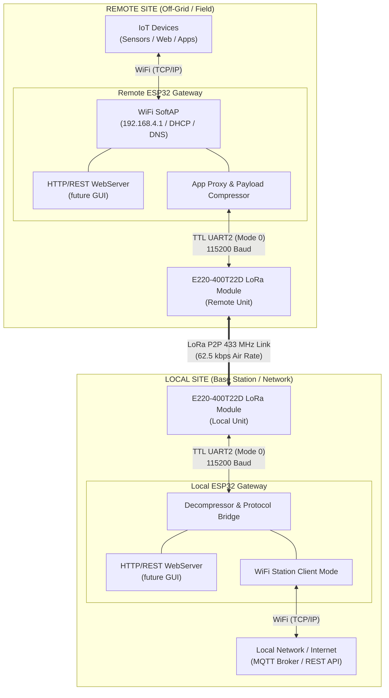

# Technical Feasibility Study & System Architecture: WiFi-LoRa-WiFi Gateway Bridge

## 1. Executive Summary & Feasibility Verdict

### Verdict: **FEASIBLE with Architectural Adaptation**

Connecting an **ESP32** to the **E220-400T22D LoRa module** and establishing a long-range wireless bridge between a local network and a remote access point is **fully feasible**. However, due to the low air bandwidth of LoRa (maximum 62.5 kbps raw rate, practical payload throughput ~2–15 kbps depending on distance), **direct raw TCP/IP packet forwarding (e.g. standard web browsing / TLS over raw IP tunneling) is impractical** without protocol optimization.

The LoRa link **can** carry application-layer traffic for purpose-built lightweight clients:
- REST API calls with small JSON payloads (< 190 bytes compressed) → **feasible**
- Custom HTTP/1.0 proxy where the ESP32 intermediates requests → **feasible**
- WebSocket keep-alive / heartbeat (interval > 2× RTT ≈ 400 ms minimum) → **feasible**
- Standard web browser / TLS / large HTTP responses → **not feasible**

To achieve reliable long-range IoT data transmission, the system must use an **Application-Level Proxy / Message Protocol Bridge** (e.g., MQTT-SN, CoAP, or a custom lightweight REST packet compressor) running on the ESP32 units, rather than uncompressed full-duplex TCP/IP IP-layer routing.

> **⚠️ Document note:** The manufacturer's PDF header reads "E220-900T22D User Manual" - this appears to be a rebadged document for the same hardware family. All frequency-specific values in the body (410–493 MHz, default 433.125 MHz) are correct for the E220-400T22D.

---

## 2. LoRa Module Technical Analysis (E220-400T22D)

### 2.1 Distinguishing LoRa vs. LoRaWAN
* **LoRa (Physical Layer Modulation):** Chirp Spread Spectrum (CSS) radio modulation used by the E220-400T22D (based on Semtech LLCC68). It operates point-to-point (P2P) or broadcast without requiring network infrastructure.
* **LoRaWAN (MAC & Network Protocol):** A standardized media access control protocol managed by the LoRa Alliance for wide-area star topologies (end-node to gateway to network server).
* **Module Classification:** The **E220-400T22D** is a **transparent UART LoRa module**, not a full LoRaWAN protocol stack node. It handles physical layer RF transmission, sub-packaging, error checking (CRC), and preambles automatically via onboard firmware over TTL UART.

### 2.2 Key Module Parameters
| Parameter | Value / Specification | Technical Significance for Architecture |
| :--- | :--- | :--- |
| **RF Transceiver Chip** | Semtech LLCC68 | Modern, high-efficiency LoRa IC with PA+LNA |
| **Operating Frequency** | 410.125 – 493.125 MHz (Default: 433.125 MHz) | 84 channels (1 MHz step, `CH * 1MHz`) |
| **Transmission Distance** | Up to 5 km | Ideal line-of-sight conditions (5 dBi antenna @ 2.4 kbps) |
| **Air Data Rate** | **2.4 kbps to 62.5 kbps** | User-configurable (REG0 bits 2-0); higher rate = shorter range |
| **UART Baud Rate** | 1,200 to 115,200 bps (Default: 9,600 bps) | Speed between ESP32 and E220 module; **use 115200 in production** |
| **Packet Size Limit** | **200 Bytes max per air sub-packet** | Configurable to 200, 128, 64, or 32 bytes |
| **Onboard FIFO Buffer** | **400 Bytes** | Written to RFIC in sub-packets; AUX HIGH ≠ RF transmission complete |
| **Operating Voltage** | 2.3V – 5.5V DC | Module I/O is **3.3V TTL native** (see §3.1 for 5V MCU caution) |
| **Transmit Power** | 21.5 – 22.5 dBm (~160 mW max) | TX current: ~110 mA at maximum (22 dBm) output |
| **Sleep Current** | ~5 µA | Deep Sleep / WOR receive mode |

---

## 3. Hardware Interfacing & ESP32 Programming Guide

### 3.1 Wiring Schematic: ESP32 <-> E220-400T22D

The E220 module provides 7 functional pins that connect directly to standard ESP32 GPIOs:

```
+------------------------+                  +------------------------+
|      ESP32 Board       |                  | E220-400T22D LoRa Mod  |
|                        |                  |                        |
|        3.3V / 5V  ---- |----------------->| VCC (Pin 6)            |
|              GND  ---- |----------------->| GND (Pin 7)            |
|   GPIO16 (RX2)    <--- |------------------| TXD (Pin 4)            |
|   GPIO17 (TX2)    ---> |------------------| RXD (Pin 3)            |
|   GPIO4 (Output)  ---> |------------------| M0  (Pin 1)            |
|   GPIO2 (Output)  ---> |------------------| M1  (Pin 2)            |
|   GPIO15 (Input)  <--- |------------------| AUX (Pin 5)            |
+------------------------+                  +------------------------+
```

> **⚠️ Voltage caution:** The module is **3.3V TTL native**. The ESP32 is also 3.3V, so no level shifters are needed. If a 5V MCU is ever used instead, **4–10 kΩ pull-up resistors on TXD and AUX are required** to avoid damaging the module (per manufacturer §4).

#### Pin Mapping Table
| E220 Pin | Name | Direction | ESP32 Connection | Description & Function |
| :---: | :---: | :---: | :---: | :--- |
| **1** | **M0** | Input (weak pull-up) | GPIO 4 | Mode control bit 0; float or ground if unused |
| **2** | **M1** | Input (weak pull-up) | GPIO 2 | Mode control bit 1; float or ground if unused |
| **3** | **RXD** | Input | GPIO 17 (TX2) | Serial UART Input (receives data from ESP32 TX) |
| **4** | **TXD** | Output | GPIO 16 (RX2) | Serial UART Output (sends data to ESP32 RX) |
| **5** | **AUX** | Output | GPIO 15 | Status indicator (see §3.2 for full semantics) |
| **6** | **VCC** | Power | 3.3V or 5.0V | Power supply (≥3.3V for maximum RF output power) |
| **7** | **GND** | Power | GND | Common Ground |

---

### 3.2 E220 Operating Modes & State Control

The ESP32 controls the operating mode of the module by driving the **M0** and **M1** GPIO pins.

| Mode | M1 | M0 | Mode Name | Description & Usage |
| :---: | :---: | :---: | :--- | :--- |
| **0** | **0** | **0** | **Normal / Transmission Mode** | UART and wireless channels open. Transparent or Fixed transmission. Main data exchange mode. |
| **1** | 0 | 1 | WOR Transmitting | Adds preamble automatically before packet send. For battery-powered wake-on-radio receivers. |
| **2** | 1 | 0 | WOR Receiving | Low-power preamble detection mode. |
| **3** | **1** | **1** | **Deep Sleep / Configuration Mode** | Wireless disabled. Module accepts register read/write commands over UART at **fixed 9600 8N1 only**. |

#### AUX Pin - Full Semantics

> **⚠️ CRITICAL - AUX=HIGH does NOT mean the RF transmission is complete.**

AUX serves three distinct functions. Misreading it is the most common firmware bug with this module:

1. **On power-on / mode exit:** AUX goes LOW during self-check and reconfiguration. **Wait for the rising edge of AUX** before sending any data - this marks the point where the module is operational.

2. **During UART→RF transmission (Mode 0):**
   - AUX goes **LOW** when the 400-byte internal FIFO starts being transferred to the RF chip.
   - AUX goes **HIGH** when the FIFO has been handed to the RFIC - but the **last sub-packet may still be transmitting over the air**.
   - The correct send pattern is: poll AUX HIGH → write data → wait for AUX to go LOW (confirms FIFO accepting data) → wait for AUX to go HIGH again (FIFO drained to RFIC) → wait additional guard time for RF burst to complete before writing the next frame.

3. **Mode switching:** After setting M0/M1, the module does not immediately switch. **AUX must show a rising edge lasting ≥ 2 ms** before the new mode is active. Use an interrupt or tight polling loop - do not rely on `delay(2)`.

4. **Note (from manufacturer §5.6.4):** *"Do not transmit large amounts of data at low air speeds - data accumulation causes communication abnormalities and data loss."* This reinforces using 62.5 kbps and makes AUX-based flow control mandatory at low rates.

#### Mode 3 Exit Sequence
When switching **from** Mode 3 back to Mode 0, the module reconfigures all parameters. AUX goes LOW during this process. Wait for AUX HIGH (the **T_BUSY rising edge**) before transmitting any data.

---

### 3.3 ESP32 Firmware Protocol & Registers Configuration

#### Command Format for Register Setup (Mode 3: M1=1, M0=1, UART fixed at 9600 8N1)

| # | Command | Format | Response |
| :---: | :--- | :--- | :--- |
| 1 | Write Register (persistent) | `0xC0 + StartAddr + Length + Parameters` | `0xC1 + StartAddr + Length + Parameters` |
| 2 | Read Register | `0xC1 + StartAddr + Length` | `0xC1 + StartAddr + Length + Values` |
| 3 | Write Temporary (lost on reboot) | `0xC2 + StartAddr + Length + Parameters` | `0xC1 + StartAddr + Length + Parameters` |
| 4 | Wrong format | any malformed command | **`0xFF 0xFF 0xFF`** |

> **Always check for `FF FF FF` response** and retry on error.

#### Complete Register Map (Table 7-2)

| Addr | Name | Bits | Values | Default | Notes |
| :---: | :---: | :---: | :--- | :---: | :--- |
| 00H | ADDH | 7-0 | Module address high byte | 0x00 | Address `0xFFFF` or `0x0000` = broadcast/monitor (no address filtering) |
| 01H | ADDL | 7-0 | Module address low byte | 0x00 | |
| 02H | REG0 | 7-5 | UART baud rate | 011 = 9600 | 001=1200, 010=2400, 011=9600, 100=19200, 101=38400, 110=57600, **111=115200** |
| | | 4-3 | Reserved | - | |
| | | 2-0 | Air data rate | 010 = 2.4k | 000/001=2.4k, 011=4.8k, 100=9.6k, 101=19.2k, 110=38.4k, **111=62.5k** |
| 03H | REG1 | 7-6 | Sub-packet size | 00 = 200B | 00=200B, 01=128B, 10=64B, 11=32B |
| | | 5 | RSSI ambient noise | 0 = disable | Enable: read dBm via `C0 C1 C2 C3` command; `dBm = -(256 - value)` |
| | | 4-2 | Reserved | - | |
| | | 1-0 | **Transmitting power** | 00 = 22dBm | **00=22dBm, 01=17dBm, 10=13dBm, 11=10dBm** |
| 04H | REG2 | 7-0 | Channel (CH) | 0x17 | Frequency = 410.125 MHz + CH × 1 MHz; range 0x00–0x53 (84 channels) |
| 05H | REG3 | 7 | **RSSI byte on receive** | 0 = disable | When enabled, module **appends 1 RSSI byte** after every received payload on TXD pin. Frame parsers must account for this. |
| | | 6 | Transmission method | 0 = Transparent | 1 = Fixed: MCU must prepend **3 bytes `[ADDH][ADDL][CH]`** to every TX payload (reduces usable payload to 187B). |
| | | 5 | Reserved | - | |
| | | 4 | **LBT enable** | 0 = disable | Listen Before Talk: senses channel before TX. Prevents collisions but adds **up to 2 seconds of variable latency**. |
| | | 3 | Reserved | - | |
| | | 2-0 | WOR cycle | 000 = 500ms | T = (1+WOR)×500ms; range 500ms–4000ms. **Both sender and receiver must be set identically.** |
| 06H | CRYPT_H | 7-0 | Encryption key high byte | 0x00 | Write-only (read returns 0x00). Both modules must share the same 16-bit key. 0x0000 = no encryption. |
| 07H | CRYPT_L | 7-0 | Encryption key low byte | 0x00 | |

#### Factory Default Parameters
```
c0 00 00 62 00 17
```
Address=0x0000, Air rate=2.4kbps, UART=9600 8N1, Channel=0x17 (433.125 MHz), Power=22dBm

#### Recommended Production Configuration (115200 baud, 62.5 kbps, 22 dBm)
```cpp
// Command: C0 + StartAddress(00) + Length(08) + [ADDH][ADDL][REG0][REG1][REG2][REG3][CRYPT_H][CRYPT_L]
//
// ADDH = 0x00, ADDL = 0x01  → Module address 0x0001
// REG0 = 0xEF  → UART=115200 (111), AirRate=62.5k (111)
// REG1 = 0x00  → SubPacket=200B (00), RSSI noise=off (0), Power=22dBm (00)
// REG2 = 0x17  → Channel 23 → 433.125 MHz
// REG3 = 0x00  → RSSI byte=off, Transparent mode, LBT=off, WOR=500ms
// CRYPT_H/L = 0x00, 0x00  → No encryption (set to shared secret to enable)
//
uint8_t configCmd[] = {0xC0, 0x00, 0x08, 0x00, 0x01, 0xEF, 0x00, 0x17, 0x00, 0x00, 0x00};
// Expected response: C1 00 08 00 01 EF 00 17 00 00 00
// Error response:    FF FF FF  → check wiring and that module is in Mode 3
```

> **Important:** The config UART speed is **always 9600 8N1** in Mode 3 regardless of the UART baud setting in REG0. Switch to 115200 only after returning to Mode 0.

---

## 4. Network & Protocol Stack Feasibility Analysis

### 4.1 Bandwidth & Throughput Calculation

#### Raw Air Rate vs. Real Payload Performance
While the E220 manual lists a maximum air data rate of **62.5 kbps**, practical data throughput is constrained by radio overhead, preamble transmission, CRC checks, sub-packaging limits, and distance.

| Parameter | Air Data Rate: 2.4 kbps (Longest Range) | Air Data Rate: 62.5 kbps (Highest Bandwidth) |
| :--- | :--- | :--- |
| **Max Physical Air Speed** | 300 Bytes / second | 7,812 Bytes / second (~7.8 KB/s) |
| **Practical Payload Throughput** | ~200 Bytes / second | **~4.5 – 6.0 KB / second** |
| **200-Byte Packet Air Duration** | ~750 ms | **~30 – 50 ms** |
| **Target Distance** | Up to 5 km | 500 m – 1.5 km |

> **⚠️ Manufacturer warning:** "Do not transmit large amounts of data at low air speeds - data accumulation and data loss will result." This makes **62.5 kbps the recommended operating rate** for the gateway use case.

### 4.2 Why Raw TCP/IP Tunneling Fails over Standard LoRa
If a developer attempts to directly bridge IP packets via SLIP (Serial Line Internet Protocol) or PPP (Point-to-Point Protocol) across the E220 link:

1. **Protocol Header Overhead:**
   * IPv4 Header: 20 Bytes
   * TCP Header: 20 Bytes
   * Total Header Overhead = 40 Bytes per packet. Out of a 200-Byte sub-packet, **20% of the link bandwidth is lost strictly to IP headers**.
2. **TCP Acknowledgment (ACK) & RTT Latency:**
   * TCP is a connection-oriented, full-duplex protocol expecting fast bidirectional ACKs.
   * LoRa is half-duplex. While ESP32 #1 sends, ESP32 #2 cannot transmit ACKs.
   * Round-Trip Time (RTT) over LoRa is 200ms to 2000ms. Standard OS TCP stacks (Windows, Android, Linux) will trigger TCP Retransmission Timeouts (RTO), leading to exponential backoff and connection drops.
3. **Buffer Saturation:**
   * A single web page request or TLS handshake (HTTPS) is 5 KB – 50 KB.
   * At 4.5 KB/s net throughput, transferring 50 KB takes >10 seconds. The 400-byte E220 internal FIFO buffer would instantly overflow, causing dropouts.

---

## 5. Gateway Architecture & End-to-End System Design

### 5.1 System Architecture Diagram

To bypass the TCP/IP bottleneck, we implement an **Application-Level Gateway Bridge**. The ESP32 units act as protocol translators rather than raw IP routers.



---

### 5.2 Component Roles & Workflow

#### A. Remote ESP32 Gateway (Access Point Node)
1. **WiFi Access Point (SoftAP):** Runs a local WiFi network (e.g. SSID: `LoRa-Gateway-AP`). IoT devices (smartphones, microcontrollers, sensors) connect to it.
2. **HTTP/REST WebServer:** Runs an embedded WebServer providing a RESTful API and (future) web GUI served from flash (LittleFS/SPIFFS).
3. **Payload Serialization & Framing:**
   * Strips standard TCP/IP framing.
   * Serializes sensor payload data into a compact binary format. **Preferred: [nanopb](https://github.com/nanopb/nanopb) (Protocol Buffers for microcontrollers)** - typically 15-30 bytes for a 5-field sensor reading vs. 70-150 bytes for equivalent JSON. Alternatives in descending efficiency: CBOR (TinyCBOR), MessagePack (ArduinoMsgPack), JSON (ArduinoJson).
   * Note: nanopb uses the same `.proto` schema files as full gRPC, so server-side services can use standard gRPC/protobuf libraries against the same schema. The ESP32 speaks protobuf-over-custom-frame rather than protobuf-over-HTTP/2.
   * Appends framing headers: `[START_BYTE (1B)][CMD_TYPE (1B)][SEQ_NUM (2B)][PAYLOAD_LEN (2B)][PAYLOAD (N B)][CRC16 (2B)]`.
4. **UART Streamer:** Polls E220 **AUX** pin; writes complete frames to `HardwareSerial(2)` at 115200 baud only when AUX is HIGH and has been HIGH for a guard interval after the previous transmission completed.

#### B. LoRa Wireless Link (E220-400T22D Pair)
1. **Physical Transmission:** Transmits sub-packets of up to 200 bytes across 433 MHz.
2. **Hardware CRC & Retries:** E220 automatically handles radio preamble, chirp generation, and hardware CRC error checking.
3. **Half-duplex:** Only one node can transmit at a time. Protocol must account for turn-based operation.

#### C. Local ESP32 Gateway (Station / Bridge Node)
1. **LoRa Receiver:** Monitors UART RX from local E220 module.
2. **Frame Validation:** Verifies frame start bytes and CRC16 checksum.
3. **Internet Forwarder:** Connects to the local home/office WiFi router (STA Mode). Forwards received telemetry to remote cloud servers, REST APIs, or local MQTT brokers over standard TCP/IP.
4. **Return Path Dispatcher:** Encapsulates downstream command acknowledgments or cloud data back into LoRa packets for return transmission to the remote site.

---

## 6. Communication Protocol & Payload Framing Specification

To guarantee data integrity across the half-duplex LoRa link, the ESP32 firmware must implement a custom lightweight framing layer:

### Frame Structure (Transparent Mode, Max 200 Bytes)
```
+------------+------------+---------------+-----------------+------------------+---------------+
| Header     | Type       | Sequence No.  | Payload Length  | Payload Data     | CRC16         |
| (0xAA 0x55)| (1 Byte)   | (2 Bytes)     | (2 Bytes)       | (1 to 190 Bytes) | (2 Bytes)     |
+------------+------------+---------------+-----------------+------------------+---------------+
```
Total fixed overhead: 8 bytes. Maximum payload: **190 bytes** (200 − 8).

In **Fixed Transmission mode** (REG3 bit 6 = 1), the E220 itself prepends `[ADDH][ADDL][CH]` (3 bytes) before air transmission, reducing the MCU-visible payload space to **187 bytes**. The frame format above remains the same from the MCU's perspective - the 3-byte routing header is transparent to the firmware in Fixed mode (sent as the first 3 bytes written to UART before the frame data).

* **Header (`0xAA 0x55`):** Synchronizes start of packet over UART.
* **Type:** `0x01` = Sensor Telemetry, `0x02` = HTTP GET Proxy Request, `0x03` = HTTP Response, `0x04` = Heartbeat / ACK.
* **Sequence No:** Monotonically increasing counter to detect dropped frames.
* **Payload Length:** Size of actual data payload.
* **CRC16:** Software validation calculated over **Type + Sequence + PayloadLength + Payload** (not the header bytes `0xAA 0x55`).

> **⚠️ UART inactivity timeout:** The E220 force-flushes its internal buffer after **2 seconds of UART inactivity**. Always write each complete frame in a single `write()` call - never byte-by-byte with inter-byte delays - or the module will fragment your frame at the RF layer.

> **⚠️ RSSI byte:** If REG3 bit 7 (RSSI byte) is ever enabled, the module appends a **1-byte RSSI value** after every received payload on TXD. Ensure this bit is explicitly set to 0 in the configuration command to avoid a spurious trailing byte corrupting frame parsing.

---

## 7. Firmware Implementation & Code Design Patterns

### 7.1 ESP32 Hardware Init & AUX-Correct Send Pattern

```cpp
#include <Arduino.h>

#define PIN_M0   4
#define PIN_M1   2
#define PIN_AUX  15

// HardwareSerial on ESP32 (UART2): RX=GPIO16, TX=GPIO17
HardwareSerial LoRaSerial(2);

void setMode(uint8_t m1, uint8_t m0) {
  digitalWrite(PIN_M1, m1);
  digitalWrite(PIN_M0, m0);
  // Wait for AUX rising edge ≥ 2ms confirming mode switch complete
  delay(10);  // short settle
  unsigned long t = millis();
  while (digitalRead(PIN_AUX) == LOW && millis() - t < 1000) delay(1);
  delay(2);  // ensure AUX HIGH sustained for ≥ 2ms (per §5.6.4 Note 3)
}

void setupE220Normal() {
  pinMode(PIN_M0, OUTPUT);
  pinMode(PIN_M1, OUTPUT);
  pinMode(PIN_AUX, INPUT);

  // Start in Normal Mode (Mode 0: M1=0, M0=0) at 115200 baud
  digitalWrite(PIN_M0, LOW);
  digitalWrite(PIN_M1, LOW);
  LoRaSerial.begin(115200, SERIAL_8N1, 16, 17);

  // Wait for module self-check to complete (rising edge of AUX)
  while (digitalRead(PIN_AUX) == LOW) delay(1);
  delay(2);
}

// Configure the module via Mode 3 (always at 9600 baud in config mode)
void configureE220() {
  // 1. Switch UART to 9600 for config mode
  LoRaSerial.end();
  LoRaSerial.begin(9600, SERIAL_8N1, 16, 17);

  // 2. Enter Mode 3 (Deep Sleep / Config)
  setMode(HIGH, HIGH);

  // 3. Send config: C0 00 08 [ADDH][ADDL][REG0][REG1][REG2][REG3][CRYPT_H][CRYPT_L]
  // ADDH=0x00, ADDL=0x01, REG0=0xEF (115200 baud + 62.5k air), 
  // REG1=0x00 (200B sub-pkt, 22dBm), REG2=0x17 (433.125MHz), REG3=0x00, CRYPT=0x0000
  uint8_t configCmd[] = {0xC0, 0x00, 0x08, 0x00, 0x01, 0xEF, 0x00, 0x17, 0x00, 0x00, 0x00};
  LoRaSerial.write(configCmd, sizeof(configCmd));
  delay(100);

  // 4. Read and verify response (should echo C1 00 08 ...)
  uint8_t resp[11] = {0};
  int n = LoRaSerial.readBytes(resp, 11);
  if (n == 0 || resp[0] == 0xFF) {
    // FF FF FF = wrong format - check wiring and that module is in Mode 3
    // Handle error: retry or halt
  }

  // 5. Return to Normal Mode (Mode 0) and switch UART back to 115200
  setMode(LOW, LOW);
  LoRaSerial.end();
  LoRaSerial.begin(115200, SERIAL_8N1, 16, 17);
  // Wait for T_BUSY rising edge after mode-3 exit reconfiguration
  while (digitalRead(PIN_AUX) == LOW) delay(1);
  delay(2);
}

// Send one complete frame - call only when AUX is HIGH
// Returns false if module is busy; caller should retry
bool sendLoRaFrame(uint8_t* frame, size_t length) {
  // 1. Confirm module is idle (AUX HIGH)
  if (digitalRead(PIN_AUX) == LOW) return false;

  // 2. Write the complete frame in one call (never byte-by-byte with delays)
  LoRaSerial.write(frame, length);

  // 3. Wait for AUX to go LOW (FIFO filling) then HIGH again (FIFO drained to RFIC)
  unsigned long t = millis();
  while (digitalRead(PIN_AUX) == HIGH && millis() - t < 50) {}  // wait for LOW
  while (digitalRead(PIN_AUX) == LOW  && millis() - t < 500) {} // wait for HIGH

  // 4. Additional guard: last sub-packet is still transmitting over air.
  //    At 62.5kbps a 200-byte sub-packet takes ~30-50ms.
  delay(50);

  return true;
}
```

---

## 8. Feasibility Evaluation Summary Matrix

| Evaluation Aspect | Rating | Technical Rationale & Mitigation |
| :--- | :---: | :--- |
| **Hardware Interfacing** | **EXCELLENT** | ESP32 is 3.3V - matches E220 TTL level natively, no level shifters needed. |
| **Wireless Distance** | **EXCELLENT** | 22 dBm power output with LoRa modulation provides up to 5 km line-of-sight at low air rates. |
| **Power Consumption** | **GOOD** | E220 supports WOR and Deep Sleep (~5µA). ESP32 can utilize deep sleep between transmissions. |
| **Raw TCP/IP Tunneling** | **POOR** | IP headers, TCP timeout mechanisms, and half-duplex RTT choke standard TCP stacks. |
| **Lightweight REST / App-Level Proxy** | **EXCELLENT** | Small protobuf/binary payloads (<190B) over custom framing deliver reliable performance. nanopb payloads are 4-5x smaller than JSON. |
| **AUX Flow Control Complexity** | **MODERATE** | AUX semantics are subtle; correct TX sequencing requires careful polling (see §3.2). |
| **ESP32 WebServer + LoRa Concurrent** | **FEASIBLE** | Memory pressure is real with SoftAP + UART + WebServer + future GUI - heap budget must be profiled early. |

---

## 9. Conclusion & Implementation Recommendations

1. **Adopt Application-Level Gateway Architecture:** Implement the ESP32 nodes as **Protocol Converters / Web API Proxies**. Lightweight REST calls with small payloads are viable; general-purpose IP routing is not.

2. **Configure E220 for Maximum Performance:**
   * Set Air Data Rate to **62.5 kbps** (`REG0 bits 2-0 = 111`).
   * Set Packet Sub-packaging to **200 Bytes** (`REG1 bits 7-6 = 00`).
   * Set UART Baud Rate to **115,200 bps** (`REG0 bits 7-5 = 111`).
   * Set Transmitting Power to **22 dBm** (`REG1 bits 1-0 = 00`).
   * Complete REG0 value: `0xEF`. Complete REG1 value: `0x00`.

3. **Implement Correct AUX Polling:** Do not treat AUX=HIGH as "safe to transmit immediately." Always: poll HIGH → write complete frame in single call → wait for AUX LOW → wait for AUX HIGH → add 50ms RF guard delay.

4. **Write Configuration in Mode 3 at 9600 Baud:** Switch to 9600 before entering Mode 3, verify the `C1` echo response, check for `FF FF FF` error, then switch back to 115200 after returning to Mode 0.

5. **Keep Frames Under 190 Bytes:** Account for the 8-byte custom frame header. In Fixed Transmission mode, an additional 3-byte routing header further reduces payload to 187 bytes.

6. **Write Each Frame Atomically:** Never dribble bytes to the E220 with delays between them - the module force-flushes its buffer after 2 seconds of UART inactivity, splitting your frame across RF packets.

7. **Disable RSSI Byte (REG3 bit 7 = 0):** Explicitly set this off in the config command. If accidentally enabled, every received packet will have a spurious trailing byte that corrupts frame parsing.

8. **Consider Encryption:** CRYPT_H/CRYPT_L (registers 06H-07H) provide free 16-bit air-link encryption. Both modules must share the same key. Default `0x0000` = no encryption.

9. **Hardware Design Notes:**
   * Use a DC-stabilized power supply with low ripple; voltage instability causes garbled packets.
   * Keep the E220 antenna vertical and exposed - **never inside a metal enclosure**.
   * Keep the module away from USB 3.0 cables and high-frequency switching components (both generate interference in the 433 MHz band and adjacent harmonics).
   * Reserve ≥30% power supply margin for peak TX current (~110 mA).

10. **Arduino IDE / PlatformIO Compatibility:** Start with a PlatformIO project structure (`src/main.cpp`) from the beginning. Do **not** use Arduino IDE's `.ino` layout - migrating to PlatformIO later requires restructuring all relative includes. Both tools support the Arduino framework; only the project layout differs.

11. **Use nanopb (protobuf) for payload serialization:** nanopb encodes a typical 5-field sensor struct in 15-30 bytes vs. 70-150 bytes for equivalent JSON - a 4-5x reduction that directly extends the range of viable payload sizes within the 190-byte frame limit. The `.proto` schema files are reusable with full gRPC on the server side; the ESP32 uses only the protobuf encoding layer, not the HTTP/2 transport. Alternatives in descending efficiency: CBOR (TinyCBOR), MessagePack (ArduinoMsgPack), JSON (ArduinoJson). Install nanopb via PlatformIO library: `nanopb/Nanopb`. Generate C structs from `.proto` files with `nanopb_generator.py`.

---

## Appendix A: TCP/IP over LoRa - A SLIP-Style Bridge Analysis

### A.1 Historical Context: Why the 1980s Serial Bridge Worked

In the late 1980s it was common practice to connect two LANs over a pair of RS-232 serial ports running at 115,200 bps using **SLIP** (Serial Line Internet Protocol, RFC 1055, 1988) or early proprietary equivalents. Basic TCP/IP services - FTP, Telnet, SMTP, DNS - worked reliably over these links. This was not a hack; it was standard practice for inter-campus and inter-office connectivity before leased lines became affordable.

That serial bridge worked because the physical medium had properties that are perfectly compatible with TCP/IP:

| Property | 1980s RS-232 Serial Link | E220 LoRa Link @ 62.5 kbps |
| :--- | :--- | :--- |
| **Duplex** | **Full duplex** (dedicated TX wire + dedicated RX wire) | **Half-duplex** (single shared RF channel) |
| **Round-trip latency** | ~0.1 ms (wire propagation only) | **52 ms minimum** (two sequential air transmissions) |
| **Availability** | 100% - wire is always ready | Stochastic - LBT hold-off up to 2 s, fading, interference |
| **Bit error rate** | Near zero on shielded cable | Variable - SNR-dependent, degrades with distance |
| **Max continuous throughput** | 11,520 bytes/s (115,200 bps, continuous stream) | ~4,500–6,000 bytes/s effective (half-duplex overhead) |
| **Buffer model** | Unbounded stream (OS serial buffer) | 400-byte FIFO → RF chip (discrete sub-packets) |
| **ACK cost** | Free - travels on idle RX wire simultaneously | **Consumes the shared channel** - every ACK is a full LoRa transmission |

The fundamental difference is **duplex**. TCP was designed assuming that the ACK path is "free" - that ACKs travel back on an independent wire that is unused during data transmission. On your 1980s serial cable, sending a 1 KB data burst and receiving the ACKs for it happened simultaneously. Over LoRa, they are strictly sequential.

---

### A.2 The Five Physical Constraints That Affect TCP over LoRa

#### A.2.1 Half-Duplex and the ACK Tax

When Node A transmits a TCP segment to Node B over LoRa, Node B cannot send an ACK until Node A has finished transmitting and released the channel. The minimum round-trip time is therefore:

```
RTT_min = T_air(segment) + T_turnaround + T_air(ACK)

At 62.5 kbps with a 200-byte segment and a 40-byte ACK:
  T_air(200B)  ≈ 32 ms
  T_turnaround ≈ 2–5 ms (AUX guard + mode readiness)
  T_air(40B)   ≈  6 ms
  ─────────────────────
  RTT_min      ≈ 40–50 ms

At 2.4 kbps:
  T_air(200B)  ≈ 667 ms
  T_air(40B)   ≈ 133 ms
  ─────────────────────
  RTT_min      ≈ 800–900 ms
```

TCP's initial Retransmission Timeout (RTO) on Linux and Windows defaults to **1 second**. At 2.4 kbps the LoRa link is already at the edge of triggering spurious retransmissions. At 62.5 kbps there is comfortable headroom.

Furthermore, every ACK consumes the channel for ~6 ms. With TCP's default one-ACK-per-segment behaviour, roughly **16% of channel time is spent on ACKs alone**, reducing effective data throughput from 6 KB/s to ~5 KB/s.

#### A.2.2 The 400-Byte FIFO and TCP Window Size

TCP uses a **sliding window** to keep the pipe full. Modern OS TCP stacks default to a receive window of 64 KB or more. The E220 has a 400-byte FIFO between the UART and the RF chip. Any data written to UART beyond 400 bytes before the previous sub-packet is transmitted is silently dropped.

For a SLIP-style bridge to work correctly, the TCP maximum segment size (MSS) must be forced down and the TCP window limited so that in-flight data never exceeds ~190 bytes (one LoRa sub-packet minus framing). This is achievable by configuring the bridge interface MTU:

```
/sbin/ifconfig slip0 mtu 190
```

With MTU=190 and a forced window of 190 bytes, TCP degenerates to a strict stop-and-wait protocol - exactly what the 1980s SLIP implementations used. This is slow but correct.

#### A.2.3 Air Time Is Not Wire Time

Your RS-232 cable delivered bits at 115,200 bps with essentially zero propagation delay. LoRa uses Chirp Spread Spectrum modulation: each symbol carries multiple bits spread across a wide bandwidth, and the air time per byte is determined by the spreading factor, not a simple baud rate. The E220 also inserts a mandatory preamble (8 symbols) and hardware CRC before and after every sub-packet:

```
Approximate air time breakdown for one 200-byte sub-packet at 62.5 kbps:
  Preamble:        ~3 ms
  Header:          ~1 ms
  Payload (200B): ~26 ms
  CRC:             ~1 ms
  ─────────────────────
  Total:          ~31 ms  (vs. 13.9 ms on a 115,200 bps serial cable)
```

The LoRa link is therefore approximately **2.2× slower per byte** than the 1980s serial cable even at the same nominal bit rate - and it is half-duplex on top of that.

#### A.2.4 Stochastic Availability (The Cable Was Always There)

Your RS-232 cable was deterministic. The LoRa channel is not:

- **Co-channel interference:** The 433 MHz ISM band is unregulated and shared with remote controls, weather sensors, alarm systems, and other LoRa devices. A busy environment can cause packet loss rates of 1–5% even at close range.
- **LBT hold-off (if enabled):** The E220's built-in Listen Before Talk mechanism delays transmission for up to **2 seconds** if it detects channel activity. This is a 2-second RTO-triggering stall from TCP's perspective.
- **Fading and terrain:** Reflections, vegetation, and movement cause signal level variations that have no equivalent on a copper cable.

TCP interprets packet loss as **congestion** and responds with slow-start and exponential window reduction. A single lost packet halves the congestion window. On a channel with 2% packet loss, TCP throughput can fall to less than 30% of the theoretical maximum due to repeated slow-start cycles.

#### A.2.5 No Simultaneous Receive During Transmit

On your 1980s bridge, both gateways could receive ACKs while transmitting data. On LoRa, during the ~31 ms that Node A is transmitting a 200-byte packet, **anything Node B sends is lost** - the receiving RF chip is not listening. This means:

- TCP delayed ACKs (RFC 1122 §4.2.3.2) - which batch multiple ACKs - are harmful here; they must be disabled.
- Bidirectional TCP traffic (e.g., a full-duplex Telnet session) requires explicit turn-management at the gateway level.
- Nagle's algorithm must be disabled (`TCP_NODELAY`) to prevent the gateway from buffering partial packets waiting to coalesce.

---

### A.3 What Actually Works - Service-by-Service Analysis

With the constraints above in mind, the following table shows which TCP/IP services are viable over the LoRa bridge at 62.5 kbps:

| Service | Protocol | Payload per Exchange | Verdict | Reason |
| :--- | :---: | :---: | :---: | :--- |
| **DNS lookup** | UDP | 40–100 B req / 100–500 B resp | ✅ **Yes** | Single request/response; no connection; tolerates high RTT |
| **NTP time sync** | UDP | 48 B each way | ✅ **Yes** | One exchange; 1 s accuracy sufficient |
| **ICMP ping** | ICMP | ≤56 B | ✅ **Yes** | Single packet; RTT measurement works fine |
| **MQTT (small telemetry)** | TCP | 20–50 B per message | ✅ **Yes** | Persistent connection; tiny payloads; tolerates 50 ms RTT |
| **CoAP** | UDP | ≤190 B | ✅ **Yes** | Designed for constrained links; built-in retry |
| **HTTP/1.0 small REST** | TCP | <190 B req + <190 B resp | ⚠️ **Maybe** | Requires MTU=190, TCP_NODELAY, no keep-alive; one req/resp per connection |
| **SMTP (plain text, small)** | TCP | <1 KB total | ⚠️ **Maybe** | Old-style SMTP without TLS; store-and-forward acceptable |
| **FTP (control channel only)** | TCP | Command/response | ⚠️ **Maybe** | Control channel feasible; data transfer slow but possible |
| **HTTP/1.0 large body** | TCP | >1 KB | ⚠️ **Slow** | Works at ~4.5 KB/s; 10 KB page takes ~2.5 s |
| **Telnet / interactive SSH** | TCP | Keystroke-by-keystroke | ❌ **No** | 50 ms RTT per keystroke is unusable for interactive use |
| **HTTP/1.1** | TCP | Keep-alive + pipelining | ❌ **No** | Pipeline stall on half-duplex; window management breaks |
| **HTTPS / TLS 1.2+** | TCP | TLS handshake 5–15 KB | ❌ **No** | Handshake alone saturates link for 1–3 seconds |
| **Modern web browsing** | TCP/TLS | 100 KB – 10 MB | ❌ **No** | Orders of magnitude over capacity |

The services that worked on the 1980s serial SLIP bridge (FTP, SMTP, DNS, NTP, Telnet) also largely work on LoRa at 62.5 kbps - **except Telnet**, because the higher RTT (~50 ms vs. ~0.1 ms) makes interactive character echo intolerably slow. The services that do not work are all modern additions that assume a fast, symmetric, always-on connection.

---

### A.4 Implementation: A Minimal LoRa-SLIP Bridge

If a transparent TCP/IP bridge over LoRa is desired (rather than an application-level proxy), the minimal viable implementation is a **SLIP framing layer with MTU clamping and TCP tuning**.

#### A.4.1 ESP32 Software Architecture

```
Remote LAN side                                    Local LAN side
─────────────────────────────────────────────────────────────────

 WiFi clients         Remote ESP32            Local ESP32        LAN router
 ┌─────────┐         ┌─────────────┐         ┌─────────────┐    ┌────────┐
 │ IoT dev │─ WiFi-> │ SoftAP      │         │ STA mode    │───>│ Router │
 │ phone   │         │ TUN/TAP     │         │ TUN/TAP     │    │        │
 └─────────┘         │ interface   │         │ interface   │    └────────┘
                     │ MTU = 190   │         │ MTU = 190   │
                     │             │         │             │
                     │ SLIP framer │         │ SLIP parser │
                     │ ───────────>│<──E220─>│ ───────────>│
                     │ AUX polling │  LoRa   │ AUX polling │
                     └─────────────┘         └─────────────┘
```

> **Note:** lwIP (the TCP/IP stack on ESP32-Arduino) does not natively support TUN/TAP or arbitrary MTU on a custom interface. Implementing a true transparent SLIP bridge requires either the ESP-IDF `esp_netif` custom driver API or a userspace proxy approach. This is significantly more complex than the application-layer gateway and is only recommended if true IP transparency is required.

#### A.4.2 Critical TCP/IP Configuration Parameters

For TCP to function correctly over a SLIP-over-LoRa link, the following non-default settings are **mandatory** on any device that communicates through the bridge:

| Parameter | Default | Required for LoRa-SLIP | How to Set |
| :--- | :---: | :---: | :--- |
| **Interface MTU** | 1500 B | **190 B** | `ifconfig slip0 mtu 190` |
| **TCP MSS** | 1460 B | **150 B** (MTU − IP − TCP headers) | Negotiated automatically from MTU |
| **TCP receive window** | 64 KB | **190 B** (= 1 MSS) | `sysctl net.ipv4.tcp_rmem` or socket option |
| **TCP_NODELAY** | off | **on** (disable Nagle) | `setsockopt(TCP_NODELAY, 1)` |
| **TCP delayed ACK** | on (40 ms) | **off** | `setsockopt(TCP_QUICKACK, 1)` |
| **Initial RTO** | 1 s (Linux) | **500 ms** minimum safe at 62.5 kbps | `sysctl net.ipv4.tcp_rto_min` |
| **TCP keepalive interval** | 75 s | ≥ **120 s** (reduce keep-alive overhead) | `setsockopt(TCP_KEEPINTVL)` |

With these settings, TCP degenerates to stop-and-wait (window = 1 MSS) - exactly how SLIP worked in the 1980s. Throughput ceiling: approximately **150 bytes of payload per 90 ms round-trip = ~1.6 KB/s net application throughput**. Adequate for sensor data, DNS, NTP, small REST calls, and MQTT. Inadequate for anything resembling modern web traffic.

#### A.4.3 SLIP Frame Format (RFC 1055)

SLIP is trivially simple - a reason it survived for decades:

```
┌──────────────────────────────────────────────────┬────────┐
│  IP Packet (up to 190 bytes with LoRa MTU)        │  0xC0  │
│  (0xC0 in payload → escaped as 0xDB 0xDC)        │ (END)  │
│  (0xDB in payload → escaped as 0xDB 0xDD)        │        │
└──────────────────────────────────────────────────┴────────┘
```

No length field, no checksum (relies on IP/TCP checksums). The LoRa hardware CRC provides an additional error detection layer below SLIP. The E220's transparent mode carries SLIP bytes as opaque payload - the framing from §6 (`0xAA 0x55` header + CRC16) wraps the SLIP frame for UART synchronization.

---

### A.5 Recommended Architecture Decision

| Approach | Complexity | Transparency | Performance | Best For |
| :--- | :---: | :---: | :---: | :--- |
| **Application-Level Proxy** (§5) | Low | None - clients connect to ESP32 endpoint | ~4.5 KB/s effective | Custom IoT sensors, REST API, purpose-built apps |
| **LoRa-SLIP Transparent Bridge** (this appendix) | High | Full - any TCP/IP service routable | ~1.6 KB/s net (stop-and-wait TCP) | Existing devices that cannot be modified; general-purpose LAN extension |
| **Hybrid: UDP/CoAP over LoRa** | Medium | Partial - UDP apps only | ~3–4 KB/s | DNS forwarding, NTP, telemetry protocols already using UDP |

**Recommendation for this project:** Begin with the Application-Level Proxy (§5) for the REST/WebServer use case. If true WLAN-to-WLAN IP bridging is needed in a later phase, implement the SLIP bridge as a secondary firmware mode, activated by a runtime flag. The two architectures can coexist on the same hardware.
