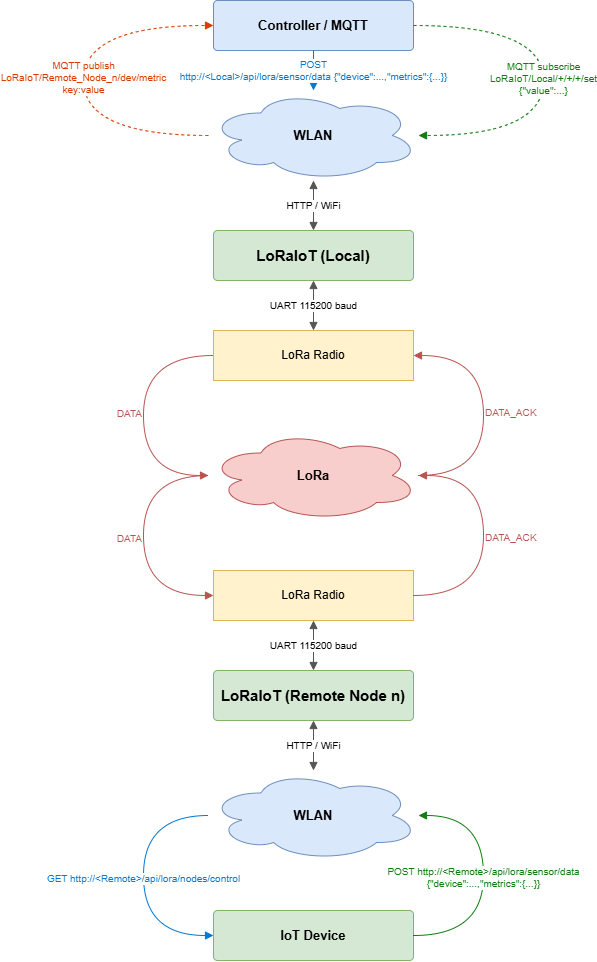

# LoRaIoT IoT Protocol - Worked Examples

This document shows two end-to-end worked examples derived directly from the running firmware
code. Each example gives the curl command that an IoT device or home-automation script sends,
the expected HTTP response from the handler, and the exact MQTT topics that LOCAL publishes or
subscribes to. Topic names are produced by `mqttSanitizeTopicLevel` in `MqttService.cpp`, which
passes `A-Z a-z 0-9 _ -` unchanged and replaces every other character (space, `%`, `/`, etc.)
with `_`. All values travel as scaled integers; the real value is `value / scale`.



## Node Address Placeholders

The commands below use placeholders instead of hard-coded IP addresses because every
installation is different:

<details>
<summary>Address placeholder reference (click to expand)</summary>

| Placeholder | What to substitute |
|---|---|
| `<Local>` | Hostname or IP address of the LOCAL node (e.g. `192.168.1.147` or `loraiot-local.local`). |
| `<Remote-Node-x>` | Hostname or IP address of the target REMOTE node (x = 1, 2, or 3). Each REMOTE has its own address; look it up with `GET /api/lora/nodes` on LOCAL or `GET /api/lora/address` on the REMOTE node itself. In AP / AP_STA mode the SoftAP address is `192.168.4.1` by default. |
| `<broker>` | Hostname or IP address of the MQTT broker (e.g. `192.168.1.117` or `mqtt.local`). |

</details>

---

## Request Body Schema and Field Limits {#schema}

Both `POST /api/lora/sensor/data` (REMOTE) and `POST /api/lora/nodes/control` (LOCAL) share
the same JSON body shape. The annotated schema below shows every field, its JSON type, and the
hard limits enforced by `DeviceTable.h`. These limits also apply to the MQTT `/set` payload
(which carries one metric object) and to the topic levels derived from `device` and metric key
names.

```
{
  "device":  <string, max 12 chars>,    // device name; also the MQTT topic level
                                        // max 4 distinct devices per REMOTE node (node-wide hard cap)
  "metrics": {
    "<metric-key>": {                   // metric name, max 12 chars; also the MQTT topic level
                                        // max 8 metrics per device (node-wide hard cap)
      "value":  <integer|string|bool>,  // see value types below
      "unit":   <string, max 5 chars>,  // optional, default ""; stored as metadata only
      "scale":  <integer >= 1>          // optional, default 1; 0 treated as 1
    }
  }
}
```

> **Hard caps (node-wide, not per-request):** a REMOTE node holds at most **4 devices** and
> each device holds at most **8 metrics**. These slots are allocated on first use and never
> freed until the node reboots. A POST that would exceed either cap is rejected with HTTP 400
> and the metric appears in the `rejected` array of the response.

### Field Reference

| Field | JSON type | Max length / range | Default | Notes |
|---|---|---|---|---|
| `device` | string | 12 chars | - | Required. Name stored in registry and used as MQTT topic level (sanitized). |
| metric key (object key inside `"metrics"`) | string | 12 chars | - | Required. Name stored in registry and used as MQTT topic level (sanitized). |
| `value` (numeric) | integer or float | int32 range (-2 147 483 648 to 2 147 483 647) | - | Stored as `int32`; floats are truncated. Pass the pre-scaled integer, e.g. `215` for 21.5 with scale 10. |
| `value` (text) | string | 12 bytes UTF-8 | - | Stored verbatim. Strings over 12 bytes are rejected (HTTP 400). Use for state labels such as `"on"`, `"off"`, `"auto"`. |
| `value` (boolean) | `true` / `false` | - | - | Stored as the text strings `"true"` / `"false"`. |
| `unit` | string | 5 chars | `""` | Optional. Stored as metadata; used in MQTT payload only for `/set` round-trips. Never appears in the MQTT topic path. |
| `scale` | integer | >= 1; 0 treated as 1 | `1` | Optional. Divisor: real value = `value / scale`. MQTT payload is the formatted decimal, e.g. `"21.5"`. |

### Sanitization Rule for Topic Levels

`device` and metric key names are stored as-is in the registry. When building an MQTT topic
level the firmware replaces every character outside `[A-Z a-z 0-9 _ -]` with `_`. The `/set`
parser matches incoming topic levels back to registry names via their sanitized form, so
`Power_Supply` in a topic matches a registered device `"Power Supply"`.

<details>
<summary>Full capacity limits with source constant names (click to expand)</summary>

| Resource | Limit | Source constant in `DeviceTable.h` |
|---|---|---|
| Devices per REMOTE node | 4 | `DEVICE_TABLE_MAX_DEVICES` |
| Metrics per device | 8 | `DEVICE_TABLE_MAX_METRICS` |
| Device / metric name length | 12 chars | `DEVICE_TABLE_NAME_LEN - 1` |
| Unit string length | 5 chars | `DEVICE_TABLE_UNIT_LEN - 1` |
| Text value length | 12 bytes UTF-8 | `DEVICE_TABLE_TEXT_MAX_LEN` |

These limits apply equally to sensor data (REMOTE) and control setpoints (LOCAL).

</details>

---

## Example 1 - Environmental Sensor (REMOTE, sensor data POST)

### Scenario

An IoT sensor board running a small HTTP client joins the REMOTE node SoftAP and POSTs
temperature and humidity readings. LOCAL receives the DATA_ACK frame over LoRa and forwards
each metric to the MQTT broker as a separate retained topic.

**Assumptions:**
- REMOTE node address: `<Remote-Node-1>` (substitute the actual hostname or IP).
- REMOTE LoRa address: `0x02` (assumption - `Remote_Node_1`; confirm with
  `GET /api/lora/address` on the node). `n = addr - 1 = 1`, so the MQTT node level is
  `Remote_Node_1`. Adjust `Remote_Node_<n>` in the topics below if the address differs.
- MQTT broker: `<broker>`, user and password as configured.
- MQTT prefix: `LoRaIoT` (default).
- `mqttRetain`: `1` (default) - all telemetry topics are published with `retain = true`.

### curl Command

**Bash / sh:**

```bash
curl -s -X POST http://<Remote-Node-1>/api/lora/sensor/data \
  -H "Content-Type: application/json" \
  -d '{"device":"Env-Sensor",
       "metrics":{"Temperature":{"value":215,"unit":"C","scale":10},
                  "Humidity":   {"value":483,"unit":"%","scale":10}}}'
```

**PowerShell note:** PowerShell's `curl` is an alias for `Invoke-WebRequest`. Use `curl.exe`
explicitly and escape the inner double quotes with a backslash, or wrap the JSON body in a
here-string. Recommended approach:

```powershell
$body = '{"device":"Env-Sensor","metrics":{"Temperature":{"value":215,"unit":"C","scale":10},"Humidity":{"value":483,"unit":"%","scale":10}}}'
curl.exe -s -X POST http://<Remote-Node-1>/api/lora/sensor/data `
  -H "Content-Type: application/json" `
  -d $body
```

### Request Body Explained

The `value` field is the **scaled integer** - the physical reading multiplied by `scale`:
- Temperature 21.5 C: `21.5 * 10 = 215` (integer).
- Humidity 48.3 %: `48.3 * 10 = 483` (integer).

The `unit` field (`"C"`, `"%"`) is stored as metadata and forwarded verbatim. It does not
appear in the MQTT topic name; only the metric name (`"Temperature"`, `"Humidity"`) is used
to build the topic level.

### Expected HTTP Response

**`200 OK`** (all metrics accepted):

```json
{"accepted":[{"metric":"Temperature","device_idx":1,"metric_id":1},{"metric":"Humidity","device_idx":1,"metric_id":2}],"rejected":[],"registry_rev":1}
```

`registry_rev` increments only on schema changes (new device or new metric name). A repeat
POST with the same device/metric names returns the same `registry_rev` value and updates only
the stored value. See `doc/RestApi.md` for the full status code table.

### MQTT Topics Published by LOCAL

LOCAL publishes each metric as a separate retained scalar topic. The payload is the real value
formatted by `mqttFormatScaledDecimal`: `215 / 10 = 21.5`, `483 / 10 = 48.3`.

| Topic | Payload | Retained | Direction | Notes |
|---|---|---|---|---|
| `LoRaIoT/Remote_Node_1/status` | `online` | Yes | LOCAL -> broker | Published when REMOTE is first seen or returns from offline |
| `LoRaIoT/Remote_Node_1/Env-Sensor/Temperature` | `21.5` | Yes (`mqttRetain=1`) | LOCAL -> broker | scale 10: one decimal place |
| `LoRaIoT/Remote_Node_1/Env-Sensor/Humidity` | `48.3` | Yes (`mqttRetain=1`) | LOCAL -> broker | scale 10: one decimal place |

All telemetry is published with `qos = 0` and `retain = true` (when `mqttRetain = 1`). All
names in this example (`Env-Sensor`, `Temperature`, `Humidity`) pass the sanitizer unchanged -
they contain only allowed characters. Note: the `%` unit is metadata only and never appears in
a topic level, so it is not sanitized.

### Subscribe and See the Topics

```bash
mosquitto_sub -h <broker> -u <user> -P <password> \
  -t 'LoRaIoT/Remote_Node_1/#' -v
```

Expected output lines (order depends on which messages arrive first):

```
LoRaIoT/Remote_Node_1/status online
LoRaIoT/Remote_Node_1/Env-Sensor/Temperature 21.5
LoRaIoT/Remote_Node_1/Env-Sensor/Humidity 48.3
```

Because retain is enabled, re-running `mosquitto_sub` after the node has sent data will
immediately replay the last retained value for each topic.

### Notes

- `POST /api/lora/sensor/data` is a **REMOTE-only** endpoint. Sending it to the LOCAL node
  returns `404`.
- After the first POST with a new device or metric name, REMOTE increments `registry_rev` and
  pings LOCAL. LOCAL starts a Describe crawl to fetch the device/metric definitions (name,
  unit, scale) before the DATA_ACK arrives. Until the crawl completes, the MQTT topic levels
  fall back to `dev<idx>` / `m<id>`. After the crawl completes, topics switch to the real names.
- Numeric values are truncated to `int32` by `valVar.as<int32_t>()` in `controlApplyMetric`.
  Do not pass floating-point JSON values expecting implicit scaling - pass the pre-scaled integer.
- The node address `0x02` / `Remote_Node_1` is stated as an assumption above. If the node is
  provisioned at a different address, adjust the `Remote_Node_<n>` level in all topics accordingly.

---

## Example 2 - Power Supply Control (LOCAL, control setpoint POST)

### Scenario

A home-automation script or Node-RED flow sets the output voltage, current limit, and power
state of a DC power supply connected to a REMOTE node. The device is named `"Power-Supply"`.
LOCAL stores the setpoints in `ControlRegistry` and pushes them over LoRa to the REMOTE node
as a DATA_ACK frame. An MQTT client can also push the same setpoints via the `/set` topic
without calling the REST API.

**Assumptions:**
- LOCAL node address: `<Local>` (substitute the actual hostname or IP).
- Target REMOTE node LoRa address: `0x02` (assumption - `Remote_Node_1`). `addr=2` in the query.
  Use `addr=3` (and `Remote_Node_2` in topics) if the REMOTE is at address `0x03`, etc.
- MQTT broker: `<broker>`, user and password as configured.
- MQTT prefix: `LoRaIoT` (default).

### curl Command - REST POST

**Bash / sh:**

```bash
curl -s -X POST "http://<Local>/api/lora/nodes/control?addr=2" \
  -H "Content-Type: application/json" \
  -d '{"device":"Power-Supply",
       "metrics":{"Voltage":{"value":1200,"unit":"V","scale":100},
                  "Current":{"value":50,  "unit":"A","scale":10},
                  "Pwr":    {"value":"off"}}}'
```

**PowerShell note:**

```powershell
$body = '{"device":"Power-Supply","metrics":{"Voltage":{"value":1200,"unit":"V","scale":100},"Current":{"value":50,"unit":"A","scale":10},"Pwr":{"value":"off"}}}'
curl.exe -s -X POST "http://<Local>/api/lora/nodes/control?addr=2" `
  -H "Content-Type: application/json" `
  -d $body
```

### Request Body Explained

- `Voltage`: output voltage 12.00 V - stored as `1200` (scale 100), published as `12.00`.
- `Current`: current limit 5.0 A - stored as `50` (scale 10), published as `5.0`.
- `Pwr`: power state - JSON string `"off"`. Text metric. No `unit` or `scale` needed (ignored
  for strings). To turn on, send `"value":"on"`.

**Note on the `Pwr` text metric:** there is no enum type and no compile-time list of allowed
values (see [value types in the field reference](#schema)). The firmware stores whatever string
the caller sends up to 12 bytes. `"on"`, `"off"`, `"standby"`, etc. are all valid. A JSON
boolean `true` would be stored as the text `"true"`, not `"on"`. All names in this example
(`Power-Supply`, `Voltage`, `Current`, `Pwr`) pass the sanitizer unchanged.

### Expected HTTP Response

**`200 OK`** (all metrics accepted and REMOTE acknowledged):

```json
{"accepted":[{"metric":"Voltage","device_idx":1,"metric_id":1},{"metric":"Current","device_idx":1,"metric_id":2},{"metric":"Pwr","device_idx":1,"metric_id":3}],"rejected":[],"registry_rev":1,"delivery":"ok"}
```

`delivery` can also be `"after_describe"` (`202`) on the first call if REMOTE has not yet
fetched the schema, `"timeout"` (`504`) if REMOTE does not respond, or `"busy"` (`503`) if the
LoRa broker is occupied. See `doc/RestApi.md` for the full status code table.

### MQTT Control (the `/set` Topic)

LOCAL subscribes to a single wildcard filter right after connecting to the broker:

```
LoRaIoT/Local/+/+/+/set
```

An external client publishes **one message per metric** (non-retained) to the corresponding
`/set` topic. LOCAL receives the message in its `mqttTask`, parses the JSON payload with
`controlApplyMetric`, updates `ControlRegistry`, and hands the device off to `PushTask` which
sends it to REMOTE over LoRa.

#### /set Topic Pattern

```
<prefix>/Local/<node>/<device>/<metric>/set
```

For the Power Supply device on REMOTE (Node 1, address `0x02`):

| Topic | Example Payload | Direction | Notes |
|---|---|---|---|
| `LoRaIoT/Local/Remote_Node_1/Power-Supply/Voltage/set` | `{"value":1200,"unit":"V","scale":100}` | client -> LOCAL broker | numeric: scaled integer |
| `LoRaIoT/Local/Remote_Node_1/Power-Supply/Current/set` | `{"value":50,"unit":"A","scale":10}` | client -> LOCAL broker | numeric: scaled integer |
| `LoRaIoT/Local/Remote_Node_1/Power-Supply/Pwr/set` | `{"value":"on"}` | client -> LOCAL broker | text: no unit/scale needed |

`unit` and `scale` are optional in the payload (defaults: `""` and `1`). Numeric payloads must
include them if the REMOTE device does not yet have the metric registered, otherwise the value
is stored with scale 1 and published unscaled.

#### mosquitto_pub Examples

Set voltage to 12.00 V (non-retained):

```bash
mosquitto_pub -h <broker> -u <user> -P <password> \
  -t 'LoRaIoT/Local/Remote_Node_1/Power-Supply/Voltage/set' \
  -m '{"value":1200,"unit":"V","scale":100}'
```

Set current limit to 5.0 A (non-retained):

```bash
mosquitto_pub -h <broker> -u <user> -P <password> \
  -t 'LoRaIoT/Local/Remote_Node_1/Power-Supply/Current/set' \
  -m '{"value":50,"unit":"A","scale":10}'
```

Turn power on (text metric, non-retained):

```bash
mosquitto_pub -h <broker> -u <user> -P <password> \
  -t 'LoRaIoT/Local/Remote_Node_1/Power-Supply/Pwr/set' \
  -m '{"value":"on"}'
```

Turn power off:

```bash
mosquitto_pub -h <broker> -u <user> -P <password> \
  -t 'LoRaIoT/Local/Remote_Node_1/Power-Supply/Pwr/set' \
  -m '{"value":"off"}'
```

**Do not set the retain flag** (`-r`) on `/set` messages. The firmware discards any `/set`
message that arrives within `MQTT_SET_RETAINED_DRAIN_MS` (1 s) of a SUBSCRIBE, which is when
the broker replays retained messages. A retained `/set` would therefore be silently dropped on
every reconnect.

#### What LOCAL Subscribes To

LOCAL subscribes to exactly one filter per broker session:

```
LoRaIoT/Local/+/+/+/set
```

This filter has five levels after the prefix (`Local`, node, device, metric, `set`). It matches
only command topics and never matches telemetry topics (`LoRaIoT/Remote_Node_<n>/...`) or
the availability topic (`LoRaIoT/Local/status`).

#### REMOTE-Side Result

LOCAL pushes the whole device (all metrics in `ControlRegistry` for that device) to REMOTE as
a DATA_ACK frame. REMOTE stores the values in its `ControlRegistry` cache. The IoT device on
REMOTE reads them with `GET /api/lora/nodes/control`. **Nothing is echoed back** on the `/set`
topic or on any state topic. When REMOTE's IoT device applies the setpoint and reports back via
`POST /api/lora/sensor/data`, LOCAL publishes the measured value on the normal telemetry topic
(`LoRaIoT/Remote_Node_1/...`), not on `/set`.

### Notes

- `POST /api/lora/nodes/control` is a **LOCAL-only** endpoint. Sending it to a REMOTE node
  returns `404`.
- The `addr` query parameter is mandatory. Omitting it returns `400`.
- The device name `"Power-Supply"` is stored in `ControlRegistry` as `"Power-Supply"`. The
  hyphen is already valid in MQTT topic levels, so the sanitized topic level is identical to
  the stored name: `Power-Supply`. The `/set` parser resolves topic names back to registry
  names by comparing their sanitized forms, which match exactly here.
- Each `mosquitto_pub` call triggers one independent LoRa push for the whole device. If the
  PushTask queue (8 entries) is full, the push is dropped without retry; the next `/set`
  or REMOTE BEACON triggers a re-synchronisation.

---

## Further Reading

- [`doc/RestApi.md`](RestApi.md) - full endpoint reference, status codes, request and response schemas.
- [`doc/MqttFeasibility.md`](MqttFeasibility.md) - full MQTT architecture, topic scheme, payload format,
  threading model, and UC1/UC2 implementation detail.
- [`doc/LoRaProtocol.md`](LoRaProtocol.md) - binary frame format, DATA_ACK, Describe crawl, and address
  scheme used by all examples above.
