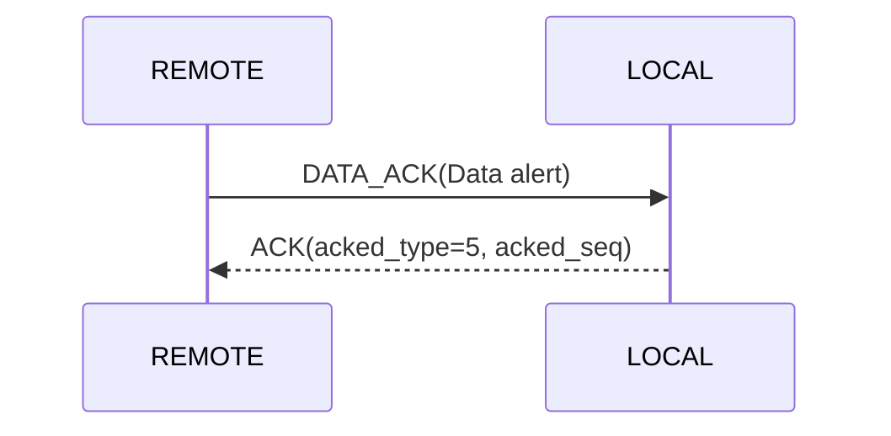
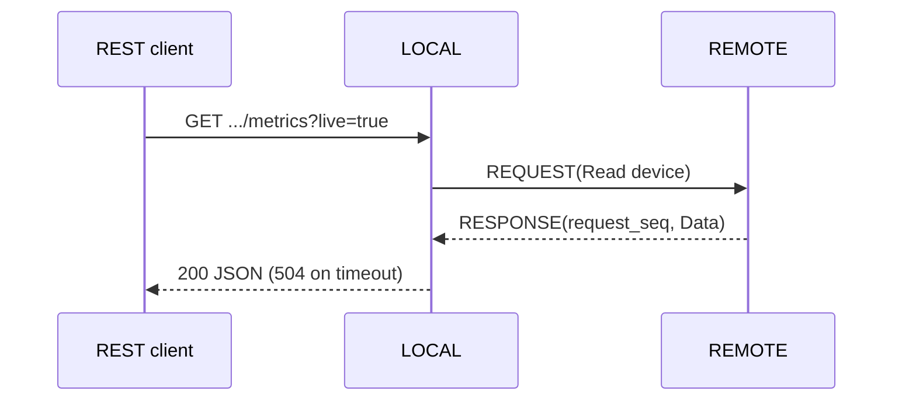
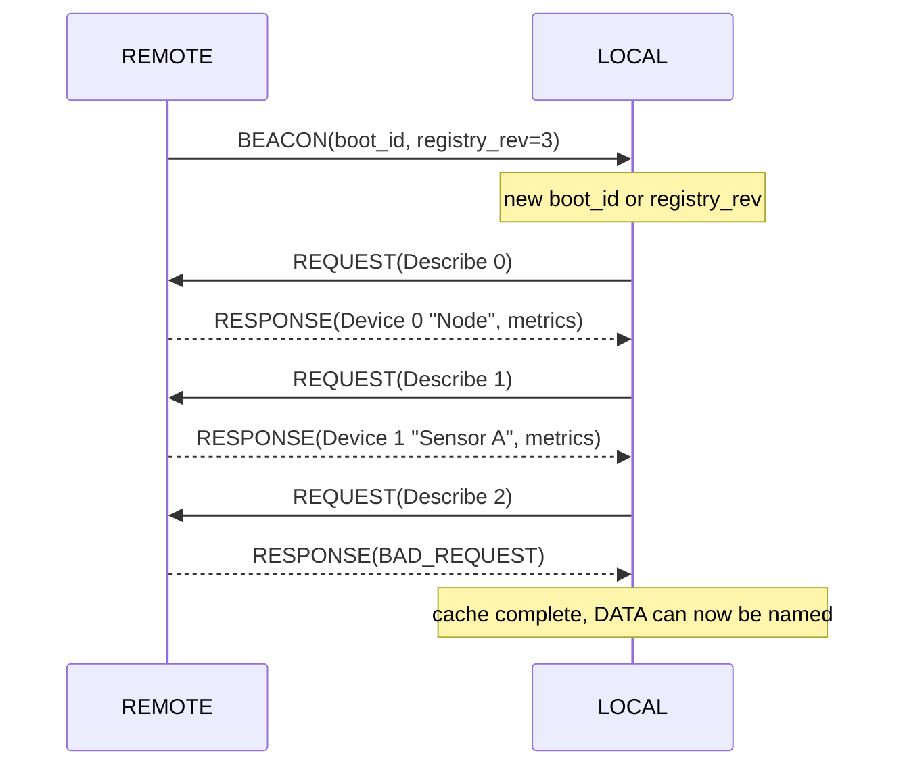
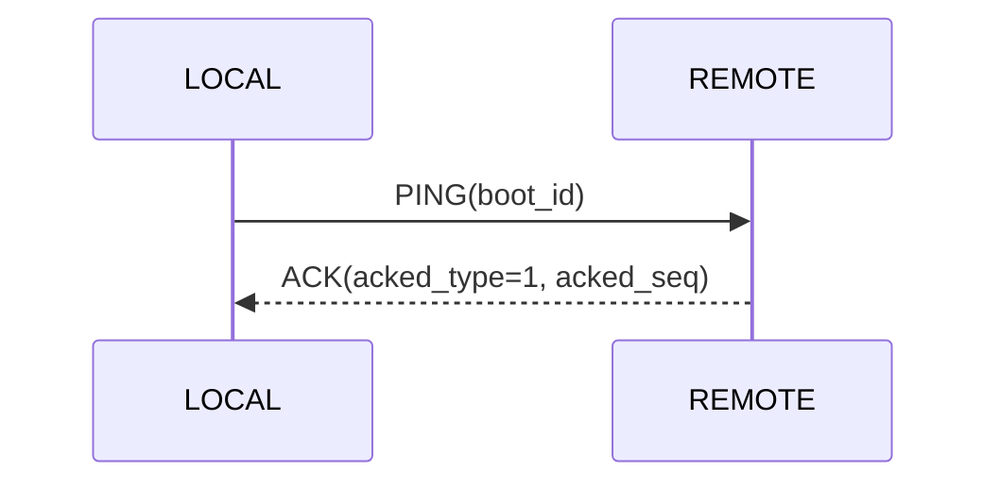

# LoRaIoT LoRa Protocol Specification

**Version:** 1 (draft, produced by Milestone 1)
**Status:** Normative for Milestones 3 to 7. Supersedes the frame header and type table of
`Feasibility.md` §6.

Facts about the radio module are taken from `E220-400T22D_UserManual_EN_v1.2.pdf`, which
wins over any other document in this repository. Items the manual does not specify are
listed in §18 and must be verified on hardware in Milestone 5.

---

## 1. Principles

- Topology: star. All traffic is between LOCAL and one REMOTE. REMOTE-to-REMOTE traffic is not supported.
- Every frame carries SRC and DST in its header. The E220 never delivers the sender address to the MCU.
- The header is fixed binary (parseable without nanopb). The message content is protobuf (nanopb).
- Internally (REST on LOCAL and REMOTE) the data is JSON. Over LoRa it is protobuf.
- One message is exactly one frame. There is no fragmentation and no multi-frame message.
- Half-duplex, one shared channel, LBT off. Collisions are handled by ACK + random backoff + retry.
- Every transmission follows the AUX rule: AUX HIGH, write the frame in one `write()`,
  wait AUX LOW, wait AUX HIGH, then `LORA_RF_GUARD_DELAY_MS` (50 ms).
- Only the `loraTask` touches Serial2. REST/WebSocket handlers post requests to it and wait.

---

## 2. Radio configuration (normative)

| Register | Value | Meaning |
|---|---|---|
| ADDH / ADDL | `0x00` / node address | Module address `0x00NN`. Never `0x0000` or `0xFFFF` (see §3) |
| REG0 | `0xE7` | Bits 7-5 = `111` 115200 baud, bits 4-3 = `00` 8N1, bits 2-0 = `111` 62.5 kbps |
| REG1 | `0x00` | 200 B sub-packet, RSSI ambient noise off, 22 dBm |
| REG2 | channel (default `0x17`) | 410.125 MHz + CH x 1 MHz, CH 0-83 |
| REG3 | `0x40` | Bit 7 RSSI byte OFF, bit 6 fixed transmission, bit 4 LBT OFF, WOR 500 ms |
| CRYPT_H / CRYPT_L | shared 16-bit key | See §16. `0x0000` = off |

- Transmit: the MCU writes `[ADDH][ADDL][CH]` followed by the frame (fixed transmission, manual §7.2 REG3 bit 6).
- Unicast target: `ADDH=0x00`, `ADDL=DST`. Broadcast target: `ADDH=0xFF`, `ADDL=0xFF`.
- Register writes use Mode 3 (M1=1, M0=1) at 9600 8N1, regardless of REG0.
- Response `FF FF FF` means a malformed command.

---

## 3. Addressing

| Address | Meaning |
|---|---|
| `0x00` | Invalid / unprovisioned |
| `0x01` | LOCAL (fixed) |
| `0x02` - `0xFE` | REMOTE (provisioned) |
| `0xFF` | Broadcast |

Manual §5.3 and §5.4: module address `0xFFFF` is the broadcast address (a frame sent to it is
received by all modules on the channel); module address `0x0000` or `0xFFFF` makes a
receiving module monitor the channel without address filtering. Neither is a valid own
address here. LOCAL and the REMOTEs also filter by DST in software.

Broadcast is allowed only for PING. Replies to a broadcast PING are unicast.

---

## 4. Frame format

```
+------+-----+------+-----+-----+--------+-----+---------+--------+
| SYNC | VER | TYPE | SRC | DST |  SEQ   | LEN | PAYLOAD | CRC16  |
| 2 B  | 1 B | 1 B  | 1 B | 1 B |  2 B   | 1 B | 0-186 B |  2 B   |
+------+-----+------+-----+-----+--------+-----+---------+--------+
```

| Field | Size | Notes |
|---|---|---|
| SYNC | 2 | `0xAA 0x55` |
| VER | 1 | Protocol version, `0x01` |
| TYPE | 1 | See §5 |
| SRC | 1 | Sender address |
| DST | 1 | Receiver address |
| SEQ | 2 | Big-endian |
| LEN | 1 | Payload length 0 to 186 |
| PAYLOAD | LEN | Protobuf message |
| CRC16 | 2 | Big-endian |

The fixed overhead is 11 B. The E220 sub-packet is 200 B (REG1). With the 3 routing bytes
the UART write is at most 3 + 11 + 186 = 200 B, so the maximum payload is 186 B. The manual
does not state whether the routing bytes count toward the sub-packet, so the conservative
reading is used (verify in M5). A frame must fit one sub-packet, otherwise the receiving
module outputs it in pieces.

### 4.1 CRC

CRC-16/CCITT-FALSE: polynomial `0x1021`, init `0xFFFF`, no input reflection, no output
reflection, xorout `0x0000`.

- Scope: VER, TYPE, SRC, DST, SEQ, LEN, PAYLOAD (not SYNC, not the CRC itself).
- Check value: CRC of the ASCII string `123456789` is `0x29B1` (use as a unit test).
- Reference bitwise implementation:

```cpp
uint16_t crc = 0xFFFF;
for (size_t i = 0; i < len; i++) {
  crc ^= (uint16_t)data[i] << 8;
  for (int b = 0; b < 8; b++)
    crc = (crc & 0x8000) ? (uint16_t)((crc << 1) ^ 0x1021) : (uint16_t)(crc << 1);
}
```

### 4.2 Worked example

PING from LOCAL (`0x01`) to REMOTE (`0x02`), SEQ 1, payload `Beacon{boot_id = 0x12345678}` (the optional fields are absent in a PING):

| Part | Bytes |
|---|---|
| E220 routing header (ADDH, ADDL, CH 0x17) | `00 02 17` |
| SYNC | `AA 55` |
| VER, TYPE (PING = `01`), SRC, DST | `01 01 01 02` |
| SEQ | `00 01` |
| LEN | `06` |
| PAYLOAD (field 1 varint) | `08 F8 AC D1 91 01` |
| CRC16 | `72 0D` |

Full UART write: `00 02 17 AA 55 01 01 01 02 00 01 06 08 F8 AC D1 91 01 72 0D`.
(The CRC value was computed with the reference implementation above.)

### 4.3 Receiver rules

Drop silently (log at DEBUG, count in the error counter) on: bad CRC, unknown VER, unknown
TYPE, DST that is neither the own address nor `0xFF`. If the SYNC bytes are missing the
parser resynchronises on the next `0xAA 0x55`. A receiver never answers a bad frame with an
error frame (this avoids storms).

---

## 5. Message types

| Code | Name | Reply | Purpose |
|---|---|---|---|
| `0x01` | PING | ACK | Liveness check, unicast or broadcast. Payload is a `Beacon` with only `boot_id` |
| `0x02` | BEACON | none | "I'm here", REMOTE to LOCAL. Payload is a `Beacon` with all fields |
| `0x03` | ACK | none | Confirms one DATA_ACK or one PING |
| `0x04` | DATA | none | Data, fire and forget |
| `0x05` | DATA_ACK | ACK | Data that must be confirmed |
| `0x06` | REQUEST | RESPONSE | Command or query (e.g. "read sensor A") |
| `0x07` | RESPONSE | none | Answer to a REQUEST, also its implicit acknowledgement |

- Either side may send DATA, DATA_ACK and REQUEST. A REMOTE may send them unsolicited
  (for example a load alert).
- A REQUEST is answered by its RESPONSE, which carries `request_seq`. There is no separate ACK.
- The ACK payload names the acknowledged TYPE and SEQ. The acknowledged message's sender is
  the ACK's DST, so it is not repeated in the payload.
- Codes `0x08` - `0x7F` are reserved, `0x80` - `0xFF` are free for experiments.

---

## 6. Sequence numbers

- Each node has one counter, incremented for every new frame and wrapping 65535 to 0.
- Retransmissions reuse the SEQ.
- A frame is a duplicate if SEQ and TYPE equal those of the previous frame from the same SRC.
  - A duplicate DATA_ACK is ACKed again but not processed again.
  - A duplicate REQUEST is answered with the cached RESPONSE again (the sensor is not read twice).
- Loss statistic: `gap = (uint16_t)(seq - lastSeq - 1)`. If `gap < 32768`, `gap` frames were lost.
  Otherwise count nothing (reboot or reordering).
- The counter starts at a random value after each boot.

### 6.1 Reboot detection (boot_id)

Every node creates a random 32-bit `boot_id` at boot. It is carried in BEACON and PING and
repeated in every one of them.

The receiver stores the last `boot_id` per SRC. When it changes or is first seen, the receiver
resets all state it holds for that SRC: last SEQ, duplicate detection and the cached RESPONSE.
No acknowledgement is required, because the next BEACON or PING repeats the value.

- REMOTE to LOCAL: the BEACON carries `boot_id`. A booting REMOTE is in UNDISCOVERED state and beacons every 5 s.
- LOCAL to REMOTE: PING carries `boot_id`. LOCAL sends a broadcast PING at boot and repeats it in every keep-alive PING.
- On a BEACON with a new or unknown `boot_id`, LOCAL replies with a PING.
- A REQUEST that was in flight during a reboot is not answered; the requester times out (§7).

---

## 7. Reliability and timing

Named constants (values to confirm in M5):

| Message | Attempt timeout | Attempts |
|---|---|---|
| DATA_ACK | `LORA_ACK_TIMEOUT_MS` = 200 ms | 4 (1 + 3 retries) |
| PING | `LORA_ACK_TIMEOUT_MS` = 200 ms | 2 (1 + 1 retry) |
| REQUEST | `LORA_REQUEST_TIMEOUT_MS` = 1000 ms | 2 (1 + 1 retry) |
| Broadcast PING | `LORA_ACK_TIMEOUT_MS` | 1 (no retry) |

- The timeout starts when the transmission, including the AUX guard, has completed.
- Before each retry wait a random time between `LORA_BACKOFF_MIN_MS` (20 ms) and `LORA_BACKOFF_MAX_MS` (200 ms).
- After the last attempt: log an error, mark the link degraded and report a timeout. The node
  does not enter the FAULT state.
- Each REMOTE delays its ACK to a broadcast PING by a random 0 to `LORA_BCAST_REPLY_WINDOW_MS` (1000 ms).
  Lost replies are tolerated; LOCAL may repeat the PING.
- The REQUEST timeout covers REMOTE processing plus the RESPONSE airtime (up to 200 B).

---

## 8. Beacon and discovery

REMOTE state machine:

```
UNDISCOVERED  ->  BEACON every 5 s (+ random jitter 0 to 1 s)
    first frame from LOCAL addressed to this REMOTE
DISCOVERED    ->  BEACON every 60 s
    no frame from LOCAL for 2 min
UNDISCOVERED  ->  (self-healing, no coordination needed)
```

LOCAL:
- Registry entry per REMOTE: address, last-seen timestamp, boot_id, online flag.
- Any frame from a REMOTE updates its last-seen.
- On a BEACON from an unknown REMOTE or with a changed `boot_id`, LOCAL replies with a PING.
- LOCAL sends a keep-alive PING to every REMOTE idle for 60 s.
- An entry is purged after 180 s without any frame (3 missed slow beacons). The REMOTE
  re-enters through its fast beacon.

---

## 9. Medium access

There is no scheduler. Either side may transmit at any time (LBT off), and collisions are
resolved by §7. A node that waits for an ACK or RESPONSE sends no new frames except replies.
LOCAL may poll cyclically by sending REQUEST(Read). The interval is configurable (M6).

---

## 10. Payloads (protobuf, nanopb)

The same schema is stored in `src/lora/proto/loraiot.proto`. It is a technical design artifact (not compiled, not used
by the firmware yet). Keep the two copies identical; this section is the source of truth.

```proto
syntax = "proto3";
package loraiot;

// ======================================================================
// Common
// ======================================================================

// Result code. Used in ACK and RESPONSE. OK is 0, so it is omitted on the wire.
enum Status {
  STATUS_OK          = 0;  // Everything worked
  STATUS_BAD_REQUEST = 1;  // Something failed, see the log of the answering node.
                           // Also ends the Describe crawl (no such device)
}

// ======================================================================
// Definitions: sent rarely, cached by LOCAL
// ======================================================================

// Describes ONE kind of value that a device reports.
message Metric {
  uint32 id    = 1;  // Short number used in Measurement.metric_id. Unique within one
                     // device, starts at 1. Sensor A and Sensor B may both have an id 1.
  string name  = 2;  // Human-readable key shown in REST/JSON, e.g. "Voltage" (max 12 chars).
                     // Case-sensitive, used verbatim
  string unit  = 3;  // Unit shown next to the value, e.g. "V". May be empty (max 5 chars)
  uint32 scale = 4;  // Divisor that turns the integer back into the real value:
                     // real = value / scale. Example: scale 100, value 335 -> 3.35.
                     // 0 (not set) is treated as 1, so plain integers need no scale
}

// Describes ONE device and all the metrics it can report.
message Device {
  uint32 device = 1;            // Device index. 0 = the REMOTE node itself,
                                // 1.. = a device attached through the SoftAP
  string name = 2;              // Device name, e.g. "Sensor A" (max 12 chars)
  repeated Metric metrics = 3;  // The metrics this device reports (max 8)
}

// ======================================================================
// Measurements: sent often, as small as possible
// ======================================================================

// One measured value. Its meaning (name, unit, scale) comes from the Metric
// with the same id, found through Data.device.
message Measurement {
  uint32 metric_id = 1;  // Which Metric this is, e.g. 1 = "Voltage" of that device
  sint32 value = 2;      // The scaled integer. sint32 keeps negative numbers short
                         // (a plain int32 would need 10 bytes for -5)
}

// A set of measurements from ONE device. Payload of DATA and DATA_ACK, and the
// result inside the RESPONSE to a Read.
message Data {
  uint32 device = 1;                // Which device the values belong to (0 = the node itself)
  repeated Measurement values = 2;  // The values, normally a few per frame (max 16)
  uint32 age_ms = 3;                // Milliseconds since the values were measured.
                                    // 0 = just now. A SoftAP device pushes its data,
                                    // so a live read of it reports the age of its last post
  bool alert = 4;                   // true = unsolicited event (e.g. a threshold was passed),
                                    // false = normal reading
}

// ======================================================================
// Control messages
// ======================================================================

// Confirms that one frame was received. Payload of the ACK type.
// The ACK's DST is the original sender, so the sender is not repeated here.
message Ack {
  uint32 acked_type = 1;  // TYPE byte of the frame being confirmed.
                          // 5 = a DATA_ACK, 1 = a PING (the only two types that need an ACK)
  uint32 acked_seq  = 2;  // SEQ of that frame. Together with acked_type this tells the
                          // sender exactly which of its pending frames arrived
  Status status = 3;      // OK = accepted. BAD_REQUEST = received, but not accepted
}

// Payload of BOTH the PING type (answered by an ACK) and the BEACON type (no reply).
// A PING sends only boot_id. A BEACON sends all four fields.
message Beacon {
  uint32 boot_id = 1;                // Random number chosen by the sender at boot. If it
                                     // differs from the last one seen from that sender, the
                                     // sender has rebooted and the receiver discards what it
                                     // knew about it
  optional uint32 fw_version = 2;    // Firmware version of the REMOTE (diagnostics).
                                     // Absent in a PING
  optional uint32 uptime_s = 3;      // Seconds since the REMOTE booted. Absent in a PING
  optional uint32 registry_rev = 4;  // Counter that increases whenever a Device or a Metric is
                                     // added or changed. If LOCAL sees a new value it re-reads
                                     // the definitions with Describe. The definitions themselves
                                     // are NOT in the beacon. Absent in a PING ("optional" lets
                                     // LOCAL tell "absent" from a real 0)
}

// ======================================================================
// REQUEST / RESPONSE
// ======================================================================

// "Give me the current values of this device", also known as a live read.
// The answer is a Data containing ALL metrics of that device.
message Read {
  uint32 device = 1;  // Device to read (0 = the node itself)
}

// "Tell me what this device is and what it reports." The answer is a Device.
message Describe {
  uint32 device = 1;  // Device index to describe. LOCAL asks 0, 1, 2, ... until it gets
                      // STATUS_BAD_REQUEST, which means there are no more devices
}

// "Send my text back". Used for link testing and for measuring the payload limit.
message Echo {
  string text = 1;  // The REMOTE returns it REVERSED in the RESPONSE (max 175 chars). Reversing
                    // proves the frame was processed and not merely reflected (M3 test)
}

// Payload of the REQUEST type. Exactly one command is set.
message Request {
  oneof command {
    Read read = 1;          // Live read of one device
    Describe describe = 2;  // Fetch a device definition
    Echo echo = 3;          // Link test
  }
}

// Payload of the RESPONSE type. It answers exactly one REQUEST.
message Response {
  uint32 request_seq = 1;  // SEQ of the REQUEST this answers. This is how LOCAL matches
                           // the answer to the REST call that is waiting for it
  Status status = 2;       // OK, or BAD_REQUEST if the request failed
  oneof result {           // At most one, depending on the request. None on error
    Data data = 3;         // Answer to Read
    Device def = 4;        // Answer to Describe
    Echo echo = 5;         // Answer to Echo
  }
}
```

| TYPE | Payload message |
|---|---|
| PING, BEACON | `Beacon` |
| ACK | `Ack` |
| DATA, DATA_ACK | `Data` |
| REQUEST | `Request` |
| RESPONSE | `Response` |

Rules:
- Sender, receiver and version are never in the payload (header only). `boot_id` is the single exception
  because it describes the sender's lifetime, not its identity.
- A BEACON must set all four `Beacon` fields. A PING sets only `boot_id`. The firmware checks this by TYPE,
  not by the schema. nanopb generates `has_fw_version`, `has_uptime_s` and `has_registry_rev` for the
  `optional` fields.
- Unknown fields are ignored (forward compatibility).
- A `Measurement` whose `metric_id` or `Data.device` is not in the LOCAL cache is shown in REST as
  `device_<n>/metric_<id>` and triggers a `Describe` (§12).
- A device that has no value yet answers `Read` with `STATUS_OK` and an empty `values` list.
- The REMOTE rejects a registration (a new device or metric from the SoftAP REST API, answered with HTTP 400)
  if the resulting encoded `Device` plus the `Response` overhead would exceed 186 B. A `Describe` answer
  therefore always fits one frame. The same applies to `Echo.text` (175 chars) and `Data.values` (16 values).
- The nanopb `.options` file (`src/lora/proto/loraiot.options`) bounds all strings and repeated fields
  (`Metric.name` 12, `Metric.unit` 5, `Device.name` 12, `Device.metrics` 8, `Data.values` 16, `Echo.text` 175)
  so no heap is used. Measured encoded sizes against the 186 B payload limit: `Data` with 16 worst-case
  values 171 B (fits); `Response(Echo)` with 175 characters 185 B (fits); `Response(Device)` with 4
  maximum-length metrics 138 B (fits); `Device` with 8 maximum-length metrics 241 B (does NOT fit). At most 5
  maximum-length metrics fit, so the schema bound alone does not guarantee that a `Device` fits and the
  registration check above is mandatory. How to regenerate the C sources and repeat the measurements:
  `doc/NanopbGeneration.md`.
- New message fields use new numbers; existing numbers are never reused.

---

## 11. Naming conventions

There is no metric registry in the protocol. Every REMOTE defines its own metrics (§12), so any sensor
value can be transported without changing the LOCAL firmware, for example `{id=1, name="CPU Frequency",
unit="MHz", scale=1}`.

Suggested but not enforced:
- `name` is a short label in title case: `Voltage`, `Current`, `Power`, `Energy`, `Temperature`, `Humidity`.
  It is case-sensitive, so `Voltage` and `voltage` are two different metrics.
- Use SI base units with a `scale` that keeps the value inside `sint32` (about +/-2.1e9). Example:
  230.4 W is `value=2304, scale=10`. For quantities that would overflow (uptime in ms), choose a coarser unit.
- A boolean is `0` or `1` with `scale = 0` (meaning 1).

---

## 12. Device identity and definitions

The wire format supports both deployments:
- Custom code on the REMOTE itself (for example a Modbus meter on the GPIO pins) reports as `device = 0`.
- An external device that posts to the REMOTE's SoftAP REST API is addressed as `device = 1..N`.

The REMOTE owns the device table and each device's metric table. A new device name in a REST post is
assigned the next free index (indices are contiguous). A new JSON key from a known device is assigned the
next free metric id (starting at 1) with the unit and scale taken from the post.

`Beacon.registry_rev` increments whenever either table changes. LOCAL keeps a cache per REMOTE and
device, and fills it with the `Describe` crawl:

1. LOCAL sees a new `boot_id` or a new `registry_rev` in a BEACON.
2. It sends `REQUEST(Describe{0})`, then `Describe{1}`, `Describe{2}`, and so on.
3. The REMOTE answers each with `RESPONSE(Device)`. It answers `STATUS_BAD_REQUEST` for a device
   that does not exist, which ends the crawl.
4. A lost frame is only a timeout, so LOCAL retries (§7) and does not end the crawl early.

LOCAL drops the whole cache of a REMOTE when its `boot_id` changes. It also runs `Describe` for a
single device when a `Data` frame mentions a device or metric it does not know.

An AP device pushes its data, so a live read of such a device returns the last posted values with
`age_ms` set. Data produced by code on the REMOTE itself can be sampled on demand (`age_ms = 0`).

---

## 13. JSON and protobuf mapping

With the definition `Device{device=1, name="Sensor A", metrics=[{1,"Voltage","V",100}, {2,"Current","A",1000},
{3,"Temperature","degC",10}]}` cached on LOCAL, this JSON:

```json
{"device":"Sensor A","data":{"Voltage":3.35,"Current":0.12,"Temperature":22.5}}
```

corresponds to `Data{device=1, values=[{1,335},{2,120},{3,225}]}` inside a frame with SRC = the REMOTE
and DST = `0x01`. The REST layer computes `value / scale` and takes the key from `Metric.name`.

Address and version are not part of the JSON data object. The REST layer adds the node address
(and `age`) around it when answering a client.

---

## 14. Channel change (not supported)

The protocol has no command to change the radio channel. A channel is changed only through the
configuration of each node (REST or captive portal). A REMOTE configured to a different channel than LOCAL
is unreachable over the air until it is reconfigured locally, for example through its SoftAP REST API.

---

## 15. Exchange diagrams

Reliable data (REMOTE alert):



Live read:



Discovery of the definitions:



Liveness:



---

## 16. Security (v1)

There is no authentication: SRC is not protected and can be spoofed. The only protection is the
E220 communication key (CRYPT_H / CRYPT_L, registers 06H / 07H), which scrambles the radio signal
against similar modules. It is write-only and must be identical on all nodes. `0x0000` disables it.
This is a deterrent, not security. The key is stored in NVS and must not be hardcoded in source.

---

## 17. REST mapping (implemented - Phase 2/3 of RestPlan.md)

The final contract is `src/LoRaIoT/src/openapi_json.h` and `doc/RestApi.md`.

URLs use query parameters (not path parameters) - rationale in `doc/TechDebt.md §2`.
Blocking calls use `LoRaBroker` (`src/LoRaIoT/src/LoRaBroker.h`); frame encoding is a
Phase 2 stub pending the frame protocol layer.

### LOCAL endpoints

| Method | Endpoint | LoRa action |
|---|---|---|
| `GET` | `/api/lora/nodes` | Registry read (no LoRa) |
| `GET` | `/api/lora/nodes/devices?addr=` | Cached device definitions (no LoRa); `?refresh=true` re-runs the Describe crawl (§12) |
| `GET` | `/api/lora/nodes/devices?addr=&device=` | Single device lookup by index or name (no LoRa) |
| `GET` | `/api/lora/nodes/metrics?addr=&device=` | Cached measurements with age (no LoRa) |
| `GET` | `/api/lora/nodes/metrics?addr=&device=&live=true&timeout=ms` | `REQUEST(Read)` -> wait for `RESPONSE(Data)` via LoRaBroker |
| `GET,POST` | `/api/lora/nodes/ping?addr=` | `PING` -> wait for `ACK`; returns RTT and `boot_id` |
| `GET` | `/api/lora/ping` | Broadcast `PING` (dst=0xFF) -> first `ACK` |
| `POST` | `/api/lora/nodes/echo?addr=` | `REQUEST(Echo)` -> wait for `RESPONSE(Echo)`; REMOTE reverses the text |
| `POST` | `/api/lora/nodes/data?addr=&ack=true\|false` | `DATA` or `DATA_ACK` (fire and forget) |
| `POST` | `/api/lora/beacon` | Broadcast `BEACON` (fire and forget) |
| `GET` | `/api/lora/stats` | TX/RX/CRC/ACK counters from `LoRaTransport` (no LoRa) |

### REMOTE endpoint

| Method | Endpoint | Action |
|---|---|---|
| `POST` | `/api/sensor/data` | SoftAP sensor ingestion; updates `SensorRegistry`; increments `registry_rev` on schema change |

### Behaviour notes

- All blocking calls return `503` when the broker is busy (one request already in flight).
- All blocking calls return `504` when no response arrives within the timeout (default 3 s).
- `{device}` accepts the index (integer) or the device name string.
- Handlers never touch Serial2 directly; blocking ones post to LoRaBroker and wait on a semaphore.
- Unsolicited DATA and DATA_ACK frames update the LOCAL cache via `DeviceRegistry.storeData()` and may be pushed over WebSocket (not yet wired).

---

## 18. To verify in Milestone 5

| Item | Why |
|---|---|
| Do the 3 routing bytes count toward the 200 B sub-packet? | Decides whether the payload limit is 186 B or higher |
| Does a module with its own address receive a frame sent to `0xFFFF`? | Broadcast PING is an optimisation only; without it LOCAL relies on beacons |
| `LORA_ACK_TIMEOUT_MS`, backoff window, broadcast reply window | Proposed values |
| `0x0000` as a transmit target | Not documented by the manual; do not use |
