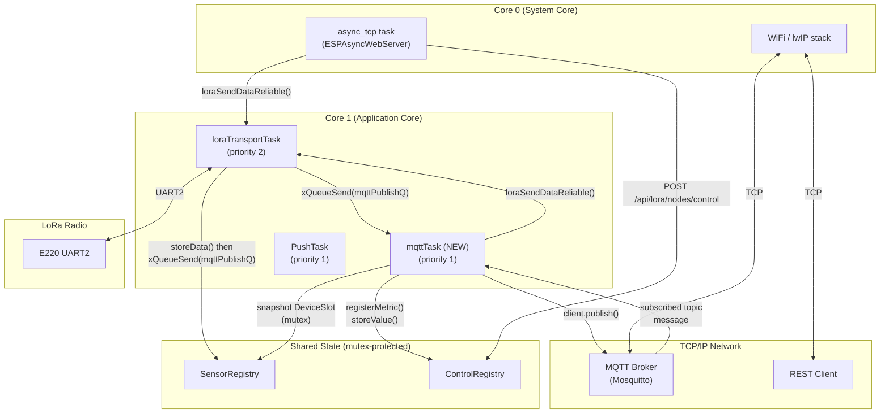

# MQTT Integration Feasibility Analysis

**LoRaIoT - Read-only feasibility study**
**Date:** 2025
**Status:** Analysis only - no source files modified

---

## 1. Use Cases

| # | Name | Description |
|---|------|-------------|
| UC1 | **Sensor Publish** | LOCAL node publishes sensor data received from REMOTE nodes to an MQTT broker (e.g. Mosquitto). Triggered whenever a DATA or DATA_ACK frame is successfully stored in SensorRegistry. |
| UC2 | **Setpoint Subscribe** | LOCAL node subscribes to MQTT topics and translates received messages into LoRa control pushes to the target REMOTE node, reusing the same path as `POST /api/lora/nodes/control`. |

Both use cases live exclusively on the LOCAL node. REMOTE nodes are unaware of MQTT.

---

## 2. Resource Baseline (from live diagnostics)

| Metric | Value | Status |
|--------|-------|--------|
| Free heap | 130 KB | OK |
| Min-ever free heap | 99 KB | OK (budget floor) |
| Heap fragmentation | 38% | WARNING |
| Flash image used | 1,260,160 B | CRITICAL |
| Flash partition size | 1,310,720 B | - |
| Flash headroom | ~49 KB | CRITICAL |
| PSRAM | None | - |
| DRAM total | 294,384 B | - |

The flash situation is the single hardest constraint. Only ~49 KB of app partition space is available before the partition overflows. This governs which MQTT library (if any) can be added without a partition table resize.

---

## 3. Library Comparison

### 3.1 Candidate Libraries

#### Option A - PubSubClient (knolleary/pubsubclient)

| Property | Detail |
|----------|--------|
| Latest stable release | 2.8 (2020) - no commits since; last issue response > 30 days |
| Model | Synchronous / blocking |
| Thread safety | **None.** All calls must come from one task. |
| Keep-alive | Caller must call `client.loop()` periodically (typically from `applicationLoop`) |
| Max message size | Compile-time `MQTT_MAX_PACKET_SIZE` (default 256 B, max ~4 KB with PROGMEM hack) |
| TLS | Via `WiFiClientSecure` wrapper - adds full mbedTLS heap cost |
| Flash footprint (ESP32 Arduino) | ~10-14 KB code |
| Heap at runtime | ~6-8 KB connection state + 256 B receive buffer (default) |
| Maintenance concern | Last tag 2020; no active triage. Technically still functional but abandoned upstream. |

The blocking `client.loop()` poll requirement means a dedicated task or tight integration with `applicationLoop`. Neither is inherently unsafe, but the blocker is the blocking `send()` call: MQTT publish from inside the LoRa receive callback (`loraTransportTask`) would violate the threading model unless guarded by a queue.

#### Option B - AsyncMqttClient (marvinroger/async-mqtt-client)

| Property | Detail |
|----------|--------|
| Latest stable release | 0.9.0 (2020) - archived read-only since 2022 |
| Model | Fully async; callbacks run on the `async_tcp` task (Core 0, same as ESPAsyncWebServer) |
| Thread safety | Callbacks run on Core 0 async_tcp task alongside ESPAsyncWebServer handlers. **No additional mutex needed for MQTT-only state, but any shared state (SensorRegistry, ControlRegistry) must still be mutex-protected.** |
| Compatibility | Depends on `AsyncTCP` (already present in `platformio.ini`). **Compatible with ESPAsyncWebServer.** |
| Keep-alive | Handled internally - no periodic poll required |
| Max message size | Limited by `ASYNC_TCP_MAX_INCOMING_BUFFER` (default 4 KB) - adequate |
| TLS | Not supported at all - clear-text TCP only |
| Flash footprint (ESP32 Arduino) | ~18-22 KB code |
| Heap at runtime | ~10-14 KB connection state + 4 KB TCP receive buffer |
| Maintenance concern | **Archived, read-only.** Officially unmaintained. |

The callback-on-Core-0 model matches the ESPAsyncWebServer pattern already used by RestService. Subscribing and then calling `loraSendDataReliable()` directly from an MQTT callback would be wrong (it blocks the async_tcp task), but a queue-drain pattern from a new task is clean. However, the library is archived and has no TLS support.

#### Option C - arduino-mqtt (256dpi/arduino-mqtt)

| Property | Detail |
|----------|--------|
| Latest stable release | 5.0 (actively maintained, commits 2024) |
| Model | Synchronous / blocking (same poll model as PubSubClient) |
| Thread safety | **None.** Single-task use only. |
| Keep-alive | Caller calls `client.loop()` periodically |
| Max message size | Limited only by the `WiFiClient` TCP buffer (typically 4-8 KB) |
| TLS | Via `WiFiClientSecure` wrapper |
| Flash footprint (ESP32 Arduino) | ~8-12 KB code |
| Heap at runtime | ~4-6 KB connection state |
| Maintenance concern | Actively maintained - **best maintenance posture of the three** |

The smallest flash footprint of the three and the best maintenance status. The blocking loop model is the same as PubSubClient but easier to reason about given its smaller API surface.

### 3.2 Comparison Table

| Property | PubSubClient | AsyncMqttClient | arduino-mqtt |
|----------|:-----------:|:---------------:|:------------:|
| Actively maintained | No (2020) | No (archived 2022) | **Yes (2024)** |
| Flash (KB) | ~12 | ~20 | **~10** |
| Heap runtime (KB) | ~7 | ~12 | **~5** |
| TLS support | Via WiFiClientSecure | **No** | Via WiFiClientSecure |
| Async (non-blocking poll) | No | **Yes** | No |
| AsyncTCP compatibility | - | Yes (already present) | - |
| Thread-safe | No | Core 0 callbacks | No |
| API complexity | Low | Medium | **Low** |

### 3.3 Recommended Library: arduino-mqtt

**Rationale:**

- **Smallest flash footprint** (~10 KB vs ~20 KB for AsyncMqttClient) - critical given only ~49 KB headroom.
- **Actively maintained** - the only candidate with commits in 2024.
- **TLS-capable** via `WiFiClientSecure` (opt-in, does not add heap cost when unused against a local broker).
- The blocking poll model is manageable by running it in a dedicated `mqttTask` on Core 1. A FreeRTOS queue bridges the LoRa receive path (Core 1, `loraTransportTask`) and the MQTT task cleanly without mutex exposure.
- AsyncMqttClient is tempting for its Core 0 callback fit, but its archived status and total lack of TLS make it unsuitable for a new production integration.

**TLS note:** If the MQTT broker requires TLS (e.g. HiveMQ Cloud), `WiFiClientSecure` adds ~40-80 KB of heap for the mbedTLS context. Given that minimum-ever free heap is 99 KB and the TLS context alone could consume 40-80 KB of that, **TLS is only viable without other memory pressure or with heap fragmentation reduction work first.** The analysis below assumes a local unencrypted broker (Mosquitto on the same LAN) for the initial integration.

---

## 4. Integration Architecture

### 4.1 Publish Flow (UC1 - Sensor data to MQTT)

**Where sensor data arrives today:**

In [`Application.cpp:605`](../src/LoRaIoT/src/Application.cpp:605) inside `onLoRaReceive()`, the `DATA_ACK` case calls `cachedRegistry().storeData(frame.src, data)`. On LOCAL this stores values from REMOTE into `SensorRegistry`. The `DATA` case at line 583 does the same without sending an ACK. Both run inside `loraTransportTask` on Core 1.

**Proposed trigger:** After a successful `storeData()` call in the `DATA` and `DATA_ACK` handlers, post a lightweight notification item onto a new `mqttPublishQueue` (FreeRTOS queue, depth 8). The item carries only the peer address and device index (two `uint8_t` values - no JSON, no copy of the data). The `mqttTask` reads items from this queue, snapshots the relevant `DeviceSlot` under the `SensorRegistry` mutex, serialises to JSON, and calls `client.publish()`.

This pattern avoids all LoRa/MQTT coupling in the hot receive path.

**Payload format (recommended):**

```json
{
  "node": 2,
  "device": 1,
  "device_name": "Sensor A",
  "metrics": [
    {"id": 1, "name": "Voltage", "unit": "V", "scale": 100, "value": 333}
  ],
  "age_ms": 120
}
```

This mirrors the existing `GET /api/lora/nodes/sensor` JSON schema so consumers share the same field names.

**Topic naming convention (recommended):**

```
loraiot/<node_addr>/<device_index>
```

Example: `loraiot/2/1` for node 0x02, device index 1. The topic prefix (`loraiot/`) should be configurable via NVS (key `mqttPrefix`).

### 4.2 Subscribe Flow (UC2 - MQTT setpoints to REMOTE)

**Where control data enters today:**

In [`RestService.cpp:828`](../src/service/src/RestService.cpp:828), `POST /api/lora/nodes/control` validates input, calls `ControlRegistry.registerMetric()` and `ControlRegistry.storeValue()`, then calls `loraSendDataReliable(addr, protoData, ackStatus)`. This is the complete path from "received setpoint" to "LoRa DATA_ACK frame sent."

**Proposed integration:** The `mqttTask` subscribes on connect. When an incoming MQTT message arrives (`client.onMessage()` callback or polled via `client.loop()`), the task parses the topic to extract the peer address and the body to extract the device/metric values, then follows the same code path as the REST handler:

1. Validate addr range.
2. Call `ControlRegistry.registerMetric()` and `ControlRegistry.storeValue()`.
3. Call `pingTaskNotifyControlChange(addr)`.
4. Call `loraSendDataReliable(addr, protoData, ackStatus)`.

**Thread safety note:** `loraSendDataReliable()` blocks on `responseSem` (see Architecture §6.2). This is safe from `mqttTask` because `mqttTask` is a dedicated FreeRTOS task and the block only stalls `mqttTask`, not the async_tcp task or `loraTransportTask`.

### 4.3 Architecture Diagram



---

## 5. Resource Impact

### 5.1 Flash

| Component | Estimated size | Notes |
|-----------|---------------|-------|
| arduino-mqtt library code | ~10 KB | Typical ESP32 Arduino LTO build |
| `MqttService.cpp/.h` (new) | ~3-4 KB | Task, queue, connect/reconnect, publish, subscribe |
| JSON serialisation additions | ~1 KB | New `buildSensorJson()` helper; ArduinoJson already present |
| Topic strings in PROGMEM | ~0.2 KB | `mqttTopic[]` buffers declared with `PROGMEM` |
| NVS key strings (literal) | ~0.1 KB | Compile-time string constants |
| **Total addition** | **~14-15 KB** | - |
| Current headroom | ~49 KB | From resource report |
| **Remaining headroom** | **~34-35 KB** | Sufficient without partition resize |

**Verdict:** Fits in the current `app` partition without a resize, provided arduino-mqtt is the chosen library. AsyncMqttClient (~20 KB) would also fit (~29 KB remaining) but is not recommended. **TLS via `WiFiClientSecure` adds ~25-40 KB of mbedTLS code** that would consume most of the remaining headroom; TLS should be deferred until a partition resize is performed.

### 5.2 Heap

| Component | Estimated heap | Notes |
|-----------|--------------|-------|
| arduino-mqtt connection state | ~5-6 KB | Socket, WiFiClient internal buffers |
| TCP receive buffer (lwIP) | ~5 KB | Shared with the WiFi stack; may already be allocated |
| `mqttTask` stack | 4 KB | Same sizing as PushTask (`PUSH_TASK_STACK_SIZE = 4096`) |
| `mqttPublishQueue` (8 items x 2 B) | 16 B + queue struct ~80 B | Negligible |
| JSON serialisation buffer (on stack) | ~512 B | Temporary during publish; not persistent |
| NVS handles for new keys | ~200 B | One NVS handle shared with existing `sc_prefs` |
| **Total addition** | **~9-11 KB** | Excluding TLS |
| TLS context (if used) | **+40-80 KB** | mbedTLS heap; breaks budget if used |
| Current min-ever free heap | 99 KB | Budget floor |
| **Projected min-ever free heap** | **~88-90 KB** | Without TLS - acceptable |

**Verdict:** Without TLS the heap budget is comfortable. With TLS the min-ever free heap drops to ~19-59 KB, below the safe operating threshold given 38% fragmentation. TLS must not be added until heap fragmentation is addressed.

### 5.3 Sensor Payload Size Estimate

Maximum MQTT publish payload:
- `LORA_MAX_PEERS` = 3 peers maximum in `SensorRegistry`
- `DEVICE_TABLE_MAX_DEVICES` = 4 devices per peer
- `DEVICE_TABLE_MAX_METRICS` = 8 metrics per device
- Device name: 12 chars max, metric name: 12 chars max, unit: 5 chars max

A worst-case single-device JSON payload (1 device, 8 metrics):

```
{"node":254,"device":4,"device_name":"Sensor ABCD","metrics":[
  {"id":1,"name":"MetricNAME12","unit":"UUUUU","scale":9999,"value":-2147483648},
  ... x8
],"age_ms":9999999}
```

Estimated: ~650 B per device publish. Well within TCP MTU and MQTT default message limits. No special fragmentation or chunking is required.

---

## 6. Threading Model Compliance

The LoRaIoT threading model (AGENTS.md §"Threading Model") defines:

| Rule | How MQTT must comply |
|------|---------------------|
| UART2 / loraTransportTask is the sole UART owner | `mqttTask` must never call `LoRaSerial` directly. All LoRa transmissions go through `loraSendDataReliable()` which posts to `txQueue`. |
| ESPAsyncWebServer callbacks run on Core 0 | MQTT receive messages are processed on `mqttTask` (Core 1), not the async_tcp task. No clash. |
| Shared state protected by FreeRTOS mutex | `mqttTask` reads `SensorRegistry` under the existing mutex (via `getDeviceSlot()`). `mqttTask` writes `ControlRegistry` via the existing `registerMetric()` / `storeValue()` mutex-protected methods. |
| `loraSendDataReliable()` may block | This is acceptable inside `mqttTask` because it is a dedicated task and blocking it does not stall the WiFi stack or `loraTransportTask`. |
| `loraTransportTask` receive callback must be non-blocking | The publish notification is posted with `xQueueSend(..., 0)` (timeout 0). If the queue is full the message is dropped; the next DATA frame will trigger a new publish. This is identical to the PushTask notification pattern. |

**MQTT callbacks and cores:**

With arduino-mqtt (synchronous model), there are no background callbacks. `client.loop()` is called from `mqttTask` in a timed loop; the `onMessage` handler (or inline message check) runs synchronously within that same `mqttTask` context. This is the cleanest threading outcome: all MQTT I/O stays on one task.

**mqttTask proposed placement:**

```
Core 1 (Application Core)
  loraTransportTask  (priority 2)  - existing
  mqttTask           (priority 1)  - NEW (same priority as PushTask, WebSocketService.broadcastTask)
  PushTask           (priority 1)  - existing
  WebSocketService.broadcastTask (priority 1) - existing
```

The task is created with `TASK_CREATE` per project convention and registered with `TaskRegistry.add()` immediately after.

---

## 7. Required Changes

### 7.1 New Library Dependency (`platformio.ini`)

```ini
256dpi/arduino-mqtt @ ^5.0.0
```

Added to the `[env]` `lib_deps` block so it applies to all targets.

### 7.2 New Source Files

| File | Purpose |
|------|---------|
| `src/service/src/MqttService.h` | Class declaration: `MqttService`, `mqttServiceBegin()`, `mqttPublishSensor()` notification function |
| `src/service/src/MqttService.cpp` | `mqttTask` FreeRTOS task, `mqttPublishQueue`, connect/reconnect logic, publish and subscribe handlers |

Pattern follows `WebSocketService`: a class with a single `begin()` that spawns the task, and a static task function. The class holds the `MQTTClient` instance and the `WiFiClient` socket.

### 7.3 Changes to `Application.cpp`

- In `onLoRaReceive()` `DATA` case (line 583): after successful `storeData()`, call `mqttServiceNotifyPublish(frame.src, data.device)`.
- In `onLoRaReceive()` `DATA_ACK` case (line 614): same notification after successful `storeData()`.
- In `applicationSetup()` after `pushTaskBegin()` (line 693): call `mqttServiceBegin()` on LOCAL nodes only (`if (Gateway.isLocal())`).

### 7.4 Changes to `RestService.cpp` / New MQTT Configuration Endpoint

New endpoints needed (registered in `RestService::registerRoutes()`):

| Endpoint | Method | Purpose |
|----------|--------|---------|
| `PUT /api/mqtt/config` | PUT | Set broker host, port, topic prefix, optional credentials. Persists to NVS. |
| `GET /api/mqtt/config` | GET | Return current MQTT config (omit password from response). |
| `GET /api/mqtt/status` | GET | Return connection state: `connected`, `disconnected`, `error`. |

These must also be documented in `src/LoRaIoT/src/openapi_json.h` and `doc/RestApi.md`.

### 7.5 NVS Keys

All stored under the existing namespace `sc_prefs` (key `LORA_NVS_NAMESPACE`).

| NVS Key | Type | Description | Default |
|---------|------|-------------|---------|
| `mqttBroker` | `char[64]` | Broker hostname or IP | `""` (empty = MQTT disabled) |
| `mqttPort` | `uint16_t` | Broker TCP port | `1883` |
| `mqttUser` | `char[32]` | Optional username | `""` |
| `mqttPass` | `char[32]` | Optional password | `""` |
| `mqttPrefix` | `char[32]` | Topic prefix | `"loraiot"` |
| `mqttEnabled` | `uint8_t` | 1 = enabled, 0 = disabled | `0` |

**Important:** `mqttEnabled = 0` by default means the MQTT task exists but does nothing until explicitly configured. This is the correct behaviour for an opt-in feature on existing nodes that have not been provisioned with broker details.

### 7.6 Partition Table

**No partition table resize is required** for the initial non-TLS integration with arduino-mqtt. Flash addition is ~14-15 KB against ~49 KB headroom.

If TLS is added later, the app partition must grow by ~40-64 KB. The standard `default` partition scheme (4 MB flash) allocates 1,310,720 B to app. A custom `partitions_mqtt_tls.csv` moving to a `min_spiffs` base (1,572,864 B app) would provide ~262 KB headroom - sufficient for TLS. This requires adding `board_build.partitions = partitions_mqtt_tls.csv` to the affected `platformio.ini` environments and creating the CSV file.

---

## 8. Verdict

### Feasible with prerequisites

MQTT integration is **technically feasible** on the current hardware with the following conditions:

| Condition | Status |
|-----------|--------|
| Use arduino-mqtt (not AsyncMqttClient, not PubSubClient) | Required for flash budget and maintenance |
| Non-TLS broker on the local LAN (e.g. Mosquitto) | Required until flash budget grows |
| No partition table resize for non-TLS | Not required |
| Dedicate `mqttTask` to all MQTT I/O (no callbacks from other tasks) | Required for threading model compliance |
| Post publish notifications via `mqttPublishQueue` (timeout 0) from loraTransportTask | Required - never block the receive callback |
| Call `loraSendDataReliable()` only from `mqttTask`, never from Core 0 async callbacks | Required |

### Prerequisites that must be completed first

1. **Heap fragmentation reduction** - Current 38% fragmentation means the practical allocatable contiguous block is smaller than the 99 KB free-heap number suggests. Before adding any persistent connection (MQTT socket holds ~5 KB continuously), verify that allocations succeed after 24+ hours of uptime. If fragmentation reaches 50%+ the socket `connect()` may fail sporadically.

2. **TLS deferred** - Do not add `WiFiClientSecure` in the first implementation pass. A local Mosquitto broker with anonymous or password-only authentication over plain TCP is the correct starting point. TLS can be added in a second pass after a partition resize.

3. **Flash headroom monitoring** - After adding arduino-mqtt, run `pio run` and verify the `.elf` size stays below 1,310,720 B. If additional features have been added since the resource report was taken, the headroom may have shrunk further.

### Non-prerequisites (nice to have later)

- TLS (after partition resize)
- MQTT broker auto-discovery via mDNS
- WebSocket dashboard indicator for MQTT connection state
- Retained messages (`MQTT_RETAIN = true`) for last-known sensor values
