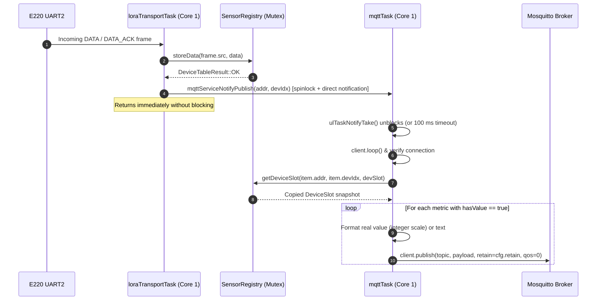

# MQTT Integration Feasibility Analysis

**LoRaIoT - Feasibility study and architectural specification**
**Status:** Architecture analysis and design specification

---

## 1. Use Cases

| # | Name | Description |
|---|---|---|
| UC1 | **Sensor Publish** | LOCAL node forwards sensor data received from REMOTE nodes across LoRa to an MQTT broker (e.g. Mosquitto) using a hierarchical topic tree. Triggered whenever a DATA or DATA_ACK frame is successfully stored in SensorRegistry. |
| UC2 | **Setpoint Subscribe** | LOCAL node subscribes to MQTT control topics and translates received messages into LoRa control pushes to the target REMOTE node, reusing the same path as `POST /api/lora/nodes/control`. |

Both use cases live exclusively on the LOCAL node. REMOTE nodes are completely unaware of MQTT.

---

## 2. Resource Baseline (from live diagnostics)

| Metric | Value | Status |
|---|---|---|
| Free heap | 130 KB | OK |
| Min-ever free heap | 99 KB | OK (budget floor) |
| Heap fragmentation | 38% | WARNING |
| Flash image used | 1,260,160 B | CRITICAL |
| Flash partition size | 1,310,720 B | - |
| Flash headroom | ~49 KB | CRITICAL |
| PSRAM | None | - |
| DRAM total | 294,384 B | - |

The flash headroom (~49 KB) is the primary physical constraint. This governs which MQTT library can be integrated without requiring a partition table resize.

---

## 3. Library Comparison

### 3.1 Candidate Libraries

#### Option A - PubSubClient (knolleary/pubsubclient)

| Property | Detail |
|---|---|
| Latest stable release | 2.8 (2020) - no commits since; unmaintained |
| Model | Synchronous / blocking poll (`client.loop()`) |
| Thread safety | None. Single-task use only. |
| Max message size | Compile-time `MQTT_MAX_PACKET_SIZE` (default 256 B) |
| TLS | Via `WiFiClientSecure` wrapper (adds full mbedTLS heap footprint) |
| Flash footprint | ~10-14 KB code |
| Heap at runtime | ~6-8 KB connection state + buffer |

#### Option B - AsyncMqttClient (marvinroger/async-mqtt-client)

| Property | Detail |
|---|---|
| Latest stable release | 0.9.0 (2020) - archived read-only since 2022 |
| Model | Fully async; callbacks execute on the Core 0 `async_tcp` task |
| Thread safety | Callbacks run on Core 0 alongside ESPAsyncWebServer |
| TLS | Not supported (clear-text TCP only) |
| Flash footprint | ~18-22 KB code |
| Heap at runtime | ~10-14 KB connection state + TCP buffers |

#### Option C - arduino-mqtt (256dpi/arduino-mqtt)

| Property | Detail |
|---|---|
| Latest stable release | 2.5.3 (actively maintained, lwmqtt C core) |
| Model | Synchronous / blocking poll (`client.loop()`) |
| Thread safety | None. Single-task use only. |
| Max message size | Limited only by `WiFiClient` TCP buffer (4-8 KB) |
| TLS | Supported via `WiFiClientSecure` wrapper |
| Flash footprint | ~8-12 KB code |
| Heap at runtime | ~4-6 KB connection state |

### 3.2 Comparison Table

| Property | PubSubClient | AsyncMqttClient | arduino-mqtt |
|---|:---:|:---:|:---:|
| Actively maintained | No (2020) | No (archived 2022) | **Yes (2024)** |
| Flash footprint | ~12 KB | ~20 KB | **~10 KB** |
| Heap at runtime | ~7 KB | ~12 KB | **~5 KB** |
| TLS support | Via WiFiClientSecure | No | Via WiFiClientSecure |
| Non-blocking async | No | Yes | No |
| Thread safe | No | Core 0 callbacks | No |
| Code complexity | Low | Medium | **Low** |

### 3.3 Recommended Library: arduino-mqtt

**Rationale:**
- **Smallest flash footprint** (~10 KB vs ~20 KB for AsyncMqttClient), preserving ~35 KB of the critical ~49 KB flash headroom.
- **Actively maintained** with clean modern C++ API.
- **Dedicated task model**: Running `client.loop()` inside a dedicated Core 1 FreeRTOS task (`mqttTask`) isolates all MQTT network I/O from the Core 0 WiFi stack and the Core 1 `loraTransportTask`.

---

## 4. Integration Architecture

### 4.1 Topic Scheme and Data Model

LoRaIoT adopts a hierarchical, per-metric scalar topic structure inspired by solar gateway systems (e.g. AhoyDTU). This structure maps directly to Home Assistant, openHAB, Node-RED, and time-series databases without requiring JSON parsing or client-side JSONPath templates.

#### Topic Pattern
```
<prefix>/<node>/<device>/<metric>
```

- `<prefix>`: Configurable MQTT root prefix from NVS (`mqttPrefix`, default `"LoRaIoT"`).
- `<node>`: Textual node identifier, formatted as `Remote_Node_<n>` where `n` is the dashboard node number, `n = LoRa address - 1` (`REMOTE (Node 1)` = address `0x02` = `Remote_Node_1`, see `Tier.cpp`). Valid `n` is 1 to 253.
- `<device>`: Human-readable device name from Describe crawl cache (e.g. `SensorA`, `HM600_ch1`), or fallback `dev<index>` before Describe crawl completes.
- `<metric>`: Human-readable metric name from Describe crawl cache (e.g. `Voltage`, `YieldTotal`), or fallback `m<metricId>` before Describe crawl completes.

#### Payload Formatting
- **Real Values (Decimal / Integer)**: The raw integer value received over LoRa is divided by its cached `scale` divisor and formatted directly into a stack buffer using `snprintf`. The scale metadata is omitted from the payload, publishing the true physical reading:
  - `scale == 100`, raw value `335` -> published payload `"3.35"`
  - `scale == 10`, raw value `215` -> published payload `"21.5"`
  - `scale <= 1`, raw value `341` -> published payload `"341"`
- **Text & Boolean Values**: Transparent forwarding. For text metrics (`isText == true`), the string is published verbatim (e.g. `"true"`, `"false"`, `"RUNNING"`, `"ALARM"`).
- **Retain Policy**: All telemetry topics are published with `retain = true`, `qos = 0` so new MQTT subscribers immediately receive the most recent valid state for every metric.

#### Example Topic Tree
```
LoRaIoT/Local/status online
LoRaIoT/Remote_Node_1/status online
LoRaIoT/Remote_Node_1/SensorA/Voltage 3.35
LoRaIoT/Remote_Node_1/SensorA/Temp 21.5
LoRaIoT/Remote_Node_1/HM600_ch1/U_DC 38.52
LoRaIoT/Remote_Node_1/HM600_ch1/I_DC 8.250
LoRaIoT/Remote_Node_1/HM600_ch1/P_DC 317.6
LoRaIoT/Remote_Node_1/HM600_ch1/YieldDay 341
LoRaIoT/Remote_Node_1/HM600_ch1/YieldTotal 986.41
```

#### Topic Name Sanitization
To guarantee valid MQTT topic syntax, any invalid characters in `DeviceSlot.name` or `MetricSlot.name` (spaces, `/`, `+`, `#`, non-ASCII) are replaced with underscores (`_`) during topic construction.

---

### 4.2 Forwarding Pipeline (UC1 - LoRa to MQTT)

Sensor data arrives on the LOCAL node as a protobuf-encoded `loraiot_Data` message inside a `DATA` or `DATA_ACK` frame.



#### Step-by-Step Execution
1. **LoRa Receive**: `loraTransportTask` receives and decodes the frame in `Application.cpp:onLoRaReceive()`, calling `SensorRegistry.storeData(frame.src, data)`.
2. **Non-Blocking Hand-Off**: If storage succeeds, `onLoRaReceive()` calls `mqttServiceNotifyPublish(frame.src, data.device)`. This inserts `{addr, deviceIdx}` into a fixed 12-entry pending array under a brief spinlock with de-duplication, and wakes `mqttTask` via `xTaskNotifyGive()`. `loraTransportTask` never blocks.
3. **Pending-Set Processing**: `mqttTask` unblocks on `ulTaskNotifyTake()`, runs `client.loop()`, and drains the pending set, taking snapshots via `SensorRegistry.getDeviceSlot(item.addr, item.deviceIdx, devSlot)` under mutex.
4. **Publish Execution**: `mqttTask` iterates over the snapshot metrics, calculates real decimal values using pure integer arithmetic with scale applied, and publishes each valid metric to its dedicated topic.

---

### 4.3 Control Subscribe Flow (UC2 - MQTT Setpoints to REMOTE) - implemented

To allow external controllers (Home Assistant, Node-RED, scripts) to push setpoints to actuators or remote settings, `mqttTask` subscribes to control topics after every broker connect. The message carries exactly the data of one metric entry of `POST /api/lora/nodes/control`, and the registry work is done by the same function, so REST and MQTT cannot diverge.

#### Setpoint Topic and Payload
```
Topic:   <prefix>/Local/Remote_Node_<n>/<device>/<metric>/set
Payload: {"value":336,"unit":"V","scale":100}     numeric: scaled integer, like REST
         {"value":"online"}                        text (a JSON true/false is stored as "true"/"false")
```
- The `Local/` namespace means "command into LOCAL". It keeps commands apart from telemetry (`<prefix>/Remote_Node_<n>/...`) and from `<prefix>/Local/status`. The subscribe filter `<prefix>/Local/+/+/+/set` has five levels after the prefix, so `Local/status` can never match it.
- `<n>` is the dashboard node number, address = `n + 1`. Example: `LoRaIoT/Local/Remote_Node_1/SensorA/Voltage/set` addresses `REMOTE (Node 1)` = address `0x02`; with `curl` that is `POST /api/lora/nodes/control?addr=2`.
- The payload is JSON, like zigbee2mqtt's `<device>/set`. Plain-value payloads are not supported. `unit` (default `""`) and `scale` (default 1, 0 treated as 1) are optional, as in REST.
- Equivalent of the REST example: `mosquitto_pub -t 'LoRaIoT/Local/Remote_Node_1/SensorA/Voltage/set' -m '{"value":336,"unit":"V","scale":100}'` and `mosquitto_pub -t 'LoRaIoT/Local/Remote_Node_1/SensorA/Power/set' -m '{"value":"online"}'` (two messages, two pushes).
- Home Assistant needs a `command_template` to build this JSON (HA sends plain values by default), for example `{"value":{{ (value*100)|round(0) }},"unit":"V","scale":100}`.

#### Execution Flow
1. **Subscribe**: `connectBroker()` subscribes to `<prefix>/Local/+/+/+/set` (QoS 0) right after the online publish and `resetPeerStatus()`. A live configuration change (including a new prefix) takes the normal reconnect path, so the filter is rebuilt from the active prefix and the old subscription disappears with the old session (clean session). A failed SUBSCRIBE keeps the connection and is retried every `MQTT_SET_RESUBSCRIBE_MS` (30 s).
2. **Callback (copy only)**: the 256dpi `onMessageAdvanced` callback runs inside `client.loop()` on `mqttTask`. It copies topic and payload into a static queue of `MQTT_SET_QUEUE_LEN` (2) entries and returns. There is no heap allocation, no `String`, no registry access, no LoRa and no blocking. Topics of 96 characters or more, payloads of 96 bytes or more, and a full queue are dropped with a warning.
3. **Processing** (`drainSetQueue()`, after `client.loop()` returned), per message:
   - Strip `<prefix>/Local/`, split `Remote_Node_<n>/<device>/<metric>/set`. Malformed topics get an error log and are ignored (no error reply is published).
   - `Remote_Node_<n>` must parse (decimal digits only, no leading zero, `n` = 1 to 253, so the address is 2 to 254; address 0, 1 = LOCAL itself and 0xFF broadcast are therefore impossible). The peer must be known in `SensorRegistry` (same precondition as the REST handler), otherwise a warning is logged.
   - Names are resolved to the registered names by comparing sanitized forms (`mqttSanitizeTopicLevel`, the same function the telemetry topics use), so a device registered as `Sensor A` and published as `Sensor_A` is found again. A device or metric that does not exist yet is registered under the topic spelling, as a REST POST would. A topic name that sanitizing would change (other than `A-Z a-z 0-9 _ -`) is rejected with an error log, because it could not be matched against telemetry.
   - The payload is parsed with ArduinoJson (`JsonDocument` on the heap, freed at the end of the message) and handed to `controlApplyMetric()` (`ControlSetpoint.cpp`), the function `POST /api/lora/nodes/control` also uses. It validates the value, calls `ControlRegistry.registerMetric()` and `storeValue()` / `storeTextValue()` (the registry takes its own mutex).
   - If the registry revision changed, `pingTaskNotifyControlChange(addr)` makes the REMOTE crawl the new schema, as in REST.
4. **LoRa push (hand-off)**: `pushTaskNotifySetpoint(addr, deviceIdx)` puts one item on the `PushTask` queue (non-blocking, timeout 0). `PushTask` runs `toProtoData()` + `loraSendDataReliable()` for that one device (the whole device, as with REST) on its own task, with the existing busy-retry logic. `mqttTask` never waits on the LoRa link or its broker mutex.
5. **No echo**: nothing is published on the `/set` topic or on a state topic. The REMOTE normally publishes the new measured value itself.

#### Retained `/set` messages
The 256dpi `onMessageAdvanced` callback is `void(MQTTClient*, char topic[], char bytes[], int length)`; it does **not** pass the retained flag. A retained `/set` would replay a stale command on every reconnect, so the callback discards every message that arrives before the SUBSCRIBE succeeded and during `MQTT_SET_RETAINED_DRAIN_MS` (1 s) after it. The broker sends retained messages immediately after SUBSCRIBE, so they fall into that window. A genuinely new non-retained `/set` that arrives inside the first second after (re)connect is dropped too (logged at debug level). Publishers should therefore not set the retain flag on `/set`.

#### Limits and known open points
- The library source is not in the workspace, so the callback signature and `MQTTClient(bufSize)` constructor above are taken from the arduino-mqtt v2.5.3 API and **not verified by a build**.
- Client buffer enlarged from 128 to `MQTT_CLIENT_BUFFER_SIZE` = 256 bytes (read and write buffer: about +512 B heap). `MQTT_TASK_STACK_SIZE` raised from 4096 to 5120 for JSON parsing and `registerMetric()`. Both are first estimates; measure `GET /status` (`MqttTask` `freeBytesMin`, `freeHeap`, `minFreeHeap`, `sketch.size`) after the first `/set` messages and tune.
- `ControlRegistry` is not persisted. After a LOCAL reboot a `/set` re-registers the metric (that is why `unit` and `scale` travel in the payload), but a REMOTE that wants the values earlier relies on the existing `PushTask` crawl/node-back push.
- A dropped `PushTask` queue item (queue full, 8 entries) is not retried; the next `/set` or node-back push resynchronises the device.
- `value` must fit `int32`; a numeric `value` is truncated like in REST (floats are not scaled).
- Non-power-of-ten scales (existing open issue of `mqttFormatScaledDecimal`, which prints scales other than 10^k as scale 1) are irrelevant on the `/set` side, because the scaled integer travels unchanged to the REMOTE. They remain an issue only for telemetry display.

---

### 4.4 Availability and LWT Architecture

Availability tracking provides immediate visibility into broker connection status and individual LoRa node reachability:

| Topic | Payload | Retained | Trigger Event |
|---|---|---|---|
| `<prefix>/Local/status` | `offline` | Yes | Broker Last Will and Testament (LWT) configured on connect; also published on a graceful disconnect. |
| `<prefix>/Local/status` | `online` | Yes | Published by `mqttTask` immediately after successful MQTT connect. |
| `<prefix>/Remote_Node_<n>/status` | `online` | Per `mqttRetain` | New peer on its first BEACON, offline->online transition (`markSeen()` returns true), or republish after (re)connect. |
| `<prefix>/Remote_Node_<n>/status` | `offline` | Per `mqttRetain` | `PingTask` marks the peer offline after `PING_OFFLINE_ATTEMPTS` unanswered PINGs, or republish after (re)connect. |

#### Per-Peer Status Hand-Off (implemented)

- **API**: `mqttServiceNotifyPeerStatus(addr, online)` is non-blocking (spinlock plus `xTaskNotifyGive`, no broker I/O, no heap). It is a no-op on REMOTE, where `mqttTask` does not exist.
- **Pending state**: `MqttService` keeps one slot per peer (`MQTT_PEER_STATUS_MAX` = `LORA_MAX_PEERS` = 3) holding `target` (latest requested state) and `published` (last state sent to the broker). State changes coalesce: the latest state wins, and a notification equal to the already published state does not wake the task.
- **Hooks**:
  - `Application.cpp:onLoRaReceive()`: when `markSeen()` returns true (offline->online), `online` is notified (LOCAL only).
  - `Application.cpp` BEACON case: a brand-new peer has no offline->online transition because `markSeen()` ignores unknown peers and `updatePeerMeta()` creates the entry already online. LOCAL therefore checks `getLiveness()` before and after `updatePeerMeta()` and notifies `online` only when the peer did not exist before. Later BEACONs of a known peer do not notify.
  - `PingTask.cpp:checkIdleNode()`: after `markOffline(addr)`, `offline` is notified. The drain step re-reads the registry, so a peer that was already offline is not published a second time.
- **Drain**: `mqttTask` drains peer status only while connected, before the telemetry queue, so `online` precedes the first data. While disconnected nothing is discarded; only the latest state per peer is kept (unlike the telemetry queue, which is cleared). A failed publish keeps the slot pending for the next loop pass.
- **Source of truth**: at publish time the payload is derived from `SensorRegistry.getLiveness()`, so a notification overtaken by a newer state change from the other task cannot publish a stale value. If the registry evicted the peer, its slot is freed and nothing is published.
- **Reconnect**: right after `<prefix>/Local/status` = `online` is published, `resetPeerStatus()` clears every `published` state and seeds missing targets from the registry, so all known peers are republished because the broker's retained state may be stale.
- **LWT**: only LOCAL's own `<prefix>/Local/status` has a Last Will, so LOCAL and each REMOTE follow the same `<prefix>/<node>/status` shape. There is no per-peer LWT; if LOCAL dies, subscribers rely on `<prefix>/Local/status` = `offline`, and the retained per-peer values are corrected on the next LOCAL connect.

---

## 5. AhoyDTU Inverter Mapping Case Study

To validate LoRaIoT's capacity limits against real-world solar microinverter data, an AhoyDTU topic tree for a Hoymiles HM-600 inverter (2 DC inputs, 1 AC grid output) is mapped below.

### 5.1 Metric Grouping Strategy (Channel as Device)
LoRaIoT supports up to 4 devices per peer and up to 8 metrics per device. Because an inverter reports > 20 total metrics across its AC and DC channels, each AhoyDTU channel is mapped as an independent LoRaIoT device:
- `Device 1` (`"HM600_ch0"`): AC grid channel (voltage, frequency, temp, AC yield).
- `Device 2` (`"HM600_ch1"`): DC string 1 (voltage, current, power, DC yield).
- `Device 3` (`"HM600_ch2"`): DC string 2 (voltage, current, power, DC yield).

### 5.2 Worked Mapping Table

| AhoyDTU Topic | LoRaIoT Device | Metric Name | Unit | Scale | LoRa sint32 | Published MQTT Topic | Published Payload |
|---|---|---|---|---|---|---|---|
| `ch1/U_DC` | `HM600_ch1` | `U_DC` | `V` | 100 | `3852` | `LoRaIoT/Remote_Node_1/HM600_ch1/U_DC` | `38.52` |
| `ch1/I_DC` | `HM600_ch1` | `I_DC` | `A` | 1000 | `8250` | `LoRaIoT/Remote_Node_1/HM600_ch1/I_DC` | `8.250` |
| `ch1/P_DC` | `HM600_ch1` | `P_DC` | `W` | 10 | `3176` | `LoRaIoT/Remote_Node_1/HM600_ch1/P_DC` | `317.6` |
| `ch1/YieldDay` | `HM600_ch1` | `YieldDay` | `Wh` | 1 | `341` | `LoRaIoT/Remote_Node_1/HM600_ch1/YieldDay` | `341` |
| `ch1/YieldTotal`| `HM600_ch1` | `YieldTotal`| `kWh`| 100 | `98641`| `LoRaIoT/Remote_Node_1/HM600_ch1/YieldTotal`| `986.41` |
| `ch0/U_AC` | `HM600_ch0` | `U_AC` | `V` | 10 | `2314` | `LoRaIoT/Remote_Node_1/HM600_ch0/U_AC` | `231.4` |
| `ch0/F_AC` | `HM600_ch0` | `F_AC` | `Hz` | 100 | `5001` | `LoRaIoT/Remote_Node_1/HM600_ch0/F_AC` | `50.01` |
| `ch0/MaxTemp` | `HM600_ch0` | `MaxTemp` | `degC`| 10 | `425` | `LoRaIoT/Remote_Node_1/HM600_ch0/MaxTemp` | `42.5` |

### 5.3 Data Scope Boundary (What is Excluded from LoRa)
- **Static Configuration JSON** (`firmware`, `hardware`): Static metadata (~100-200 bytes) does not change at runtime and is omitted from LoRa transmission to preserve the 186-byte payload budget.
- **Solar Calculations** (`sunrise`, `sunset`): Computed locally by central home automation platforms.
- **Remote IP Details** (`ip_addr`): Remote SoftAP IP is fixed (192.168.4.1) and irrelevant to central brokers.

---

## 6. Resource and Threading Model

### 6.1 Flash & Heap Budget

| Component | Flash Footprint | Runtime Heap | Notes |
|---|---|---|---|
| `arduino-mqtt` library | ~10 KB | ~5 KB | Socket and protocol state |
| `MqttService` task & pending-set | ~3 KB | ~4.2 KB | 4 KB task stack + spinlock pending-set |
| Per-metric string formatting | ~0 KB | 0 KB | Uses pure integer formatting with stack buffer |
| **Total Impact** | **~13 KB** | **~9.2 KB** | Safe within ~49 KB flash / ~99 KB heap budget |

### 6.2 Threading Model Compliance

```
Core 0 (System Core)                     Core 1 (Application Core)
─────────────────────────────────────    ─────────────────────────────────────
WiFi / lwIP stack (system)               Arduino main task: loop()
ESPAsyncWebServer request callbacks      loraTransportTask (priority 2, Serial2 owner)
                                         mqttTask (priority 0, MQTT socket & loop)
                                         PushTask (priority 1)
                                         WebSocketService.broadcastTask (priority 1)
```

- `mqttTask` is created via `TASK_CREATE` and registered with `TaskRegistry.add()`.
- `SensorRegistry` is accessed only via mutex-protected snapshot getters (`getDeviceSlot()`).
- Publish hand-off from `loraTransportTask` uses a spinlock-guarded pending set + `xTaskNotifyGive` to guarantee non-blocking LoRa reception.
- Setpoint hand-off to the LoRa side (`/set`, section 4.3): the MQTT callback only copies into a static queue; `mqttTask` then updates `ControlRegistry` (own mutex) and calls `pushTaskNotifySetpoint()` (non-blocking queue send). `PushTask` (priority 1) owns the blocking `loraSendDataReliable()`. `mqttTask` never blocks on LoRa and stays at priority 0.

---

## 7. Configuration & REST Endpoints

### 7.1 REST Endpoints

| Endpoint | Method | Description |
|---|---|---|
| `GET /api/mqtt/config` | GET | Retrieve current MQTT settings (passwords masked). JSON keys match NVS key names (`mqttBroker`, `mqttPort`, ...). |
| `PUT /api/mqtt/config` | PUT | Update MQTT broker configuration and persist to NVS. JSON keys match NVS key names. |
| `GET /api/mqtt/status` | GET | Check live MQTT connection state (`idle`, `disconnected`, `connected`, `error`). |

### 7.2 NVS Parameters (`sc_prefs` namespace)

| Key | Type | Default | Description |
|---|---|---|---|
| `mqttBroker` | `char[64]` | `""` | Broker hostname or IPv4 address. |
| `mqttPort` | `uint16_t` | `1883` | TCP port. |
| `mqttUser` | `char[32]` | `""` | Optional username. |
| `mqttPass` | `char[32]` | `""` | Optional password. |
| `mqttPrefix` | `char[32]` | `"LoRaIoT"` | Root topic prefix. |
| `mqttRetain` | `uint8_t` | `1` | 1 = enable retain for telemetry/status, 0 = disable. |
| `mqttDiscovery`| `uint8_t` | `0` | 1 = enable Home Assistant MQTT auto-discovery (Sub-Task 6). |
| `mqttEnabled`| `uint8_t` | `0` | Master enable switch (0 = dormant task). |

---

## 8. Home Assistant Integration (Optional Extension)

Home Assistant MQTT Auto-Discovery allows sensors and controls to appear automatically in Home Assistant without manual YAML configuration.

### 8.1 Discovery Topic and Payload Example
When a Describe crawl completes (`SensorRegistry.markCrawlComplete()`), discovery payloads can be published to `homeassistant/sensor/<unique_id>/config` with `retain = true`.

**Discovery Topic:**
```
homeassistant/sensor/loraiot_2_HM600_ch1_YieldTotal/config
```

**Discovery Payload:**
```json
{
  "name": "YieldTotal",
  "stat_t": "LoRaIoT/Remote_Node_1/HM600_ch1/YieldTotal",
  "unit_of_meas": "kWh",
  "dev_cla": "energy",
  "stat_cla": "total_increasing",
  "uniq_id": "loraiot_2_HM600_ch1_YieldTotal",
  "avty_t": "LoRaIoT/Remote_Node_1/status",
  "dev": {
    "ids": ["loraiot_2_HM600_ch1"],
    "name": "HM600_ch1",
    "mf": "LoRaIoT",
    "via_device": "loraiot_local"
  }
}
```

### 8.2 Resource Assessment and Phasing
- **Flash Impact**: ~2.5 KB flash for the JSON discovery template generator.
- **Heap Impact**: Generated directly into temporary stack buffers; 0 bytes permanent heap allocation.
- **Implementation Status**: Feasible within resource budgets, but deferred as a Phase 2 extension behind an NVS toggle (`mqttDiscovery`, default 0). Core telemetry publishing remains the priority.

---

## 9. Verdict and Implementation Recommendation

MQTT integration is **fully feasible** on the LOCAL node.

The recommended minimal first implementation slice consists of:
1. Adding `256dpi/MQTT @ ^2.5.3` to `platformio.ini` (plain TCP, no TLS).
2. Implementing `MqttService.cpp/.h` with `mqttTask` (priority 0 on Core 1, below the Arduino loop task; see `doc/Learnings.md` chapter 1) and a spinlock-guarded pending set (12 entries, de-duplicated) with a task notification.
3. Hooking `Application.cpp:onLoRaReceive()` to enqueue `{addr, deviceIdx}` on `DATA` and `DATA_ACK`.
4. Formatting real values with scale applied and publishing per-metric scalar topics with `retain = true`.
5. Supporting broker LWT (`<prefix>/Local/status`) and per-node availability (`<prefix>/Remote_Node_<n>/status`).
6. Implementing setpoint subscription on `<prefix>/Local/+/+/+/set` (JSON payload = one REST metric object) translating to `ControlRegistry` and a `PushTask` hand-off (section 4.3).
7. Exposing REST configuration endpoints (`/api/mqtt/config`, `/api/mqtt/status`).
