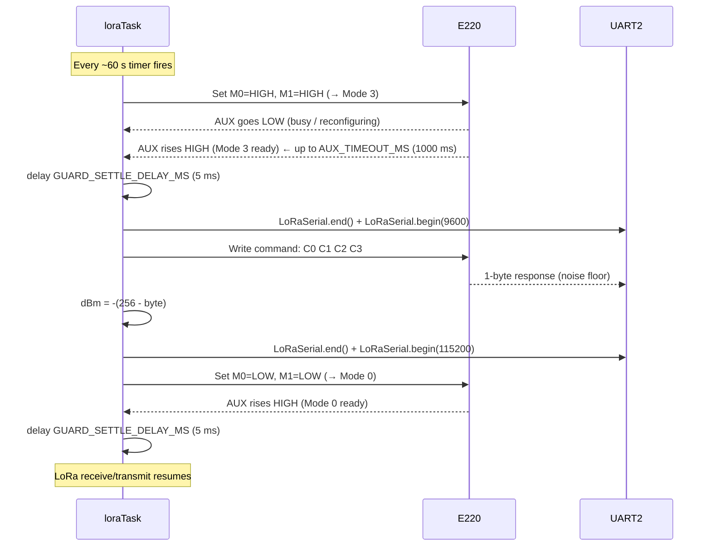

# LoRaIoT - Technical Debt and Improvement Notes

Tracked improvements that are not urgent enough to block current milestones but
should be revisited before a production release.

---

## ESP32 Memory Layout

Understanding which memory region is appropriate for a given purpose is essential
for avoiding DRAM overflows and making informed sizing decisions.

| Region | Size | R/W | Characteristics |
|---|---|---|---|
| DRAM (`.bss` / `.data`) | ~320 KB | R/W | Fast, byte-addressable. Holds all globals, statics, stack, and heap. WiFi stack consumes ~100 KB of this at runtime, leaving ~170-200 KB for application use. The linker places all `static` and global variables here automatically. |
| IRAM | ~128 KB | R/W | Instruction cache. Can hold data with `IRAM_ATTR` but intended for ISRs and time-critical code only. Not suitable for large data structures. |
| PSRAM (external) | 4-8 MB | R/W | SPI-attached pseudo-SRAM. Byte-addressable; works with `ps_malloc()` / `heap_caps_malloc(MALLOC_CAP_SPIRAM)`. ~10x slower than DRAM. Only present on **WROVER** modules - absent on the common **WROOM**. Requires `CONFIG_SPIRAM` in `sdkconfig`. |
| RTC SLOW RAM | 8 KB | R/W | Survives deep sleep when marked `RTC_DATA_ATTR`. For tiny persistent state (boot counters, wake reason). Too small for registries. |
| Flash - NVS | ~20 KB (partition) | R/W | Wear-levelled key-value store via `Preferences`. Survives power cycles. Already used for channel, address, log level. Slow (SPI flash); not suitable for live measurement caches. |
| Flash - PROGMEM | ~4 MB (partition) | R only | Read-only at runtime. Used for large constant strings via `PROGMEM` / `F()` / `ICACHE_RODATA_ATTR`. Already used for `INDEX_HTML` and `openapi_json.h`. Not writable. |

### DRAM budget at a glance (Arduino WiFi build, ESP32 WROOM)

```
Total DRAM:              ~320 KB
WiFi stack + lwIP:       ~100 KB  (system, not in .bss)
FreeRTOS task stacks:     ~24 KB  (6 tasks × 2-4 KB each, heap)
FreeRTOS queues/mutexes:   ~4 KB  (heap)
LogBuffer static array:   ~20 KB  (.bss)
nanopb TX scratch (§4):    ~1 KB  (.bss, static locals in Application.cpp)
TaskRegistry:             <0.1 KB (.bss)
Other static globals:      ~3 KB  (.bss)
Phase 1 registries:        ~7 KB  (.bss)
─────────────────────────────────
Estimated free heap:     ~145 KB  (live measurement via GET /status after M6 tasks added;
                                   was ~166 KB estimate before M6 task stacks and .bss growth)
```

The single largest controllable cost in `.bss` is `LogBuffer` - see §1 below for
improvement options. Flash image size (§6) is the current critical resource; DRAM
is healthy. Everything else (nanopb encode/decode, REST handlers, OpenAPI strings)
adds flash size, not DRAM.

### When to use each region

| Use case | Region |
|---|---|
| Mutable runtime state (registries, caches) | DRAM - plain globals/statics |
| Large read-only strings and lookup tables | PROGMEM (flash, read-only) |
| Surviving a deep-sleep cycle | RTC SLOW RAM (`RTC_DATA_ATTR`) |
| Persisting across power cycles | NVS (`Preferences`) |
| Large mutable buffers on WROVER only | PSRAM (`ps_malloc`) |
| ISR / time-critical hot path data | IRAM (`IRAM_ATTR`) |

---

## 1. LogBuffer RAM efficiency (`src/util/src/LogBuffer.h/.cpp`)

### Current design

The ring buffer is a static 2D array of fixed-width rows:

```cpp
char lines[LOG_BUFFER_LINES][LOG_BUFFER_LINE_LEN];  // 128 × 160 = 20 KB static BSS
```

All 20 KB are reserved at link time regardless of how many entries exist.
A typical log line (`[INFO ][Application.cpp:52] LoRa started`) is ~50 chars,
so each 160-byte slot wastes ~110 bytes of padding - roughly 13 KB of the 20 KB
is air at normal INFO-level logging.

The REMOTE node has no serial monitor attached (only power), making `GET /api/log`
over WiFi the sole diagnostic channel. The buffer must therefore stay in RAM;
dropping it is not an option.

### Option A - Reduce fixed dimensions (trivial)

Change the two constants in `LogBuffer.h`:

```cpp
static constexpr int LOG_BUFFER_LINES   = 64;   // was 128
static constexpr int LOG_BUFFER_LINE_LEN = 100;  // was 160
```

Result: 64 × 100 = **6.4 KB** (saves 13.6 KB). Still wastes space per line but
requires no structural change. Good as a quick fix.

Constraint: lines longer than 99 chars are silently truncated. Current longest
lines (`[INFO ][LoRaTransport.cpp:163] LoRa TX: target=...`) fit within 100 chars
at INFO level; DEBUG/TRACE hex dumps may be clipped.

### Option B - Heap-allocated pointer ring (moderate effort, ~50 lines)

Store only a pointer array statically; `malloc` each line on first write and
`free` it when the ring overwrites it:

```cpp
char* lines[LOG_BUFFER_LINES];   // 128 × 4 B = 512 B static BSS
```

Each slot is allocated to exactly `strlen(line) + 1` bytes on first use.

- Static BSS: **512 B**
- Heap at runtime: ~64 lines × ~55 B avg = **~3.5 KB live**
- Cost: one `malloc` + one `free` per log call (~5 µs each on ESP32 heap allocator)
- Risk: mild heap fragmentation if line lengths vary widely (they don't in practice)

### Option C - Single contiguous heap block with offset index (best balance)

Allocate one flat buffer on the heap at `begin()`. Keep a compact `uint16_t`
offset index. Lines are packed end-to-end with `'\0'` separators; the ring
advances a write pointer and wraps, evicting the oldest entry when space runs out.

```cpp
uint16_t offsets[LOG_BUFFER_LINES];  // 128 × 2 B = 256 B static BSS
char*    buf;                         // single heap alloc at begin(), e.g. 6 KB
```

- Static BSS: **256 B**
- Heap: one `malloc` of a fixed size at boot - no further allocations ever
- No fragmentation risk
- Implementation: ~50 extra lines in `append()` and `getJson()`
- This is the pattern used by embedded syslog implementations

### Recommendation

Apply **Option A** immediately if DRAM pressure is felt. Implement **Option C**
as a dedicated task once Phase 2-3 of the REST plan are complete and total heap
usage is stable.

---

## 2. REST API URL design: path parameters vs query parameters

### Context

The Phase 2 REST endpoints address variable resources: a specific remote node
(`addr`), a specific device on that node (`device`), and so on. Two URL styles
were considered.

### Option A - Path parameters (strict REST convention)

```
GET /api/lora/nodes/2/devices/1/metrics
```

This is the canonical REST style where every resource has its own URI. It is
the pattern described in the original `RestPlan.md` (`{addr}`, `{device}`).

**Problem on ESPAsyncWebServer:** the library's `server->on(path, ...)` matcher
does exact string matching only. It has no built-in support for named path
parameters. Supporting `{addr}` requires either:

- A custom `AsyncWebHandler` subclass with a `canHandle()` override that does
  prefix matching and manual `request->url()` substring extraction, or
- A dedicated helper (`UrlParams.h`) that parses segment N from the raw URL
  string after the fact.

Either approach adds non-trivial code with its own edge cases (trailing slashes,
hex vs decimal address notation, `url()` encoding). On a two-node embedded
system with no external API consumers this complexity has no payoff.

### Option B - Query parameters (chosen)

```
GET /api/lora/nodes/snapshot?addr=2&device=1
GET /api/lora/nodes/snapshot?addr=2&device=1&live=true&timeout=2000
POST /api/lora/nodes/echo?addr=2
GET  /api/lora/nodes/ping?addr=2
POST /api/lora/nodes/data?addr=2&ack=true
```

`ESPAsyncWebServer` handles query parameters natively via `hasArg`/`arg`
(the same API already used by `GET /api/log?clear=1` in `Server.cpp`):

```cpp
if (!request->hasArg("addr")) { /* 400 */ }
uint8_t addr = (uint8_t)request->arg("addr").toInt();
```

Zero helper code. Every route is a flat exact-match string. Parameter validation
is a single `getParam()` + range-check inline in the handler.

**Trade-off accepted:** the URLs are slightly less "RESTful" by textbook
convention. In practice REST style is a guideline, not a protocol. The W3C and
RFC 3986 make no distinction between path segments and query strings as resource
identifiers. For a firmware API used only by `curl`, Home Assistant, and the
built-in Swagger UI, query parameters are indistinguishable from path parameters
in every observable way.

### Full Phase 2 URL reference

| Method | Path | Query params | Node |
|---|---|---|---|
| `GET` | `/api/lora/nodes` | - | LOCAL |
| `GET` | `/api/lora/nodes/snapshot` | - (all nodes) | LOCAL |
| `GET` | `/api/lora/nodes/snapshot` | `addr`, `?device` | LOCAL |
| `GET` | `/api/lora/nodes/snapshot` | `addr`, `device`, `?live=true`, `?timeout=ms` | LOCAL |
| `POST` | `/api/lora/nodes/data` | `addr`, `?ack=true\|false` | LOCAL |
| `POST` | `/api/lora/nodes/echo` | `addr` | LOCAL |
| `GET` | `/api/lora/nodes/ping` | `addr` | LOCAL |
| `POST` | `/api/lora/nodes/ping` | `addr` | LOCAL |
| `GET` | `/api/lora/ping` | - | LOCAL (broadcast) |
| `POST` | `/api/lora/beacon` | - | LOCAL |
| `GET` | `/api/lora/stats` | - | LOCAL |
| `POST` | `/api/sensor/data` | - | REMOTE |

---

## 3. WebSocket infrastructure: keep and build a GUI, or remove

### Current state

`/ws/data` is a live, connectable WebSocket endpoint. `WebSocketService::broadcastTask`
(`src/service/src/WebSocketService.cpp`) runs as a FreeRTOS task on every boot,
loops at 1 s intervals, and sends nothing - the `ws->textAll()` call is commented
out pending a payload definition. The infrastructure (endpoint registration,
task creation, mutex) is wired but produces no output.

The endpoint was carried over from the SerialController template project, which
had a real browser GUI that consumed the 1 s push to drive a live data table.

### Why WebSockets only make sense with a browser GUI

REST polling (`GET /api/lora/nodes/snapshot`) works for any client. WebSockets
add value only for a browser page that must update without user-initiated
reloads - a live dashboard. There is no device-to-device or server-push use
case in this project that would justify WebSockets over plain HTTP.

REMOTE runs in SoftAP mode (LAN-disconnected after provisioning); a browser
cannot reach it over the LAN. A GUI is therefore only meaningful on LOCAL.

### Option A - Add a real browser GUI on LOCAL (keep WebSockets)

Implement a self-contained HTML page (inline CSS + JS WebSocket client) stored
in PROGMEM at `src/LoRaIoT/src/index_html.h`, served at `GET /`. The page
connects to `ws://<host>/ws/data` and renders a live dashboard showing:

- Active tier and gateway status
- Node registry table (addr, boot_id, registry_rev, last_seen)
- Per-device metric values with age
- LoRa link stats (TX/RX/CRC/ACK counters)

The SerialController template (`ESP/SerialController/src/SerialController/src/index_html.h`,
~1,110 lines) is the reference pattern to adapt.

**Cost:**
- Flash: ~30-40 KB additional PROGMEM for the HTML/CSS/JS
- Current flash headroom: ~105 KB (92% used of 1,280 KB)
- After frame protocol layer (est. ~20-30 KB): headroom shrinks to ~55-75 KB
- A 35 KB GUI would consume roughly half that remaining margin
- `WebSocketService::broadcastTask` payload must be implemented
- `index_html.h` deprecation notice must be removed

**Constraint:** implement only after the frame protocol layer is complete and
the final flash budget is known. If headroom is < 50 KB at that point, the GUI
should be hosted externally (e.g. a static page on the LAN that fetches from
the ESP32 API) rather than embedded in flash.

### Option B - Remove WebSocket infrastructure (simplify)

Remove the WebSocket endpoint and service entirely. `GET /openapi/ui` (Swagger UI)
already provides a fully interactive, self-documenting explorer for every endpoint.
Cached and live metric reads are available via `GET /api/lora/nodes/snapshot`.
Neither requires a persistent connection.

**What to remove:**
- `src/service/src/WebSocketService.h/.cpp` - delete both files
- `src/LoRaIoT/src/Server.cpp` - remove `AsyncWebSocket ws(WS_PATH)`,
  `WebSocketService wsService(&ws)`, `server.addHandler(&ws)`, `wsService.begin()`
- `src/LoRaIoT/src/Server.h` - remove `WS_PATH` constant and `extern WebSocketService wsService`
- `src/LoRaIoT/src/Application.cpp` - remove the drain-WebSocket-command-queue TODO comment
- `src/LoRaIoT/src/index_html.h` - already has deprecation notice; can be removed or replaced
  with a one-line redirect to `/openapi/ui`
- `doc/RestApi.md` - remove the `WebSocket /ws/data` entry from the summary table and section
- `src/LoRaIoT/src/openapi_json.h` - no entry to remove (WebSocket is not in the OpenAPI spec)

**Savings:** ~4 KB flash (compiled task code) + 4 KB DRAM (task stack) + simplifies
the threading diagram in `doc/TechDebt.md §ESP32 Memory Layout` and `README.md`.

### Recommendation

Do not act on either option until the frame protocol layer is complete and a
final flash measurement is available. At that point:

- If flash headroom > 60 KB: Option A is viable.
- If flash headroom < 60 KB: choose Option B.
- If a LAN-hosted dashboard is acceptable: choose Option B regardless and host
  the GUI as a static page that polls the REST API.

---

## 4. loraTransportTask nanopb scratch buffers

### Current design

All nanopb encode/decode work on `loraTransportTask` (stack = 4096 B) uses `static` local variables to avoid stack overflow. The affected functions and their BSS cost are:

- `sendBadRequestResponse` - `loraiot_Response` (311 B) + `payloadBuf[311]` = 622 B
- `sendDescribeResponse` - `loraiot_Request` (181 B) + `loraiot_Device` (300 B) + `loraiot_Response` (311 B) + `payloadBuf[311]` = 1103 B
- `sendReadResponse` - `loraiot_Request` (181 B) + `loraiot_Data` (238 B) + `loraiot_Response` (311 B) + `payloadBuf[311]` = 1041 B
- `sendEchoResponse` - `loraiot_Request` (181 B) + `loraiot_Response` (311 B) + `payloadBuf[311]` = 803 B
- RESPONSE decode in `onLoRaReceive` - `loraiot_Response` (311 B)
- REQUEST peek in `onLoRaReceive` - `loraiot_Request` (181 B)
- `DescribeCrawler::sendDescribeRequest` - `loraiot_Request` (181 B) + `payloadBuf[186]` = 367 B

Total static BSS committed: approximately **1341 B** (overlapping unions; the real worst-case unique bytes are `loraiot_Request` 181 + `loraiot_Device` 300 + `loraiot_Response` 311 + `payloadBuf` 311 = **1103 B**, since many of the statics alias across functions that are never live simultaneously - but each is independently reserved).

### Why it is a risk

1. `static` locals are safe **only** because `loraTransportTask` is the sole caller and processes one frame at a time. Any future refactor that calls these helpers from a second context (ISR, second task, timer callback) will silently corrupt data - the compiler will not warn.
2. If the proto schema grows (more metrics, longer strings), `loraiot_Response_size` and `loraiot_Device_size` grow automatically. The `static` buffers grow with them in BSS, but *without any compile-time guard* that checks total BSS headroom.
3. There is no single place in the codebase that documents or enforces the "one caller at a time" invariant. The constraint is an implicit assumption that future contributors may not be aware of.

### Option A - Status quo with a safety assertion (trivial)

Add a `static bool s_inFlight = false` guard:

```cpp
static void sendBadRequestResponse(const LoRaFrame& req) {
  configASSERT(!s_inFlight);   // fires immediately if called re-entrantly
  s_inFlight = true;
  // ... existing body ...
  s_inFlight = false;
}
```

Cost: one `bool` in BSS, zero runtime overhead in release builds (if `configASSERT` maps to nothing). Makes the single-caller invariant explicit and machine-checked. Does not reduce BSS usage.

### Option B - Shared `TxScratch` struct (moderate effort, ~30 lines)

Replace all the scattered `static` locals with a single named workspace:

```cpp
// src/LoRaIoT/src/Application.cpp  (or a dedicated TxScratch.h)
struct TxScratch {
  loraiot_Request  req;                      // 181 B
  loraiot_Response resp;                     // 311 B
  loraiot_Device   dev;                      // 300 B
  loraiot_Data     data;                     // 238 B
  uint8_t          buf[loraiot_Response_size]; // 311 B
};
static TxScratch s_txScratch;               // 1341 B total, one BSS slot
```

Each helper zeroes only the fields it needs (`s_txScratch.resp = loraiot_Response_init_zero`) and accesses the struct by name. Benefits:

- Total BSS cost is visible in one place (`sizeof(TxScratch)` = 1341 B)
- No duplicated `static` declarations scattered across four functions
- The single ownership is structurally obvious - it has one name

### Option C - `TxScratch` wrapped in a class with guarded access (recommended long-term)

Encapsulate `s_txScratch` in a small class that enforces single-use at runtime:

```cpp
class LoRaTxScratch {
public:
  // Claim the scratch space. Asserts if already in use (re-entrancy guard).
  // Returns references to the internal buffers for the caller to populate.
  loraiot_Request&  request()  { configASSERT(!inUse); inUse = true; req  = loraiot_Request_init_zero;  return req; }
  loraiot_Response& response() {                                       resp = loraiot_Response_init_zero; return resp; }
  loraiot_Device&   device()   {                                       dev  = loraiot_Device_init_zero;   return dev; }
  loraiot_Data&     data()     {                                       data_ = loraiot_Data_init_zero;    return data_; }
  uint8_t*          buf()      { return rawBuf; }
  size_t            bufSize()  { return sizeof(rawBuf); }

  // Release the scratch space after a frame is built and sent.
  void release()               { inUse = false; }

private:
  bool             inUse = false;
  loraiot_Request  req;
  loraiot_Response resp;
  loraiot_Device   dev;
  loraiot_Data     data_;
  uint8_t          rawBuf[loraiot_Response_size];
};

static LoRaTxScratch s_txScratch;
```

Each helper calls `s_txScratch.request()` to claim, populates, sends, then calls `s_txScratch.release()`. The `configASSERT(!inUse)` fires immediately under test if a second context accidentally calls in. The class interface documents exactly what the scratch space is for - new contributors cannot misuse it without reading the API.

### Recommendation

Apply **Option A** (assertion guard) immediately - it is a one-line change per helper that makes the invariant machine-checked. Implement **Option C** (`LoRaTxScratch` class) as a dedicated task once M6 is complete and the full set of frame-building helpers is stable. Implement Option C in `src/LoRaIoT/src/LoRaTxScratch.h` (header-only, no `.cpp` needed).

---

---

## 5. Broadcast PING: single-slot broker contradicts multi-ACK collection

### Current design

`GET /api/lora/ping` sends a PING frame to address `0xFF` (E220 broadcast) and returns
as soon as the **first** ACK arrives. The implementation in `LoRaBroker.cpp` is:

```cpp
void loraBrokerOnPingAck(uint8_t srcAddr, uint32_t rttMs) {
    xSemaphoreTake(brokerMutex, portMAX_DELAY);
    bool match = pendingActive && pendingIsPing;
    if (match) {
        lastPingResult.addr  = srcAddr;   // overwrites - single slot
        lastPingResult.rttMs = rttMs;
        pendingActive = false;            // slot released on first ACK
    }
    xSemaphoreGive(brokerMutex);
    if (match) {
        xSemaphoreGive(responseSem);      // unblocks the HTTP handler immediately
    }
}
```

Any subsequent ACKs from other nodes arrive after `pendingActive` is already `false`
and are silently discarded.

### Why this contradicts the single-slot, single-waiter pattern

The broker is designed around three invariants that are correct for unicast but break
for multi-ACK broadcast:

1. **Single result slot** - `lastPingResult` holds exactly one `(addr, rttMs)` pair.
   There is no array. Writing a second ACK would require either an array or a queue,
   neither of which exists.

2. **Binary semaphore as a one-shot gate** - `responseSem` is a FreeRTOS binary
   semaphore. It has only two states: taken and given. `xSemaphoreGive()` on an already-
   given semaphore is a no-op — the second ACK's `xSemaphoreGive()` would be silently
   dropped even if the slot were still open.

3. **`pendingActive = false` on first match** - the flag is cleared the moment the
   first ACK is stored. This is the correct design for unicast (only one node can
   answer) but makes multi-ACK collection impossible: every subsequent ACK sees
   `pendingActive = false` and takes the no-op path.

4. **Physical layer constraint** - the E220 module is half-duplex. When LOCAL sends
   a broadcast PING, all REMOTEs receive it at the same moment and each immediately
   queues an ACK. Without a random backoff before transmitting the ACK, all REMOTEs
   transmit simultaneously and their signals **collide on the air** — only the
   strongest survives. This is a MAC-layer problem entirely below the broker layer.
   Fixing the broker to collect multiple ACKs only makes sense if the protocol also
   adds a random ACK backoff on REMOTE (e.g. `delay(random(0, 200))` before sending
   the ACK). Without that, even a multi-ACK broker would receive at most one ACK
   from N nodes.

### Why sending multiple broadcast PINGs does not help

A common intuition is: "send 5 PINGs rapidly — different nodes will answer different
ones." This does not work because:

- All N REMOTEs respond to **every** PING, not just one. Each PING triggers N
  simultaneous ACKs, all of which collide with each other.
- The staggering of the 5 PINGs (sequential, each ~300 ms apart including ACK wait)
  gives no advantage: each PING independently causes the same simultaneous-ACK
  collision. The result is still "the strongest signal wins each time" — which is
  likely the same node every time (the one physically closest).
- This is exactly the problem CSMA/CA (Carrier Sense Multiple Access / Collision
  Avoidance) was designed to solve in WiFi. The E220 has no equivalent mechanism.

### What a correct multi-ACK implementation would require

Both layers must change together:

**Protocol layer (REMOTE firmware):**
- After receiving a broadcast PING, REMOTE waits a random delay before sending its
  ACK: `delay(random(0, BROADCAST_ACK_JITTER_MS))` where `BROADCAST_ACK_JITTER_MS`
  is large enough that two nodes are unlikely to transmit simultaneously.
  With N=10 nodes and E220 ACK air-time ~15 ms, a jitter window of ~200 ms gives
  ~93% probability of zero collisions (birthday problem with 10 slots of 15 ms each
  in a 200 ms window).
- This jitter should only apply to broadcast PINGs (dst=0xFF), not unicast PINGs.

**Broker layer (LOCAL firmware):**

| Change | Detail |
|---|---|
| `PingResult results[MAX_BROADCAST_NODES]` | Replace single slot with a fixed-size array (e.g. 8 entries) |
| `uint8_t resultCount` | Track how many ACKs have been collected |
| `loraBrokerOnPingAck()` | Append to array instead of overwriting; do NOT release `pendingActive` or give the semaphore on each ACK |
| New `broadcastPingActive` flag | Separate from `pendingActive` so normal unicast requests are still blocked during the window |
| `loraBrokerBroadcastPingWait(windowMs)` | New function: blocks for `windowMs` using `xTaskDelayUntil` or a countdown semaphore, then releases the slot and returns |
| `loraBrokerGetBroadcastPingResults()` | Returns pointer + count to the results array |
| `GET /api/lora/ping?window=<ms>` | REST handler uses the new wait function; default window e.g. 500 ms |

**Files affected:** `LoRaBroker.h`, `LoRaBroker.cpp`, `RestService.cpp`,
`openapi_json.h`, `doc/RestApi.md`, `index_html.h`.

### Recommendation

Do not implement until there are 3 or more REMOTE nodes in the deployment. With a
single REMOTE, sequential per-node pings (`GET /api/lora/nodes/ping?addr=N`) give
identical information with no firmware changes. Implement the random ACK jitter on
REMOTE first, verify it eliminates collisions on hardware with 2 nodes, then add the
multi-ACK broker support. Track the jitter constant `BROADCAST_ACK_JITTER_MS` as a
named constant in `LoRaTransport.h` so it can be tuned per deployment.

---

## 6. Flash partition layout: app slot is 92.5% full

### Analysis (live data from `GET /status`, both nodes identical)

| Partition | Address | Size | Used by this firmware |
|---|---|---|---|
| nvs | 0x009000 | 20 KB | Yes (log level, LoRa channel/address, tier) |
| otadata | 0x00E000 | 8 KB | OTA bookkeeping only |
| app0 | 0x010000 | 1280 KB | Yes (running image) |
| app1 | 0x150000 | 1280 KB | OTA target only |
| **spiffs** | 0x290000 | **1408 KB** | **No** |
| coredump | 0x3F0000 | 64 KB | Crash dumps |

This is the Arduino-ESP32 / PlatformIO `default.csv` layout for a 4 MB flash.

- The firmware image is 1,212,608 B. An app slot is 1,310,720 B (1280 KB), so the
  image fills **92.5%** of a slot. Headroom is only **98,112 B (~96 KB)**.
  (`sketch.freeSpace` in `/status` is the slot size, not free bytes.)
- The 85% WARNING threshold is already exceeded; 95% (CRITICAL) is only ~32 KB of
  growth away.
- No code uses SPIFFS, LittleFS or FFat (`grep` finds only a "(future)" remark in
  `doc/Feasibility.md`). The browser UI is served from PROGMEM (`INDEX_HTML`), which
  is part of the app image. The 1408 KB `spiffs` partition is therefore **dead flash**.
- The application is not feature complete (Phase 2-3 REST endpoints, GUI, more
  protocol handling), so the image will grow. 96 KB of headroom will not last.
- Partitions only affect flash. They do nothing for heap or `.bss` pressure.

### Conclusion

Re-purpose the unused `spiffs` area by enlarging `app0` and `app1`. OTA is kept
(both slots are the same size, as OTA requires). `nvs` stays at the same address and
size, so stored settings survive the reflash. `coredump` stays at `0x3F0000`.

| Partition | Address | Size | Note |
|---|---|---|---|
| nvs | 0x009000 | 20 KB | unchanged |
| otadata | 0x00E000 | 8 KB | unchanged |
| app0 | 0x010000 | **1984 KB** (0x1F0000) | was 1280 KB |
| app1 | 0x200000 | **1984 KB** (0x1F0000) | was 1280 KB |
| coredump | 0x3F0000 | 64 KB | unchanged |

Ends exactly at 0x400000 (4 MB). App partitions must be aligned to 64 KB (0x10000);
both are.

Effect on the current image (1,212,608 B):

| | Before | After |
|---|---|---|
| Slot size | 1,310,720 B | 2,031,616 B |
| Used | 92.5% | 59.7% |
| Headroom | 98,112 B (~96 KB) | 819,008 B (~800 KB), about 8.3x more |

### How to apply

Create `partitions.csv` in the repository root (next to `LoRaIoT.ino` and
`platformio.ini`):

```csv
# Name,    Type, SubType,  Offset,   Size,     Flags
nvs,       data, nvs,      0x9000,   0x5000,
otadata,   data, ota,      0xE000,   0x2000,
app0,      app,  ota_0,    0x10000,  0x1F0000,
app1,      app,  ota_1,    0x200000, 0x1F0000,
coredump,  data, coredump, 0x3F0000, 0x10000,
```

**Arduino IDE:** with `partitions.csv` in the sketch folder, the arduino-esp32 build
uses it automatically and ignores *Tools > Partition Scheme*. Run a normal *Upload*;
it writes bootloader, partition table and app together. Fallback if a custom table
is not wanted: select *Minimal SPIFFS (1.9MB APP with OTA/190KB SPIFFS)*, which gives
~1.9 MB per slot and keeps a small SPIFFS area (less headroom than the table above).

**PlatformIO:** add to `[env:esp32dev]` (the table above is specific to 4 MB flash
and a classic ESP32; do not put it in the shared `[env]` section because the other
targets have different flash sizes and defaults):

```ini
[env:esp32dev]
board_build.partitions = partitions.csv
```

The path is relative to the project root. This is compatible with both toolchains
because both read the same CSV.

### Caveats

- **Serial flash required, once per node.** A changed partition table cannot be
  delivered over OTA (OTA only writes into existing slots). Both LOCAL and REMOTE
  need a USB upload.
- **Do not move `nvs`.** Moving or resizing it wipes stored settings and the nodes
  fall back to defaults (channel, address, tier, log level).
- **Anything on the old `spiffs` area is lost.** Nothing uses it today.
- **Verify after flashing:** `GET /status` should list `app0`/`app1` at 1984 KB and
  no `spiffs`. The Arduino IDE build output should report the new maximum.
- Keep `ESPInfo.h` unchanged; it enumerates partitions dynamically.

### Further mitigations as the image grows

Ordered roughly by expected benefit versus effort. Sizes are not measured; get a
real number first (Arduino IDE build output, or `pio run -t size` / the `.map` file)
before spending effort on any of them.

1. **Track image size against the new slot.** Treat 85% of 2,031,616 B
   (~1.65 MB) as the next WARNING line, and re-check `/status` after each milestone.
2. **Lower the core debug level.** Arduino IDE: *Tools > Core Debug Level: None*.
   PlatformIO: `build_flags = -DCORE_DEBUG_LEVEL=0`. Removes ESP-IDF/Arduino log
   strings and call sites.
3. **Compress PROGMEM assets.** Serve `INDEX_HTML` and `openapi_json.h` pre-gzipped
   (`Content-Encoding: gzip`). Text such as HTML and JSON typically compresses to
   20-30% of its size. The openapi document grows with every endpoint, so this
   scales with the API.
4. **Remove WebSockets if no GUI is built** (see §3). Saves the broadcast task code
   and library paths, as well as DRAM for its task stack.
5. **Review duplicated web stacks.** `WiFiManager` brings its own HTTP server for the
   captive portal while `ESPAsyncWebServer` serves the application. Consider whether
   one can replace the other, or whether WiFiManager can be restricted to the
   provisioning path only. Check the map file before investing.
6. **Trim log strings.** `Log_*` macros embed `__FILE__` and format strings in flash
   at every call site. Dropping TRACE/DEBUG call sites at compile time (e.g. a
   `LOG_COMPILE_LEVEL` guard) removes them from the image entirely.
7. **ArduinoJson / nanopb instantiations.** Large numbers of distinct
   `JsonDocument` shapes or nanopb messages add code. Only relevant if the map
   file shows them as large.
8. **Hard ceiling of 4 MB flash.** If two 1984 KB slots are eventually not enough:
   (a) drop OTA and use a single `factory` app of ~3.9 MB, giving up rollback and
   remote updates, or (b) move to a module with 8 or 16 MB flash (for example a
   WROOM-32E variant in the same footprint) and re-do the table.

## 7. RSSI ambient noise polling via periodic Mode 3 entry

### Background

The E220-400T22D exposes two RSSI-related features (both currently disabled):

| Feature | Register | Current state |
|---|---|---|
| RSSI ambient noise | REG1 bit 5 | Disabled (`REG1_RSSI_NOISE_DISABLE = 0x00`) |
| RSSI byte on receive | REG3 bit 7 | Disabled (`REG3_RSSI_BYTE_DISABLE = 0x00`) |

True SNR is not available - the E220 is a transparent UART bridge and does not surface the
per-packet SNR figure that the internal SX126x chip computes. Only modules with a direct SPI
interface expose that register. The closest practical substitute is the ambient noise floor,
readable via the `C0 C1 C2 C3` command in Mode 3, converted as `dBm = -(256 - byte)`.

### What periodic polling would require

To sample the ambient noise floor (e.g. every 60 seconds) the loraTask must:

1. Drain and pause normal operation (existing `pause()` / `resume()` pattern already used by Diagnostics).
2. Switch to Mode 3 and rebaud UART2 to 9600.
3. Issue the 4-byte read command and consume the 1-byte response.
4. Rebaud to 115200 and switch back to Mode 0.
5. Resume normal receive/transmit.



### Timing breakdown

All constants are defined in `src/lora/src/LoRaTransport.h`.

| Step | Time | Constant |
|---|---|---|
| Mode 3 entry: AUX settles | typically a few ms, up to 1000 ms worst case | `AUX_TIMEOUT_MS` |
| Guard settle after AUX | 5 ms | `GUARD_SETTLE_DELAY_MS` |
| UART rebaud to 9600 + 4-byte write | ~1 ms | - |
| Read 1-byte response | ~1 ms | - |
| UART rebaud to 115200 | ~1 ms | - |
| Mode 0 re-entry: AUX settles + guard | 5 ms guard | `GUARD_SETTLE_DELAY_MS` |
| **Total realistic** | **~15-25 ms** | - |
| **Total worst-case** | **~2 s** (two AUX timeouts, fault condition) | `AUX_TIMEOUT_MS` x2 |

At a 60-second polling interval the radio blackout duty cycle is approximately 0.03%
(25 ms / 60 000 ms), well within the existing ACK retry and timeout margins.

### Key constraints

- **REG1 bit 5 does not need to be permanently set.** The `C0 C1 C2 C3` read command
  returns the noise floor regardless of that bit. No persistent register change is
  needed, which avoids a flash write on every poll cycle.
- **UART2 single-owner rule.** `loraTask` must own the entire sequence. The
  existing `pause()` / `resume()` pair (already used by Diagnostics for the boot
  self-test) provides the correct pattern.
- **Radio is deaf during the blackout.** Any BEACON or PING arriving in the ~15-25 ms
  window is lost. This is acceptable at a 1-minute interval but must be documented
  for anyone shortening the poll period significantly.
- **Both nodes should poll independently.** There is no cross-node correlation benefit;
  each node's noise floor reflects its own RF environment.

### Recommendation

Implement as a background periodic poll inside `loraTask` (or a thin wrapper on the
existing `pause()` / `resume()` sequence), storing the last reading in a member
variable exposed via `GET /api/lora/stats`. No new task is needed. Effort is low
(~30-40 lines). Defer until after Milestone 6 so it does not interfere with the
DATA / DATA_ACK / REQUEST / RESPONSE flow currently under development.

