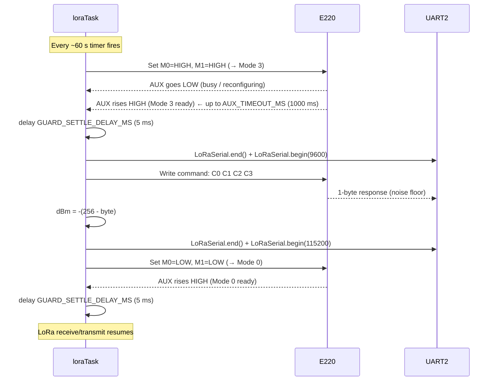
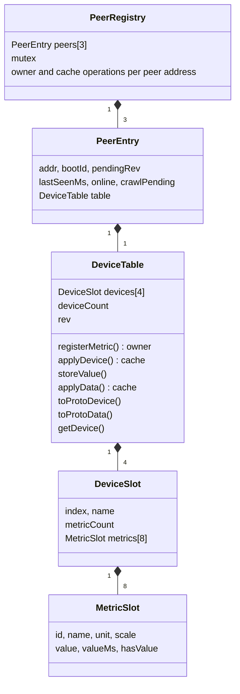
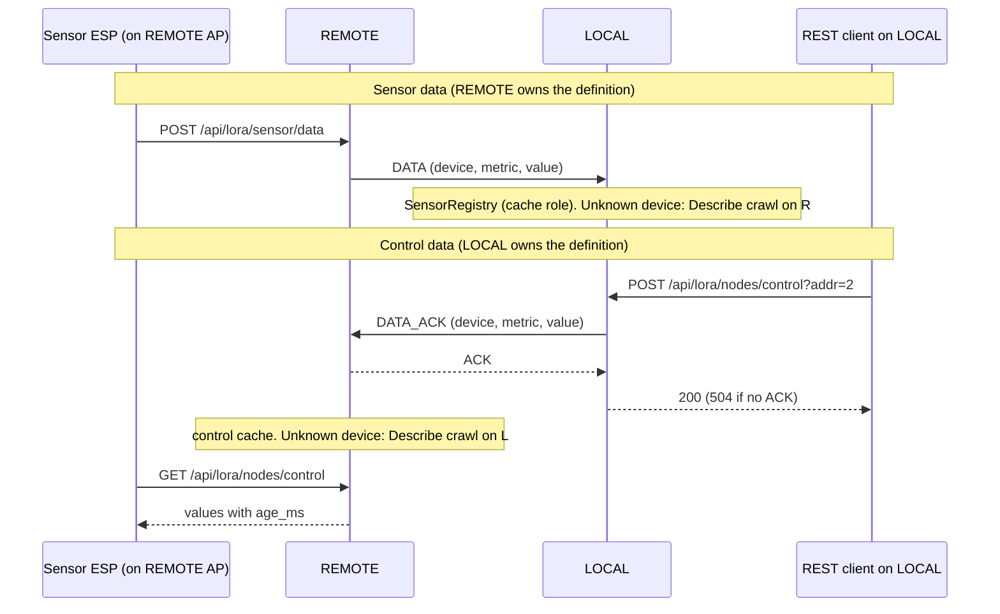

# LoRaIoT - Technical Debt and Improvement Notes

Tracked improvements that are not urgent enough to address immediately but
should be revisited before a production release.

---

## ESP32 Memory Layout

Understanding which memory region is appropriate for a given purpose is essential
for avoiding DRAM overflows and making informed sizing decisions.

| Region | Size | R/W | Characteristics |
|---|---|---|---|
| DRAM (`.bss` / `.data`) | ~320 KB | R/W | Fast, byte-addressable. Holds all globals, statics, stack, and heap. WiFi stack consumes ~100 KB of this at runtime, leaving ~170-200 KB for application use. The linker places all `static` and global variables here automatically. |
| IRAM | ~128 KB | R/W | Instruction cache. Can hold data with `IRAM_ATTR` but intended for ISRs and time-critical code only. Not suitable for large data structures. |
| PSRAM (external) | 4-8 MB | R/W | SPI-attached pseudo-SRAM. Byte-addressable; works with `ps_malloc()` / `heap_caps_malloc(MALLOC_CAP_SPIRAM)`. ~10x slower than DRAM. Only present on **WROVER** modules - absent on the common **WROOM**. Requires `CONFIG_SPIRAM` in `sdkconfig`. |
| RTC SLOW RAM | 8 KB | R/W | Survives deep sleep when marked `RTC_DATA_ATTR`. For tiny persistent state (boot counters, wake reason). Too small for registries. |
| Flash - NVS | ~20 KB (partition) | R/W | Wear-levelled key-value store via `Preferences`. Survives power cycles. Already used for channel, address, log level. Slow (SPI flash); not suitable for live measurement caches. |
| Flash - PROGMEM | ~4 MB (partition) | R only | Read-only at runtime. Used for large constant strings via `PROGMEM` / `F()` / `ICACHE_RODATA_ATTR`. Already used for `INDEX_HTML` and `openapi_json.h`. Not writable. |

### DRAM budget at a glance (Arduino WiFi build, ESP32 WROOM)

```
Total DRAM:              ~320 KB
WiFi stack + lwIP:       ~100 KB  (system, not in .bss)
FreeRTOS task stacks:     ~24 KB  (6 tasks × 2-4 KB each, heap)
FreeRTOS queues/mutexes:   ~4 KB  (heap)
LogBuffer static array:   ~20 KB  (.bss)
nanopb TX scratch (§4):    ~1 KB  (.bss, static locals in Application.cpp)
TaskRegistry:             <0.1 KB (.bss)
Other static globals:      ~3 KB  (.bss)
SensorRegistry + ControlRegistry: ~7 KB  (.bss)
─────────────────────────────────
Estimated free heap:     ~145 KB  (live measurement via GET /status)
```

The single largest controllable cost in `.bss` is `LogBuffer` - see §1 below for
improvement options. Flash image size (§6) is the current critical resource; DRAM
is healthy. Everything else (nanopb encode/decode, REST handlers, OpenAPI strings)
adds flash size, not DRAM.

### When to use each region

| Use case | Region |
|---|---|
| Mutable runtime state (registries, caches) | DRAM - plain globals/statics |
| Large read-only strings and lookup tables | PROGMEM (flash, read-only) |
| Surviving a deep-sleep cycle | RTC SLOW RAM (`RTC_DATA_ATTR`) |
| Persisting across power cycles | NVS (`Preferences`) |
| Large mutable buffers on WROVER only | PSRAM (`ps_malloc`) |
| ISR / time-critical hot path data | IRAM (`IRAM_ATTR`) |

---

## 1. LogBuffer RAM efficiency (`src/util/src/LogBuffer.h/.cpp`)

### Current design

The ring buffer is a static 2D array of fixed-width rows:

```cpp
char lines[LOG_BUFFER_LINES][LOG_BUFFER_LINE_LEN];  // 128 × 160 = 20 KB static BSS
```

All 20 KB are reserved at link time regardless of how many entries exist.
A typical log line (`[INFO ][Application.cpp:52] LoRa started`) is ~50 chars,
so each 160-byte slot wastes ~110 bytes of padding - roughly 13 KB of the 20 KB
is air at normal INFO-level logging.

The REMOTE node has no serial monitor attached (only power), making `GET /api/log`
over WiFi the sole diagnostic channel. The buffer must therefore stay in RAM;
dropping it is not an option.

### Option A - Reduce fixed dimensions (trivial)

Change the two constants in `LogBuffer.h`:

```cpp
static constexpr int LOG_BUFFER_LINES   = 64;   // was 128
static constexpr int LOG_BUFFER_LINE_LEN = 100;  // was 160
```

Result: 64 × 100 = **6.4 KB** (saves 13.6 KB). Still wastes space per line but
requires no structural change. Good as a quick fix.

Constraint: lines longer than 99 chars are silently truncated. Current longest
lines (`[INFO ][LoRaTransport.cpp:163] LoRa TX: target=...`) fit within 100 chars
at INFO level; DEBUG/TRACE hex dumps may be clipped.

### Option B - Heap-allocated pointer ring (moderate effort, ~50 lines)

Store only a pointer array statically; `malloc` each line on first write and
`free` it when the ring overwrites it:

```cpp
char* lines[LOG_BUFFER_LINES];   // 128 × 4 B = 512 B static BSS
```

Each slot is allocated to exactly `strlen(line) + 1` bytes on first use.

- Static BSS: **512 B**
- Heap at runtime: ~64 lines × ~55 B avg = **~3.5 KB live**
- Cost: one `malloc` + one `free` per log call (~5 µs each on ESP32 heap allocator)
- Risk: mild heap fragmentation if line lengths vary widely (they don't in practice)

### Option C - Single contiguous heap block with offset index (best balance)

Allocate one flat buffer on the heap at `begin()`. Keep a compact `uint16_t`
offset index. Lines are packed end-to-end with `'\0'` separators; the ring
advances a write pointer and wraps, evicting the oldest entry when space runs out.

```cpp
uint16_t offsets[LOG_BUFFER_LINES];  // 128 × 2 B = 256 B static BSS
char*    buf;                         // single heap alloc at begin(), e.g. 6 KB
```

- Static BSS: **256 B**
- Heap: one `malloc` of a fixed size at boot - no further allocations ever
- No fragmentation risk
- Implementation: ~50 extra lines in `append()` and `getJson()`
- This is the pattern used by embedded syslog implementations

### Recommendation

Apply **Option A** immediately if DRAM pressure is felt. Implement **Option C**
as a dedicated task once the REST API stabilises and total heap usage is stable.

---

## 2. REST API URL design: path parameters vs query parameters

### Context

The registry REST endpoints address variable resources: a specific remote node
(`addr`), a specific device on that node (`device`), and so on. Two URL styles
were considered.

### Option A - Path parameters (strict REST convention)

```
GET /api/lora/nodes/2/devices/1/metrics
```

This is the canonical REST style where every resource has its own URI. It is
the pattern described in the original `RestPlan.md` (`{addr}`, `{device}`).

**Problem on ESPAsyncWebServer:** the library's `server->on(path, ...)` matcher
does exact string matching only. It has no built-in support for named path
parameters. Supporting `{addr}` requires either:

- A custom `AsyncWebHandler` subclass with a `canHandle()` override that does
  prefix matching and manual `request->url()` substring extraction, or
- A dedicated helper (`UrlParams.h`) that parses segment N from the raw URL
  string after the fact.

Either approach adds non-trivial code with its own edge cases (trailing slashes,
hex vs decimal address notation, `url()` encoding). On a two-node embedded
system with no external API consumers this complexity has no payoff.

### Option B - Query parameters (chosen)

```
GET /api/lora/nodes/sensor?addr=2&device=1
GET /api/lora/nodes/sensor?addr=2&device=1&live=true&timeout=2000
POST /api/lora/nodes/echo?addr=2
GET  /api/lora/nodes/ping?addr=2
```

`ESPAsyncWebServer` handles query parameters natively via `hasArg`/`arg`
(the same API already used by `GET /api/log?clear=1` in `Server.cpp`):

```cpp
if (!request->hasArg("addr")) { /* 400 */ }
uint8_t addr = (uint8_t)request->arg("addr").toInt();
```

Zero helper code. Every route is a flat exact-match string. Parameter validation
is a single `getParam()` + range-check inline in the handler.

**Trade-off accepted:** the URLs are slightly less "RESTful" by textbook
convention. In practice REST style is a guideline, not a protocol. The W3C and
RFC 3986 make no distinction between path segments and query strings as resource
identifiers. For a firmware API used only by `curl`, Home Assistant, and the
built-in Swagger UI, query parameters are indistinguishable from path parameters
in every observable way.

### Current URL reference (as implemented)

| Method | Path | Query params | Node |
|---|---|---|---|
| `GET` | `/api/lora/nodes` | - | LOCAL |
| `GET` | `/api/lora/nodes/sensor` | - (all nodes) | LOCAL (cache view) |
| `GET` | `/api/lora/nodes/sensor` | `addr`, `?device` | LOCAL (cache view) |
| `GET` | `/api/lora/nodes/sensor` | `addr`, `device`, `?live=true`, `?timeout=ms`, `?refresh=true` | LOCAL (cache view) |
| `GET` | `/api/lora/nodes/control` | `?addr`, `?device` | LOCAL (owner view) |
| `POST` | `/api/lora/nodes/control?addr=` | - | LOCAL |
| `POST` | `/api/lora/nodes/echo` | `addr` | LOCAL |
| `GET` | `/api/lora/nodes/ping` | `addr` | LOCAL |
| `POST` | `/api/lora/nodes/ping` | `addr` | LOCAL |
| `GET` | `/api/lora/ping` | - | LOCAL (broadcast) |
| `GET` | `/api/lora/stats` | - | both |
| `POST` | `/api/lora/sensor/data` | - | REMOTE |
| `GET` | `/api/lora/nodes/sensor` | `?device` | REMOTE (owner view) |
| `GET` | `/api/lora/nodes/control` | `?device`, `?live=true`, `?refresh=true` | REMOTE (cache view) |

---

## 3. WebSocket infrastructure: keep and build a GUI, or remove

### Current state

`/ws/data` is a live, connectable WebSocket endpoint. `WebSocketService::broadcastTask`
(`src/service/src/WebSocketService.cpp`) runs as a FreeRTOS task on every boot,
loops at 1 s intervals, and sends nothing - the `ws->textAll()` call is commented
out pending a payload definition. The infrastructure (endpoint registration,
task creation, mutex) is wired but produces no output.

The endpoint was carried over from the SerialController template project, which
had a real browser GUI that consumed the 1 s push to drive a live data table.

### Why WebSockets only make sense with a browser GUI

REST polling (`GET /api/lora/nodes/sensor`) works for any client. WebSockets
add value only for a browser page that must update without user-initiated
reloads - a live dashboard. There is no device-to-device or server-push use
case in this project that would justify WebSockets over plain HTTP.

REMOTE runs in SoftAP mode (LAN-disconnected after provisioning); a browser
cannot reach it over the LAN. A GUI is therefore only meaningful on LOCAL.

### Option A - Add a real browser GUI on LOCAL (keep WebSockets)

Implement a self-contained HTML page (inline CSS + JS WebSocket client) stored
in PROGMEM at `src/LoRaIoT/src/index_html.h`, served at `GET /`. The page
connects to `ws://<host>/ws/data` and renders a live dashboard showing:

- Active tier and gateway status
- Node registry table (addr, boot_id, registry_rev, last_seen)
- Per-device metric values with age
- LoRa link stats (TX/RX/CRC/ACK counters)

The SerialController template (`ESP/SerialController/src/SerialController/src/index_html.h`,
~1,110 lines) is the reference pattern to adapt.

**Cost:**
- Flash: ~30-40 KB additional PROGMEM for the HTML/CSS/JS
- Current flash headroom: ~105 KB (92% used of 1,280 KB)
- After frame protocol layer (est. ~20-30 KB): headroom shrinks to ~55-75 KB
- A 35 KB GUI would consume roughly half that remaining margin
- `WebSocketService::broadcastTask` payload must be implemented
- `index_html.h` deprecation notice must be removed

**Constraint:** implement only after the frame protocol layer is complete and
the final flash budget is known. If headroom is < 50 KB at that point, the GUI
should be hosted externally (e.g. a static page on the LAN that fetches from
the ESP32 API) rather than embedded in flash.

### Option B - Remove WebSocket infrastructure (simplify)

Remove the WebSocket endpoint and service entirely. `GET /openapi/ui` (Swagger UI)
already provides a fully interactive, self-documenting explorer for every endpoint.
Cached and live metric reads are available via `GET /api/lora/nodes/sensor` (LOCAL) or `GET /api/lora/nodes/control` (REMOTE).
Neither requires a persistent connection.

**What to remove:**
- `src/service/src/WebSocketService.h/.cpp` - delete both files
- `src/LoRaIoT/src/Server.cpp` - remove `AsyncWebSocket ws(WS_PATH)`,
  `WebSocketService wsService(&ws)`, `server.addHandler(&ws)`, `wsService.begin()`
- `src/LoRaIoT/src/Server.h` - remove `WS_PATH` constant and `extern WebSocketService wsService`
- `src/LoRaIoT/src/Application.cpp` - remove the drain-WebSocket-command-queue TODO comment
- `src/LoRaIoT/src/index_html.h` - already has deprecation notice; can be removed or replaced
  with a one-line redirect to `/openapi/ui`
- `doc/RestApi.md` - remove the `WebSocket /ws/data` entry from the summary table and section
- `src/LoRaIoT/src/openapi_json.h` - no entry to remove (WebSocket is not in the OpenAPI spec)

**Savings:** ~4 KB flash (compiled task code) + 4 KB DRAM (task stack) + simplifies
the threading diagram in `doc/TechDebt.md §ESP32 Memory Layout` and `README.md`.

### Recommendation

Do not act on either option until the frame protocol layer is complete and a
final flash measurement is available. At that point:

- If flash headroom > 60 KB: Option A is viable.
- If flash headroom < 60 KB: choose Option B.
- If a LAN-hosted dashboard is acceptable: choose Option B regardless and host
  the GUI as a static page that polls the REST API.

---

## 4. loraTransportTask nanopb scratch buffers

### Current design

All nanopb encode/decode work on `loraTransportTask` (stack = 4096 B) uses `static` local variables to avoid stack overflow. The affected functions and their BSS cost are:

- `sendBadRequestResponse` - `loraiot_Response` (311 B) + `payloadBuf[311]` = 622 B
- `sendDescribeResponse` - `loraiot_Request` (181 B) + `loraiot_Device` (300 B) + `loraiot_Response` (311 B) + `payloadBuf[311]` = 1103 B
- `sendReadResponse` - `loraiot_Request` (181 B) + `loraiot_Data` (238 B) + `loraiot_Response` (311 B) + `payloadBuf[311]` = 1041 B
- `sendEchoResponse` - `loraiot_Request` (181 B) + `loraiot_Response` (311 B) + `payloadBuf[311]` = 803 B
- RESPONSE decode in `onLoRaReceive` - `loraiot_Response` (311 B)
- REQUEST peek in `onLoRaReceive` - `loraiot_Request` (181 B)
- `DescribeCrawler::sendDescribeRequest` - `loraiot_Request` (181 B) + `payloadBuf[186]` = 367 B

Total static BSS committed: approximately **1341 B** (overlapping unions; the real worst-case unique bytes are `loraiot_Request` 181 + `loraiot_Device` 300 + `loraiot_Response` 311 + `payloadBuf` 311 = **1103 B**, since many of the statics alias across functions that are never live simultaneously - but each is independently reserved).

### Why it is a risk

1. `static` locals are safe **only** because `loraTransportTask` is the sole caller and processes one frame at a time. Any future refactor that calls these helpers from a second context (ISR, second task, timer callback) will silently corrupt data - the compiler will not warn.
2. If the proto schema grows (more metrics, longer strings), `loraiot_Response_size` and `loraiot_Device_size` grow automatically. The `static` buffers grow with them in BSS, but *without any compile-time guard* that checks total BSS headroom.
3. There is no single place in the codebase that documents or enforces the "one caller at a time" invariant. The constraint is an implicit assumption that future contributors may not be aware of.

### Option A - Status quo with a safety assertion (trivial)

Add a `static bool s_inFlight = false` guard:

```cpp
static void sendBadRequestResponse(const LoRaFrame& req) {
  configASSERT(!s_inFlight);   // fires immediately if called re-entrantly
  s_inFlight = true;
  // ... existing body ...
  s_inFlight = false;
}
```

Cost: one `bool` in BSS, zero runtime overhead in release builds (if `configASSERT` maps to nothing). Makes the single-caller invariant explicit and machine-checked. Does not reduce BSS usage.

### Option B - Shared `TxScratch` struct (moderate effort, ~30 lines)

Replace all the scattered `static` locals with a single named workspace:

```cpp
// src/LoRaIoT/src/Application.cpp  (or a dedicated TxScratch.h)
struct TxScratch {
  loraiot_Request  req;                      // 181 B
  loraiot_Response resp;                     // 311 B
  loraiot_Device   dev;                      // 300 B
  loraiot_Data     data;                     // 238 B
  uint8_t          buf[loraiot_Response_size]; // 311 B
};
static TxScratch s_txScratch;               // 1341 B total, one BSS slot
```

Each helper zeroes only the fields it needs (`s_txScratch.resp = loraiot_Response_init_zero`) and accesses the struct by name. Benefits:

- Total BSS cost is visible in one place (`sizeof(TxScratch)` = 1341 B)
- No duplicated `static` declarations scattered across four functions
- The single ownership is structurally obvious - it has one name

### Option C - `TxScratch` wrapped in a class with guarded access (recommended long-term)

Encapsulate `s_txScratch` in a small class that enforces single-use at runtime:

```cpp
class LoRaTxScratch {
public:
  // Claim the scratch space. Asserts if already in use (re-entrancy guard).
  // Returns references to the internal buffers for the caller to populate.
  loraiot_Request&  request()  { configASSERT(!inUse); inUse = true; req  = loraiot_Request_init_zero;  return req; }
  loraiot_Response& response() {                                       resp = loraiot_Response_init_zero; return resp; }
  loraiot_Device&   device()   {                                       dev  = loraiot_Device_init_zero;   return dev; }
  loraiot_Data&     data()     {                                       data_ = loraiot_Data_init_zero;    return data_; }
  uint8_t*          buf()      { return rawBuf; }
  size_t            bufSize()  { return sizeof(rawBuf); }

  // Release the scratch space after a frame is built and sent.
  void release()               { inUse = false; }

private:
  bool             inUse = false;
  loraiot_Request  req;
  loraiot_Response resp;
  loraiot_Device   dev;
  loraiot_Data     data_;
  uint8_t          rawBuf[loraiot_Response_size];
};

static LoRaTxScratch s_txScratch;
```

Each helper calls `s_txScratch.request()` to claim, populates, sends, then calls `s_txScratch.release()`. The `configASSERT(!inUse)` fires immediately under test if a second context accidentally calls in. The class interface documents exactly what the scratch space is for - new contributors cannot misuse it without reading the API.

### Recommendation

Apply **Option A** (assertion guard) immediately - it is a one-line change per helper that makes the invariant machine-checked. Implement **Option C** (`LoRaTxScratch` class) as a dedicated task once M6 is complete and the full set of frame-building helpers is stable. Implement Option C in `src/LoRaIoT/src/LoRaTxScratch.h` (header-only, no `.cpp` needed).

---

---

## 5. Broadcast PING: single-slot broker contradicts multi-ACK collection

### Current design

`GET /api/lora/ping` sends a PING frame to address `0xFF` (E220 broadcast) and returns
as soon as the **first** ACK arrives. The implementation in `LoRaBroker.cpp` is:

```cpp
void loraBrokerOnPingAck(uint8_t srcAddr, uint32_t rttMs) {
    xSemaphoreTake(brokerMutex, portMAX_DELAY);
    bool match = pendingActive && pendingIsPing;
    if (match) {
        lastPingResult.addr  = srcAddr;   // overwrites - single slot
        lastPingResult.rttMs = rttMs;
        pendingActive = false;            // slot released on first ACK
    }
    xSemaphoreGive(brokerMutex);
    if (match) {
        xSemaphoreGive(responseSem);      // unblocks the HTTP handler immediately
    }
}
```

Any subsequent ACKs from other nodes arrive after `pendingActive` is already `false`
and are silently discarded.

### Why this contradicts the single-slot, single-waiter pattern

The broker is designed around three invariants that are correct for unicast but break
for multi-ACK broadcast:

1. **Single result slot** - `lastPingResult` holds exactly one `(addr, rttMs)` pair.
   There is no array. Writing a second ACK would require either an array or a queue,
   neither of which exists.

2. **Binary semaphore as a one-shot gate** - `responseSem` is a FreeRTOS binary
   semaphore. It has only two states: taken and given. `xSemaphoreGive()` on an already-
   given semaphore is a no-op — the second ACK's `xSemaphoreGive()` would be silently
   dropped even if the slot were still open.

3. **`pendingActive = false` on first match** - the flag is cleared the moment the
   first ACK is stored. This is the correct design for unicast (only one node can
   answer) but makes multi-ACK collection impossible: every subsequent ACK sees
   `pendingActive = false` and takes the no-op path.

4. **Physical layer constraint** - the E220 module is half-duplex. When LOCAL sends
   a broadcast PING, all REMOTEs receive it at the same moment and each immediately
   queues an ACK. Without a random backoff before transmitting the ACK, all REMOTEs
   transmit simultaneously and their signals **collide on the air** — only the
   strongest survives. This is a MAC-layer problem entirely below the broker layer.
   Fixing the broker to collect multiple ACKs only makes sense if the protocol also
   adds a random ACK backoff on REMOTE (e.g. `delay(random(0, 200))` before sending
   the ACK). Without that, even a multi-ACK broker would receive at most one ACK
   from N nodes.

### Why sending multiple broadcast PINGs does not help

A common intuition is: "send 5 PINGs rapidly — different nodes will answer different
ones." This does not work because:

- All N REMOTEs respond to **every** PING, not just one. Each PING triggers N
  simultaneous ACKs, all of which collide with each other.
- The staggering of the 5 PINGs (sequential, each ~300 ms apart including ACK wait)
  gives no advantage: each PING independently causes the same simultaneous-ACK
  collision. The result is still "the strongest signal wins each time" — which is
  likely the same node every time (the one physically closest).
- This is exactly the problem CSMA/CA (Carrier Sense Multiple Access / Collision
  Avoidance) was designed to solve in WiFi. The E220 has no equivalent mechanism.

### What a correct multi-ACK implementation would require

Both layers must change together:

**Protocol layer (REMOTE firmware):**
- After receiving a broadcast PING, REMOTE waits a random delay before sending its
  ACK: `delay(random(0, BROADCAST_ACK_JITTER_MS))` where `BROADCAST_ACK_JITTER_MS`
  is large enough that two nodes are unlikely to transmit simultaneously.
  With N=10 nodes and E220 ACK air-time ~15 ms, a jitter window of ~200 ms gives
  ~93% probability of zero collisions (birthday problem with 10 slots of 15 ms each
  in a 200 ms window).
- This jitter should only apply to broadcast PINGs (dst=0xFF), not unicast PINGs.

**Broker layer (LOCAL firmware):**

| Change | Detail |
|---|---|
| `PingResult results[MAX_BROADCAST_NODES]` | Replace single slot with a fixed-size array (e.g. 8 entries) |
| `uint8_t resultCount` | Track how many ACKs have been collected |
| `loraBrokerOnPingAck()` | Append to array instead of overwriting; do NOT release `pendingActive` or give the semaphore on each ACK |
| New `broadcastPingActive` flag | Separate from `pendingActive` so normal unicast requests are still blocked during the window |
| `loraBrokerBroadcastPingWait(windowMs)` | New function: blocks for `windowMs` using `xTaskDelayUntil` or a countdown semaphore, then releases the slot and returns |
| `loraBrokerGetBroadcastPingResults()` | Returns pointer + count to the results array |
| `GET /api/lora/ping?window=<ms>` | REST handler uses the new wait function; default window e.g. 500 ms |

**Files affected:** `LoRaBroker.h`, `LoRaBroker.cpp`, `RestService.cpp`,
`openapi_json.h`, `doc/RestApi.md`, `index_html.h`.

### Recommendation

Do not implement until there are 3 or more REMOTE nodes in the deployment. With a
single REMOTE, sequential per-node pings (`GET /api/lora/nodes/ping?addr=N`) give
identical information with no firmware changes. Implement the random ACK jitter on
REMOTE first, verify it eliminates collisions on hardware with 2 nodes, then add the
multi-ACK broker support. Track the jitter constant `BROADCAST_ACK_JITTER_MS` as a
named constant in `LoRaTransport.h` so it can be tuned per deployment.

---

## 6. Flash partition layout: app slot is 92.5% full

### Analysis (live data from `GET /status`, both nodes identical)

| Partition | Address | Size | Used by this firmware |
|---|---|---|---|
| nvs | 0x009000 | 20 KB | Yes (log level, LoRa channel/address, tier) |
| otadata | 0x00E000 | 8 KB | OTA bookkeeping only |
| app0 | 0x010000 | 1280 KB | Yes (running image) |
| app1 | 0x150000 | 1280 KB | OTA target only |
| **spiffs** | 0x290000 | **1408 KB** | **No** |
| coredump | 0x3F0000 | 64 KB | Crash dumps |

This is the Arduino-ESP32 / PlatformIO `default.csv` layout for a 4 MB flash.

- The firmware image is 1,212,608 B. An app slot is 1,310,720 B (1280 KB), so the
  image fills **92.5%** of a slot. Headroom is only **98,112 B (~96 KB)**.
  (`sketch.freeSpace` in `/status` is the slot size, not free bytes.)
- The 85% WARNING threshold is already exceeded; 95% (CRITICAL) is only ~32 KB of
  growth away.
- No code uses SPIFFS, LittleFS or FFat (`grep` finds only a "(future)" remark in
  `doc/Feasibility.md`). The browser UI is served from PROGMEM (`INDEX_HTML`), which
  is part of the app image. The 1408 KB `spiffs` partition is therefore **dead flash**.
- The image will continue to grow as features are added. 96 KB of headroom will not last.
- Partitions only affect flash. They do nothing for heap or `.bss` pressure.

### Conclusion

Re-purpose the unused `spiffs` area by enlarging `app0` and `app1`. OTA is kept
(both slots are the same size, as OTA requires). `nvs` stays at the same address and
size, so stored settings survive the reflash. `coredump` stays at `0x3F0000`.

| Partition | Address | Size | Note |
|---|---|---|---|
| nvs | 0x009000 | 20 KB | unchanged |
| otadata | 0x00E000 | 8 KB | unchanged |
| app0 | 0x010000 | **1984 KB** (0x1F0000) | was 1280 KB |
| app1 | 0x200000 | **1984 KB** (0x1F0000) | was 1280 KB |
| coredump | 0x3F0000 | 64 KB | unchanged |

Ends exactly at 0x400000 (4 MB). App partitions must be aligned to 64 KB (0x10000);
both are.

Effect on the current image (1,212,608 B):

| | Before | After |
|---|---|---|
| Slot size | 1,310,720 B | 2,031,616 B |
| Used | 92.5% | 59.7% |
| Headroom | 98,112 B (~96 KB) | 819,008 B (~800 KB), about 8.3x more |

### How to apply

Create `partitions.csv` in the repository root (next to `LoRaIoT.ino` and
`platformio.ini`):

```csv
# Name,    Type, SubType,  Offset,   Size,     Flags
nvs,       data, nvs,      0x9000,   0x5000,
otadata,   data, ota,      0xE000,   0x2000,
app0,      app,  ota_0,    0x10000,  0x1F0000,
app1,      app,  ota_1,    0x200000, 0x1F0000,
coredump,  data, coredump, 0x3F0000, 0x10000,
```

**Arduino IDE:** with `partitions.csv` in the sketch folder, the arduino-esp32 build
uses it automatically and ignores *Tools > Partition Scheme*. Run a normal *Upload*;
it writes bootloader, partition table and app together. Fallback if a custom table
is not wanted: select *Minimal SPIFFS (1.9MB APP with OTA/190KB SPIFFS)*, which gives
~1.9 MB per slot and keeps a small SPIFFS area (less headroom than the table above).

**PlatformIO:** add to `[env:esp32dev]` (the table above is specific to 4 MB flash
and a classic ESP32; do not put it in the shared `[env]` section because the other
targets have different flash sizes and defaults):

```ini
[env:esp32dev]
board_build.partitions = partitions.csv
```

The path is relative to the project root. This is compatible with both toolchains
because both read the same CSV.

### Caveats

- **Serial flash required, once per node.** A changed partition table cannot be
  delivered over OTA (OTA only writes into existing slots). Both LOCAL and REMOTE
  need a USB upload.
- **Do not move `nvs`.** Moving or resizing it wipes stored settings and the nodes
  fall back to defaults (channel, address, tier, log level).
- **Anything on the old `spiffs` area is lost.** Nothing uses it today.
- **Verify after flashing:** `GET /status` should list `app0`/`app1` at 1984 KB and
  no `spiffs`. The Arduino IDE build output should report the new maximum.
- Keep `ESPInfo.h` unchanged; it enumerates partitions dynamically.

### Further mitigations as the image grows

Ordered roughly by expected benefit versus effort. Sizes are not measured; get a
real number first (Arduino IDE build output, or `pio run -t size` / the `.map` file)
before spending effort on any of them.

1. **Track image size against the new slot.** Treat 85% of 2,031,616 B
   (~1.65 MB) as the next WARNING line, and re-check `/status` after each significant change.
2. **Lower the core debug level.** Arduino IDE: *Tools > Core Debug Level: None*.
   PlatformIO: `build_flags = -DCORE_DEBUG_LEVEL=0`. Removes ESP-IDF/Arduino log
   strings and call sites.
3. **Compress PROGMEM assets.** Serve `INDEX_HTML` and `openapi_json.h` pre-gzipped
   (`Content-Encoding: gzip`). Text such as HTML and JSON typically compresses to
   20-30% of its size. The openapi document grows with every endpoint, so this
   scales with the API.
4. **Remove WebSockets if no GUI is built** (see §3). Saves the broadcast task code
   and library paths, as well as DRAM for its task stack.
5. **Review duplicated web stacks.** `WiFiManager` brings its own HTTP server for the
   captive portal while `ESPAsyncWebServer` serves the application. Consider whether
   one can replace the other, or whether WiFiManager can be restricted to the
   provisioning path only. Check the map file before investing.
6. **Trim log strings.** `Log_*` macros embed `__FILE__` and format strings in flash
   at every call site. Dropping TRACE/DEBUG call sites at compile time (e.g. a
   `LOG_COMPILE_LEVEL` guard) removes them from the image entirely.
7. **ArduinoJson / nanopb instantiations.** Large numbers of distinct
   `JsonDocument` shapes or nanopb messages add code. Only relevant if the map
   file shows them as large.
8. **Hard ceiling of 4 MB flash.** If two 1984 KB slots are eventually not enough:
   (a) drop OTA and use a single `factory` app of ~3.9 MB, giving up rollback and
   remote updates, or (b) move to a module with 8 or 16 MB flash (for example a
   WROOM-32E variant in the same footprint) and re-do the table.

## 7. RSSI ambient noise polling via periodic Mode 3 entry

### Background

The E220-400T22D exposes two RSSI-related features (both currently disabled):

| Feature | Register | Current state |
|---|---|---|
| RSSI ambient noise | REG1 bit 5 | Disabled (`REG1_RSSI_NOISE_DISABLE = 0x00`) |
| RSSI byte on receive | REG3 bit 7 | Disabled (`REG3_RSSI_BYTE_DISABLE = 0x00`) |

True SNR is not available - the E220 is a transparent UART bridge and does not surface the
per-packet SNR figure that the internal SX126x chip computes. Only modules with a direct SPI
interface expose that register. The closest practical substitute is the ambient noise floor,
readable via the `C0 C1 C2 C3` command in Mode 3, converted as `dBm = -(256 - byte)`.

### What periodic polling would require

To sample the ambient noise floor (e.g. every 60 seconds) the loraTask must:

1. Drain and pause normal operation (existing `pause()` / `resume()` pattern already used by Diagnostics).
2. Switch to Mode 3 and rebaud UART2 to 9600.
3. Issue the 4-byte read command and consume the 1-byte response.
4. Rebaud to 115200 and switch back to Mode 0.
5. Resume normal receive/transmit.



### Timing breakdown

All constants are defined in `src/lora/src/LoRaTransport.h`.

| Step | Time | Constant |
|---|---|---|
| Mode 3 entry: AUX settles | typically a few ms, up to 1000 ms worst case | `AUX_TIMEOUT_MS` |
| Guard settle after AUX | 5 ms | `GUARD_SETTLE_DELAY_MS` |
| UART rebaud to 9600 + 4-byte write | ~1 ms | - |
| Read 1-byte response | ~1 ms | - |
| UART rebaud to 115200 | ~1 ms | - |
| Mode 0 re-entry: AUX settles + guard | 5 ms guard | `GUARD_SETTLE_DELAY_MS` |
| **Total realistic** | **~15-25 ms** | - |
| **Total worst-case** | **~2 s** (two AUX timeouts, fault condition) | `AUX_TIMEOUT_MS` x2 |

At a 60-second polling interval the radio blackout duty cycle is approximately 0.03%
(25 ms / 60 000 ms), well within the existing ACK retry and timeout margins.

### Key constraints

- **REG1 bit 5 does not need to be permanently set.** The `C0 C1 C2 C3` read command
  returns the noise floor regardless of that bit. No persistent register change is
  needed, which avoids a flash write on every poll cycle.
- **UART2 single-owner rule.** `loraTask` must own the entire sequence. The
  existing `pause()` / `resume()` pair (already used by Diagnostics for the boot
  self-test) provides the correct pattern.
- **Radio is deaf during the blackout.** Any BEACON or PING arriving in the ~15-25 ms
  window is lost. This is acceptable at a 1-minute interval but must be documented
  for anyone shortening the poll period significantly.
- **Both nodes should poll independently.** There is no cross-node correlation benefit;
  each node's noise floor reflects its own RF environment.

### Recommendation

Implement as a background periodic poll inside `loraTask` (or a thin wrapper on the
existing `pause()` / `resume()` sequence), storing the last reading in a member
variable exposed via `GET /api/lora/stats`. No new task is needed. Effort is low
(~30-40 lines). Implement when convenient; no blocking dependency.


## 8. Push-only data flow and control data from LOCAL to REMOTE

**Status: FULLY IMPLEMENTED (Steps 0-15 of `push-control-plan.md`).**

### Implementation Summary & Final Names
- **`DeviceTable`** (`src/registry/src/DeviceTable.h`): Unified building block storing device definitions and metric values.
- **`PeerEntry`** (`src/registry/src/PeerEntry.h`): Per-peer state wrapper containing `DeviceTable` and peer metadata.
- **`PeerRegistry`** (`src/registry/src/PeerRegistry.h`): Multi-peer container (3 peers fixed, 4 devices/peer, 8 metrics/device).
- **Singletons**: Global `SensorRegistry` and `ControlRegistry` on both nodes (`src/LoRaIoT/src/Application.cpp`).
- **Role abstraction**: `ownedRegistry()` and `cachedRegistry()` accessors (`src/LoRaIoT/src/Application.h`).
- **Push pipeline**: `PushTask` (`src/LoRaIoT/src/PushTask.h/.cpp`) with dirty-bit queueing and reliable `loraSendDataReliable()` retries.
- **Describe crawler**: `DescribeCrawler` (`src/LoRaIoT/src/DescribeCrawler.h/.cpp`) runs symmetrically on both nodes.
- **REST Endpoints**: Unified symmetric routes `GET /api/lora/nodes/sensor`, `GET,POST /api/lora/nodes/control`, `POST /api/lora/sensor/data`.

### 8.1 Why this change

1. **Polling is wasteful.** The planned cyclic read task (`REQUEST(Read)` every 5 s per device) sends two
   frames per device per interval, even when nothing changed. LoRa is slow and half duplex, so this
   traffic costs a lot and gives little. The old plan file that described it (`ms6-plan.md`) was outdated
   and has been deleted. A new implementation plan is to be derived from this chapter (section 8.13).
2. **Push already carries the news.** A node that has a new value sends it. Every frame also counts as
   "I am alive" (via `cachedRegistry().markSeen()`), so a pushing node never needs a keep-alive PING either.
3. **LOCAL must also send data to REMOTE.** Example: set the output voltage of a DC/DC converter that
   charges a battery. REMOTE cannot drive such hardware itself (ESP32 resources are too small). A
   second ESP joins the access point that REMOTE opens and does the real sensor and control work. So
   REMOTE only stores and serves the values. It does not know what they mean.
4. **The old model is one-directional.** Today only REMOTE defines devices and LOCAL caches them. For
   control data the roles are reversed, so the design must become symmetric.

### 8.2 Decisions

| # | Decision |
|---|---|
| D1 | No cyclic polling of values, in either direction. The cyclic read task is not built. |
| D2 | Push (`DATA`, `DATA_ACK`) is the normal way to move values, in both directions. |
| D3 | `REQUEST(Describe)` stays. It is "ask when you do not know", not polling. It costs zero frames in steady state. It now works in both directions. |
| D4 | `REQUEST(Read)` stays only as an on-demand fetch (REST `live=true`). Nothing calls it on a timer. It must also work in both directions. |
| D5 | The node that creates a device is its **owner**. The owner defines it, assigns indices and pushes the values. The other node is the **cache side**. It learns the definitions with Describe and the values from pushes. |
| D6 | Direction fixes the kind of data. From REMOTE to LOCAL it is **sensor data**. From LOCAL to REMOTE it is **control data**. No new field in the frame is needed. |
| D7 | The same JSON has two meanings. `{"Voltage":{"value":335,"scale":100}}` posted on REMOTE means "I measured 3.35 V". Posted on LOCAL it means "set 3.35 V". Only the receiving client understands the meaning. |
| D8 | **No NVS writes for any of this.** Neither LOCAL nor REMOTE stores registries or caches in flash. All tables are RAM only. |
| D9 | LOCAL is the owner of the desired control state. It re-pushes control values to a REMOTE that has rebooted (section 8.7). |
| D10 | Protocol-level validation (min, max, writable flags) is not added. REMOTE does not understand the values, so it cannot validate them. LOCAL's REST layer validates the request. The consumer on REMOTE side decides what is safe. |

### 8.3 The four registries

Each node needs one **owner** table and one **cache** table.

| Role | Holds | On REMOTE | On LOCAL |
|---|---|---|---|
| Owner | Devices and metrics this node defines, plus their current values. REST creates entries. Answers Describe and Read. Counts `registry_rev`. | `SensorRegistry` (`src/registry/src/PeerRegistry.cpp`) | `ControlRegistry` (`src/registry/src/PeerRegistry.cpp`) |
| Cache | Definitions and values learned from the peer (Describe and pushed `Data`). | `ControlRegistry` (same instance, cache role) | `SensorRegistry` (same instance, cache role) |

Notes:

- **Naming.** Resolved, see "Resolved implementation" below. The names are not role names. The role
  (owner or cache) depends on the tier and is hidden behind two accessors.
- **Same shape.** Both instances share the same `PeerRegistry` class backed by `DeviceTable`. The owner and cache roles are selected at runtime via `ownedRegistry()` and `cachedRegistry()` accessors.
- **LOCAL's owner table is per target node.** Each REMOTE gets its own control devices. The table is
  keyed by node address. REMOTE's cache has only one peer (LOCAL).
- **No name clash.** `Data.device = 1` from REMOTE and `Data.device = 1` from LOCAL are different
  devices. The frame header `SRC` says who owns it, so each cache is keyed by the owner's address.
- **Device indices.** Keep the existing rule: index 1..N for registered devices. Index 0 is reserved and
  answers `BAD_REQUEST` (the crawler starts at `DESCRIBE_FIRST_DEVICE_IDX = 1`). `doc/LoRaProtocol.md`
  section 12 and its exchange diagram still say the crawl starts at 0. Fix that text while updating the
  spec.
- **Size limit.** A `Device` definition must fit one frame (186 B payload). `SensorRegistry` already
  checks this when a metric is registered. `ControlRegistry` must do the same check, because LOCAL
  answers Describe with the same message.
- **Capacity.** `DEVICE_REGISTRY_MAX_NODES` is 3 and a `NodeEntry` is about 2 KB. A per-node control
  table on LOCAL and a new cache on REMOTE add RAM. The constants are fixed (see "Resolved
  implementation" below); measure free heap (`GET /status`) after each step. Stack risk: `getNode()`
  copies a whole `NodeEntry` (about 2 KB) by value, and
  `loraTransportTask` has a 4096 B stack. The same risk applies to the new tables, so do not copy whole
  entries on small task stacks (use accessors that return only what is needed).

#### Resolved implementation

Decided in `push-control-plan.md` (Step 1). It replaces the "four different classes" idea by one shared
building block.

- **One class `DeviceTable`** (4 devices x 8 metrics; per metric: id, name, unit, scale, value, time of
  the value, `hasValue`; plus the revision `rev`) replaces both the plain structs of today's
  `SensorRegistry` and the nanopb structs of today's `DeviceRegistry`. Owner functions: `registerMetric()`
  (with the payload size check). Cache functions: `applyDevice()` and `applyData()`. Common:
  `storeValue()`, `toProtoDevice()`, `toProtoData()`. The owner counts `rev`, the cache copies it. The
  table has no mutex; the registry that owns it locks.
- **`PeerEntry`** wraps one `DeviceTable` plus the peer liveness fields: `addr`, `bootId`, `pendingRev`,
  `lastSeenMs`, `online`, `crawlPending`.
- **`PeerRegistry`** holds 3 `PeerEntry` slots and one mutex. It offers the owner and cache operations
  per peer address.
- **Two global instances on both nodes**: `SensorRegistry` and `ControlRegistry`, both of class
  `PeerRegistry`. Their role depends on the tier:

  | Accessor | On LOCAL | On REMOTE |
  |---|---|---|
  | `ownedRegistry()` (answers Describe and Read, pushes values) | `ControlRegistry` | `SensorRegistry` |
  | `cachedRegistry()` (crawled by Describe, filled by pushes) | `SensorRegistry` | `ControlRegistry` |

  The accessors hide the role per tier, so LoRa code never branches on the tier. Only the REST layer
  uses the names `SensorRegistry` and `ControlRegistry` directly. On REMOTE both registries use the single
  peer key `LORA_DEFAULT_ADDR_LOCAL` (0x01).
- **Capacity (fixed):** 3 peer slots, 4 devices per peer, 8 metrics per device. REMOTE uses 1 peer slot
  and wastes the other two; a tier-dependent allocation was rejected as not worth the complexity. Verify
  with `GET /status` against the baseline (Step 0 of the plan).
- **No whole-table copies.** No function returns or copies a whole table or registry. Accessors copy one
  `DeviceSlot` (about 340 B) or a few scalars.
- **Partial pushes.** A pushed `Data` updates only the metrics it names. Every value stores its own time
  (`millis() - age_ms` at arrival), so `age_ms` on a later read is correct end to end. Today's
  `DeviceRegistry.storeData()` replaces the whole `lastData` of a device and would erase the other values.
- **Unknown device or metric.** `applyData()` does not apply such a `Data` and returns `UNKNOWN_DEVICE`
  or `UNKNOWN_METRIC`; the caller schedules a crawl. Applying a changed `Device` keeps the values of
  metrics whose id, unit and scale did not change and clears the others.



### 8.4 Who talks to whom



### 8.5 Describe in both directions

Today only LOCAL asks and only REMOTE answers. After the change both can do both.

What exists and what changes:

| Part | Today | After |
|---|---|---|
| `DescribeCrawler` | Documented as "Only exists on LOCAL". One global state. Called from LOCAL branches only. | Runs on both nodes. State is per peer (LOCAL: up to 3 peers, REMOTE: 1). |
| `onLoRaReceive` REQUEST case | REMOTE answers Describe, Read and Echo. LOCAL logs "unexpected REQUEST". | Both nodes answer Describe, Read and Echo from their own owner table. |
| `onLoRaReceive` RESPONSE case | LOCAL only. Describe results go to the crawler, Echo and Data go to the broker. | Same routing on both nodes. |
| `onLoRaReceive` DATA case | LOCAL only. Unknown device: value dropped, crawl scheduled. | Both nodes. Same behavior. |
| Crawl trigger | LOCAL sees a new `boot_id` or `registry_rev` in a BEACON. | Same, plus the trigger in section 8.6 for REMOTE. |

Rules that do not change: a lost frame is only a timeout and is retried (`DESCRIBE_RESPONSE_TIMEOUT_MS`,
`DESCRIBE_MAX_RETRIES`). `STATUS_BAD_REQUEST` ends the crawl. Late responses to an earlier retry must be
ignored (check `response.request_seq` against the in-flight SEQ). This check is not implemented yet:
`DescribeCrawler.cpp` stores `inFlightSeq` but `describeCrawlerOnResponse()` does not compare it.

Both nodes may crawl each other at the same moment. This is allowed (section 9 of the protocol: a waiting
node still sends replies), and neither side blocks. It must be tested.

### 8.6 How REMOTE learns that LOCAL's control definitions changed

BEACON goes only from REMOTE to LOCAL. LOCAL needs a way to say "my control definitions changed".

- The `Beacon` message already has the optional field `registry_rev`. LOCAL's **PING** carries it for
  the target node: the revision of the control table for that REMOTE.
- This needs no change in the `.proto` file (R6: the wire format does not change at all, no nanopb
  regeneration; optional `registry_rev`, `Ack.status` and `DATA_ACK` already exist). It does change the
  rule in `doc/LoRaProtocol.md` section 10 ("a PING sets only `boot_id`"). Change the rule and also the
  check "by TYPE" in the firmware.
- **Only for nodes with control devices (R4).** LOCAL puts `registry_rev` into a PING only for a node that
  has control devices. A node without control data needs no crawl and no airtime. Broadcast PINGs stay
  unchanged.
- LOCAL sends a PING in reply to every BEACON (`PingTask`). That covers the normal case and a reboot of
  REMOTE.
- When the control table of a node changes (new device or new metric, or a changed unit or scale), LOCAL
  sends a PING to that node at once (not only at the next beacon).
- REMOTE compares the `registry_rev` from the PING with the revision it crawled last. A new value or a
  new LOCAL `boot_id` starts a crawl (same logic as `PeerRegistry.updateNodeMeta()` implements today).
- A new device or metric inside a `Data` frame also starts a crawl, but a changed unit or scale of a
  known metric is only noticed through the revision. That is why the revision is needed.

### 8.7 Pushing values after Describe, and reboots

Problem today: when `Data` arrives for an unknown device, the values are thrown away and a crawl starts
(`Application.cpp`, DATA case). The first value is lost.

Rule (refinement R1): **when the owner answers the end of a crawl (it sees `Describe` for index count+1
and answers `BAD_REQUEST`), it then pushes the current values of all its devices** (`DATA_ACK` frames, so
a lost value is repeated). The cache side then has definitions and values together. This works in both
directions: LOCAL for control, REMOTE for sensors. It also solves the lost first value. The push is done
**once at the end of the crawl, not after every `Describe` answer**, because a push in the middle of a
crawl would collide with the peer's next `Describe` request on the half-duplex link.

Refinement R5: background pushes (end of crawl, node back online) run in a **dedicated small task with a
queue** (`PushTask`, on both nodes). The receive callback only queues an item `{peerAddr, reason}`. It
must never send the push itself, because it runs on `loraTransportTask` and cannot wait for an `ACK` that
the same task has to receive. A full queue drops the item; the next event queues it again.

Reboot cases:

| Event | What happens |
|---|---|
| **REMOTE reboots** | Its RAM caches are empty. It sends the fast BEACON. LOCAL sees a new `boot_id` (`updateNodeMeta()` clears the cached sensor data of that node and schedules a crawl) and replies with a PING that carries the control revision. REMOTE has nothing cached, so it crawls LOCAL. When LOCAL answers the end of that crawl it pushes the values of all control devices for that node (rule above). **This is the "LOCAL re-pushes all control values after a new REMOTE `boot_id`" rule from the discussion.** It must happen after REMOTE knows the definitions, otherwise REMOTE drops the values and only starts a crawl. |
| **LOCAL reboots** | The control table is RAM only, so it is empty. Index numbers are assigned in order of the first POST, so they may differ from before. REMOTE learns about the reboot from the new LOCAL `boot_id` (LOCAL pings at boot and after every BEACON). **REMOTE must clear the whole control cache for LOCAL**, because old index numbers may now mean other devices. The consumer then sees "no control data" and must fail safe. The REST client must POST the control values again. LOCAL does not restore them (D8). |
| **A REMOTE was offline but did not reboot** | Pushes sent while it was away were lost. When LOCAL sees the node come back (`markSeen()` returns true, log line "is back online"), LOCAL re-pushes all control values for that node. |
| **A control push gets no ACK** | The POST is answered with 504. LOCAL keeps the value in its owner table as the desired state and re-pushes it on the events above. |

Where the `boot_id` of LOCAL is tracked on REMOTE: `LoRaState` already detects a changed `boot_id` per
`SRC` and resets sequence state. Add a hook there (or in `onLoRaReceive`) that clears the control cache.

### 8.8 Control push and acknowledgement

- Control values go LOCAL to REMOTE as `DATA_ACK`. Retry rule from the protocol: 4 attempts, 200 ms
  timeout, random backoff.
- `ACK` means only "REMOTE received and stored it". It does not mean the converter changed. For real
  confirmation the sensor ESP should post the measured value back to REMOTE as a normal sensor metric
  (for example a metric `VoltageActual`), which reaches LOCAL as sensor data. Keep setpoint and measured
  value as two separate metrics.
- Values must be absolute (set to 3.35 V), never relative (add 0.1 V). A retry or a duplicate is then
  harmless.
- **Code gap:** `DATA_ACK` is only an enum value (`LoRaFrame.h`) and appears in the stats comment. No
  code sends it with retries, receives it, or sends the `ACK` for it. The existing `ACK` handling is for
  PING only. Build the sender (with retry), the receiver and the `ACK` reply on both nodes. Check how
  `LoRaBroker` (single in-flight slot, types PING, Echo, Read) should wait for it: either add a broker
  request type or give the control push its own wait.
- Duplicate handling is required by section 6 of the protocol: a duplicate `DATA_ACK` is ACKed again
  but not processed again. Today `onLoRaReceive` returns before any reply for a duplicate, so this must be
  fixed together with the `DATA_ACK` receiver.
- The POST handler runs on Core 0 and must not touch Serial2. It posts the work and waits on a
  semaphore (the existing pattern with `LoRaBroker`).
- **Unknown device (R2).** A node that receives a `DATA_ACK` for a device (or metric) it does not know
  answers `ACK{status=BAD_REQUEST}` and starts a crawl of the sender. `Ack.status` already defines
  `BAD_REQUEST` as "received but not accepted", so no `.proto` change is needed.
- **HTTP answers of the control POST (R3).** The first value of a new device cannot be accepted before the
  crawl has finished, so the POST distinguishes three outcomes:

  | Answer | When |
  |---|---|
  | `200` | `ACK{OK}` received for every changed device. |
  | `202` | Deferred: the sender only learned that the peer does not know the device yet (`ACK{BAD_REQUEST}`), or the schema changed in this request and the PING with the new revision has just been sent. The crawl is triggered and the value is pushed at its end (section 8.7). |
  | `504` | No `ACK` after all attempts. LOCAL keeps the value as the desired state. |

  If the broker slot is busy the handler returns `503`, as the other endpoints do.
- **Background pushes (R5).** Pushes that are not caused by a REST call (end of crawl, node back online)
  are sent by the separate `PushTask` with its queue (section 8.7), never from the receive callback. The
  `ACK` for those pushes is received by `loraTransportTask` and completes the pending broker slot.

### 8.9 REST API changes

There are no existing callers, so renames are free. The API is deliberately the same on both nodes:
the same paths exist on LOCAL and REMOTE, and `sensor` / `control` always names the **kind of data**
(sensor data flows REMOTE to LOCAL, control data flows LOCAL to REMOTE). What differs is the role of the
node for that kind (owner or cache, section 8.3). The handler for a shared path branches on the tier.

| Node | Method and path | Role | Meaning |
|---|---|---|---|
| LOCAL | `GET /api/lora/nodes/sensor` | cache | Renamed from `/api/lora/nodes/snapshot`. Cached sensor data of the REMOTE nodes (`?addr=`, `?device=`, `?live=true`, `?refresh=true` as before). |
| LOCAL | `GET /api/lora/nodes/control` | owner | Content of `ControlRegistry` (own control devices and values), `?addr=` selects the node. |
| LOCAL | `POST /api/lora/nodes/control?addr=` | owner | Create or update control devices and push the values to node `addr`. Same JSON as `POST /api/lora/sensor/data`. Answers after the `ACK` arrived, or 504. |
| REMOTE | `POST /api/lora/sensor/data` | owner | Renamed from `/api/sensor/data`. The sensor ESP posts measurements. |
| REMOTE | `GET /api/lora/nodes/sensor` | owner | Content of `SensorRegistry` (own sensor devices and values). |
| REMOTE | `GET /api/lora/nodes/control` | cache | Content of the control cache: definitions, values and `age_ms` per value. This is what the sensor/control ESP reads. |

Same path, same meaning of the data kind, opposite role:

| Path | On LOCAL | On REMOTE |
|---|---|---|
| `GET /api/lora/nodes/sensor` | cache of the REMOTE nodes' sensor data | own `SensorRegistry` |
| `GET /api/lora/nodes/control` | own `ControlRegistry` | cache of LOCAL's control data |

Query parameters per node:

- `addr`: LOCAL only (selects the REMOTE node; without it all nodes are returned, as the snapshot does
  today). REMOTE has exactly one peer (LOCAL) and no `addr`; a request that sends it gets 400.
- `device`: on both nodes. On LOCAL it needs `addr`.
- `live=true` (sends `REQUEST(Read)`) and `refresh=true` (re-runs the Describe crawl): only on the **cache**
  view of each node, that is LOCAL `.../sensor` and REMOTE `.../control`. On an owner view they get 400,
  because the node already holds the truth. This needs the broker (single in-flight request slot) and the
  crawler to exist on REMOTE as well (section 8.5), and LOCAL to answer `Read` (decision D4).
- The JSON layout of the answer should be identical on both nodes so a client can reuse its parser.
  REMOTE adds the link indicator described in section 8.10.

Notes:

- The word `nodes` in the path means "the peers of this node". On REMOTE it is a bit odd (one peer), but
  it keeps the path identical on both sides, which was the goal.
- The two POST paths are not identical (`/api/lora/nodes/control?addr=` on LOCAL, `/api/lora/sensor/data`
  on REMOTE). LOCAL has to name its target node, REMOTE always sends to LOCAL. This is accepted.
- All manual-use endpoints must be `GET` (browser address bar). The REMOTE views and the LOCAL control
  view are `GET`. The two POSTs have a body, so they cannot be `GET`.
- Documents updated in the same change as the code: `src/LoRaIoT/src/openapi_json.h`, `doc/RestApi.md`, `doc/OpenAPI.md`, `index_html.h`, `doc/LoRaProtocol.md` section 17.

Rules for the POST on LOCAL:

- Validate the JSON (device is a string, metrics is an object, name lengths 12 and 5, scale not zero).
- `addr` must be a known node, otherwise 404.
- Registration fails with 400 if the encoded `Device` would not fit one frame (same as REMOTE).
- `POST /api/lora/nodes/data?addr=` was a raw debug endpoint. Resolved (open point 3): removed in Step 15.

### 8.10 What REMOTE returns to the consumer

REMOTE does not know what a value means, so it must give the consumer what it needs to decide:

- For every value: `age_ms` (time since it was received).
- A link indicator: `peer_last_seen_ms_ago`, the time since the last frame from LOCAL, and `online`, which turns `false` after `PING_IDLE_THRESHOLD_MS` (90 s) of silence with no ACK from LOCAL (resolved in section 8.12 - REMOTE runs the same `PingTask` keep-alive as LOCAL since Step 13).
- No control data (empty answer) after a LOCAL reboot until LOCAL pushes again (section 8.7).

The consumer must define its own fail-safe: if data is too old or missing, return the converter to a safe
voltage. REMOTE cannot do this because it does not know which value controls what.

### 8.11 Risks and limits

- **Security.** `SRC` can be spoofed. The only protection is the E220 key, which is a deterrent
  (protocol section 16). That was acceptable for telemetry. With control data a third party could change
  an output. Plan authentication (for example a signature over the control payload) before using this on
  real hardware.
- **Random access.** With push in both directions, any node may transmit at any time. There is no
  scheduler. Collisions are handled only by the backoff rules. Keep control updates rare and keep sensor
  reporting rules (minimum change, minimum and maximum interval) on the sensor ESP or REMOTE.
- **Lost plain `DATA`.** A lost sensor update stays lost until the next change. Use `DATA_ACK` for values
  that must arrive, and let the sender repeat the last value at a slow heartbeat.
- **Removing a device** is not learned from pushes. A reboot clears everything. A registry that never
  forgets entries stays correct for the lifetime of one boot.
- **RAM.** See the capacity note in section 8.3.

### 8.12 Open points (all resolved)

All open points were decided in Step 1 of `push-control-plan.md`.

1. **Class names - resolved.** `DeviceTable` (shared building block), `PeerEntry`, `PeerRegistry`. Two
   global instances on both nodes: `SensorRegistry` and `ControlRegistry` (both `PeerRegistry`).
   Accessors `ownedRegistry()` and `cachedRegistry()` hide the role per tier (section 8.3).
2. **REMOTE paths - resolved.** Same as on LOCAL, see section 8.9.
3. **Raw `POST /api/lora/nodes/data?addr=` - resolved.** Removed in Step 15.
4. **`REQUEST(Read)` - resolved.** Kept for on-demand use only (D4, confirmed).
5. **Control POST waits for the `ACK` - resolved.** `200` after `ACK{OK}`, `202` when deferred (the peer
   did not know the device yet, R3), `504` on timeout (section 8.8).
6. **Capacity - resolved.** 3 peer slots (fixed), 4 devices per peer, 8 metrics per device (section 8.3).
7. **REMOTE's view of LOCAL - resolved.** REMOTE reports `peer_last_seen_ms_ago` and `online` (section 8.10). REMOTE runs the same `PingTask` keep-alive as LOCAL and marks LOCAL offline after 90 s + 3 failed PINGs (Step 13).
8. **Old plan files - resolved.** `RestPlan.md`, `loraiot-plan.md` and `ping-ack-poc-plan.md` deleted in Step 15.

### 8.13 Suggested implementation order

The detailed plan is `push-control-plan.md` (derived from this chapter; `ms6-plan.md` was outdated and has
been deleted). The refinements R1 to R6 of that plan are incorporated in sections 8.3, 8.6 to 8.9 and in
this list:

| # | Refinement | Where |
|---|---|---|
| R1 | Push values once at the end of a crawl, not after every device | 8.7 |
| R2 | `DATA_ACK` for an unknown device is answered with `ACK{BAD_REQUEST}` and starts a crawl | 8.8 |
| R3 | Control POST answers `202` (deferred), `200` (`ACK{OK}`) or `504` (no ACK) | 8.8 |
| R4 | LOCAL puts `registry_rev` in a PING only for a node that has control devices | 8.6 |
| R5 | Background pushes run in a small task with a queue | 8.7, 8.8 |
| R6 | The wire format does not change (no `.proto` change, no nanopb regeneration) | 8.6, 8.13 |

Order (the plan step numbers are in brackets):

1. Update the spec: `doc/LoRaProtocol.md` sections 5, 8, 9 (remove "LOCAL may poll cyclically"), 10 (PING
   carries `registry_rev`), 12 (both directions, crawl start at 1), 15 (diagrams) and 17 (REST). Update
   `src/lora/proto/loraiot.proto` comments only (no field changes, R6). [Step 2]
2. Implementation plan: `push-control-plan.md` and the design decisions of this chapter. [Steps 0 and 1,
   done]
3. Shared registry implementation: `DeviceTable`, then `SensorRegistry` and `DeviceRegistry` rebuilt on
   it, then the merge into `PeerRegistry` with the two instances `SensorRegistry` and `ControlRegistry`.
   No behavior change. [Steps 3 to 6]
4. Role-independent receive path and crawler: make the crawler per peer, remove the `isLocal` limits in
   `onLoRaReceive`, answer Describe and Read on LOCAL. [Step 7]
5. REST renames and views (section 8.9), `nodes/control` GET and POST on LOCAL (registration only), then
   OpenAPI, `RestApi.md` and `index_html.h`. [Step 8]
6. PING with `registry_rev`, immediate PING on control change, REMOTE crawl trigger, LOCAL `boot_id`
   handling on REMOTE (clear cache). [Step 9]
7. `DATA_ACK` sender with retry, receiver and `ACK` reply (both nodes), then the control values pushed on
   POST (`200`, `202`, `504`). [Steps 10 and 11]
8. `PushTask`: push values at the end of a crawl and re-push on "back online". [Step 12]
9. Age, link indicator, `live` and `refresh` on the cache views [Step 13], tests with two nodes (sensor
   and control round trip, reboot of each side, both nodes crawling at once, lost frames, the consumer
   view after a LOCAL reboot) [Step 14], and cleanup and final docs [Step 15].
