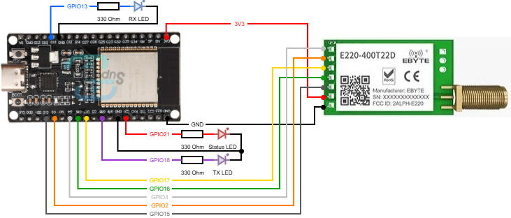

# Wiring Diagram: Reproducible Specification



Source file: [`images/LoRaIoT.drawio`](images/LoRaIoT.drawio). Exported picture: [`images/LoRaIoT.png`](images/LoRaIoT.png).

This document is a **repeatable specification**, not just a wiring guide. Starting from a `.drawio` file that contains only the two device pictures (ESP32 and E220), following sections 1 to 6 (or pasting the prompt of section 7 into Bob in Agent or Draw.io mode) reproduces the complete `LoRaIoT.drawio`. Section 8 is a short real-world assembly checklist.

All coordinates are draw.io units (pixels, origin top-left, y grows downwards). Pin dots are 6x6 ellipses, so the coordinates given are their top-left corner; the dot centre is at +3/+3.

---

## 1. Starting point

A draw.io file `doc/images/LoRaIoT.drawio` (single page, `dx="388" dy="302" grid="1" gridSize="10" page="1" pageWidth="827" pageHeight="1169"`; `dx`/`dy` are only the editor scroll offset and do not change the result) that contains exactly two cells besides the root cells `0` and `1`:

| Cell id | Picture | Source file | x | y | width | height | Style |
|---|---|---|---|---|---|---|---|
| `LmXVRe2-s3JQDYUS3DH0-1` | ESP32-WROOM-32 DevKit (38 pin) | `doc/images/ESP32-WROOM-32.jpg` | 30 | 280 | 260 | 132.5 | `shape=image;imageAspect=0;aspect=fixed;verticalLabelPosition=bottom;verticalAlign=top;image=data:image/jpeg,...` |
| `LmXVRe2-s3JQDYUS3DH0-2` | Ebyte E220-400T22D | `doc/images/E220.jpg` | 490 | 288.75 | 271 | 115 | same style, other image data |

Do not move, resize or edit these two cells. Everything else is anchored to their pixel positions.

### 1.1 Pin labels printed on the ESP32 picture (left to right)

- Top row: V5 CMD SD3 SD2 G13 GND G12 G14 G27 G26 G25 G23 G32 G35 G34 SM SP EN 3V3
- Bottom row: CLK SD0 SD1 G15 G2 G0 G4 G16 G17 G5 G18 G19 GND G21 RXD TXD G22 G23 GND

Read both rows left to right as printed on the picture. The rightmost bottom pin is **GND**, the rightmost top pin is **3V3**. `RXD`/`TXD` on the bottom row are GPIO3/GPIO1 (UART0) and are not used.

### 1.2 Pin order on the E220 picture

The seven pins are on the **left edge** of the board. Pin dots are 14 px apart at x=489. From top to bottom: **M0, M1, RXD, TXD, AUX, VCC, GND** (see the table in section 3).

---

## 2. Design rules

These are the decisions taken while building the diagram. They must be applied exactly.

1. **Pin markers:** every connection point is a 6x6 filled ellipse placed on the pin of the picture. Fill and stroke colour equal the wire colour. The marker is the source or target of the edge (so edges stay attached if a marker is moved).
2. **Wires** are edges with `edgeStyle=orthogonalEdgeStyle`, `rounded=0`, `endArrow=none`, `endFill=0` and `strokeWidth=2`. Colour is per wire (section 3).
3. **Wire colours** (hex): black `#000000`, red `#FF0000`, dark grey `#595959`, green `#00A000`, yellow `#FFD700`, orange `#FF8000`, light grey `#BFBFBF`, blue `#0066FF` (RX LED), purple `#9933CC` (TX LED).
4. **A wire leaving a GPIO pin is never black.** Black is reserved for GND.
5. **E220 colour code, from the top pin to the bottom pin:** M0 light grey, M1 orange, RXD yellow, TXD green, AUX dark grey, VCC red, GND black. The colour of a signal follows the signal: the ESP32 end has the same colour as the E220 end.
6. **GND choices:**
   - E220 GND uses the **rightmost** GND pin of the bottom row (next to the right-hand G23). The wire crosses other wires, which is accepted.
   - Status LED GND uses the GND pin **directly left of G21** (bottom row).
   - TX LED GND has no pin of its own: its return wire ends in the junction dot `TX-9` on the status LED return wire (`LED-7`), so both LEDs share the GND pin left of G21.
   - RX LED GND uses the GND pin **directly right of G13** (top row).
7. **Power:** E220 VCC comes from the 3V3 pin (rightmost of the top row); the wire leaves the **top** of the board and runs over it.
8. **Resistor** is drawn as a plain **rectangle** (IEC style, not a zig-zag), 30x10, with a black 2 px border and no fill. It sits **immediately before the LED** (GPIO -> resistor -> LED -> GND) so that its label row lines up with the other GPIO labels. Value **330 Ohm** (220 Ohm would also work). All three LED circuits use the same resistor.
9. **LEDs** use the shape `mxgraph.electrical.opto_electronics.led_2`, 25x15, with a pale fill that matches the wire colour: status LED light red, TX LED light purple, RX LED light blue. The "+" side (left, anode) is connected to the resistor with a wire in the signal colour (red, purple, blue). The return wire to GND is **black**.
10. **Labels** are 8 pt text cells with white background, coloured like their wire, placed on the wire next to the ESP32 (section 5). The text "330 Ohm" must stay on **one line** (do not set `whiteSpace` on that cell; `whiteSpace=nowrap` is not a valid draw.io value). The LED names "Status LED", "TX LED" and "RX LED" are vertically level with their "330 Ohm". Labels are the **last cells** in the file so they are painted above every wire; a label defined before a wire is overdrawn by it.
11. **Compactness:** the status and TX LED circuits sit tight under the bottom row of the ESP32 pins; the bundle of E220 signal wires runs directly below them. The RX LED circuit sits above the top row, left of the 3V3 wire. No wasted space between them.
12. **Writing style:** hyphens only, no em dash or en dash.

---

## 3. Wiring table

| Signal | ESP32 pin (picture label) | ESP32 marker id | ESP32 marker x, y | E220 pin | E220 marker id | E220 marker x, y | Colour |
|---|---|---|---|---|---|---|---|
| M0 | GPIO4 (`G4`) | `W-7` | 126.5, 402 | pin 1 (top) | `W-8` | 489, 302 | light grey `#BFBFBF` |
| M1 | GPIO2 (`G2`) | `W-6` | 104.9, 402 | pin 2 | `W-9` | 489, 316 | orange `#FF8000` |
| RXD | GPIO17 (`G17`, UART2 TX) | `W-5` | 150.3, 402 | pin 3 | `W-10` | 489, 330 | yellow `#FFD700` |
| TXD | GPIO16 (`G16`, UART2 RX) | `W-4` | 138.4, 402 | pin 4 | `W-11` | 489, 344 | green `#00A000` |
| AUX | GPIO15 (`G15`) | `W-3` | 93, 402 | pin 5 | `W-12` | 489, 358 | dark grey `#595959` |
| VCC | 3V3 (top row, rightmost) | `W-2` | 264.7, 286 | pin 6 | `W-13` | 489, 372 | red `#FF0000` |
| GND | GND (bottom row, rightmost) | `W-1` | 266, 402 | pin 7 (bottom) | `W-14` | 489, 386 | black `#000000` |

Status, TX and RX LED (not connected to the E220):

| Part | Connection | Marker id | Marker x, y | Colour |
|---|---|---|---|---|
| ESP32 GPIO21 (`G21`) | -> resistor of the status LED | `LED-1` | 207, 402 | red `#FF0000` |
| ESP32 GND left of `G21` | <- status LED cathode | `LED-2` | 195.5, 402 | black `#000000` |
| ESP32 GPIO18 (`G18`) | -> resistor of the TX LED | `TX-1` | 172.9, 402 | purple `#9933CC` |
| Junction on the status LED return wire (`LED-7`) | <- TX LED cathode | `TX-9` | 372, 449 | black `#000000` |
| ESP32 GPIO13 (`G13`, top row) | -> resistor of the RX LED | `RX-1` | 99.5, 286 | blue `#0066FF` |
| ESP32 GND right of `G13` (top row) | <- RX LED cathode | `RX-2` | 111.3, 286 | black `#000000` |

Every marker is `parent="1"`, `vertex="1"`, `value=""`, geometry width 6 and height 6, style:

```
ellipse;whiteSpace=wrap;html=1;fillColor=<C>;strokeColor=<C>;
```

with `<C>` the colour of the row.

---

## 4. Edges (wires)

All edges: `edge="1" parent="1"`, style prefix

```
edgeStyle=orthogonalEdgeStyle;rounded=0;html=1;
```

followed by the exit/entry part, then `endArrow=none;endFill=0;strokeWidth=2;strokeColor=<C>;`. Edge geometry is `<mxGeometry relative="1" as="geometry">` with an `<Array as="points">` of `mxPoint` waypoints where listed.

### 4.1 E220 wires

Exit/entry part for all except `W-16`: `exitX=0.5;exitY=1;exitDx=0;exitDy=0;entryX=0;entryY=0.5;entryDx=0;entryDy=0;` (leave the bottom of the ESP32 marker, enter the left of the E220 marker). `W-16` uses `exitY=0` because it leaves the top of the board.

| Edge id | Source | Target | Colour | Waypoints (x, y) in order |
|---|---|---|---|---|
| `W-15` | `W-1` | `W-14` | `#000000` | (269, 414), (480, 414), (480, 389) |
| `W-16` | `W-2` | `W-13` | `#FF0000` | (267.7, 270), (470, 270), (470, 375) |
| `W-17` | `W-3` | `W-12` | `#595959` | (96, 542), (460, 542), (460, 361) |
| `W-18` | `W-4` | `W-11` | `#00A000` | (141.4, 506), (430, 506), (430, 347) |
| `W-19` | `W-5` | `W-10` | `#FFD700` | (153.3, 494), (420, 494), (420, 333) |
| `W-20` | `W-6` | `W-9` | `#FF8000` | (107.9, 530), (450, 530), (450, 319) |
| `W-21` | `W-7` | `W-8` | `#BFBFBF` | (129.5, 518), (440, 518), (440, 305) |

Routing principle: the horizontal runs below the ESP32 are staggered by 12 px, the wire whose ESP32 pin is furthest right (GPIO17) running highest at y=494 and the one furthest left (GPIO15) lowest at y=542. The bundle starts 30 px lower than it would without the TX LED, which leaves room for the TX LED circuit (y=460 to 470) between the GND wire (y=414) and the bundle. The vertical runs in front of the E220 are staggered by 10 px (x = 420 ... 460), so that the lines never overlap. The black GND wire runs at y=414 and enters the E220 at x=480; the red 3V3 wire runs above the ESP32 at y=270 and comes down at x=470.

### 4.2 LED parts and wires (status, TX and RX LED)

Resistors share the style `rounded=0;html=1;fillColor=none;strokeColor=#000000;strokeWidth=2;verticalLabelPosition=bottom;verticalAlign=top;fontSize=8;spacingTop=2.5;`. LEDs share the style prefix `verticalLabelPosition=bottom;verticalAlign=top;shape=mxgraph.electrical.opto_electronics.led_2;html=1;` followed by the fill/stroke colours of the table and `fontSize=8;strokeWidth=2;`.

| Id | Kind | Value | x | y | w | h | Fill / stroke colour |
|---|---|---|---|---|---|---|---|
| `LED-3` | resistor (vertex) | `330 Ohm` | 290 | 423 | 30 | 10 | none / `#000000` |
| `LED-4` | status LED (vertex) | `Status LED` | 335 | 419.5 | 25 | 15 | `#f8cecc` / `#b85450` |
| `TX-3` | resistor (vertex) | `330 Ohm` | 290 | 460 | 30 | 10 | none / `#000000` |
| `TX-4` | TX LED (vertex) | `TX LED` | 335 | 456.5 | 25 | 15 | `#e1d5e7` / `#9673a6` |
| `RX-3` | resistor (vertex) | `330 Ohm` | 170 | 240 | 30 | 10 | none / `#000000` |
| `RX-4` | RX LED (vertex) | `RX LED` | 215 | 236.5 | 25 | 15 | `#dae8fc` / `#6c8ebf` |

| Edge id | Source | Target | Exit/entry part | Colour | Waypoints |
|---|---|---|---|---|---|
| `LED-5` | `LED-1` | `LED-3` | `exitX=0.5;exitY=1;exitDx=0;exitDy=0;entryX=0;entryY=0.5;entryDx=0;entryDy=0;` | `#FF0000` | none |
| `LED-6` | `LED-3` | `LED-4` | `exitX=1;exitY=0.5;exitDx=0;exitDy=0;entryX=0;entryY=0.5;entryDx=0;entryDy=0;entryPerimeter=0;` | `#FF0000` | none |
| `LED-7` | `LED-4` | `LED-2` | `exitX=1;exitY=0.5;exitDx=0;exitDy=0;exitPerimeter=0;entryX=0.5;entryY=1;entryDx=0;entryDy=0;` | `#000000` | (375, 428), (375, 452), (198.5, 452) |
| `TX-5` | `TX-1` | `TX-3` | `exitX=0.5;exitY=1;exitDx=0;exitDy=0;entryX=0;entryY=0.5;entryDx=0;entryDy=0;` | `#9933CC` | none |
| `TX-6` | `TX-3` | `TX-4` | `exitX=1;exitY=0.5;exitDx=0;exitDy=0;entryX=0;entryY=0.5;entryDx=0;entryDy=0;entryPerimeter=0;` | `#9933CC` | none |
| `TX-7` | `TX-4` | `TX-9` | `exitX=1;exitY=0.5;exitDx=0;exitDy=0;exitPerimeter=0;entryX=0.5;entryY=1;entryDx=0;entryDy=0;` | `#000000` | (375, 465) |
| `RX-5` | `RX-1` | `RX-3` | `exitX=0.5;exitY=0;exitDx=0;exitDy=0;entryX=0;entryY=0.5;entryDx=0;entryDy=0;` | `#0066FF` | none |
| `RX-6` | `RX-3` | `RX-4` | `exitX=1;exitY=0.5;exitDx=0;exitDy=0;entryX=0;entryY=0.5;entryDx=0;entryDy=0;entryPerimeter=0;` | `#0066FF` | none |
| `RX-7` | `RX-4` | `RX-2` | `exitX=1;exitY=0.5;exitDx=0;exitDy=0;exitPerimeter=0;entryX=0.5;entryY=0;entryDx=0;entryDy=0;` | `#000000` | (255, 245), (255, 270), (114.3, 270) |

The TX LED return wire `TX-7` ends in the junction dot `TX-9` at (372, 449), whose centre (375, 452) is the corner of `LED-7`; both LEDs therefore share the GND pin left of G21. The RX LED is the only LED on the top row: its anode wire leaves the top of `RX-1` (`exitY=0`) and its return wire enters the top of `RX-2`, the GND pin right of G13.

---

## 5. Labels

All labels are `parent="1" vertex="1"` text cells with style

```
text;html=1;fontSize=8;align=center;verticalAlign=middle;fillColor=#ffffff;strokeColor=none;spacing=0;fontColor=<C>;
```

| Id | Text | x | y | w | h | Colour `<C>` | Sits on wire |
|---|---|---|---|---|---|---|---|
| `W-22` | `GND` | 300 | 409 | 24 | 10 | `#000000` | `W-15` (horizontal run at y=414) |
| `W-23` | `3V3` | 360 | 265 | 24 | 10 | `#FF0000` | `W-16` (run at y=270) |
| `W-24` | `GPIO15` | 240 | 537 | 36 | 10 | `#595959` | `W-17` (run at y=542) |
| `W-25` | `GPIO2` | 240 | 525 | 36 | 10 | `#FF8000` | `W-20` (run at y=530) |
| `W-26` | `GPIO4` | 240 | 513 | 36 | 10 | `#BFBFBF` | `W-21` (run at y=518) |
| `W-27` | `GPIO16` | 240 | 501 | 36 | 10 | `#00A000` | `W-18` (run at y=506) |
| `W-28` | `GPIO17` | 240 | 489 | 36 | 10 | `#FFD700` | `W-19` (run at y=494) |
| `W-29` | `GPIO21` | 240 | 423 | 36 | 10 | `#FF0000` | `LED-5`/`LED-6` (red wire into the resistor) |
| `TX-8` | `GPIO18` | 240 | 460 | 36 | 10 | `#9933CC` | `TX-5`/`TX-6` (purple wire into the resistor, run at y=465) |
| `RX-8` | `GPIO13` | 122 | 240 | 36 | 10 | `#0066FF` | `RX-5`/`RX-6` (blue wire into the resistor, run at y=245) |

The labels `GPIO15` ... `GPIO17`, `GPIO18` and `GPIO21` all share x=240, so they form one clean column; `GPIO13` sits on the top row at x=122 because its pin is on the top edge. The white fill hides the wire behind the text. `RX-8` and `TX-8` are the last two cells of the file so that the wires of the RX and TX LEDs are painted below them; `W-22` ... `W-29` also come after all wires they sit on.

---

## 6. Build order and checks

1. Open `LoRaIoT.drawio` with only the two image cells.
2. Add the 16 pin markers (`LED-1`, `LED-2`, `W-1` ... `W-14`) and the 4 LED markers `RX-1`, `RX-2`, `TX-1`, `TX-9` from section 3.
3. Add `LED-3` and `LED-4` and the edges `LED-5` ... `LED-7`, then `RX-3`, `RX-4` and `RX-5` ... `RX-7`, then `TX-3`, `TX-4` and `TX-5` ... `TX-7` (section 4.2).
4. Add the edges `W-15` ... `W-21` (section 4.1).
5. Add the labels `W-22` ... `W-29`, `RX-8` and `TX-8` (section 5). Labels are added last so that they are drawn on top of the wires.
6. Check, in this order:
   - Every marker sits on the pin dot of the picture (zoom to 400 %).
   - Wire colours match section 3 and no GPIO wire is black.
   - E220 colours read, top to bottom: light grey, orange, yellow, green, dark grey, red, black.
   - No two wires overlap; the only crossings are the accepted ones of the GND wire.
   - Every "330 Ohm" is on one line and level with its LED name ("Status LED", "RX LED", "TX LED").
   - No label (in particular `GPIO13` and `GPIO18`) is overdrawn by a wire.
   - The XML contains no em dash or en dash.
7. Export as PNG to `doc/images/LoRaIoT.png`.

Note for editors: draw.io may rewrite coordinates when the file is saved after manual tweaks (for example the `dx`/`dy` page offset). Always re-read the file before applying an automated change.

---

## 7. Ready-to-paste prompt

Paste this into Bob (Agent mode, or Draw.io mode if the file is the only target) after placing the two pictures in the file:

```text
Open doc/images/LoRaIoT.drawio. It contains only the images of the ESP32-WROOM-32
(id LmXVRe2-s3JQDYUS3DH0-1, x=30 y=280 260x132.5) and the E220-400T22D
(id LmXVRe2-s3JQDYUS3DH0-2, x=490 y=288.75 271x115). Do not change them.
Add the complete wiring exactly as specified in doc/WiringLoRaIot.md,
sections 2 to 5:

1. Place 6x6 ellipse pin markers (fill = stroke = wire colour) on the ESP32 and
   E220 pins at the coordinates of the section 3 tables, with the ids given there.
2. Wire them with orthogonal 2 px edges without arrows, with the waypoints of
   section 4.1: M0 light grey GPIO4, M1 orange GPIO2, RXD yellow GPIO17, TXD green
   GPIO16, AUX dark grey GPIO15, VCC red 3V3 (leaves the top of the board),
   GND black to the rightmost bottom GND pin. E220 pins from top to bottom are
   M0, M1, RXD, TXD, AUX, VCC, GND. A GPIO wire is never black.
3. Add the status LED: GPIO21 -> 330 Ohm resistor (plain rectangle, 30x10, label
   "330 Ohm" on one line) -> LED (mxgraph.electrical.opto_electronics.led_2,
   label "Status LED") -> black wire back to the GND pin directly left of G21.
   The wire to the "+" side of the LED is red. The resistor is immediately
   before the LED. Geometry and waypoints as in section 4.2.
   Add the TX LED the same way: GPIO18 (purple) -> 330 Ohm -> "TX LED"; its black
   return wire ends in the junction dot TX-9 on the status LED return wire.
   Add the RX LED above the top row: GPIO13 (blue) -> 330 Ohm -> "RX LED" ->
   black wire back to the GND pin directly right of G13 (top row).
4. Add the 8 pt coloured labels of section 5 (GND, 3V3, GPIO15, GPIO2, GPIO4,
   GPIO16, GPIO17, GPIO21, GPIO18, GPIO13) with white background. Keep the bottom
   GPIO labels in one column at x=240. Keep each LED name level with its
   "330 Ohm". Add the labels as the LAST cells of the file so no wire is painted
   over a label.
5. Use only hyphens, never em or en dashes. Do not build or flash anything.
6. When done, verify with the checklist of section 6 and tell me which items you
   could not verify.
```

---

## 8. Real-world assembly checklist (secondary)

The diagram shows the electrical connections; this is the matching bench procedure.

| Step | Action |
|---|---|
| 1 | Power off and unplug the USB cable. Fit the **antenna** to the E220 before connecting power (transmitting without an antenna can damage the PA). |
| 2 | Connect the seven E220 pins to the ESP32 as in section 3. Use short wires; keep VCC and GND short and add a 100 uF capacitor across E220 VCC and GND (see `ReadMe.md` §3). |
| 3 | LEDs (three per node, each wired GPIO -> 330 Ohm resistor -> LED anode (longer leg); LED cathode (shorter leg, flat side) -> GND): Status LED on GPIO21 (cathode to the GND pin left of G21), RX LED on GPIO13 (cathode to the GND pin right of G13 on the top row), TX LED on GPIO18 (cathode joined to the Status LED GND wire, so it shares the GND pin left of G21). At 3.3 V and about 2 V LED forward voltage (red, yellow, green) the current is roughly 4 mA, well below the GPIO limit. 220 Ohm gives about 6 mA and is also fine. The blue and purple colours in the diagram only tell the circuits apart, they do not prescribe the LED colour; blue and white LEDs have a forward voltage near 3 V and are dim at 330 Ohm. |
| 4 | The E220 is 3.3 V TTL native, no level shifters are needed. If the module is ever supplied from 5 V together with a 5 V MCU, add 4.7 kOhm pull-ups on TXD and AUX (see [`Feasibility.md`](Feasibility.md) §3.1). |
| 5 | Check with a multimeter: no short between 3V3 and GND, and continuity for each of the seven signals. |
| 6 | Connect USB, flash the firmware (manually, from your IDE) and watch the three LEDs. Meaning of the LED states: see the pin mapping table in [`../ReadMe.md`](../ReadMe.md) §3. |

Related documents: [`Feasibility.md`](Feasibility.md) §3.1 (schematic and pin table), [`../ReadMe.md`](../ReadMe.md) §3 (canonical pin mapping).
