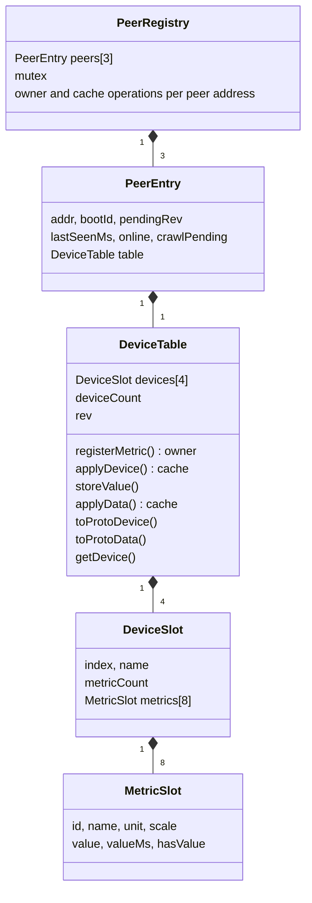

# Plan: push-only data flow and control data (TechDebt.md chapter 8)

Source of the requirements: `doc/TechDebt.md` chapter 8 (decisions D1 to D10, sections 8.3 to 8.11).
This file turns them into small steps. Each step can be built, flashed and tested on its own before the
next one starts. Steps 0-14 are complete; Step 15 is next.

Known test nodes (from `AGENTS.md`): LOCAL `http://192.168.1.147` (LoRa address 0x01), REMOTE
`http://192.168.1.174` (LoRa address 0x02). Use `curl.exe` (not the PowerShell `curl` alias).

## Status

| Step | Title | Kind | Status |
|---|---|---|---|
| 0 | Baseline | measure | [x] |
| 1 | Analysis and design decision | doc | [x] |
| 2 | Spec update | doc | [x] |
| 3 | `DeviceTable` (shared building block) | code, no behavior change | [x] |
| 4 | `SensorRegistry` on `DeviceTable` | code, no behavior change | [x] |
| 5 | `DeviceRegistry` on `DeviceTable`, shared JSON writer | code, no behavior change | [x] |
| 6 | Merge into `PeerRegistry` (two instances) | code, no behavior change | [x] |
| 7 | Role-independent receive path and crawler | code, no new traffic | [x] |
| 8 | REST renames, REMOTE views, LOCAL control registration | code + docs | [x] |
| 9 | Control definitions reach REMOTE (PING carries `registry_rev`) | code | [x] |
| 10 | Reliable `DATA_ACK` path | code | [x] |
| 11 | Control values pushed on POST | code | [x] |
| 12 | Push after crawl and after reboot or return | code | [x] |
| 13 | Age, link indicator, `live` and `refresh` on cache views | code | [x] |
| 14 | Failure tests | test only | [x] |
| 15 | Cleanup and final docs | doc + code | [x] |

## Rules for every step

These come from `AGENTS.md` and apply to all code steps.

- The agent never builds or flashes. The developer runs the PlatformIO or Arduino build manually and
  reports size and warnings. Do not add build commands to any hook.
- No new files under `src/main/java/`. Never write under `ESP/`.
- Use `TASK_CREATE`, then `TaskRegistry.add(name, handle, stackSize)` for every new task.
- No underscore-prefixed members. Braces on every `if`. No magic numbers (named `static constexpr`).
- Function prototypes live in headers. Use `Log_*` macros, never `Serial.println()`.
- ESPAsyncWebServer handlers run on Core 0: never touch Serial2 there. Block only on the broker
  semaphore, and stay below the 5 s task watchdog (`BROKER_MAX_TIMEOUT_MS` = 4000).
- `loraTransportTask` (4096 B stack) runs the receive callback. It must never block waiting for a
  frame that it has to receive itself, and must not copy large structs by value.
- A REST endpoint is added in `RestService::registerRoutes()`, and in the same step in
  `src/LoRaIoT/src/openapi_json.h` and `doc/RestApi.md`. Manual-use endpoints are `GET` and get a link in
  `index_html.h`.
- Writing style: use `-`, never the long dashes.
- Regression after every code step: run the skills `loraiot-ping` and `loraiot-pingall`, and compare
  `GET /status` memory with the Step 0 baseline.
- One git commit per step, so any step can be reverted alone.

## Findings from the code (evidence for this plan)

1. `SensorRegistry` (REMOTE only) and `DeviceRegistry` (LOCAL only) store the same information (device
   index, name, metrics with id, name, unit, scale, and values) in two unrelated layouts.
2. `DeviceRegistry.storeData()` replaces the whole `lastData` of a device. A push that carries only one
   changed metric therefore erases the other values. Chapter 8 expects partial pushes, so this must change.
3. `DEVICE_REGISTRY_MAX_DEVICES = 5` ("device 0 plus 4"), but the crawler starts at index 1 and
   `SensorRegistry` allows 4 devices (1..4). Slot 0 is never used.
4. `getNode()` copies a whole `NodeEntry` (about 2 KB). `PingTask` and the crawler already work around
   this with `getLiveness()` and `getBootId()`, because their stacks are only 4 KB.
5. The REST snapshot handler contains the same JSON-building block twice (single node and all nodes).
6. `?refresh=true` is documented (`doc/LoRaProtocol.md` section 17) but `RestService.cpp` has no code for
   it.
7. `DATA_ACK` exists only as an enum value in `LoRaFrame.h`. No code sends it, receives it or answers it.
   `POST /api/lora/nodes/data` still uses the unframed `LoRaTransport.sendRaw()` stub (`[Phase2 stub]`).
8. `onLoRaReceive` gates REQUEST, RESPONSE, DATA and ACK handling on `isLocal`. A duplicate frame returns
   before any reply, so a duplicate `DATA_ACK` is not ACKed again (the spec requires an ACK again).
9. The broker has one in-flight slot (`pendingActive`). This matches protocol section 9: a node that waits
   for an ACK or RESPONSE sends nothing else except replies.
10. `describeCrawlerOnResponse()` never compares `response.request_seq` with `ctx.inFlightSeq`.
11. `Application.cpp` starts both registries on both tiers, before `Gateway.begin()`.
12. `/status` already reports `freeHeap`, `minFreeHeap`, `maxAllocHeap` and the stack high-water mark per
    task. Flash headroom is about 96 KB (TechDebt chapter 6), so every step must watch image growth.
13. `PingTask` (LOCAL) is the only sender of PINGs and builds them in `LoRaBroker.cpp`. The PING payload is
    a `Beacon` with only `boot_id`, and the `Beacon` message already has the optional `registry_rev`.

## Target design (decided in Step 1)

### Why one structure is enough

The difference between the four tables in TechDebt 8.3 is only who writes to them.

| Aspect | `SensorRegistry` today | `DeviceRegistry` today | Verdict |
|---|---|---|---|
| Role | owner (REST creates entries) | cache (Describe and Data fill it) | Same data, different write path |
| Device key | name, index assigned by the registry | index from Describe | After registration both are (index, name, metrics) |
| Metric storage | plain struct with value, `lastValueMs`, `hasValue` per metric | nanopb `loraiot_Device` plus one `loraiot_Data` per device | Per-metric value is right and allows partial pushes |
| Time of a value | `millis()` per metric | one `age_ms` and one `lastDataMs` per device | Per metric |
| Revision | counted (`registryRev++`) | received (`pendingRev`, `registryRev`) | One `rev` field: the owner counts it, the cache copies it |
| Peers | none (the peer is always LOCAL) | up to 3 nodes by address | An array of peers, 1 used on REMOTE |
| Liveness | none | `bootId`, `lastSeenMs`, `online`, `crawlPending` | Peer metadata, also useful on REMOTE for LOCAL |
| Capacity | 4 devices x 8 metrics | 5 slots x 8 metrics | Unify to 4 x 8 |
| Payload size check | `estimateEncodedDeviceSize()` | none | Owner only, shared helper |
| Locking | mutex | mutex | Same |

Answers to the questions of the discussion:

- The same layout works for `ControlRegistry` on LOCAL and for the control cache on REMOTE. They are
  `SensorRegistry` and `DeviceRegistry` with roles swapped.
- `SensorRegistry` and `DeviceRegistry` can be merged into one class. LOCAL uses 3 peer slots, REMOTE uses 1.

### Classes

Two global instances exist on both nodes: `SensorRegistry` and `ControlRegistry` (both `PeerRegistry`).
Their role depends on the tier. LoRa code never branches on the tier. It uses two accessors:

| Accessor | On LOCAL | On REMOTE |
|---|---|---|
| `ownedRegistry()` (answers Describe and Read, pushes values) | `ControlRegistry` | `SensorRegistry` |
| `cachedRegistry()` (crawled by Describe, filled by pushes) | `SensorRegistry` | `ControlRegistry` |

Only the REST layer uses the names `SensorRegistry` and `ControlRegistry` directly (Step 8). On REMOTE both
registries use the single peer key `LORA_DEFAULT_ADDR_LOCAL` (0x01).

### Rules for the shared structure

- No function returns or copies a whole table or registry. Accessors copy one `DeviceSlot` (about 340 B)
  or a few scalars.
- A pushed `Data` updates only the metrics it names (partial update). Every value stores its own time.
- A value's time is `millis() - age_ms` at arrival, so `age_ms` on a later read is correct end to end.
- A `Data` frame with an unknown device or an unknown metric id is not applied and returns a result code
  (`UNKNOWN_DEVICE`, `UNKNOWN_METRIC`). The caller schedules a crawl.
- Applying a changed `Device` keeps the values of metrics whose id, unit and scale did not change and
  clears the others.
- The owner function `registerMetric()` keeps the existing rules: names 12 and 5 characters, at most 8
  metrics, at most 4 devices, and the payload size check against `LORA_MAX_PAYLOAD_LEN`.

### Refinements to TechDebt chapter 8 (applied to the text in Step 1)

| # | Refinement | Reason |
|---|---|---|
| R1 | Push the values once at the end of a crawl (the owner sees `Describe` for index count+1 and answers `BAD_REQUEST`), not after every device. | A push in the middle of a crawl collides with the peer's next `Describe` request (half duplex). |
| R2 | A node answers a `DATA_ACK` for an unknown device with `ACK{status=BAD_REQUEST}` and starts a crawl. | The `Ack` message already defines `BAD_REQUEST` as "received but not accepted". No `.proto` change. |
| R3 | The control POST answers `202` when the sender only learned that the peer does not know the device yet, `200` after an `ACK{OK}`, `504` after no ACK. | The first value of a new device cannot be accepted before the crawl finishes. |
| R4 | LOCAL puts `registry_rev` into a PING only for a node that has control devices. | A node without control data needs no crawl and no airtime. |
| R5 | Background pushes (end of crawl, node back online) run in a small task with a queue. | The receive callback cannot wait for an ACK that it must receive itself. |
| R6 | The wire format does not change at all (no `.proto` change, no nanopb regeneration). | Everything needed already exists: optional `registry_rev`, `Ack.status`, `DATA_ACK`. |

---

# Phase A - Prepare

## Step 0 - Baseline

Goal: have numbers and golden output to compare against after each refactoring step.

Do:
1. Developer builds the current firmware and notes the image size and flash percentage.
2. On both nodes save `GET /status` (heap, `minFreeHeap`, `maxAllocHeap`, task stack minimums) and
   `GET /api/lora/stats`. Keep the files outside the repo, for example in `$env:TEMP\loraiot-baseline`.
3. On REMOTE post a sensor: `POST http://192.168.1.174/api/sensor/data` with
   `{"device":"Sensor A","metrics":{"Voltage":{"value":335,"unit":"V","scale":100},"Temp":{"value":215,"unit":"C","scale":10}}}`.
4. After a few seconds save `GET http://192.168.1.147/api/lora/nodes/snapshot` and
   `GET http://192.168.1.147/api/lora/nodes` as the golden output.
5. Run the skills `loraiot-ping`, `loraiot-pingall` and `loraiot-resources`.

Done when: baseline files exist and ping works on both nodes.

## Step 1 - Analysis and design decision (documentation only)

Goal: confirm the table and class design above before any code is written.

Do:
1. Review "Target design" with the developer. Resolve the open points listed at the end of this file.
2. Copy the final decisions and refinements R1 to R6 into `doc/TechDebt.md` chapter 8 (sections 8.3, 8.7,
   8.8, 8.9, 8.13) so that chapter and plan do not contradict each other.

Done when: the developer approved the design and TechDebt chapter 8 matches it.

## Step 2 - Spec update (documentation only)

Goal: the written protocol matches the new behavior, so later steps have a reference.

Do in `doc/LoRaProtocol.md`:
- Section 5: both nodes may send and answer REQUEST and DATA. Add that a `DATA_ACK` to an unknown device is
  answered with `ACK{BAD_REQUEST}`.
- Section 8: LOCAL's PING may carry `registry_rev` (R4). Remove nothing else.
- Section 9: delete "LOCAL may poll cyclically by sending REQUEST(Read)". Say that values are pushed, and
  `Read` is only an on-demand fetch.
- Section 10: change the rule "A PING sets only `boot_id`" to "A PING sets `boot_id` and may set
  `registry_rev`". Update the `Beacon` comments in the proto block.
- Section 12 and section 15: both nodes own and cache devices; the crawl starts at device 1 (the text and
  diagram still say 0); add the push after the end of a crawl (R1); add the diagram for control data.
- Section 17: new REST table (Step 8).
- Keep `src/lora/proto/loraiot.proto` identical to section 10 (comments only).

Done when: the document is consistent. No code and no `.options` change.

---

# Phase B - Shared data structure (no behavior change)

Each step in this phase must leave the system behaving exactly as before. The golden output of Step 0 is
the test.

## Step 3 - `DeviceTable`

Goal: one building block that all four tables use.

Do:
- Create `src/registry/library.properties` (same format as all other libraries under `src/`, no `depends=`
  field - all cross-library dependencies in this project are resolved via `#include` at build time).
  Set `name=registry`. This is where the shared data layer lives; the `lib_dir = src` setting in
  `platformio.ini` makes PlatformIO and the Arduino IDE pick it up automatically alongside `util`, `lora`,
  `diagnostics`, `service`, and `LoRaIoT`.
- New files `src/registry/src/DeviceTable.h/.cpp` with `MetricSlot`, `DeviceSlot`, `DeviceTable`
  (actual location: `src/registry/src/`, not `src/LoRaIoT/src/`)
  (`DEVICE_TABLE_MAX_DEVICES = 4`, `DEVICE_TABLE_MAX_METRICS = 8`, `DEVICE_TABLE_NAME_LEN = 13`,
  `DEVICE_TABLE_UNIT_LEN = 6`). The table has no mutex. The owner (`PeerRegistry`, Step 6) locks.
- Owner functions: `registerMetric()` (moved from `SensorRegistry`, with `estimateEncodedDeviceSize()` and
  the size constants).
- Cache functions: `applyDevice(const loraiot_Device&)` and `applyData(const loraiot_Data&, uint32_t nowMs)`
  returning `OK`, `UNKNOWN_DEVICE` or `UNKNOWN_METRIC`.
- Common: `storeValue()`, `toProtoDevice()`, `toProtoData()` (age from the oldest value present),
  `copyDevice(index, DeviceSlot&)`, `clear()`, `rev` getter and setter.
- Boot self-check `runDeviceTableCheck()` in `src/diagnostics/src/Diagnostics.cpp`, the same pattern as
  `runPingEncodeCheck()`. It covers: register and read back, size limit rejection, partial `applyData`
  keeps other values, unknown device and metric results, changed `Device` keeps unchanged values.

Not in scope: nothing uses the table yet.

Test: flash both nodes. Boot log shows `DeviceTable self-check PASS`. Regression skills pass.

## Step 4 - `SensorRegistry` on `DeviceTable`

Goal: prove the table in the owner role with the existing REMOTE flow. No caller changes anywhere.

### `src/LoRaIoT/src/SensorRegistry.h`

- Remove `#include "../../lora/src/LoRaTransport.h"` - no longer needed (DeviceTable.h brings it
  transitively).
- Add `#include "../../registry/src/DeviceTable.h"`.
- Remove the four `SENSOR_REGISTRY_*` constants (`MAX_DEVICES`, `MAX_METRICS`, `NAME_LEN`, `UNIT_LEN`) -
  replaced by the `DEVICE_TABLE_*` constants in DeviceTable.h. Add a comment pointing to that header.
- Remove `struct RegisteredMetric` and `struct RegisteredDevice` entirely.
- In `SensorRegistryClass` private section: replace `RegisteredDevice devices[SENSOR_REGISTRY_MAX_DEVICES]`,
  `uint8_t deviceCount`, and `uint32_t registryRev` with a single `DeviceTable table`. Keep
  `SemaphoreHandle_t mutex`.
- Remove private methods `findDevice()`, `findMetric()`, `estimateEncodedDeviceSize()` - all logic is
  now in `DeviceTable`.
- Change `getDevice(uint32_t, RegisteredDevice&)` to `getDevice(uint32_t, DeviceSlot&)` - `RegisteredDevice`
  is gone; `DeviceSlot` is the equivalent type. Zero external callers, so no ripple.
- All other public signatures stay exactly as today.

### `src/LoRaIoT/src/SensorRegistry.cpp`

Full rewrite as thin mutex wrappers around `DeviceTable`. Key points:
- `begin()`: create mutex only - no memset or counter resets (`DeviceTable` constructor zeroes itself).
- `registerMetric()`: lock, call `table.registerMetric(...)`, unlock, return result.
- `storeValue()`: lock, call `table.storeValue(deviceIdx, metricId, scaledValue, millis())`, unlock.
  (Behavioral note: `millis()` is now captured inside the lock, so the age is always accurate.)
- `getRegistryRev()`: `return table.getRev()` - no lock (single atomic read, same as the old direct field
  read).
- `getDeviceCount()`: `return table.getDeviceCount()` - no lock (same rationale).
- `getDevice()`: lock, `table.copyDevice(deviceIdx, out)`, unlock.
- `toProtoDevice()`: lock, `table.toProtoDevice(deviceIdx, out)`, unlock.
- `toProtoData()`: lock, `table.toProtoData(deviceIdx, out, millis())`, unlock.
  (Behavioral improvement: age_ms now reflects the oldest metric, not just `metrics[0]`.)
- Remove `findDevice()`, `findMetric()`, `estimateEncodedDeviceSize()`, and the PB size constants.
- Keep `SensorRegistryClass SensorRegistry;` singleton definition.

### `src/service/src/RestService.cpp`

One constant rename only: `SENSOR_REGISTRY_MAX_DEVICES` → `DEVICE_TABLE_MAX_DEVICES` in the
`pushedDevIdx[...]` array declaration and its matching bounds check (two places).

### No changes needed in

- `src/LoRaIoT/src/Application.cpp` - `begin()`, `toProtoDevice()`, `toProtoData()` signatures unchanged.
- `src/LoRaIoT/src/BeaconTask.cpp` - `getRegistryRev()` signature unchanged.
- `src/registry/src/DeviceTable.h/.cpp` - not touched in this step.
- `src/diagnostics/src/Diagnostics.cpp` - tests `DeviceTable` directly, unaffected.

Not in scope: `DeviceRegistry` and `Application.cpp` DATA/BEACON paths are untouched.

Test:
1. Boot log shows `DeviceTable self-check PASS` (unchanged from Step 3).
2. REMOTE: POST the Step 0 sensor (`Sensor A` with Voltage and Temp). Expect HTTP 200, `accepted` both
   metrics, `registry_rev` increments to 3 (1 device + 2 metrics).
3. REMOTE: POST a fifth device - expect HTTP 400 or `rejected` in the response body.
4. REMOTE: POST a metric with a 13-char name - expect `rejected`.
5. After Step 2: LOCAL `GET /api/lora/nodes/snapshot?addr=2` matches the golden output from Step 0.
6. BEACON log on REMOTE shows `registry_rev` in the beacon equal to 3.
7. Regression: run the `loraiot-ping` and `loraiot-pingall` skills. Both PASS.

## Step 5 - `DeviceRegistry` on `DeviceTable`, shared JSON writer

Goal: prove the table in the cache role, remove the duplicated REST code.

Do:
- `NodeEntry` holds one `DeviceTable` instead of `CachedDevice devices[5]`. Keep the public API.
  `storeDevice()` calls `applyDevice()`, `storeData()` calls `applyData()` (now partial and per metric).
- Add the accessor `getDeviceSlot(addr, deviceIdx, DeviceSlot&)` and `getNodeInfo(addr, ...)` with only
  scalars. Callers stop using `getNode()` (the 2 KB copy). Remove `getNode()` when no caller is left.
- Add one JSON writer, for example `writeTableJson(JsonObject, const DeviceTable&)`, and use it in the
  `snapshot` handler for both the single-node and the all-nodes branch. The output JSON layout must stay
  identical.
- The crawler (`DescribeCrawler.cpp`) uses `getNode()` to read `crawlPending` and `pendingRev`. Replace it
  with a small accessor (`isCrawlPending`, `getPendingRev`).

Test:
1. LOCAL `GET /api/lora/nodes/snapshot` and `?addr=2` and `?addr=2&device=1` equal the golden output.
2. Post one metric on REMOTE twice with different values. The LOCAL snapshot shows both metrics. (Before
   the step, the second push would have erased the other metric.)
3. Reboot REMOTE. LOCAL crawls again and the snapshot is complete again.
4. `GET /status`: `minFreeHeap` and the task stack minimums are not worse than the baseline.

## Step 6 - Merge into `PeerRegistry`

Goal: one class, two instances, role-based accessors. Last step of the pure refactoring.

Do:
- New files `src/registry/src/PeerRegistry.h/.cpp` (in the same `registry` library created in Step 3).
  `PeerEntry` is a struct defined in `PeerRegistry.h`. `PeerRegistry` holds `PeerEntry peers[LORA_MAX_PEERS]`,
  a mutex, and the node functions of `DeviceRegistry` (`updateNodeMeta`, `markSeen`, `markOffline`,
  `getLiveness`, `getBootId`, `markCrawlComplete`, `listPeers`) plus owner functions that take the peer
  address (`registerMetric(addr, ...)`, `storeValue(addr, ...)`). Eviction rules of `findOrCreateNode()` stay.
- Fix the layering violation in `src/lora/src/LoRaState.h` line 7: replace
  `#include "../../LoRaIoT/src/DeviceRegistry.h"` with `#include <PeerRegistry.h>`. The `lora` library
  must never include upward into `LoRaIoT`; after this change the dependency arrow is
  `LoRaIoT` -> `registry` -> `lora`, with no upward path.
- Rename the constant `DEVICE_REGISTRY_MAX_NODES` to `LORA_MAX_PEERS` (3). Check `LoRaState.h`, `PingTask.*`,
  `DescribeCrawler.cpp`, `RestService.cpp`.
- Instances `PeerRegistry SensorRegistry;` and `PeerRegistry ControlRegistry;`. Add `ownedRegistry()` and
  `cachedRegistry()` returning a reference by tier (`Gateway.getTierName()`), see the table above.
- On LOCAL all current `DeviceRegistry` calls become `SensorRegistry` calls (cache role, peer = REMOTE
  address). On REMOTE the former `SensorRegistry` calls become `SensorRegistry` calls with the key
  `LORA_DEFAULT_ADDR_LOCAL` (owner role).
- `ControlRegistry` exists but is unused yet.
- Move `begin()` for both registries to after `Gateway.begin()` only if the capacity depends on the tier.
  Default decision: fixed 3 peers on both tiers. Compare `freeHeap` with Step 0. If REMOTE loses more than
  about 4 KB, change to a tier-dependent allocation in `begin()`.

Test: everything from Step 4 and Step 5, plus the `GET /status` memory comparison (expected about equal to
the baseline, because two shared registries replace `DeviceRegistry` plus `SensorRegistry`). Developer
reports the image size and compares with Step 0.

---

# Phase C - Symmetric handling and REST (still no new traffic)

## Step 7 - Role-independent receive path and crawler

Goal: both nodes can send and answer REQUEST, RESPONSE and DATA. Discovery stays role-specific.

Do in `Application.cpp`:
- `REQUEST`: remove the `isLocal` gate. `sendDescribeResponse()` and `sendReadResponse()` use
  `ownedRegistry()` and the requesting peer's address. Echo works on both nodes. Unknown device still gives
  `BAD_REQUEST`. Since `ControlRegistry` is empty, LOCAL answers every `Describe` with `BAD_REQUEST`.
- `RESPONSE`: remove the `isLocal` gate. Routing stays: `def` or `BAD_REQUEST` to the crawler, everything
  else to the broker.
- `DATA`: remove the `isLocal` gate. Use `cachedRegistry()`. Result `UNKNOWN_DEVICE` or `UNKNOWN_METRIC`
  schedules a crawl (as now).
- Stay tier-specific: `markSeen` and "back online" log, `beaconTaskNotifyDiscovered`, PING reply
  (`sendPingAck`), BEACON handling.
- `DescribeCrawler`: operate on `cachedRegistry()` and a peer address instead of a hard-coded LOCAL view.
  Still one crawl in flight at a time; pending peers are served one after another (round robin). Add the
  missing check `response.request_seq == ctx.inFlightSeq` (finding 10). Update the file comment ("Only
  exists on LOCAL").
- `describeCrawlerLoop()` is called from `applicationLoop()` on both tiers.

Test:
1. All Step 4 to 6 tests still pass.
2. From REMOTE: `POST http://192.168.1.174/api/lora/nodes/echo?addr=1` with an echo body. LOCAL now answers
   with the reversed text (before this step LOCAL logged "unexpected REQUEST"). The echo endpoints are not
   tier-gated.
3. From REMOTE: `GET http://192.168.1.174/api/lora/nodes/snapshot?addr=1&device=1&live=true` returns 404
   with "node returned error" (LOCAL answers `BAD_REQUEST`). Check the log line on LOCAL
   `REQUEST(Read{device=1}) ... not found`. This is the proof that LOCAL answers Read.
4. A late duplicate `RESPONSE` does not advance a crawl (log shows the ignored `request_seq`).

## Step 8 - REST renames, REMOTE views, LOCAL control registration

Goal: the final REST surface of TechDebt 8.9 exists, but control data does not travel yet.

Do in `RestService::registerRoutes()` (and `openapi_json.h`, `doc/RestApi.md`, `doc/OpenAPI.md`,
`index_html.h` in the same step):

| Node | Endpoint | Behavior in this step |
|---|---|---|
| LOCAL | `GET /api/lora/nodes/sensor` | Renamed from `/api/lora/nodes/snapshot`. Cache view of `SensorRegistry`. |
| LOCAL | `GET /api/lora/nodes/control` | Owner view of `ControlRegistry`. `?addr=` selects the node. |
| LOCAL | `POST /api/lora/nodes/control?addr=` | Registers devices and metrics in `ControlRegistry[addr]` and stores the values. No LoRa traffic yet. Returns `accepted`, `rejected`, `registry_rev`. 400 for bad JSON or too-large device, 404 for an unknown `addr`. |
| REMOTE | `POST /api/lora/sensor/data` | Renamed from `/api/sensor/data`. Same body and behavior. |
| REMOTE | `GET /api/lora/nodes/sensor` | Owner view of `SensorRegistry`. `addr` gives 400. |
| REMOTE | `GET /api/lora/nodes/control` | Cache view of `ControlRegistry` (empty for now). `addr` gives 400. |

Rules:
- Every view uses the shared JSON writer of Step 5. The layout is identical on both nodes.
- `live=true` and `refresh=true` are accepted only on cache views and answered with 400 on owner views.
  Their implementation is Step 13; until then they keep the current behavior on LOCAL `nodes/sensor`.
- Update the URL table of `doc/LoRaProtocol.md` section 17. Chapter 2 of `TechDebt.md` is history, leave it.

Test:
1. `POST http://192.168.1.147/api/lora/nodes/control?addr=2` with
   `{"device":"Charger","metrics":{"VoltageSet":{"value":333,"unit":"V","scale":100}}}`. Then
   `GET http://192.168.1.147/api/lora/nodes/control?addr=2` shows the device, metric and value.
2. A second POST with a new metric increases `registry_rev` by one. A POST with the same metric and a new
   value does not.
3. The REMOTE views answer on `192.168.1.174`; the old paths answer 404.
4. Step 4 and 5 tests still pass with the new sensor paths. The golden output equals the new
   `nodes/sensor` response.
5. Check the OpenAPI document `GET /openapi` lists every new path.

---

# Phase D - Control definitions reach REMOTE

## Step 9 - PING carries `registry_rev`, REMOTE tracks LOCAL

Goal: REMOTE learns the control schema with the same crawl LOCAL uses for sensors.

Do:
- `LoRaBroker.cpp` PING builder: set `has_registry_rev` and `registry_rev` from
  `ControlRegistry` for the destination address, only if that peer has devices (R4). Broadcast PINGs stay
  unchanged.
- REMOTE, `PING` case: decode the `Beacon`, call `cachedRegistry().updateNodeMeta(frame.src, boot_id,
  has_rev, rev)` (creates the LOCAL peer entry on first contact). A changed LOCAL `boot_id` clears the
  control cache (the existing reboot logic of `updateNodeMeta`). Then `describeCrawlerSchedule()` as on
  LOCAL for a BEACON. `markSeen(LOCAL)` for every frame from LOCAL on REMOTE.
- The first PING still gets its ACK as now.
- Immediate PING on a control change: `pingTaskNotifyControlChange(addr)` called by the control POST (Step
  8 handler). `PingTask` sends one PING with the new revision, respecting `PING_MIN_GAP_MS` only for
  beacon-triggered pings (a control change must not be delayed by the gap).
- New log lines on REMOTE: `PING from 0x01 ... registry_rev=N`, then the usual `DescribeCrawler` lines.

Test:
1. `POST` a control device on LOCAL (Step 8 example). Within a few seconds REMOTE logs the crawl
   (`REQUEST(Describe{device=1}) -> node 0x01`), and
   `GET http://192.168.1.174/api/lora/nodes/control` shows device "Charger" with metric "VoltageSet" and
   `value: null`.
2. Add a metric on LOCAL: REMOTE crawls again; `registry_rev` on REMOTE equals LOCAL's.
3. Change only a value on LOCAL: no new crawl on REMOTE.
4. Reboot LOCAL: REMOTE log shows a new LOCAL `boot_id` and the control cache is empty. (LOCAL's registry
   is empty after its reboot, as decided.)
5. Reboot REMOTE: it sends a BEACON, LOCAL replies with a PING containing the revision, REMOTE crawls and
   the definitions return without any action from the client.
6. No PING with `registry_rev` is sent to a node without control devices (check LOCAL log, field absent).
7. Sensor flow from Step 4 to 8 still works at the same time (crawl in both directions at once).

---

# Phase E - Values flow

## Step 10 - Reliable `DATA_ACK` path

Goal: a proven, retried, acknowledged push in both directions, tested before it is used for control.

Do:
- Broker: add the request type `DATA_ACK` (payload `loraiot_Data`). The pending slot records the kind
  (PING, RESPONSE-type request, DATA_ACK) instead of only `pendingIsPing`.
- New helper `loraSendDataReliable(addr, data, outStatus)` for REST handlers: send once, wait
  `LORA_ACK_TIMEOUT_MS` (200 ms), up to `LORA_MAX_RETRIES + 1` = 4 attempts. Retransmissions reuse the
  same SEQ. Wait a random time between `LORA_BACKOFF_MIN_MS` and `LORA_BACKOFF_MAX_MS` before each retry.
  Count `statsAckLoss` when all attempts fail. Total worst case is about 1.6 s, below the watchdog.
- `onLoRaReceive`: `ACK` case on both nodes. `acked_type == PING` goes to `loraBrokerOnPingAck()` as now;
  `acked_type == DATA_ACK` with a matching `acked_seq` completes the pending `DATA_ACK` slot and gives
  the ACK status to the waiter.
- `DATA_ACK` case on both nodes: handle like `DATA`, then send `ACK{acked_type=DATA_ACK, acked_seq,
  status}`. Status is `OK`, or `BAD_REQUEST` for `UNKNOWN_DEVICE` or `UNKNOWN_METRIC` (R2, which also
  schedules a crawl).
- Duplicate handling: before the early return for a duplicate frame, a duplicate `DATA_ACK` is ACKed
  again (spec section 6), but not applied again.
- `POST /api/lora/nodes/data?addr=&ack=true|false` becomes a framed debug endpoint using this path instead
  of `sendRaw`. `ack=true` returns 200 with the ACK status or 504, `ack=false` queues a `DATA`. (Open point
  3 decides whether it is removed in Step 15.)

Test (use a device that both sides already know, for example the Step 0 sensor on REMOTE and a Step 9
control device on LOCAL):
1. LOCAL: `POST /api/lora/nodes/data?addr=2&ack=true` with a known control device. Response 200 with
   status OK. REMOTE log shows the `DATA_ACK`, LOCAL log shows the ACK and the round-trip time.
2. Same request for an unknown device index. Response indicates `BAD_REQUEST`; REMOTE schedules a crawl.
3. Switch REMOTE off. The request returns 504 after about 1.6 s; `GET /api/lora/stats` shows `ack_loss`
   increased. The broker is free again afterwards (a following ping works).
4. Force a duplicate (retransmission after a lost ACK, for example by powering the receiver down for one
   attempt): the value is applied once and the ACK is sent twice.
5. Other direction: from REMOTE, `POST http://192.168.1.174/api/lora/nodes/data?addr=1&ack=true` works the
   same way.
6. The PING flow and the REST ping still pass (the pending slot is shared).

## Step 11 - Control values pushed on POST

Goal: the control POST of the discussion works end to end.

Do:
- `POST /api/lora/nodes/control?addr=`: after registration, call `loraSendDataReliable()` for each changed
  device (the full device `Data`, so the values stay in sync). Answer:
  - `200` with the ACK status `OK` for every device,
  - `202` with `"delivery":"after_describe"` when the peer answered `BAD_REQUEST` (R3; step 12 completes
    it) or when the schema changed in this request and the PING with the new revision has just been sent,
  - `504` when there was no ACK. LOCAL keeps the value as the desired state.
- The handler never sends more than one request at a time (broker slot). If the broker is busy it returns
  `503` as the other endpoints do.
- Order for a schema change: register, send the PING (Step 9), then try the push. REMOTE may answer
  `BAD_REQUEST` and crawl. This is expected until Step 12.

Test:
1. Value-only update for a device REMOTE already knows: POST on LOCAL, response 200, and
   `GET http://192.168.1.174/api/lora/nodes/control` shows the new value.
2. Partial update: POST only one metric of a device with two. The other metric keeps its value on REMOTE.
3. New device: response 202. After the crawl REMOTE shows the definition (value may still be empty until
   Step 12).
4. REMOTE off: response 504 and a later successful POST works.
5. Negative scale or empty body, bad JSON: 400, nothing sent.

## Step 12 - Push after crawl and after reboot or return

Goal: no lost first value, and a returning or rebooted peer gets its values without client action.

Do:
- New small task `PushTask` (standalone `*Task.cpp/.h`, `TASK_CREATE`, `TaskRegistry.add`) on both nodes:
  a queue of items `{peerAddr, reason}`. For each item it sends the values of all devices of
  `ownedRegistry()` for that peer with `loraSendDataReliable()`, one device at a time, waiting when the
  broker is busy. A full queue drops the item (it will be queued again by the next event). Never block the
  receive callback (R5).
- Events that queue a push:
  1. The responder side of `Describe` sees the request for index count+1 and answers `BAD_REQUEST`: the
     crawl is over, queue a push to `req.src` (R1). Both directions (LOCAL for control, REMOTE for sensors).
  2. LOCAL: `markSeen()` returned true (node back online): queue a push of all control values to that node.
  3. LOCAL: a new REMOTE `boot_id` is already covered by event 1 (the REMOTE crawls LOCAL after its reboot).
  4. REMOTE: after LOCAL's crawl ends (event 1 in the other direction) the sensor values are pushed. This
     fixes the lost first value of today's flow.
- The push uses `DATA_ACK` for control and `DATA_ACK` for the sensor values too (so a lost value is
  repeated).

Test:
1. New control device on LOCAL: after the crawl REMOTE shows the value without a second POST.
2. New sensor device on REMOTE: LOCAL shows the value right after its crawl. (Compare with today where the
   first value is dropped; log line `schema unknown, Describe crawl scheduled` should no longer be followed
   by missing data.)
3. Reboot REMOTE: within one beacon interval the control definitions and values are back on REMOTE
   (`GET .../nodes/control` on 192.168.1.174), and LOCAL's sensor cache is filled again.
4. Take REMOTE offline longer than `PING_IDLE_THRESHOLD_MS` + attempts (about 90 s plus 3 attempts), change a
   control value on LOCAL (expect 504 or 503), bring REMOTE back: LOCAL logs "back online" and the new value
   arrives without client action.
5. `GET /status`: the new task appears with a sane stack minimum.

---

# Phase F - Finish

## Step 13 - Age, link indicator, `live` and `refresh` on cache views

Goal: the consumer on REMOTE gets what it needs for its own fail-safe (TechDebt 8.10).

Do:
- Per value `age_ms = now - valueMs` in all views (Step 3 stores the time).
- Add `peer_last_seen_ms_ago` (time since the last frame from the peer) and `online` to every view on both
  nodes.
- `refresh=true` on a cache view: set `crawlPending` and return 202 (finding 6; this makes the documented
  behavior real). `live=true` on a cache view: `REQUEST(Read)` through the broker, exactly as the LOCAL
  snapshot does now, now also available on REMOTE `nodes/control`. On owner views both give 400.
- Document in `doc/RestApi.md` how a consumer should use `age_ms` and `peer_last_seen_ms_ago`.

Test:
1. `GET http://192.168.1.174/api/lora/nodes/control` shows `age_ms` growing between two calls.
2. Power LOCAL off: `peer_last_seen_ms_ago` grows and `online` turns false after the keep-alive logic
   decides (REMOTE side: add a threshold constant if REMOTE should flag it, see open point 5).
3. `?refresh=true` triggers a crawl (log), `?live=true` on REMOTE fetches the value from LOCAL.
4. `?live=true` on an owner view returns 400.

## Step 14 - Failure tests (test only)

Goal: confirm the reboot and loss rules of TechDebt 8.7 on real hardware. No code unless a test fails.

| # | Scenario | Expected |
|---|---|---|
| 1 | Reboot REMOTE with control and sensor data present | Definitions and values return on both sides without client action |
| 2 | Reboot LOCAL | REMOTE clears the control cache (empty answer), LOCAL sensor cache refills from REMOTE's pushes after the new crawl, control values must be POSTed again |
| 3 | Both nodes crawl at the same time (post a sensor on REMOTE and a control device on LOCAL within one second) | Both crawls finish, no deadlock, no stuck broker slot |
| 4 | Lose frames (antenna removed for 5 s during a crawl and during a push) | Crawl retries, push returns 504, a later event repeats it |
| 5 | Several REMOTEs (if a third node is available) | Per-peer tables stay separate, control for one node does not reach the other |
| 6 | 30 minutes idle | No polling traffic: `GET /api/lora/stats` shows only beacons and keep-alives; compare with the Step 0 baseline |
| 7 | Memory | `minFreeHeap` and stack minimums are acceptable (compare with Step 0); `heapFragPct` is stable |

Done when: every row passes, or each failure is fixed and the row repeated.

## Step 15 - Cleanup and final docs

Do:
- Decide the fate of `POST /api/lora/nodes/data` (open point 3). If removed, remove it from
  `RestService.cpp`, `openapi_json.h`, `RestApi.md`, `index_html.h`.
- Remove dead code: `DeviceRegistry.*`, `RegisteredDevice`, old getters, the `sendRaw` use in REST,
  `BrokerRequestType::DESCRIBE` if unused, the commented PoC PING block in `applicationLoop()` if the
  developer agrees.
- Update `doc/LoRaProtocol.md` (the final REST table, diagrams), `README.md`, `Glossary.md`
  (owner, cache, peer, control, sensor), and `AGENTS.md` only where it names removed paths or classes.
- Mark chapter 8 of `doc/TechDebt.md` as implemented and list the final names.
- The old plans `RestPlan.md`, `loraiot-plan.md`, `ping-ack-poc-plan.md` still mention old paths and
  registries. Ask the developer whether to delete them, as was done for `ms6-plan.md`.
- Optional: add a skill `loraiot-control` (similar to `loraiot-ping`) that posts a control device on LOCAL
  and checks it on REMOTE.

Done when: no references to removed names remain (check with `grep`), docs match the code, and a final run
of Step 14 passes.

---

## Risks

| Risk | Where | Mitigation |
|---|---|---|
| Flash is 92.5% full, headroom about 96 KB | Whole plan | Developer reports image size after each code step. Apply the partition change of TechDebt chapter 6 before Step 9 if growth passes about 50 KB. |
| RAM on REMOTE with two 3-peer registries | Step 6 | Measure against Step 0. Tier-dependent allocation as fallback. |
| Receive callback blocks or overflows its 4 KB stack | Steps 7, 10, 12 | Only queue work from the callback. No whole-table copies. Check stack minimums in `/status`. |
| Single broker slot shared by REST, PingTask, PushTask | Steps 10 to 12 | Every user handles `BUSY` by retrying later. Worst case is a delayed push, never a lost state. |
| Both nodes crawling and pushing at once on a half-duplex link | Steps 9 to 12 | Pushes only at the end of a crawl (R1). Test in Step 14 row 3. |
| Spoofed `SRC` can now change an output on the consumer's side | Whole feature | Out of scope for this plan. Must be solved before use on real hardware (TechDebt 8.11). |

## Open points for the developer

1. Class and instance names: `DeviceTable`, `PeerRegistry`, `SensorRegistry`, `ControlRegistry`,
   `ownedRegistry()`, `cachedRegistry()`. Accept or rename.
2. Capacity on REMOTE: accept the fixed 3 peer slots (simple) or allow a tier-dependent allocation now.
3. Keep `POST /api/lora/nodes/data` as a debug endpoint or remove it in Step 15.
4. Accept refinements R1 to R6.
5. Should REMOTE itself flag a lost LOCAL (for example `online=false` after a time without any frame from
   LOCAL), or only report `peer_last_seen_ms_ago`? The plan only reports the time.
   DECIDED (Step 13): yes. REMOTE runs the same `PingTask` keep-alive as LOCAL (same code, peers taken from
   `cachedRegistry()`), so both sides are as symmetric as possible and need less maintenance.
6. Delete the old plan files in Step 15?
